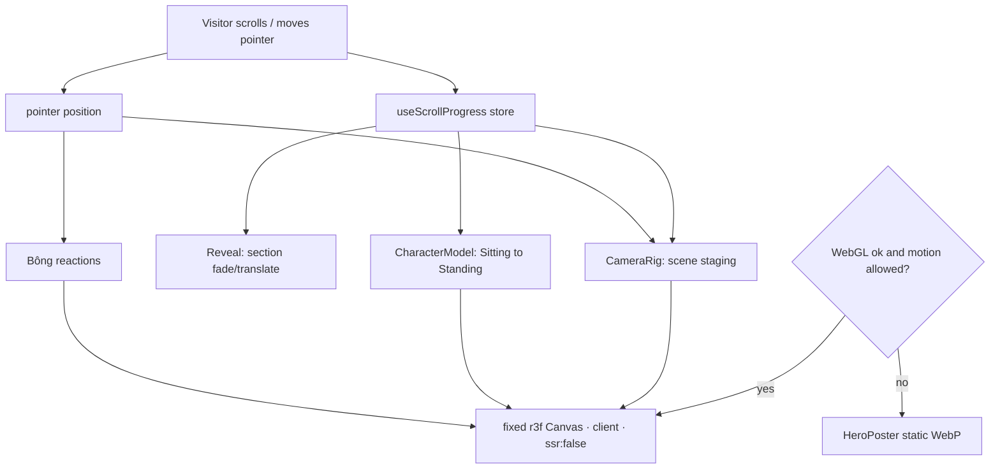
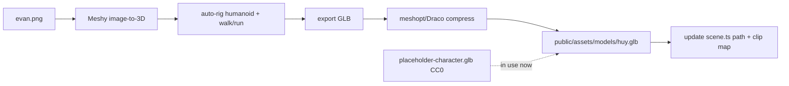

# Technical Design: 3D Interactive Portfolio

> Sources of truth: `spec.md` (WHAT), `inputs/idea/concept.md` (experience),
> `inputs/style/style-guide.md` + `inputs/style/tokens.css` (visual system),
> `inputs/content/about-me.md` (content). Stack facts verified in
> `.artifacts/research/r3f-nextjs16-stack.md` and the local Next 16 docs
> (`node_modules/next/dist/docs/`).

## Scope

**In scope**
- Single-page App Router site: Loader → Hero (interactive 3D + Bông) → What I Do
  (skills board) → Experience (timeline) → Work (4 projects) → About → Contact.
- Real-time 3D hero (react-three-fiber): rigged character at a desk + Bông the cat,
  pointer parallax, **scroll-driven staging** (no explicit twist button); Bông is a
  **hero cameo** (reactive on hover/click, reappears at Contact).
- Dark/cinematic teal visual system from the style tokens; scramble/decode text,
  scroll reveals, magnetic links — all reduced-motion aware.
- Graceful degradation: WebGL-unavailable / reduced-motion / mobile → static poster
  + clean 2D. Content readable before heavy 3D loads.
- Typed in-repo content model (no backend). Deployable to Vercel.

**Out of scope:** blog/CMS, backend/DB/auth, server contact form, i18n, analytics,
photorealistic likeness. **Producing** the final character art is external (Meshy)
and currently blocked — see Asset Status; the scene ships on a CC0 placeholder.

## Asset Status (important)

- Meshy **free tier no longer allows task creation** (API returns 402). The real
  "Huy" likeness (from `inputs/character-image/evan.png`) is **deferred** until the
  plan is upgraded. Pipeline + swap steps captured in
  `public/assets/models/README.md`; helper script `scripts/meshy.mjs`.
- **Current hero asset:** `public/assets/models/placeholder-character.glb` — CC0
  three.js *RobotExpressive*, fully rigged, clips: `Sitting, Standing, Idle,
  Walking, Running, Wave, ThumbsUp, Dance, Jump, Yes, No, Punch, Death, WalkJump`.
  The scene maps `Sitting`→desk default, `Standing`→scroll transform, `Idle`,
  `Walking`, and `Wave/ThumbsUp/Dance`→delight. Satisfies AC-008 (placeholder).
- **Bông:** Meshy auto-rig is **humanoid-only**, so the cat cannot be humanoid
  auto-rigged. Plan: image-to-3D (static) + **procedural** idle/reaction animation,
  or a small sourced cat GLB. Also deferred while Meshy is blocked; a simple proxy
  (low-poly cat / primitive) stands in until then.

## Research Summary

> Full cache: `.artifacts/research/r3f-nextjs16-stack.md`. Verified installed
> versions: next 16.3.0, react/react-dom 19.2.8.

- **Client-only 3D (verified):** `ssr:false` with `next/dynamic` is invalid in
  Server Components — must live in a Client Component
  (`node_modules/next/dist/docs/01-app/02-guides/lazy-loading.md:94`). Pattern: a
  thin `"use client"` wrapper doing `dynamic(() => import('./Scene'), {ssr:false})`.
- **Libraries:** `three` + `@react-three/fiber` v9 (React-19 compatible) +
  `@react-three/drei` v10 (`useGLTF`, `useAnimations`, `<Environment>`,
  `<Preload>`), `gsap` (now fully free incl. **ScrollTrigger** + **ScrambleTextPlugin**).
  Install: `yarn add three @react-three/fiber @react-three/drei gsap` + `-D @types/three`;
  add React-19 `resolutions` only if a transitive React-18 pin appears.
- **GLB/perf:** `useGLTF` + `useAnimations` under `<Suspense>`; `useGLTF.preload`;
  ship meshopt/Draco-compressed GLB; `dpr={[1,2]}`; `frameloop="demand"` (or
  throttle); lazy-mount Canvas; poster fallback. Assets in `public/assets/models/`.
- **Degradation:** detect WebGL via `getContext('webgl2'||'webgl')`; gate motion on
  `prefers-reduced-motion`; lower dpr / poster on mobile.
- **Fonts (verified):** `next/font/google` variable pattern (as in scaffold) for
  `Space_Grotesk` / `Inter` / `JetBrains_Mono`, `subsets:['latin']`, on `<html>`.

## Patterns & Reuse

Greenfield — this feature sets the conventions.

### Conventions to Follow

| Pattern | Project Uses | Avoid | Reference |
|---------|--------------|-------|-----------|
| Server-first | Sections are Server Components; `"use client"` only for interactivity/3D | Whole page as client | `src/app/page.tsx` (rewrite) |
| 3D isolation | Canvas behind `dynamic(ssr:false)` client wrapper | `ssr:false` in Server Component | `lazy-loading.md:94` |
| Styling | Tailwind v4 `@theme` tokens from `tokens.css` | Raw hex in JSX | `src/app/globals.css` |
| Fonts | `next/font/google` variables on `<html>` | `<link>`/CSS `@import` | scaffold `layout.tsx` |
| Content | Typed modules `src/content/*` imported by Server Components | Copy hardcoded in JSX | new |
| Motion gating | One reduced-motion + WebGL hook gates all decorative motion | Ad-hoc per-component checks | new |

### Existing Code to Reuse

| Component | Location | How to Use |
|-----------|----------|------------|
| Design tokens | `inputs/style/tokens.css` | Copy into `src/app/globals.css` |
| Root layout | `src/app/layout.tsx` | Modify — swap fonts, real metadata |
| Home route | `src/app/page.tsx` | Replace boilerplate with section composition |
| Content facts | `inputs/content/about-me.md` | Transcribe into `src/content/*` |
| Placeholder GLB | `public/assets/models/placeholder-character.glb` | `useGLTF` in Scene; swap later |

## Data Model

Greenfield — all entities are **new** typed modules under `src/content/`.

### Entities

| Entity | Purpose |
|--------|---------|
| `Profile` | Identity: name, title, tagline, location, summary |
| `SocialLink` | Contact/social channels (email + profiles; no phone) |
| `SkillGroup` | Capability groups + skill chips |
| `ExperienceItem` | Career timeline entries |
| `Project` | Work showcase entries (4 projects) |
| `SceneConfig` | Model paths, clip map, poster path |

#### Profile — `src/content/profile.ts` (new)
- `name` "Le Tran Gia Huy" · `display` "Huy Le" · `title` "Software Engineer ·
  AI-Native Development" · `tagline` · `summary` · `location`.

#### SocialLink — `src/content/socials.ts` (new)
- `label` · `href` · `icon` (Lucide) — email, LinkedIn, GitHub, Instagram, Facebook.
  **No phone** (scrubbed).

#### SkillGroup — `src/content/skills.ts` (new)
- `group` (Frontend · AI-Native · Backend/APIs · Testing & Quality) · `items`
  (`{name, icon?}[]`).

#### ExperienceItem — `src/content/experience.ts` (new)
- `company` · `role` · `period` · `location` · `highlights[]` · `tech[]`.
  Naver Vietnam, PTN Global (×2), Skyblaze.

#### Project — `src/content/projects.ts` (new)
- `id` · `index` (1–4) · `name` · `role` · `period` · `oneLiner` · `description` ·
  `tech[]` · `links{demo?, source?}` · `preview?`.
  Naver Care, InjuryEx, Australian Epilepsy Project, ETech.

#### SceneConfig — `src/content/scene.ts` (new)
- `character` `/assets/models/placeholder-character.glb`
- `clips` `{ seated:'Sitting', stand:'Standing', idle:'Idle', walk:'Walking',
  wave:'Wave' }` (placeholder mapping; update on Meshy swap)
- `cat` `/assets/models/bong.glb` (pending; proxy until then)
- `poster` `/assets/images/hero-poster.webp`

### Relationships / Contracts

Flat content graph; no persistence, no runtime API. Meshy runs offline during asset
prep, never at request time.

### Currently Exposed Fields

Greenfield — AC-named fields map to the new content entities (see Traceability).

## Decisions

| Decision | Rationale |
|----------|-----------|
| Single-page App Router; sections as Server Components | Static, SEO-relevant; minimal JS, hydrate only interactive islands |
| One fixed full-viewport Canvas behind DOM; scene reads a shared scroll-progress store | Enables scroll "staging" WITHOUT hijacking native scroll (avoids drei `ScrollControls` capturing the page); DOM stays accessible |
| `"use client"` wrapper + `dynamic(import(Scene),{ssr:false})` | Next 16 forbids `ssr:false` in Server Components; r3f needs `window` |
| Central `usePrefersReducedMotion` + `useWebGLAvailable` gate 3D/motion | Meets AC-017/018; one degradation source of truth |
| Poster-first hero; mount Canvas after load + capability check | Content readable before heavy assets (AC-009); fast LCP |
| GSAP + ScrollTrigger for DOM; ScrambleText (plugin now free) or custom hook | Mature scroll API; scramble effect for AC-002 |
| Scroll progress via small store (context + rAF; Zustand optional) | Single scrubber keeps scene staging + reveals in lockstep |
| CC0 placeholder GLB now; Meshy "Huy" swap later via `scene.ts` path + clip map | Meshy free tier blocked (402); placeholder unblocks full build (AC-008) |
| GLB in `public/assets/models/`, meshopt/Draco-compressed, `useGLTF.preload` | Static serving; compression per Stage 3; preload warms cache |
| Tailwind v4 `@theme` tokens as the only color source | Enforces palette; dark-primary |
| Lucide icons; brand chips via inline SVG | SVG-only, no emoji-as-icon |

## Component Design

| Component | File | Action | Responsibility |
|-----------|------|--------|----------------|
| RootLayout | `src/app/layout.tsx` | modify | 3 fonts as CSS vars; metadata/OG; token classes |
| globals.css | `src/app/globals.css` | modify | Tailwind + design tokens + base/reduced-motion |
| Home | `src/app/page.tsx` | modify | Server Component; compose sections + mount hero |
| Nav | `src/components/layout/Nav.tsx` | new (client) | Glass fixed nav: monogram, WORK/ABOUT/CONTACT, résumé, sound toggle |
| Footer | `src/components/layout/Footer.tsx` | new | Socials + "Designed & built by Huy Le" |
| Hero | `src/components/hero/Hero.tsx` | new | Hero DOM: eyebrow, name, `ScrambleText` subtitle, CTA + scene mount |
| HeroExperience | `src/components/hero/HeroExperience.client.tsx` | new (client) | `dynamic(ssr:false)` loader; renders `HeroPoster` until ready/capable |
| Scene | `src/components/hero/Scene.tsx` | new (client) | `<Canvas>`: lights, camera rig, `<Environment>`, `<Suspense>`, models, dpr clamp |
| CharacterModel | `src/components/hero/CharacterModel.tsx` | new (client) | `useGLTF`/`useAnimations`; clip map; scroll drives Sitting→Standing |
| CatModel (Bông) | `src/components/hero/CatModel.tsx` | new (client) | Bông proxy/GLB; procedural idle + hover/click reactions; Contact cameo |
| CameraRig | `src/components/hero/CameraRig.tsx` | new (client) | Pointer parallax (elastic) + scroll-progress staging |
| HeroPoster | `src/components/hero/HeroPoster.tsx` | new | Static WebP fallback (no WebGL / reduced-motion / mobile) |
| ScrambleText | `src/components/motion/ScrambleText.tsx` | new (client) | Decode-from-static; final text immediately under reduced-motion |
| Reveal | `src/components/motion/Reveal.tsx` | new (client) | Scroll-in fade/translate (ScrollTrigger); reduced-motion → instant |
| MagneticLink | `src/components/motion/MagneticLink.tsx` | new (client) | `quickTo` magnetic hover |
| WhatIDo | `src/components/sections/WhatIDo.tsx` | new | Filterable skills board, corner-bracket cards |
| Experience | `src/components/sections/Experience.tsx` | new | Career timeline w/ glow-node dividers |
| Work | `src/components/sections/Work.tsx` | new | Numbered 01–04 showcase; preview panels; prev/next |
| About | `src/components/sections/About.tsx` | new | Human bio (Mekong Delta, cats, Bông) |
| Contact | `src/components/sections/Contact.tsx` | new | Oversized CTA + email/socials + résumé + Bông cameo |
| useScrollProgress | `src/lib/useScrollProgress.ts` | new (client) | Shared scroll scrubber for DOM + 3D |
| usePrefersReducedMotion | `src/lib/usePrefersReducedMotion.ts` | new (client) | Reduced-motion media query |
| useWebGLAvailable | `src/lib/useWebGLAvailable.ts` | new (client) | WebGL capability/error detection |
| content modules | `src/content/*.ts` | new | Typed content (profile, socials, skills, experience, projects, scene) |

## Data Flow

Asset pipeline (offline, deferred until Meshy upgrade):

## Requirements Traceability

| Requirement | Component | File | Status |
|-------------|-----------|------|--------|
| AC-001 name/title/tagline | Hero + Profile | `hero/Hero.tsx`, `content/profile.ts` | Planned |
| AC-002 scramble subtitle | ScrambleText | `motion/ScrambleText.tsx` | Planned |
| AC-003 dark visual system | tokens | `app/globals.css` | Planned |
| AC-004 minimal nav + links | Nav | `layout/Nav.tsx` | Planned |
| AC-005 3D character at desk | Scene + CharacterModel | `hero/Scene.tsx`, `hero/CharacterModel.tsx` | Planned |
| AC-006 pointer response | CameraRig | `hero/CameraRig.tsx` | Planned |
| AC-007 Bông present + reacts | CatModel | `hero/CatModel.tsx` | Planned |
| AC-008 placeholder when no art | scene.ts + placeholder GLB | `content/scene.ts` | **Met (placeholder in place)** |
| AC-009 smooth FPS, non-blocking | Scene (dpr/Suspense) + HeroPoster | `hero/*` | Planned |
| AC-010 capabilities view | WhatIDo + skills | `sections/WhatIDo.tsx`, `content/skills.ts` | Planned |
| AC-011 ≥3 projects w/ detail | Work + projects | `sections/Work.tsx`, `content/projects.ts` | Planned |
| AC-012 project external links | Work | `sections/Work.tsx` | Planned |
| AC-013 scroll reveals | Reveal | `motion/Reveal.tsx` | Planned |
| AC-014 email + socials | Contact/Footer + socials | `sections/Contact.tsx`, `content/socials.ts` | Planned |
| AC-015 links open correctly | Contact/Footer | `sections/Contact.tsx` | Planned |
| AC-016 responsive mobile | all sections | `components/**` | Planned |
| AC-017 3D fallback | useWebGLAvailable + HeroPoster | `lib/useWebGLAvailable.ts`, `hero/HeroPoster.tsx` | Planned |
| AC-018 reduced motion | usePrefersReducedMotion | `lib/usePrefersReducedMotion.ts` | Planned |
| AC-019 Bông delight | CatModel (+ character Wave/Dance) | `hero/CatModel.tsx` | Planned |
| AC-020 themed loader | HeroExperience loading state | `hero/HeroExperience.client.tsx` | Planned |

## Test Strategy

### Infrastructure

| Aspect | Detail |
|--------|--------|
| Unit/component | Vitest + React Testing Library (to add) |
| E2E / visual | Playwright smoke (sections render, links resolve, reduced-motion, poster fallback) |
| Command | `yarn test`, `yarn e2e` (scripts to add) |
| Gate | `yarn lint` + `yarn build` must pass |

### New Tests

| Component | Test File | Scenarios |
|-----------|-----------|-----------|
| content | `content/*.test.ts` | Required fields; 4 projects; no phone in socials |
| ScrambleText | `ScrambleText.test.tsx` | Resolves to final; reduced-motion → final immediately |
| Reveal | `Reveal.test.tsx` | Renders children; reduced-motion → no transform |
| useWebGLAvailable | `useWebGLAvailable.test.ts` | context throws → false → poster |
| Nav/Contact | `*.test.tsx` | Correct hrefs; visible keyboard focus |
| Smoke (e2e) | `e2e/home.spec.ts` | Loads, sections visible, résumé/contact links, poster fallback when WebGL off |

WebGL rendering itself is verified manually + Playwright screenshot, not unit-tested.

## Considerations

### Error Handling
- WebGL failure/context loss: `useWebGLAvailable` + error boundary around `Scene` →
  `HeroPoster`. Never a blank hero.
- Asset load slow/fail: `<Suspense>` themed loader; DOM renders independently.
- Missing GLB: placeholder in place now; primitive proxy for Bông until its model exists.
- Broken/missing project link: conditionally render (no dead controls).

### Security
- Static site, no user input, no secrets in client. **`MESHY_API_KEY` stays in
  `.env` (offline/CLI only) — never imported into the client bundle.** External
  links use `rel="noopener noreferrer"`. No phone in content. `.artifacts/` secret-free.

### Performance
- `dpr [1,2]`; lazy-mount Canvas; `useGLTF.preload`; compress GLB; reserve hero
  space (CLS < 0.1); `frameloop="demand"`/throttle; `next/image` (WebP/AVIF) for
  previews; poster is LCP. Mobile: lighter scene or poster; touch reactions for Bông.

## Open Questions

- [ ] Confirm skill-group membership (Frontend · AI-Native · Backend/APIs · Testing
      & Quality) and which chips get brand icons.
- [ ] Desk-monitor content: subtle health-UI nod vs generic code (nothing proprietary).
- [ ] Ambient sound + Bông SFX (off by default) in v1, or defer?
- [ ] Scroll store: React context + rAF (default) vs Zustand.
- [ ] Résumé PDF for nav/contact download — provide a file, or omit v1?
- [ ] Bông sourcing: image-to-3D + procedural vs a small sourced cat GLB (pending Meshy).
