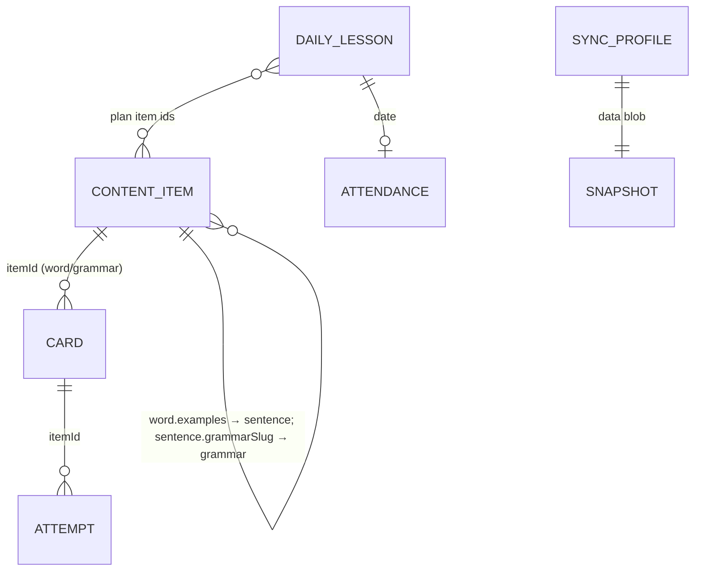
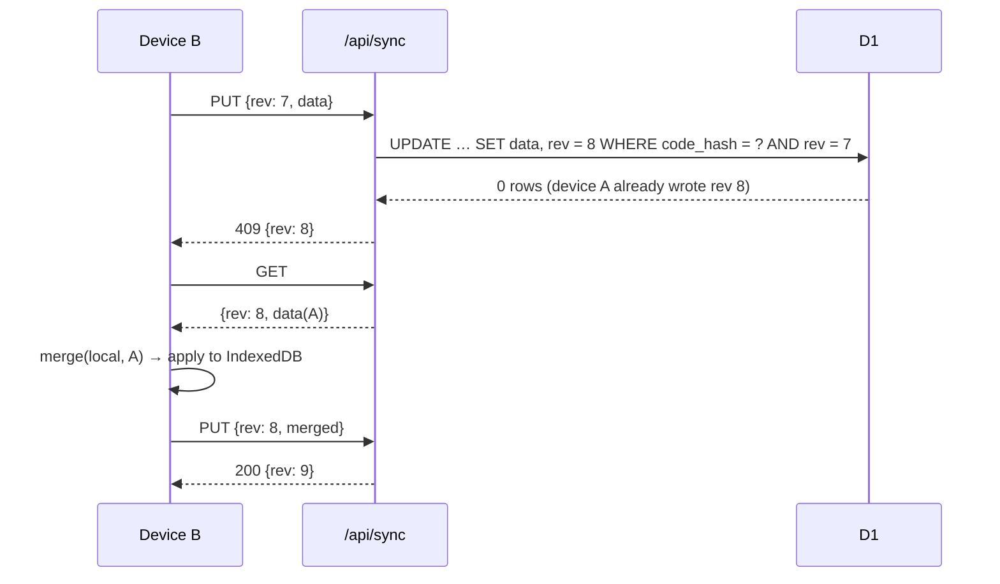

# Technical Design: Learn English app

## Scope

**In scope:** a third app, `apps/learn-english` (package `learn-english`, english.huyle.work),
covering every story in spec.md (AC-001 … AC-058, AC-046 retired). That includes:

- the offline content pipeline (word lists, IPA, one-off AI drafting, owner review, audio generation, publishing to D1)
- the browser-side learning engine (spaced repetition, lessons, attendance, hard words, exercise generators, backup)
- a small backend with three jobs: content API, sync codes, anonymous stats
- repo wiring: workspace, root scripts, CLAUDE.md, turbo env, and a Workers Builds project

**Out of scope:** the spec's Out of Scope table. Also out: any AI call at runtime, accounts, runtime TTS,
an admin UI or stats dashboard, and C2 words.

**Shape:** static app shells (prerendered, no content baked in) plus client-side state in IndexedDB.
A handful of short API routes run on the Worker against one D1 database (content, sync, stats),
and audio is served as static MP3 from R2. Everything stays within the Workers **free** plan:

- shells are served from static assets, so they use no Worker CPU
- each API call is 1 D1 round trip (a `db.batch()` counts as one query), and waiting on I/O doesn't count toward the 10 ms CPU limit
- content responses are cached at the edge, keyed by content version

## Research Summary

> From `.artifacts/research/learn-english-cloudflare-backend.md`
- Bindings exist only in request scope (`getCloudflareContext()`); never at module level or in prerender.
- D1 + Drizzle (`drizzle-orm` 0.45.4, `drizzle-kit` 0.31.11): migrations via `drizzle-kit generate` +
  `wrangler d1 migrations apply`, with `migrations_pattern: "migrations/*/migration.sql"` in wrangler.
  No interactive transactions (`db.transaction()` fails); use `db.batch()` or a single conditional statement.
- Free plan: 10 ms CPU, 50 D1 queries per invocation (a batch counts as 1), 100k D1 writes and 5M reads per day.
  The Rate Limiting binding has only 10 s or 60 s windows and is approximate.
- R2 behind a public custom domain, content-addressed keys, `immutable` cache header, a Cache Rule for `.mp3`, r2.dev off.
- OpenNext inlines `.env*` into the bundle at build; secrets go through `wrangler secret put`. No cron in v1.

> From `.artifacts/research/learn-english-tts-and-word-data.md`
- Word list: CEFR-J 1.5 (A1–B2, free with citation) + Octanove C1 (CC BY-SA 4.0). Not Oxford.
- IPA from CMUdict (BSD-style) via our own ARPAbet→IPA mapping and a maximal-onset syllabifier, shown as phonemic `/…/`.
- No usable open EN→VI dictionary, so meanings are AI-drafted once and reviewed.
- Google Chirp 3 HD en-US male voices: the ~640k-char batch fits its free 1M chars/month.

> From `.artifacts/research/learn-english-srs-and-tour.md`
- `ts-fsrs` 5.4.2 pinned exactly (the 6.0 beta renames the API); retention 0.9, max interval 365, fuzz on,
  learning steps 1m/10m, relearning 10m. FSRS ignores time; Hard is for a correct answer only.
  The app enforces the daily cap itself, ordering the backlog by lowest retrievability.
- Tour: `@diceui/tour` (shadcn registry, Base UI); we add `role="dialog"` and hidden-target handling. Fallback: driver.js.
- Letter input: one input with visual slots (shadcn `InputOTP`), autocorrect/spellcheck off, `lang="en"`;
  fold Telex/VNI diacritics before grading, and show a hint when non-ASCII letters appear.

> From `.artifacts/research/learn-english-ai-grading.md` (now **development only**)
- Batches API (`client.messages.batches.*`, 50% price, results keyed by `custom_id`) with structured
  outputs for the one-off drafting script. Nothing from the Anthropic SDK ships in the app bundle.

## Patterns & Reuse

### Conventions to Follow

| Pattern | Project Uses | Avoid | Reference |
|---------|-------------|-------|-----------|
| App layout | One app per `apps/*`, own `wrangler.jsonc`, `open-next.config.ts`, test configs | Shared runtime code across apps | `apps/react-handbook/wrangler.jsonc:1-12` |
| Static serving | `staticAssetsIncrementalCache` + `enableCacheInterception` | Default dummy cache, which re-renders every request | `apps/react-handbook/open-next.config.ts:1-11` |
| Layering | `app/api/**/route.ts` thin → `server/{domain}/*.service.ts` (`server-only`) → `*.schema.ts` (Zod, shared with UI) | Logic in routes | `.claude/rules/react-handbook/04-architecture.md:10-18` |
| Input validation / errors | `parseBody` + `jsonError`, `{ error: { message, issues? } }`, 400 bad JSON / 422 invalid | Ad-hoc shapes | `apps/react-handbook/src/lib/http.ts:1-31` |
| Env | Zod-validated `src/server/env.ts` | `process.env` scattered | `apps/react-handbook/src/server/env.ts:1-18` |
| UI kit | shadcn `base-nova` on `@base-ui/react`, lucide, Tailwind v4 | A second component library | `apps/react-handbook/components.json:1-22` |
| Unit tests | Vitest + happy-dom, `src/**/*.test.{ts,tsx}` | — | `apps/web/vitest.config.mts:1-17` |
| E2E | Playwright against a built app on a dedicated port | Testing a stale server (knowledge gotcha) | `apps/react-handbook/playwright.config.ts:1-40` |
| Root scripts | `cf:<app>:*` forwarders via `pnpm --filter` | `pnpm deploy` (pnpm built-in) | `package.json:5-25` |

### Existing Code to Reuse

| Component | Location | How to Use |
|-----------|----------|------------|
| `parseBody`, `jsonError` | `apps/react-handbook/src/lib/http.ts:3-31` | Copy into `apps/learn-english/src/lib/http.ts` |
| Env pattern | `apps/react-handbook/src/server/env.ts:1-18` | Copy and extend |
| shadcn primitives | `apps/react-handbook/src/components/ui/*` | Re-add with the shadcn CLI (button, card, dialog, progress, radio-group, sheet, sidebar, tabs, textarea, tooltip, input-otp, sonner) |
| `@repo/typescript-config`, `@repo/eslint-config` | `packages/*` | Extend, as the other apps do |
| OpenNext config | `apps/react-handbook/open-next.config.ts` | Copy as is |

Greenfield app, so no existing types are read or modified. Existing files touched for repo wiring only:
`package.json`, `turbo.json`, `CLAUDE.md`, `.claude/rules/learn-english/` (new).

## Data Model

Three stores:

1. **Content: git JSON → D1.** Reviewed source files in git are published to D1 tables, and clients cache
   them in IndexedDB.
2. **Learner state: IndexedDB per browser,** optionally mirrored to a D1 sync row.
3. **Stats: D1 daily counters.**

### Entities

| Entity | Store | Purpose |
|--------|-------|---------|
| ContentItem | git `content/**` → D1 `content_items` | One word, grammar topic, sentence, writing task or placement item (`kind`) |
| ContentRelease | D1 `content_meta` | Current content version + publish time |
| Card | IndexedDB `cards` | FSRS state per studied item |
| Attempt | IndexedDB `attempts` | Every answer: correctness, time, exercise, context |
| DailyLesson | IndexedDB `lessons` | One local date's plan, resume position, completion |
| Attendance | IndexedDB `attendance` | One row per completed local date |
| Profile | IndexedDB `meta` (`profile`) | Level, placement, tour, backup/sync state, stats opt-out |
| ContentCache | IndexedDB `content` | Last downloaded content per kind/level + version (offline fallback) |
| Snapshot | file / D1 `sync_profiles.data` | Versioned, trimmed, gzip-compressed JSON of the learner stores (backup and sync payload) |
| SyncProfile | D1 `sync_profiles` | Sync row addressed by the hash of its code |
| StatCounter | D1 `stats_daily` | `(day, metric, key) → count` |
| StatDevice | D1 `stats_devices` | `(day, device_hash)` for distinct-device counts |

#### ContentItem (D1 `content_items`; source JSON in `apps/learn-english/content/{kind}/{level}.json`)

Columns:
- `id` (TEXT PK, stable, e.g. `word:homework-n`, `grammar:present-perfect`, `sentence:…`)
- `kind` (`word`|`grammar`|`sentence`|`writing`|`placement`)
- `level` (`A1`…`C1`)
- `topic` (TEXT, nullable)
- `sort` (INT)
- `body` (JSON TEXT)
- `deleted` (INT 0/1, tombstone)
- `updated_version` (INT)

Index: `(kind, level, deleted)`. The `body` shape depends on `kind` (Zod schemas in `src/content/schema.ts`, shared with scripts):

- **word:** `headword`, `variants[]` (accepted spellings, e.g. British), `pos`, `ipa`, `meaningsVi[]`,
  `examples[]` (sentence ids), `synonyms[]` (word ids, excluded as MCQ distractors), `audio`, `source` (`cefrj-1.5`|`octanove-1.0`)
- **grammar:** `titleEn`, `titleVi`, `ruleVi`, `pattern[]` ({form, en}), `usageVi[]`, `signalWords[]`,
  `mistakes[]` ({wrong, right, explanationVi}), `examples[]` (sentence ids), `practice[]` ({prompt, options?, answer, explanationVi})
- **sentence:** `en`, `vi`, `audio`, `tokens[]`, `acceptedOrders[][]` (token index orders, ≥1),
  `wrongVariants[]` ({en, explanationVi}, for "choose the correct sentence"), `gapCandidates[]` (token indexes that may be blanked),
  `wordIds[]`, `grammarSlug?`
- **writing:** `kind` (`short-writing`), `promptVi`, `useItems[]`, `modelAnswers[]`
- **placement:** `kind` (`meaning-mcq`|`grammar-mcq`), `prompt`, `options[4]`, `answerIndex`

Only items with `status: "approved"` in git are published. `status` is a git-only field.

#### ContentRelease (D1 `content_meta`, single row `id = 1`)

- `version` (INT, incremented per publish), `published_at` (ms), `counts` (JSON per kind)

#### Card (IndexedDB `cards`, key `itemId`)

- `itemId` (`word:<id>`|`grammar:<slug>`)
- the ts-fsrs 5.4.2 card fields as is: `due` (indexed), `stability`, `difficulty`, `elapsed_days`, `scheduled_days`,
  `learning_steps`, `reps`, `lapses`, `state`, `last_review`
- `addedAt`, `updatedAt`

#### Attempt (IndexedDB `attempts`, key `id` = random UUID, indexes `[itemId, at]`, `at`)

- `id`, `itemId`, `at`, `correct`, `ms`, `hinted`, `typo`, `selfMarked`
- `exercise` (`mcq`|`missing-letters`|`listening`|`recall`|`grammar-gap`|`word-order`|`sentence-gap`|`choose-sentence`|`tile-translate`|`writing`)
- `context` (`lesson`|`review`|`exercise`|`placement`), `rating` (`again`|`hard`|`good`)

UUID keys make the union of two devices' attempts safe.

#### DailyLesson (IndexedDB `lessons`, key `date` = local `YYYY-MM-DD`)

- `date`, `contentVersion`, `plan` (parts `review`|`new-words`|`grammar`|`sentences`|`writing`, each a list of
  exercise descriptors: kind, item ids, seed), `position` ({part, index}), `completedAt?`, `updatedAt`

#### Attendance (IndexedDB `attendance`, key `date`)

- `date`, `points` (10), `bonus` (0, or 20 when the streak reaches 7/30/100), `at`

#### Profile (IndexedDB `meta`, key `profile`)

- `level`, `placement` (`pending`|`skipped`|`done`), `placementResult?`, `tourSeen`, `createdAt`
- `timeZone` (from `Intl…resolvedOptions().timeZone`, default `Asia/Ho_Chi_Minh`)
- `lastBackupAt?`
- `sync?` ({ code, rev, lastSyncedAt, dirty })
- `statsOptOut` (bool), `deviceId` (random, used only to form the daily stats hash)
- `schemaVersion`
- `fieldUpdatedAt` (map, for last-writer-wins merging)

#### Snapshot (backup file `learn-english-YYYY-MM-DD.json`, and the sync payload)

- `app` (`"learn-english"`), `version`, `exportedAt`, `summary` ({ wordsLearned, points, streak })
- `data`: { meta (without `deviceId`), cards, attendance, lessons (last 14 days), attempts (all within 30 days, plus the last 8 per item older than that) }

Sync payloads are gzipped in the browser (`CompressionStream`) and capped at 1 MB.

#### SyncProfile (D1 `sync_profiles`)

- `code_hash` (TEXT PK, SHA-256 of the normalised code), `data` (BLOB, gzipped Snapshot), `rev` (INT),
  `size` (INT), `created_at`, `updated_at`

#### StatCounter (D1 `stats_daily`, PK `(day, metric, key)`)

- `day` (the learner's local `YYYY-MM-DD`; the server accepts days within 2 days of its UTC date), `metric` (`lesson_completed`|`exercise`|`word_wrong`|`placement_done`), `key` (exercise kind / word id / `''`), `count`

#### StatDevice (D1 `stats_devices`, PK `(day, device_hash)`)

- `day`, `device_hash` = SHA-256(`deviceId` + `day` + `STATS_SALT`)

Changing the hash input every day means devices can't be linked across days.

### Relationships



When content removes an item, the publish script writes a tombstone (`deleted = 1`). Clients drop it from
lists and plans but keep its Card and Attempts (AC-054).

### API Contracts

All responses are JSON; errors use `{ error: { message (Vietnamese), issues? } }`.

| Endpoint | Method | Request | Response |
|----------|--------|---------|----------|
| `/api/content/version` | GET | — | `{ version, publishedAt }`, `Cache-Control: public, max-age=60, s-maxage=300` |
| `/api/content/items` | GET | `?kind=word&level=A1&v=<version>` (`v` required; `level` optional for `grammar`/`placement`) | `{ version, items: ContentItem[], tombstones: string[] }` (full list for that kind/level; `tombstones` = ids deleted in it). Edge-cached by full URL for 1 day; the version param busts it |
| `/api/sync` | POST | `{ data: base64(gzip Snapshot) }` | 201 `{ code, rev: 1 }` |
| `/api/sync` | GET | header `x-sync-code` | 200 `{ rev, data, updatedAt }` · 404 unknown code · 429 too many failed lookups |
| `/api/sync` | PUT | header `x-sync-code`, `{ rev, data }` | 200 `{ rev }` · 409 `{ rev }` when the stored rev differs (client merges and retries) · 413 over 1 MB |
| `/api/sync` | DELETE | header `x-sync-code` | 204 |
| `/api/stats` | POST (`sendBeacon`) | `{ day, deviceId, lessonsCompleted, placementDone, exercises: {kind: n}, wrongWords: {wordId: n} (≤20 keys) }` | 204 (always, including on invalid input, so it never blocks) |

The sync code travels in a header, never in the URL, so it stays out of logs and history.

### Currently Exposed Fields

Greenfield: every field is new.

| AC ID | Field | Source | Currently Exposed? | Gap? |
|-------|-------|--------|--------------------|------|
| AC-007 | English word | word.headword (new) | no | must add |
| AC-007 | phonetic spelling | word.ipa (new) | no | must add |
| AC-007 | word type | word.pos (new) | no | must add |
| AC-007 | Vietnamese meaning(s) | word.meaningsVi (new) | no | must add |
| AC-007 | example + translation | sentence.en/.vi via word.examples (new) | no | must add |
| AC-017 | total points | Σ Attendance.points+bonus (new) | no | must add |
| AC-017 | current / longest streak | derived from Attendance (new) | no | must add |
| AC-017 | attendance calendar | Attendance.date (new) | no | must add |
| AC-024 | rule / pattern / usage / signal words / mistakes / examples | grammar.* (new) | no | must add |
| AC-030 | hard-word reason | derived from Attempts (new) | no | must add |
| AC-034 | correct sentence, translation, explanation | sentence.en/.vi, grammar.mistakes / sentence.wrongVariants (new) | no | must add |
| AC-043 / AC-049 | date / words learned / points | Snapshot.exportedAt or sync updatedAt + summary (new) | no | must add |
| AC-056 | lessons, devices, exercises, wrong words | stats_daily, stats_devices (new) | no | must add |

## Decisions

| Decision | Rationale |
|----------|-----------|
| **Static shells + client data; D1 behind small API routes** | Free plan (no SSR CPU) and content updatable without a release (AC-052). Content pages are client-rendered from the content API and cache; SEO is not a goal for this app |
| Content routes use query params on static pages (`/tu-vung?level=A1&topic=family`, `/ngu-phap?bai=present-perfect`, `/bai-tap?id=…`) | Dynamic segments without `generateStaticParams` would SSR on the Worker; topics now come from D1 at runtime |
| Edge caching of content responses through the Workers Cache API, keyed by URL including `v`; version endpoint cached ≤ 5 min | The ≤ 10 min freshness target (AC-052) with near-zero D1 reads. **Verify** `caches.default` access inside an OpenNext route handler; fallback is relying on D1 reads (5M/day free) |
| Clients store content per (kind, level) in IndexedDB with its version; they refetch only when `/api/content/version` changes | Offline fallback (AC-055) and fast lesson building |
| Publishing = `scripts/publish-content.ts`: validate approved JSON → generate missing audio → chunked upserts and tombstones into D1 (`wrangler d1 execute --remote --file`, ≤ ~100 statements per file) → bump `content_meta.version` | Git stays the review trail (PR diffs); D1 is the serving copy. **Verify** D1 import size/statement limits when implementing |
| **No runtime AI**; the Anthropic SDK lives only in `scripts/` (devDependency) | Owner decision; zero running cost |
| Sentence tasks generated at random from `sentence` items: word-order, sentence-gap, choose-sentence, tile-translate (tokens + 2 distractor tiles from same level); grading = token-sequence match against `acceptedOrders`, with duplicate tokens interchangeable | AC-033/034 with fixed answers; accepted orders and wrong variants are drafted once and reviewed |
| Free writing = self-check against `modelAnswers` (`selfMarked: true` attempt) | AC-036 without grading |
| Pure learning engine in `src/learning/**` (no React, no IDB, no fetch) | Rules are unit-testable on plain data |
| `ts-fsrs` pinned to `5.4.2`, imported only by `src/learning/srs.ts` | 6.0 beta renames the API |
| Rating: wrong → Again; correct with hint, typo or `ms > 8000` → Hard; otherwise Good; self-marked right → Good, wrong → Again | Spec's 8 s slow-recall threshold; research says Hard is never for a wrong answer |
| Daily plan built once per local date, stored with its content version; exercise variants seeded by `(itemId, date)` | Resume consistency (AC-016) |
| Review cap 50 by lowest retrievability; new words 10, or 5 when more than 50 reviews are overdue (tentative) | Spec numbers + backlog edge case |
| IndexedDB via `idb`; cross-tab via `BroadcastChannel`; attendance written with `add()` keyed by date | Indexed queries; double award impossible across tabs |
| **Sync: snapshot + client-side merge + optimistic concurrency (`rev`)** | Simple server (store a blob). Merge rules: attempts union by UUID; card with later `last_review` wins (tie: more `reps`); attendance union by date (first row wins, so no double points); lessons per date: completed wins, else the further position; profile fields last-writer-wins by `fieldUpdatedAt` (AC-050) |
| Sync code: 12 Crockford base32 chars (60 bits) shown `XXXX-XXXX-XXXX`, generated server-side; only `SHA-256(code)` is stored | Easy to type, no 0/O or 1/I confusion; infeasible to guess; a D1 leak doesn't reveal codes |
| Sync upload debounced: at most every 60 s while changes are pending, plus on `visibilitychange: hidden` (`fetch keepalive`) | AC-048 within free D1 writes (~1 write per active minute per learner) |
| Failed-lookup throttle: Workers Rate Limiting binding, 10 failed sync GETs per 60 s per IP | Brute-force guard (edge case). **Verify** availability on the free plan; fallback is a D1 counter row per IP hash per minute |
| Sync cleanup: on each `POST /api/sync`, delete up to 100 rows with `updated_at` older than 365 days | 12-month retention without cron |
| Stats: client counts locally, sends one `sendBeacon` per day (or on hide) with ≤ 20 wrong-word keys; server does one `db.batch()` of upserts; device hashed with day + salt | AC-056/057 within free writes; no personal data, no IPs stored |
| Stats report = `scripts/stats-report.ts --from --to` using `wrangler d1 execute --remote --json` | AC-058 without an admin UI |
| TTS: Google Chirp 3 HD en-US male, local script only; voice picked by ear | Free tier covers the batch; credentials stay local. Fallback: Workers AI Aura-2 `orpheus` |
| Audio on R2 `audio.english.huyle.work`, key `sha256(voice + "|" + text)` | Immutable caching; new voice later = new keys |
| Drizzle schema for the D1 tables; migrations in `apps/learn-english/migrations/` | Research recommendation; typed queries in services |
| Tour: `@diceui/tour` with `data-tour` targets; opens the mobile sidebar sheet or centers the step | Fits base-nova; covers hidden-target edge case |
| Missing letters: hide ~30% of letters (min 1; exactly 1 for ≤ 3 letters), never the first letter of longer words, never spaces/hyphens/apostrophes; seeded | Spec edge cases |
| Telex/VNI folding in `src/learning/normalize.ts` before comparing typed English | Vietnamese learners type with Telex on |
| Snapshot schema with a version and migration chain; import and sync-apply are all-or-nothing IDB transactions | AC-043/049 and the damaged/newer/older-file edge cases |
| Be Vietnam Pro via `next/font/google` (`vietnamese`, `latin`), `<html lang="vi">`, Vietnamese ASCII routes | AC-004 |

## Component Design

| Component | File | Action | Responsibility |
|-----------|------|--------|----------------|
| App scaffold | `apps/learn-english/{package.json,next.config.ts,open-next.config.ts,wrangler.jsonc,drizzle.config.ts,tsconfig.json,eslint.config.mjs,postcss.config.mjs,components.json,vitest.config.mts,playwright.config.ts,AGENTS.md,CLAUDE.md}` | new | Per-app layout like the handbook; dev port 3002; bindings `DB` (D1 `learn-english`), `SYNC_LOOKUP_LIMITER` (rate limit); route `english.huyle.work` |
| Repo wiring | `package.json`, `turbo.json`, `CLAUDE.md`, `.claude/rules/learn-english/*.md` | modify/new | `cf:english:*` scripts; `NEXT_PUBLIC_AUDIO_BASE_URL` in turbo `build.env`; docs; app-scoped rules (`paths:` only) |
| DB schema + migrations | `src/server/db/schema.ts`, `src/server/db/index.ts`, `migrations/*/migration.sql` | new | Drizzle tables `content_items`, `content_meta`, `sync_profiles`, `stats_daily`, `stats_devices`; per-request `getDb()` |
| Word import | `scripts/import-wordlists.ts` | new | CEFR-J 1.5 + Octanove C1 CSV → dedupe → `content/word/*.json` skeletons with `source` |
| IPA builder | `scripts/build-ipa.ts`, `scripts/lib/arpabet.ts` | new | CMUdict join, ARPAbet→IPA, stress placement; lists words without an entry |
| Content drafting (dev only) | `scripts/draft-content.ts` | new | Batches API + structured outputs: meanings, topic, synonyms, example sentences (tokens, accepted orders, wrong variants, gap candidates), grammar topics, writing tasks, placement items → `status: "draft"` |
| Review helper | `scripts/review.ts` | new | Lists drafts, approves by file/id, schema validation |
| Audio generator | `scripts/generate-audio.ts` | new | Chirp 3 HD → MP3 → R2 (immutable header) for approved text missing audio; writes keys back |
| Publisher | `scripts/publish-content.ts` | new | Validate, audio, chunked SQL upserts and tombstones, bump version; `--local` / `--remote` |
| Stats report | `scripts/stats-report.ts` | new | Query D1, print a table for a date range |
| Content schema | `src/content/schema.ts` | new | Zod per kind (shared by scripts, API, client) |
| Content API | `src/app/api/content/{version,items}/route.ts`, `src/server/content/content.service.ts` | new | D1 reads, Cache API, cache headers |
| Sync API | `src/app/api/sync/route.ts`, `src/server/sync/{sync.service,sync.schema,code}.ts` | new | Create / get / put (rev check via conditional UPDATE) / delete; code generation and hashing; throttle; cleanup |
| Stats API | `src/app/api/stats/route.ts`, `src/server/stats/stats.service.ts` | new | Validate, clamp, hash device, batch upsert |
| Env | `src/server/env.ts` | new | `STATS_SALT`, `SYNC_MAX_BYTES` (default 1 MB) |
| Content client | `src/content/client.ts` | new | Version check, fetch per kind/level, IndexedDB cache, offline fallback |
| SRS wrapper | `src/learning/srs.ts` | new | ts-fsrs config, `newCard`, `review`, `retrievability` |
| Rating | `src/learning/rating.ts` | new | Attempt → Again/Hard/Good |
| Lesson planner | `src/learning/lesson-plan.ts` | new | (date, cards, profile, content, seed) → plan |
| Attendance | `src/learning/attendance.ts` | new | Streaks, bonuses, local-date math |
| Hard words | `src/learning/hard-words.ts` | new | Reason + exit rule |
| Placement | `src/learning/placement.ts` | new | Staged test ≤ 30 items → level |
| Exercise generators | `src/learning/exercises/{mcq,missing-letters,listening,recall,grammar-gap,word-order,sentence-gap,choose-sentence,tile-translate}.ts` | new | Seeded instances + graders |
| Normalise | `src/learning/normalize.ts` | new | Telex/VNI folding, variants, tokenising for sentence checks |
| Snapshot + merge | `src/learning/snapshot.ts`, `src/learning/merge.ts` | new | Schema, trim, summary, migrations; two-way merge rules |
| Storage | `src/storage/db.ts`, `src/storage/{cards,attempts,lessons,attendance,meta,content}.ts`, `src/storage/broadcast.ts` | new | IDB schema, repositories, cross-tab events, persistence check, `navigator.storage.persist()` |
| Sync client | `src/sync/sync-client.ts` | new | Turn on (POST), link (GET → merge → apply), debounced push, 409 merge-retry, unlink/delete |
| Stats client | `src/stats/stats-client.ts` | new | Local daily counters, beacon on day change/hide, opt-out |
| Hooks | `src/hooks/use-*.ts` | new | Today's lesson, due count, profile, hard words, content |
| Audio button | `src/components/audio-button.tsx` | new | Plays R2 MP3, error toast |
| Exercise UI | `src/components/exercise/*.tsx` (one per kind + `exercise-runner.tsx`) | new | Render, time, report Attempt |
| Lesson / home | `src/app/page.tsx`, `src/components/lesson/*` | new | Today's lesson, resume, completion + points |
| Vocabulary | `src/app/tu-vung/page.tsx`, `src/components/word-card.tsx` | new | Level/topic browse, learned markers, word dialog, mark learned |
| Grammar | `src/app/ngu-phap/page.tsx` | new | List by level + progress; topic view + practice |
| Review | `src/app/on-tap/page.tsx` | new | Due count + session |
| Exercise library | `src/app/bai-tap/page.tsx` | new | Filters + runner |
| Hard words | `src/app/tu-kho/page.tsx` | new | Sorted list + practice |
| Profile | `src/app/ho-so/page.tsx` | new | Points, streaks, calendar; P3 insights |
| Settings | `src/app/cai-dat/page.tsx`, `src/components/settings/{backup-panel,sync-panel,stats-toggle}.tsx` | new | Level, placement, tour replay, backup, sync, stats opt-out |
| Placement | `src/app/kiem-tra-trinh-do/page.tsx` | new | First-visit test, skip |
| Credits | `src/app/nguon-du-lieu/page.tsx` | new | CEFR-J citation, Octanove CC BY-SA, CMUdict notice |
| Welcome + tour | `src/components/tour/{welcome-dialog,app-tour}.tsx`, `src/components/ui/tour.tsx` | new | First-visit dialog, steps, replay |
| App shell | `src/app/layout.tsx`, `src/components/app-sidebar.tsx` | new | `lang="vi"`, font, nav with `data-tour`, first-visit guard |

## Visual Design Direction

Settled with `ui-ux-pro-max` (2026-10-27). The tool suggested indigo plus progress green for a learning product,
which we keep. We don't take its kids' fonts (Baloo 2 / Comic Neue, which also lack Vietnamese glyphs) or its
app-store landing pattern: this is an app for adults, used daily.

- **Style:** flat, friendly cards with soft rounded corners (`--radius: 0.875rem`) and subtle micro-interactions
  (150–250 ms, nothing on `prefers-reduced-motion`). No emoji as icons; lucide icons only.
- **Colour tokens (shadcn variables, light/dark):**
  - `--primary`: indigo, for actions and the active nav item
  - `--success`: green, for correct answers, progress and completion
  - `--streak`: amber, for the flame, streak and points
  - `--destructive`: red, for wrong answers and destructive actions
  - Feedback is never colour-only: every state has an icon (CheckCircle2 / XCircle / Flame) plus text.
  - Text contrast is ≥ 4.5:1 in both themes.
- **Type:** Be Vietnam Pro for all UI (base 16px, line-height 1.5). English being taught is set larger
  (headwords about 2rem semibold, sentences about 1.25rem). IPA uses a system font stack with IPA glyphs (`.ipa` class),
  because Be Vietnam Pro has no IPA Extensions.
- **Shell:**
  - **Desktop (≥ md):** shadcn sidebar with Hôm nay, Từ vựng, Ngữ pháp, Ôn tập, Bài tập, Từ khó, Hồ sơ, Cài đặt;
    a streak and points chip in the header.
  - **Mobile:** bottom nav limited to 5 items (Hôm nay, Ôn tập, Từ vựng, Bài tập, Thêm). "Thêm" opens a sheet
    with Ngữ pháp, Từ khó, Hồ sơ, Cài đặt and Nguồn dữ liệu. It respects safe-area insets, and content gets bottom
    padding equal to the nav height.
- **Exercise screen (focus mode):**
  - The navigation is hidden. A top bar holds a close button (with a confirm when leaving mid-lesson), a progress bar
    and an "n/N" counter. Content is centred in `max-w-xl`.
  - A sticky bottom action bar holds a full-width "Kiểm tra" button, then "Tiếp tục", ≥ 48px tall.
  - A feedback panel rises from the bottom with icon + "Chính xác!" / "Chưa đúng", the correct answer, the
    explanation and a play button.
  - Tap targets are ≥ 44px. Keyboard: Enter checks or continues; keys 1–4 pick options.
- **Theme:** follows the system (a `.dark` class set before first paint, as in the handbook).
- **States:** every list or page that waits on content or storage shows skeletons sized like the content
  (no layout shift), a Vietnamese empty state with one next action, and an error state with a retry button.

## Data Flow

**Answering an exercise (client only):**

```mermaid
sequenceDiagram
  participant UI as Exercise UI
  participant E as learning/*
  participant S as IndexedDB
  participant T as other tabs
  participant Y as sync client
  UI->>E: normalize + grade → {correct, ms, hinted, typo}
  E->>E: rating; card' = srs.review(card, rating, now)
  UI->>S: tx: add attempt (uuid), put card', update lesson.position
  S-->>T: BroadcastChannel "changed"
  S-->>Y: mark dirty → push within 60 s
  Note over UI,S: last part done → attendance.add(date) (fails if it exists, so no double award)
```

**Sync push with conflict:**



**Content update:** owner edits JSON → PR review → `publish-content --remote` (audio, D1 upserts, version+1) →
clients see the new version within ≤ 5 min at next app open/focus, refetch changed kinds/levels, and replace the IndexedDB cache.

## Requirements Traceability

| Requirement | Component | File | Status |
|-------------|-----------|------|--------|
| AC-001 | App shell, no auth | `src/app/layout.tsx` | Planned |
| AC-002 | First-visit guard → placement | `src/components/app-sidebar.tsx`, `src/app/kiem-tra-trinh-do/page.tsx` | Planned |
| AC-003 | Single voice | `scripts/generate-audio.ts`, `src/components/audio-button.tsx` | Planned |
| AC-004 | Vietnamese copy, `lang="vi"`, Vietnamese API errors | all UI, `src/server/**` | Planned |
| AC-005 | Write-through storage | `src/storage/*` | Planned |
| AC-006 | Browse + learned markers | `src/app/tu-vung/page.tsx` | Planned |
| AC-007 headword | word.headword | `src/components/word-card.tsx` | Planned |
| AC-007 IPA | word.ipa | `src/components/word-card.tsx`, `scripts/build-ipa.ts` | Planned |
| AC-007 POS | word.pos | `src/components/word-card.tsx` | Planned |
| AC-007 meanings | word.meaningsVi | `src/components/word-card.tsx` | Planned |
| AC-007 example + VI | sentence via word.examples | `src/components/word-card.tsx` | Planned |
| AC-008 | Audio button, R2 cache | `src/components/audio-button.tsx` | Planned |
| AC-009 | Mark learned → card | `src/components/word-card.tsx`, `src/storage/cards.ts` | Planned |
| AC-010 | Rating + SRS | `src/learning/{rating,srs}.ts` | Planned |
| AC-011 | Review page | `src/app/on-tap/page.tsx` | Planned |
| AC-012 | Varied exercise per review | `src/learning/lesson-plan.ts`, `src/learning/exercises/*` | Planned |
| AC-013 | Grammar cards | `src/learning/srs.ts`, `src/app/ngu-phap/page.tsx` | Planned |
| AC-014 | Planner + home | `src/learning/lesson-plan.ts`, `src/app/page.tsx` | Planned |
| AC-015 | Attendance on completion | `src/storage/attendance.ts`, `src/learning/attendance.ts` | Planned |
| AC-016 | Stored plan + position | `src/storage/lessons.ts` | Planned |
| AC-017 points / streaks / calendar | Attendance derivations | `src/app/ho-so/page.tsx`, `src/learning/attendance.ts` | Planned |
| AC-018 | Streak reset | `src/learning/attendance.ts` | Planned |
| AC-019 | Placement ≤ 30 items | `src/learning/placement.ts` | Planned |
| AC-020 | Result + level | `src/app/kiem-tra-trinh-do/page.tsx` | Planned |
| AC-021 | Skip → A1, retake | `src/app/cai-dat/page.tsx` | Planned |
| AC-022 | Manual level | `src/app/cai-dat/page.tsx` | Planned |
| AC-023 | Grammar list + progress | `src/app/ngu-phap/page.tsx` | Planned |
| AC-024 rule / pattern / usage / signal words / mistakes / examples | grammar body | `src/app/ngu-phap/page.tsx` | Planned |
| AC-025 | Practice + card | `src/app/ngu-phap/page.tsx` | Planned |
| AC-026 | Library filters | `src/app/bai-tap/page.tsx` | Planned |
| AC-027 | Missing letters | `src/learning/exercises/missing-letters.ts`, `src/components/exercise/missing-letters.tsx` | Planned |
| AC-028 | MCQ + explanation | `src/learning/exercises/mcq.ts`, `src/components/exercise/mcq.tsx` | Planned |
| AC-029 | Runner score → SRS | `src/components/exercise/exercise-runner.tsx` | Planned |
| AC-030 / AC-032 | Hard-word rules | `src/learning/hard-words.ts` | Planned |
| AC-031 | Hard-words page | `src/app/tu-kho/page.tsx` | Planned |
| AC-033 | Sentence task generators | `src/learning/exercises/{word-order,sentence-gap,choose-sentence,tile-translate}.ts` | Planned |
| AC-034 | Instant check + correct sentence + explanation | same + `src/components/exercise/sentence-*.tsx` | Planned |
| AC-035 | Related item link + bring forward | `src/components/exercise/sentence-*.tsx`, `src/storage/cards.ts` | Planned |
| AC-036 | Free writing self-check | `src/components/exercise/writing.tsx` | Planned |
| AC-037 | Insights | `src/app/ho-so/page.tsx` | Planned (P3) |
| AC-038–AC-041 | Welcome + tour + replay | `src/components/tour/*`, `src/app/cai-dat/page.tsx` | Planned |
| AC-042–AC-044 | Export / import / reset | `src/components/settings/backup-panel.tsx`, `src/learning/snapshot.ts` | Planned |
| AC-045 | Credits | `src/app/nguon-du-lieu/page.tsx` | Planned |
| AC-047 | Turn on sync | `src/sync/sync-client.ts`, `src/app/api/sync/route.ts`, `src/components/settings/sync-panel.tsx` | Planned |
| AC-048 | Debounced push / offline retry | `src/sync/sync-client.ts` | Planned |
| AC-049 | Link with code + summary | `src/sync/sync-client.ts`, `src/components/settings/sync-panel.tsx` | Planned |
| AC-050 | Merge | `src/learning/merge.ts` | Planned |
| AC-051 | Unlink / delete | `src/sync/sync-client.ts`, `src/server/sync/sync.service.ts` | Planned |
| AC-052 | Publish + version polling | `scripts/publish-content.ts`, `src/content/client.ts` | Planned |
| AC-053 | Only approved published | `scripts/publish-content.ts` | Planned |
| AC-054 | Tombstones keep progress | `scripts/publish-content.ts`, `src/content/client.ts` | Planned |
| AC-055 | Offline content fallback | `src/content/client.ts`, `src/storage/content.ts` | Planned |
| AC-056 | Stats counters | `src/stats/stats-client.ts`, `src/server/stats/stats.service.ts` | Planned |
| AC-057 | Opt-out | `src/components/settings/stats-toggle.tsx` | Planned |
| AC-058 | Report | `scripts/stats-report.ts` | Planned |

## Test Strategy

### Infrastructure

| Aspect | Detail |
|--------|--------|
| Framework | Vitest (happy-dom) + `fake-indexeddb` for client logic; Vitest with a D1 test double (Miniflare/`wrangler` `getPlatformProxy`, to verify) for services; Playwright e2e |
| Command | `pnpm --filter learn-english test`, `pnpm --filter learn-english e2e` |
| Location | `apps/learn-english/src/**/*.test.{ts,tsx}`, `apps/learn-english/scripts/**/*.test.ts`, `apps/learn-english/e2e/specs/*.spec.ts` |
| E2E server | `opennextjs-cloudflare preview` on a dedicated port with local D1 seeded by `publish-content --local` with a small fixture set (`next start` has no bindings) |

Keep `@playwright/test` at the workspace version (1.64.1) and one `@types/react` (knowledge gotcha).

### Reference Tests

| File | What It Tests |
|------|---------------|
| `apps/web/vitest.config.mts` | Vitest + happy-dom setup |
| `apps/react-handbook/playwright.config.ts` | Build-and-serve on a dedicated port, CI retries |

### New Tests

| Component | Test File | Scenarios |
|-----------|-----------|-----------|
| SRS + rating | `src/learning/srs.test.ts`, `rating.test.ts` | wrong → soon; fast correct → longer; slow/typo → Hard; self-mark mapping |
| Planner | `src/learning/lesson-plan.test.ts` | part order; cap 50 by retrievability; 10/5 new; deterministic per date; tombstoned items skipped |
| Attendance | `src/learning/attendance.test.ts` | streak +1, reset, longest kept, bonuses, time-zone boundary |
| Hard words | `src/learning/hard-words.test.ts` | 3-of-8, avg > 8 s, exit after 4 fast correct |
| Placement | `src/learning/placement.test.ts` | ≤ 30 items, staging, estimate |
| Exercise generators | `src/learning/exercises/*.test.ts` | missing-letter rules; MCQ one correct + synonyms excluded; word-order accepts every accepted order and swaps of duplicate tokens; tile-translate distractors never complete a valid sentence |
| Normalise | `src/learning/normalize.test.ts` | Telex folding, variants |
| Snapshot + merge | `src/learning/{snapshot,merge}.test.ts` | round trip; trim; damaged/newer/older; merge: attempt union, card recency, attendance never doubled, lesson completion wins, profile LWW |
| Storage | `src/storage/attendance.test.ts` | concurrent `add()` same date → one row |
| Content client | `src/content/client.test.ts` | version change refetch; offline uses cache; tombstones applied |
| Sync service | `src/server/sync/sync.service.test.ts` | create returns code, only hash stored; 409 on stale rev; 413 oversize; 404 + throttle; delete; cleanup of stale rows |
| Stats service | `src/server/stats/stats.service.test.ts` | clamps keys, hashes device per day, always 204 |
| Publisher | `scripts/publish-content.test.ts` | skips drafts, emits tombstones, bumps version, chunking |
| E2E first visit | `e2e/specs/first-visit.spec.ts` | fresh browser → skip placement → welcome → tour → lesson complete → points + streak 1; reload → no second award |
| E2E sync | `e2e/specs/sync.spec.ts` | context A turns on sync → context B links with code → progress appears; both change → merged |
| E2E backup | `e2e/specs/backup.spec.ts` | export → new context → import → same summary |
| E2E exercises | `e2e/specs/exercises.spec.ts` | missing letters, MCQ, word order, choose-sentence, writing self-check |
| E2E tour a11y | `e2e/specs/tour-a11y.spec.ts` | keyboard (Esc, arrows), mobile hidden target |

## Considerations

### Error Handling

- API errors use `{ error: { message, issues? } }` with Vietnamese messages. Clients show a toast, and for sync and stats they retry quietly.
- Content: if the version check fails, use the cached content. With no cache at all, show a Vietnamese error with a retry button (AC-055).
- Sync: offline or 5xx → stay dirty and retry with backoff. A 409 triggers merge-retry, at most 3 times before backing off.
  A 413 tells the learner the data is too large (should not happen with trimming).
- Audio failure → toast; listening exercises are swapped for recall.
- IndexedDB unavailable (private mode) → in-memory fallback + banner suggesting export or sync (edge case).

### Security

- No accounts, no personal data. The stats device hash changes daily; no IPs are stored. The rate limiter keys by IP in memory only.
- Sync codes are bearer secrets: 60 bits of entropy, stored only as SHA-256, sent in a header, with a throttle on failed lookups.
  The UI warns that anyone with the code can see and change the progress (AC-047).
- All request bodies are Zod-validated; sync blobs are size-capped and treated as opaque on the server
  (the client validates them with the Snapshot schema before applying). Stats keys are clamped and validated against the id format.
- Secrets (`STATS_SALT`) via `wrangler secret put`; the drafting key (`ANTHROPIC_API_KEY`) and Google TTS credentials exist only on the owner's machine.
- R2: public custom domain only, r2.dev disabled.

### Concerns mitigation

- Free-plan limits: confirm with `pnpm cf:english:preview` that shells are served from static assets, and keep every API handler to one D1 call.
  D1 writes stay well under 100k/day at launch: sync ~1 per active minute per learner, stats ~25 per device per day.
- Bundle: ts-fsrs ~7 kB, idb ~1 kB; content is fetched, never bundled; the Anthropic SDK and Google TTS client are script-only devDependencies.
- Licensing: rows keep `source`; Octanove-derived C1 data is offered under CC BY-SA 4.0 with notice on the credits page.

## Open Questions

- [ ] One-off drafting cost (Opus 5.5 via Batches) for ~9k words + sentences + grammar + writing tasks: roughly $40–80 (estimate). Acceptable?
- [ ] Chirp 3 HD voice: owner picks from 4 male samples before the full batch.
- [ ] Tentative: new words drop from 10 to 5 when more than 50 reviews are overdue.
- [ ] To verify during implementation: `caches.default` inside OpenNext route handlers; Rate Limiting binding on the free plan; D1 `execute --file` limits; the D1 test double for Vitest.
