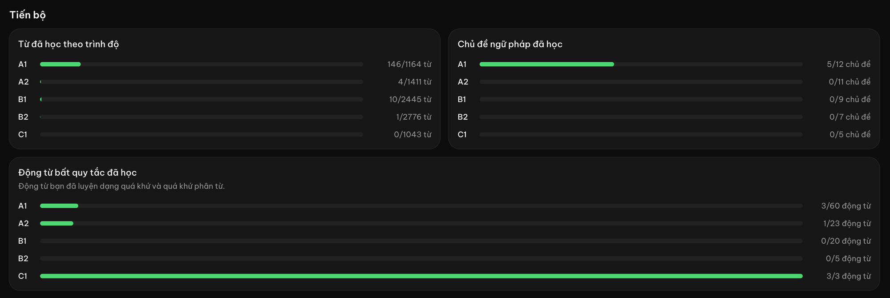

# Feature: Certificates for finished progress

## Overview

Hồ sơ shows how far the learner has got with each level, in three groups: words learned, grammar topics learned and irregular verbs learned. A full bar is the only sign that a level is done. The owner wants each finished row to earn a certificate the learner can open, keep and show to others, and every unfinished row to show that a certificate is waiting, so the learner has a goal to work towards.

## Goals

- [ ] Every progress row on Hồ sơ shows whether its certificate is earned, and a finished row opens its certificate in one tap
- [ ] A learner can save an earned certificate as an image

## Out of Scope

| Feature | Reason |
|---------|--------|
| Certificates for accuracy, streaks or points | The owner asked for one per finished progress row |
| Verifying a certificate (a code or link others can check) | No accounts; certificates are for motivation, not proof |
| Printing or a PDF file | The image covers saving and sharing (owner, 2026-10-28) |
| The phone's share sheet | The owner chose view and download (2026-10-28) |
| Keeping a certificate after new content makes the row unfinished again | Progress is worked out from what is learned now; see Edge Cases |
| A notice or celebration at the moment a row is finished | Can follow once certificates exist |

## User Stories

### P1: See and open a certificate

- As a learner, I want a certificate icon at the end of each progress row so that I can see which levels I have finished and open the certificate for them
- **Why P1:** The feature itself
- **Independent Test:** With every C1 irregular verb learned (3/3), open Hồ sơ: the C1 row of "Động từ bất quy tắc đã học" has an active certificate icon, the other rows have a locked one; pressing the C1 icon shows the certificate

**Acceptance Criteria:**

- [x] AC-001: WHEN Hồ sơ shows a progress row (words, grammar topics or irregular verbs, for a level) THEN system SHALL show a certificate icon at its right end
- [x] AC-002: WHEN the row is not finished THEN system SHALL show the icon locked (dimmed), and pressing it SHALL say in Vietnamese how many items are left to earn the certificate, without opening one
- [x] AC-003: WHEN every item of the row is learned THEN system SHALL show the icon active, and pressing it SHALL open the certificate over the page
- [x] AC-004: WHEN a certificate is open THEN system SHALL show, in English on the certificate image, the learner's name, what was finished ("1,164 words at level A1", "12 grammar topics at level A1", "60 irregular verbs at level A1"), the level, the date the last item was learned ("October 28, 2026") and the app's name. The dialog around it and the image's alt text stay in Vietnamese ("Bạn đã học xong 1.164 từ vựng trình độ A1.")
- [x] AC-005: WHEN the icon is read by a screen reader THEN system SHALL name the row and its state ("Chứng nhận từ vựng A1: chưa đạt, còn 1.018 từ" / "Xem chứng nhận từ vựng A1")

### P1: Save a certificate

- As a learner, I want to save my certificate as an image so that I can keep it or send it to others
- **Why P1:** The owner chose view and download (2026-10-28)
- **Independent Test:** Open an earned certificate and press "Tải về": the browser saves a PNG that shows the same certificate

**Acceptance Criteria:**

- [x] AC-006: WHEN the learner presses "Tải về" on an open certificate THEN system SHALL save a PNG image of the certificate, named after the row and level (for example "chung-nhan-dong-tu-bat-quy-tac-C1.png")
- [x] AC-007: WHEN the image is saved THEN system SHALL make it without the internet and without sending anything to the server

## Visual References

The three progress groups on Hồ sơ at desktop width: each row has the level, a bar and a count. The certificate icon goes after the count.

## Edge Cases

- WHEN the learner has no name THEN system SHALL put "Bạn" on the certificate in place of the name
- WHEN new content is published for a finished level THEN system SHALL show the row as unfinished again, with the locked icon, until the new items are learned
- WHEN a level has no content yet THEN system SHALL not show that row or its icon (as today)
- WHEN the name is long THEN system SHALL fit it on the certificate without cutting it off or overflowing
- WHEN the screen is a phone THEN system SHALL keep the row readable with the icon added, and the certificate SHALL fit the screen without scrolling sideways
- WHEN saving the image fails THEN system SHALL say so in Vietnamese and keep the certificate open

## Success Criteria

- [ ] A learner who finished a row opens its certificate from Hồ sơ in one tap and saves it in one more
- [ ] Locked and earned icons are told apart without relying on colour alone

## Open Questions

None.

## Notes

- Owner decision (2026-10-29): the certificate image is in English ("CERTIFICATE OF COMPLETION", "This certifies that", "has completed", "LEVEL", "Date", "Issued by"), since the app teaches English and the image is meant to be shown to others. Only the image changed; the dialog, buttons, alt text and file name are unchanged.
- Owner decisions (2026-10-28): the icon shows on every row, locked until the row is finished; the certificate can be viewed and downloaded as an image, without a share button.
- The date on the certificate is the day the row's last item was first learned, so it does not change when the learner reviews.
- At the time of writing, the owner's own profile has one finished row: C1 irregular verbs (3/3).
- Verification (2026-10-28):
  - AC-001, AC-002, AC-005: profile tests (locked label "còn 1 từ", the message on press, no dialog); in the browser every row of the three groups has the icon, locked rows dimmed with a lock badge
  - AC-003, AC-004: profile tests (name, "2 động từ bất quy tắc trình độ A1", date from the last learned item); in the browser a finished C1 row opens the drawn certificate (1600×1130) with the name, "3 động từ bất quy tắc trình độ C1", "ngày 28 tháng 10 năm 2026" and the C1 seal
  - AC-006, AC-007: profile test ("Tải về" saves "chung-nhan-dong-tu-bat-quy-tac-A1.png"); the image is drawn in the browser with no request. A real file save in the owner's browser is still to be confirmed
  - Phone: at 360px the rows keep a readable bar (88px) and the page has no sideways scroll

## Baseline

### Current Behavior

- Hồ sơ has a "Tiến bộ" section with three groups (words, grammar topics, irregular verbs), each a list of levels A1 to C1 with a bar and "learned/total" count
- A level with no content is left out of its group
- Nothing marks a finished level except a full bar

### Gaps / Limitations

- A learner gets nothing for finishing a level, and cannot keep or show the achievement
