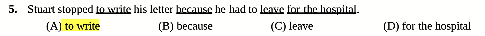

# Feature: Find the error ("Tìm lỗi sai")

## Overview

Vietnamese school exams, THPT, TOEIC and IELTS preparation all use the same question type: a sentence with four underlined parts labelled A to D, one of them wrong, and the learner picks the wrong one. Learners know this format well and need practice with it, but the course doesn't have it. The closest exercise, "Chọn câu đúng", shows whole sentences side by side, which trains noticing a difference rather than finding a mistake inside one sentence. The owner asked for the exam format, with an explanation and the correct replacement after the answer (2026-10-29).

The content already exists. Most approved sentences carry wrong versions with a Vietnamese explanation of the mistake, written for "Chọn câu đúng". In 15,112 of the 15,279 sentences, at least one wrong version differs from the correct sentence in one short part of up to three words. That part is the error, and the correct sentence gives its replacement.

## Goals

- [ ] A learner can practise the exam's "find the error" question from Bài tập, at their level and on a topic they pick
- [ ] The daily lesson can give it as one of its sentence tasks
- [ ] After every answer the learner sees which part was wrong, why, and what it should be

## Out of Scope

| Feature | Reason |
|---------|--------|
| New content written for this exercise | Uses the wrong versions sentences already have |
| Errors that are a missing or extra word | Nothing can be underlined for a missing word; only replaced parts are used |
| Sentences with two or more errors | The exam format has exactly one |
| Typing the correction | The learner picks; the replacement is shown after the answer |
| Trying again after a wrong pick | The owner chose to show the answer at once, as other exercises do (2026-10-29) |
| A timer or exam mode | Practice only |

## User Stories

### P1: Pick the incorrect part

- As a learner preparing for an exam, I want to see a sentence with four underlined parts and pick the wrong one so that I practise the question type I will meet in the exam
- **Why P1:** The feature itself
- **Independent Test:** Open Bài tập, choose "Tìm lỗi sai" at A1 and start a set. A sentence shows four underlined parts labelled A to D, with the same four parts as choices below it. Picking the wrong part marks the answer right.

**Acceptance Criteria:**

- [x] AC-001: WHEN a find-the-error task opens THEN system SHALL show one wrong sentence with exactly four underlined parts, labelled A, B, C and D in reading order, and the same four parts as choices labelled the same way
- [x] AC-002: WHEN the parts are chosen THEN exactly one SHALL be the error from the sentence's wrong version, and the other three SHALL be parts of up to three words that are correct, do not overlap the error or each other, and do not touch the error
- [x] AC-003: WHEN several tasks are shown THEN the error SHALL fall on different letters, not always the same one
- [x] AC-004: WHEN the learner picks a choice, by tapping it or pressing A to D or 1 to 4, THEN system SHALL allow checking the answer, as other multiple-choice exercises do

### P1: Learn why it is wrong

- As a learner, I want to know why the part is wrong and what it should be so that I don't make the same mistake
- **Why P1:** The owner asked for the explanation and the replacement (2026-10-29)
- **Independent Test:** For "She has the ability to learning languages fast.", pick "learning". The result marks the answer right, highlights "learning", shows "learn" as the correct form, the Vietnamese explanation, and the correct sentence with its meaning.

**Acceptance Criteria:**

- [x] AC-005: WHEN the answer is checked THEN system SHALL highlight the error in the sentence and show its correct replacement ("learning → learn")
- [x] AC-006: WHEN the answer is checked THEN system SHALL show the Vietnamese explanation of the mistake, and the correct sentence with its Vietnamese meaning and audio
- [x] AC-007: WHEN the learner picked a correct part THEN system SHALL mark the answer wrong, show which part they picked and which part was the error, and show the same explanation and replacement
- [x] AC-008: WHEN the marks are shown THEN system SHALL tell the picked part and the error apart by text or icon as well as colour

### P1: Practise it from Bài tập and in the daily lesson

- As a learner, I want this question both as a set I choose and in my daily lesson so that I meet it regularly
- **Why P1:** The owner chose both places (2026-10-29)
- **Independent Test:** Bài tập lists "Tìm lỗi sai" among the sentence types; a set of it runs, retries wrong answers and shows the score like the other sets. Over a few daily lessons with sentence tasks, at least one find-the-error task appears.

**Acceptance Criteria:**

- [x] AC-009: WHEN the learner opens Bài tập THEN system SHALL list "Tìm lỗi sai" with the other sentence exercise types, filtered by level and topic in the same way
- [x] AC-010: WHEN a set finishes THEN system SHALL behave like the other sets: score screen, retry of wrong answers (feature 006) and attempts saved to progress
- [x] AC-011: WHEN the daily lesson picks its sentence tasks THEN system SHALL include find-the-error among the kinds it can choose, and SHALL keep the lesson within its time budget
- [x] AC-012: WHEN an answer is wrong THEN system SHALL bring the words and grammar the sentence practises forward to the next review, like the other sentence exercises

## Visual References

The format the owner wants: a numbered sentence with four underlined parts, and choices (A) to (D) repeating those parts. The highlighted choice is the answer.

## Edge Cases

- WHEN a sentence has no wrong version that replaces one part of up to three words THEN system SHALL not use it for this exercise
- WHEN a sentence has several usable wrong versions THEN system SHALL pick one per task, so repeating the set can show a different error
- WHEN the wrong sentence is too short to hold three correct parts that don't touch the error THEN system SHALL not use that wrong version
- WHEN the error is a swap of word order ("abroad works" for "works abroad") THEN system SHALL underline the swapped words as one part
- WHEN the same word appears twice in the sentence THEN system SHALL underline only the occurrence that belongs to the chosen part
- WHEN a part is longer than the screen is wide THEN system SHALL wrap it without breaking the underline or its letter
- WHEN the screen is a phone THEN system SHALL keep the sentence, the four choices and the check button usable without scrolling sideways

## Success Criteria

- [ ] A learner can start a find-the-error set from Bài tập in two taps and answer a question in under 30 seconds
- [ ] Every checked answer shows the error, its replacement and why, so the learner never has to work out the mistake alone
- [ ] Marks are readable without colour

## Open Questions

None.

## Notes

- Owner decisions (2026-10-29): the exercise goes in both Bài tập and the daily lesson; a wrong pick is marked wrong at once with the answer and explanation, and comes back in Bài tập's retry round.
- The UI name is "Tìm lỗi sai"; the instruction reads "Chọn phần sai trong câu".
- Content at the time of writing: of 15,279 approved sentences, 15,112 have at least one wrong version that replaces one part of up to three words (7,698 have two such versions and 5,090 have three); the other wrong versions only add or drop a word and are not used. After also requiring three correct parts that don't touch the error, about 14,300 sentences can be used (14,306 when the generator ran over all content on 2026-10-29). A1 loses the most because its sentences are short.
- Correct parts never touch the error, so changing them can't also fix the sentence ("She have": "She" next to "have" could be blamed too).
- The letter of the error is picked at random before the correct parts are placed. It still lands on A most often (6,364 / 1,391 / 2,577 / 3,974 for A to D over all content), because many errors are the second word ("She have…") and nothing before them may be underlined.
- Verification (2026-10-29):
  - AC-001 to AC-003: 7 generator tests (four parts in reading order rebuilding the sentence, error "learning" with replacement "learn", no part touching the error, distinct parts, letters vary across seeds, same seed same question, a word-order swap underlined as one part, short or unusable sentences skipped). Run over all approved content: 14,306 questions, dotted abbreviations such as "a.m." kept whole
  - AC-004 to AC-008: runner tests (choices lettered A to D, the C key picks C, a right pick shows the error, replacement, explanation and meaning; a wrong pick says "Bạn chọn (B) …, phần này đúng." and the sentence marks the error and the pick in words for screen readers). In the browser at desktop width: a B1 set shows the lettered underlines and choices, the B key selects B, and a wrong pick shows A as the error with "have → has", the explanation and the correct sentence
  - AC-009, AC-010: library test lists "Tìm lỗi sai" (find-error.A1.home) only for sentences with a usable wrong version; sets reuse the existing runner, score screen and retry
  - AC-011: lesson-plan test picks find-the-error within six days when sentences have a usable wrong version and never otherwise; its step time (20 s) is under the sentence reserve, so the budget is unchanged
  - AC-012: prepare test gives the step the sentence's related cards, which existing sentence handling brings forward after a wrong answer
  - Not checked in a browser: phone width and the daily lesson. Pressing Enter after choosing with a letter key doesn't check the answer when nothing on the page has focus; multiple choice already behaves this way

## Baseline

### Current Behavior

- Sentences carry wrong versions, each with a Vietnamese explanation of the mistake
- "Chọn câu đúng" shows the correct sentence among three wrong ones and asks for the correct one; after checking it shows the explanation for a wrong pick
- The daily lesson rotates its sentence tasks through word order, fill the gap, choose the correct sentence, build the translation and dictation, within a time budget
- Bài tập offers each exercise type as a set by level and topic, with retry of wrong answers and a score screen

### Gaps / Limitations

- There is no question in the exam's "find the error" format, which learners need for school and certificate exams
- The learner never has to locate a mistake inside a single sentence
