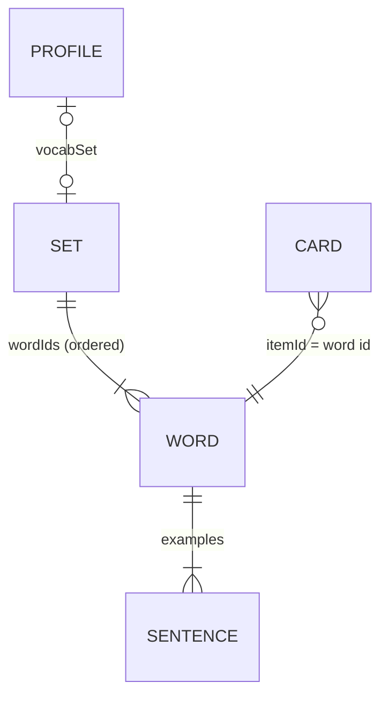
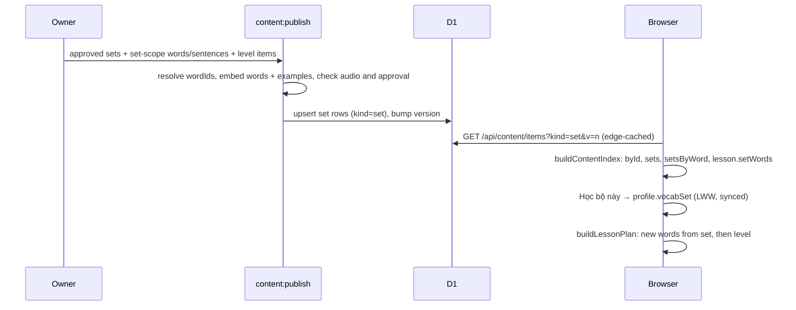

# Technical Design: Specialized vocabulary sets

## Scope

In scope: a new `set` content kind published as one bundle per set (the set's
words and their example sentences embedded), new specialized words drafted
through the existing pipeline under a "set scope", the followed set on the
profile (backups and sync included), the lesson planner taking new words from
the followed set, the "Chuyên ngành" tab on `/vocabulary`, a followed-set card
on the home page, and drafting the content of the three sets.

Out of scope: see spec.md. No D1 migration, no new API route, no runtime AI.

## Research Summary

No new technology. Everything reuses the content pipeline (feature 001), the
all-levels content kinds (`grammar`, `forms`, feature 008) and the profile
last-writer-wins merge.

## Patterns & Reuse

### Conventions to Follow

| Pattern | Project Uses | Avoid | Reference |
|---------|-------------|-------|-----------|
| New content kind | Add to `CONTENT_KINDS`, a body schema, a union member, the Drizzle `kind` enum; fetch across levels like `forms` | A new API route or table | `src/content/schema.ts:10`, `src/server/db/schema.ts:12`, `src/hooks/use-content-index.ts:28` |
| Content API cost | Bodies stored as JSON text and copied into the response without parsing | Parsing bodies in the Worker | `src/server/content/content.service.ts:35` |
| Profile field | Optional field + `PROFILE_KEYS` + `metaSchema`; `updateProfile` stamps `fieldUpdatedAt`; merge is per-field LWW, `undefined` deletes | A separate store | `src/learning/types.ts:117`, `src/learning/snapshot.ts:59`, `src/storage/meta.ts:43`, `src/learning/merge.ts:50` |
| Pure learning rules | Planner stays pure and deterministic | Reading IndexedDB in `src/learning` | `src/learning/lesson-plan.ts:154` |
| URL state | Query params via `updateSearchParams`, static page shell | Dynamic segments | `src/components/vocabulary/vocabulary-browser.tsx:70` |
| Handlers | Named `handleX`, one-line inline only | Multi-line inline handlers | `.claude/rules/learn-english/05-event-handlers.md` |

### Existing Code to Reuse

| Component | Location | How to Use |
|-----------|----------|------------|
| `WordList` / `WordCard` / `TopicChip` | `src/components/vocabulary/vocabulary-browser.tsx:247` | Move `WordList`/`WordCard` to `word-list.tsx`; the set view renders them |
| `WordDialog` + `lookupWord` | `src/components/vocabulary/word-dialog.tsx`, `vocabulary-browser.tsx:55` | Unchanged lookup: set words are in `index.byId` |
| `useCardIds` | `src/components/library/use-card-ids.ts` | Learned markers and counts per set |
| `LevelTabs` | `src/components/library/level-tabs.tsx:7` | Add an optional extra tab (value `sets`, label "Chuyên ngành") |
| `pickNewWords` | `src/learning/lesson-plan.ts:154` | Take the followed set's uncarded words first, then fall back to level words |
| `updateProfile` | `src/storage/meta.ts:43` | Follow/unfollow writes `vocabSet` |
| `getOrCreateTodayLesson` | `src/lib/session/today.ts:23` | Add `replanTodayIfUnstarted` next to it |
| Drafting builders/checks | `scripts/lib/drafting.ts:145`, `:420` | Reuse `buildWord`/`checkWordDraft` with the set's level |
| Review CLI, audio, publish | `scripts/review.ts`, `scripts/generate-audio.ts:202`, `scripts/publish-content.ts` | Generalise "level" file names to a scope (`A1`…`C1` or `set-<slug>`) |

## Data Model

### Entities

| Entity | Purpose |
|--------|---------|
| Set item (`kind: "set"`) | One per set: names, description, ordered word ids; published with its words and sentences embedded |
| Word item | Reused course words, plus new words with `source: "specialized"` that exist only inside set bundles |
| Sentence item | Examples of the set's words, embedded in the bundle |
| Profile | Gains `vocabSet` (the followed set's id) |
| Content index | Gains `sets`, `setsByWord`, and set words/sentences in `byId` and in the lesson content |
| Lesson content | Gains `setWords` and `setSentences` for the planner |

#### Set item (new)

- `id` (`set:<slug>`; slugs `it`, `recruitment`, `office`) -- follows `idOf`, `src/content/schema.ts:14`
- `level` (Level) -- the set's starting level; also the stored level of its new words. Required by `base`, `src/content/schema.ts:126`
- `sort` (int) -- order of the sets in the list
- `body.titleVi`, `body.titleEn`, `body.descriptionVi` (string)
- `body.wordIds` (word ids, ordered, 90 to 120, unique) -- the learning order
- `body.words` (word items, default `[]`) -- filled by publish, empty in source
- `body.sentences` (sentence items, default `[]`) -- filled by publish: every example of `body.words`

#### Word item (existing, one change)

- `body.source` -- `src/content/schema.ts:31`; add `"specialized"`
- `level` -- `src/content/schema.ts:126`; for specialized words, equal to the set's level (never shown)
- `topic` -- a broad topic from `content/topics.json` (`technology`, `work-jobs`, `business-economy`, …), as for other words
- All other members unchanged: `headword`, `variants`, `pos`, `ipa`, `meaningsVi`, `examples`, `synonyms`, `audio` -- `src/content/schema.ts:21-32`

#### Profile (existing, one field)

- `vocabSet?` (`set:<slug>`) -- new, `src/learning/types.ts:117`
- `level` -- `src/learning/types.ts:120`, unchanged; still drives grammar, writing and the fallback words
- `fieldUpdatedAt` -- `src/learning/types.ts:139`, stamps `vocabSet`

#### Content index (existing)

- `byId` -- `src/lib/session/content-index.ts:11`; also holds embedded set words and sentences (a level item with the same id wins)
- `wordsByLevel` -- `:12`; unchanged: embedded items never go here, so level lists, counts and the level fallback stay exact
- `sets` (new) -- `{ item, words }[]` by `sort`; `words` resolved through `byId` in `wordIds` order
- `setsByWord` (new) -- word id → set ids, for labels and distractor pools
- `lesson.setWords` (new) -- set id → ordered words; `lesson.setSentences` (new) -- all embedded sentences

### Relationships

A word can be in several sets and also be a level word; its id, card and
learned state are shared everywhere. New specialized word ids are unique
across all source files (the publish duplicate-id check, `scripts/publish-content.ts:80`).

### API Contracts

| Endpoint | Method | Request | Response |
|----------|--------|---------|----------|
| `/api/content/items` | GET | `kind=set&v=<n>` (no level; `set` is not in `LEVELLED_KINDS`, `src/server/content/content.schema.ts:8`) | `ContentItemsResponse` with the set items, bundles embedded; `tombstones` of removed sets |
| `/api/content/version` | GET | unchanged | unchanged |

No change to the route or service code: `getContentItems` already serves any
kind without a level (`src/server/content/content.service.ts:47`). Payload
estimate: 3 sets × ~100 words + ~150 sentences ≈ 300 KB raw, ~70 KB gzipped,
cached in IndexedDB until the next publish.

### Currently Exposed Fields

| AC ID | Field | Source (file:line) | Currently Exposed? | Gap? |
|-------|-------|--------------------|--------------------|------|
| AC-002 | set Vietnamese name | new `body.titleVi` | no | must add |
| AC-002 | short description | new `body.descriptionVi` | no | must add |
| AC-002 | word count | new `body.wordIds.length` | no | must add |
| AC-002 | learned count | `useCardIds`, `src/components/library/use-card-ids.ts` | yes (per level) | must map per set |
| AC-003 | meaning, phonetic spelling, audio, examples | `wordBodySchema`, `src/content/schema.ts:21` | yes | none |
| AC-004 | level label | `word.level`, shown in `word-search-box.tsx` suggestions (the word dialog shows no level) | yes | must map: set title in suggestions and set word cards; the dialog gains a "Chuyên ngành: <set>" badge for specialized words |
| AC-013 | followed set name, learned/total | `profile.vocabSet` + index `sets` | no | must add |
| AC-014 | set progress bar | `Progress`, `vocabulary-browser.tsx:181` | yes (per level) | must map per set |

## Decisions

| Decision | Rationale |
|----------|-----------|
| One `set` row per set with its words and sentences embedded at publish time | A set spans five levels; loading it from level rows would download every level (~9,000 words). One small all-levels request, like `grammar` and `forms`, keeps one D1 call per request and needs no migration |
| New specialized words exist only inside bundles, never as level rows | Keeps level lists, level counts, the placement test and the level fallback of the planner unchanged |
| Specialized words store the set's level in `level` | `level` is required on every item and NOT NULL in D1 (`src/server/db/schema.ts:13`); the UI shows the set name instead (AC-004) |
| Source files under a scope name: `content/set/set-<slug>.json` (one set per file), `content/word/set-<slug>.json`, `content/sentence/set-<slug>.json` | The scripts already work per `content/{kind}/{level}.json`; widening "level" to "scope" lets review, audio and drafting run per set (`--scope set-it`) with little new code |
| Publish skips `*/set-*.json` items as rows and builds bundles from them plus the reused level items; a set is published only when it and every word and example it needs are approved | AC-017; a half-approved set never reaches learners |
| `profile.vocabSet` holds one set id; unfollow writes `undefined` | Per-field LWW already handles a deleted field (`src/learning/merge.ts:61`); optional field keeps `SNAPSHOT_VERSION` and old snapshots still parse. An app version from before 012 rejects a snapshot whose `fieldUpdatedAt` has `vocabSet` (it is a `partialRecord` over the known keys) until that tab reloads the new version |
| Planner: followed set's uncarded words in `wordIds` order, then `pickNewWords`' level order to fill the count | AC-008, edge "fewer words left"; a missing or removed set falls back silently (edge cases) |
| Following a set plans today's lesson again, in place and stamped now, only if nothing in it is done yet; otherwise it applies from tomorrow, and the toast says which | Lessons are planned once per day and resumed (`src/lib/session/today.ts`); overwriting instead of deleting means a sync merge keeps the new plan (same position, later `updatedAt`) |
| Distractors for specialized words come from the same set; a set pool under 10 words is topped up with the set level's words | Jargon among everyday words makes multiple choice too easy |
| Set finished: the planner already falls back; the home card switches to "Bạn đã học xong bộ …" with "Chọn bộ khác" and "Ngừng học bộ này" | AC-011 without silently changing the profile |
| URL: `/vocabulary?view=sets` lists sets, `/vocabulary?set=it` opens one (plus `&word=`) | AC-006, same pattern as `level`/`topic`/`word` |
| Search: `useAllWords` adds the specialized words from the set bundles | AC-005; reused words are already found through their level |

## Component Design

| Component | File | Action | Responsibility |
|-----------|------|--------|----------------|
| Set schema | `src/content/schema.ts` | modify | `setBodySchema`, `set` kind, `source: "specialized"` |
| DB kind enum | `src/server/db/schema.ts` | modify | Add `"set"` (TS enum only; no CHECK constraint, `migrations/0000_init.sql:3`) |
| Content index | `src/lib/session/content-index.ts` | modify | Expand bundles into `byId`, `sets`, `setsByWord`, `lesson.setWords`, `lesson.setSentences` |
| Index loader | `src/hooks/use-content-index.ts` | modify | Fetch `set` with `grammar` and `forms` |
| All words | `src/hooks/use-all-words.ts` | modify | Add specialized words for search |
| Set helpers | `src/learning/sets.ts` | new | Pure: `setLabel`, `setProgress`, `nextSetWords`, `isSetFinished` |
| Lesson planner | `src/learning/lesson-plan.ts` | modify | `LessonContent.setWords/setSentences`; `pickNewWords` takes the profile's `vocabSet`; set words/sentences in `wordsById`/`sentencesById` |
| Today | `src/lib/session/today.ts` | modify | Pass `vocabSet`; `replanTodayIfUnstarted` |
| Distractor pools | `src/lib/session/prepare.ts` | modify | `sameLevelWords`/`distractorWords` use the set for specialized items |
| Profile + snapshot | `src/learning/types.ts`, `src/learning/snapshot.ts` | modify | `vocabSet` field, key, schema |
| Follow action | `src/components/vocabulary/use-follow-set.ts` | new | Follow/unfollow, replan, toast |
| Tabs | `src/components/library/level-tabs.tsx` | modify | Optional extra tab |
| Vocabulary browser | `src/components/vocabulary/vocabulary-browser.tsx` | modify | Route between level view, set list and set view; level label via `setLabel` |
| Word list | `src/components/vocabulary/word-list.tsx` | new (moved) | `WordList`, `WordCard` shared by level and set views |
| Set list | `src/components/vocabulary/set-list.tsx` | new | Cards: name, description, count, progress, "Đang học" badge |
| Set view | `src/components/vocabulary/set-view.tsx` | new | Header, progress bar, "Học bộ này"/"Ngừng học bộ này", words |
| Labels | `word-dialog.tsx`, `word-search-box.tsx` | modify | Set title instead of level for specialized words |
| Home card | `src/components/lesson/followed-set-card.tsx` | new | Name, learned/total, link; finished state |
| Today lesson | `src/components/lesson/today-lesson.tsx` | modify | Render the card |
| Scripts scope | `scripts/review.ts`, `scripts/generate-audio.ts`, `scripts/draft-content.ts`, `scripts/lib/drafting.ts` | modify | `--scope set-<slug>`; `checkSpecializedDraft` rejects duplicates of course words (AC-016) |
| Publish | `scripts/publish-content.ts` | modify | Skip set-scope rows, build and validate bundles, approval gate |
| Content | `content/{set,word,sentence}/set-{it,recruitment,office}.json` | new | Three sets, drafted in-session, status `draft` until the owner approves |
| E2E fixture | `scripts/fixtures/content/` | modify | One small set for e2e |

## Data Flow

## UI Direction

Settled with `ui-ux-pro-max` against the existing Từ vựng page, so the sets look like the rest of the app:

- "Chuyên ngành" is a sixth tab after A1 to C1 in `LevelTabs`. At 360 px the level tabs narrow (`px-1.5`, no minimum width) so the row fits without sideways scrolling; they stay 44 px tall.
- Set list: one card per set in a 1, 2 or 3 column grid (phone, md, xl). Each card is a link with the Vietnamese name, the English name in small muted text, a two-line description, "N từ", "Đã học x/y" and a 2 px track progress bar. The followed set carries a "Đang học" badge.
- Set view: a header card with a back link to the list, name and badge, description, the follow button (primary "Học bộ này", or outline "Ngừng học bộ này" when followed), the progress bar and one status line (following, or finished). The words below use the shared `WordList`, with a level or set name tag on each card.
- Home: a compact card under today's lesson with the set's name, learned/total and "Xem bộ từ". When the set is finished it says so, with "Chọn bộ khác" and "Ngừng học bộ này".
- States: empty list and unknown set use `EmptyState`; loading and errors reuse the page's skeleton and `ContentError`. Colors come from theme tokens only.

## Requirements Traceability

| Requirement | Component | File | Status |
|-------------|-----------|------|--------|
| AC-001 | Tabs | `level-tabs.tsx`, `vocabulary-browser.tsx` | Planned |
| AC-002 name | Set list | `set-list.tsx` (`body.titleVi`) | Planned |
| AC-002 description | Set list | `set-list.tsx` (`body.descriptionVi`) | Planned |
| AC-002 word count | Set list | `set-list.tsx` (`body.wordIds.length`) | Planned |
| AC-002 learned count | Set helpers + `useCardIds` | `sets.ts`, `set-list.tsx` | Planned |
| AC-003 | Set view + word list | `set-view.tsx`, `word-list.tsx`, `word-dialog.tsx` | Planned |
| AC-004 | `setLabel` | `sets.ts`, `word-list.tsx`, `word-dialog.tsx`, `word-search-box.tsx` | Planned |
| AC-005 | All words | `use-all-words.ts` | Planned |
| AC-006 | URL params | `vocabulary-browser.tsx` | Planned |
| AC-007 | Follow action | `use-follow-set.ts`, `set-view.tsx` | Planned |
| AC-008 | Planner | `lesson-plan.ts`, `today.ts` | Planned |
| AC-009 | Existing recording (word cards) | `src/lib/session/record.ts` (unchanged) | Planned |
| AC-010 | Follow action | `use-follow-set.ts` | Planned |
| AC-011 | Set helpers + home card | `sets.ts`, `followed-set-card.tsx` | Planned |
| AC-012 | Snapshot + merge | `snapshot.ts`, `types.ts` | Planned |
| AC-013 | Home card | `followed-set-card.tsx`, `today-lesson.tsx` | Planned |
| AC-014 | Set view | `set-view.tsx` | Planned |
| AC-015 | Content + publish checks | `content/set/*`, `publish-content.ts` | Planned |
| AC-016 | Drafting check | `scripts/lib/drafting.ts` | Planned |
| AC-017 | Publish gate | `publish-content.ts` | Planned |

## Test Strategy

### Infrastructure

| Aspect | Detail |
|--------|--------|
| Framework | Vitest (happy-dom) + Testing Library; Playwright for e2e |
| Command | `pnpm test`, `pnpm e2e` (in `apps/learn-english`) |
| Location | `*.test.ts(x)` next to the code; `e2e/*.spec.ts` |

### Reference Tests

| File | What It Tests |
|------|---------------|
| `src/learning/lesson-plan.test.ts` | Planner determinism and new-word picking |
| `src/learning/snapshot.test.ts`, `merge.test.ts` | Profile fields through backup and sync |
| `scripts/publish-content.test.ts` | Approval, references, row diffing |
| `src/components/vocabulary/vocabulary-browser.test.tsx` | Browser with a built index |

### New Tests

| Component | Test File | Scenarios |
|-----------|-----------|-----------|
| Set schema | `src/content/schema.test.ts` | Valid set; bad id; empty `wordIds`; `specialized` source |
| Content index | `src/lib/session/content-index.test.ts` | Embedded items in `byId` but not `wordsByLevel`; level item wins; word in two sets |
| Set helpers | `src/learning/sets.test.ts` | Labels, progress, finished, removed set |
| Planner | `src/learning/lesson-plan.test.ts` | Set words first in order; skip learned; top up from level; missing set falls back |
| Snapshot/merge | `snapshot.test.ts`, `merge.test.ts` | `vocabSet` round trip; unfollow wins by stamp; old snapshot without it |
| Distractors | `src/lib/session/prepare.test.ts` | Specialized word MCQ draws from its set |
| Publish | `scripts/publish-content.test.ts` | Bundle built; draft word blocks the set; set-scope items never become rows; missing example fails |
| Drafting | `scripts/lib/drafting.test.ts` | Duplicate of a course word rejected |
| UI | `vocabulary-browser.test.tsx`, `set-view.test.tsx` | Tab, list counts, follow/unfollow, labels |
| E2E | `e2e/vocabulary-sets.spec.ts` | Open Chuyên ngành → set → follow → today's lesson shows a set word |

## Considerations

### Error Handling

- Set content failing to load uses the existing `ContentError` with retry on `/vocabulary`; the lesson index treats a failed `set` request like the other kinds (cached copy, else error). The planner ignores a `vocabSet` that isn't in the index, so a removed set never breaks the lesson.
- A removed set is a tombstone; its reused course words keep their cards, and specialized words whose content is gone are skipped in Ôn tập like any removed item (existing `skip` handling, `src/learning/lesson-plan.ts:145`).

### Security

- No new input reaches the server. `vocabSet` from a backup or sync blob is validated by `metaSchema` (`set:<slug>` pattern).

## Open Questions

- None.
