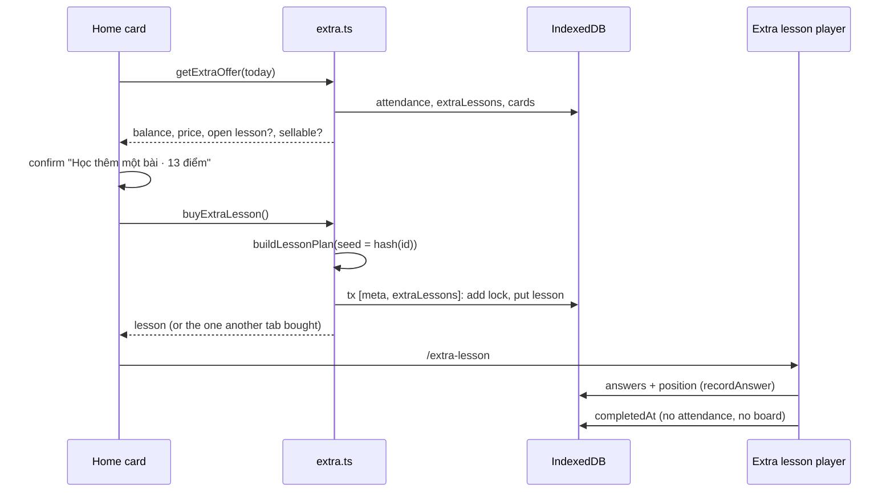

# Technical Design: Spend points on extra lessons, rank the board by streak

## Scope

In scope: 20 points per daily lesson; a points balance (earned minus spent); buying, playing and resuming extra lessons on the home page; extra lessons in IndexedDB, backups and sync; the board ranked by current streak (client, API, D1 migration, copy); updating 001 and 007 specs where this feature changes them.

Out of scope: points from anything but the daily lesson, paying for review or the library, other purchases, refunds (spec Out of Scope).

## Research Summary

No new technology. Everything uses what the app already has: `idb` stores and upgrades (`src/storage/db.ts:87`), snapshot migrations (`src/learning/snapshot.ts:248`), Drizzle + D1 migrations (`migrations/0001_leaderboard.sql`), the guarded upsert pattern (`src/server/leaderboard/leaderboard.service.ts:51`). Knowledge entries applied: D1 has no interactive transactions (one `db.batch()`); a new D1 migration goes to production before the code; a new profile field breaks older tabs mid-sync, so this design adds no profile field.

## Patterns & Reuse

### Conventions to Follow

| Pattern | Project Uses | Avoid | Reference |
|---------|-------------|-------|-----------|
| Pure rules | Point, price and ranking rules in `src/learning/*`, no React/IDB/fetch | Price math inside components | `src/learning/attendance.ts:21` |
| One write, no double award | `add()` that fails on an existing key | Read-then-put across awaits | `src/storage/attendance.ts:13` |
| Atomic multi-store write | `getDb().transaction(stores, fn)`, only `tx` awaits inside | Awaiting fetch/other work inside | `src/storage/db.ts:71` |
| Sync merge | `unionBy(key, pick)` per store | Last-writer-wins on whole arrays | `src/learning/merge.ts:9` |
| Snapshot change | Bump `SNAPSHOT_VERSION`, add a migration from the previous one | Optional fields with no version | `src/learning/snapshot.ts:20`, `:248` |
| Board request | One `db.batch()`: cleanup, guarded upsert, ranking reads | Several D1 calls | `src/server/leaderboard/leaderboard.service.ts:67` |
| Reactive reads | `useStorageQuery(key, query, stores)` + `notifyChanged` | Manual refetch | `src/components/lesson/streak-summary.tsx:18` |
| Handlers | Named `handleX` when more than one short call | Multi-line inline handlers | `.claude/rules/learn-english/05-event-handlers.md` |

### Existing Code to Reuse

| Component | Location | How to Use |
|-----------|----------|------------|
| `buildLessonPlan` (with `seed`) | `src/learning/lesson-plan.ts:227` | Builds the extra lesson's plan; `seed` = hash of the extra lesson id so it differs from the daily one |
| `flattenLesson`, `endPosition` | `src/lib/session/today.ts:75`, `:90` | Take the plan + position, so they work for extra lessons unchanged (they read `plan`, `position`, `date`) |
| `ExerciseRunner` | `src/components/exercise/exercise-runner.tsx` | Plays the extra lesson exactly like the daily one |
| `recordAnswer` | `src/storage/attempts.ts:42` | Extend its optional lesson position to point at either store |
| `streaks`, `totalPoints` | `src/learning/attendance.ts:34`, `:54` | Current streak and points ever earned for the board and balance |
| `WeeklyBoard`, `slideOffsets` | `src/components/leaderboard/weekly-board.tsx`, `src/learning/leaderboard.ts:117` | Same slide, comparing (streak, earned) instead of points |
| `sqliteDb()` | `src/test-utils/sqlite-d1.ts` | Service tests against real SQLite with the new migration |

## Data Model

### Entities

| Entity | Purpose |
|--------|---------|
| Attendance (existing) | Points earned per day; the source of "earned" and the streak |
| ExtraLesson (new) | One bought extra lesson: its price (the spend record) and its plan and progress |
| DailyLesson (existing) | Unchanged; the shape ExtraLesson mirrors |
| Snapshot (existing, v3) | Carries extra lessons in backups and sync |
| leaderboard_entries (existing, changed) | Streak, points earned and last lesson date per learner instead of week and points |
| Submit body / response (existing, changed) | What the browser sends after a daily lesson and gets back |
| BoardRow (existing, changed) | A row shown on the board |

#### Attendance

- `date` (string, key), `points` (number), `bonus` (number), `at` (number): `src/learning/types.ts:101`. Unchanged shape; new rows get `points: 20` (`DAILY_POINTS`, `src/learning/attendance.ts:4`).

#### ExtraLesson (new, `src/learning/types.ts`)

- `id` (string, key): `${date}#${n}#${random}`; `n` is the purchase number that day on this device, the random part (8 base64url chars) keeps two devices' purchases apart after a merge
- `date` (string): local date of purchase; only today's extra lessons are offered or played
- `price` (number): points paid
- `purchasedAt` (number)
- `contentVersion`, `plan`, `position`, `completedAt?`, `updatedAt`: same meaning as `DailyLesson` (`src/learning/types.ts:92`)

#### DailyLesson

- `date`, `contentVersion`, `plan`, `position`, `completedAt?`, `updatedAt`: `src/learning/types.ts:92`. Unchanged. `flattenLesson`/`endPosition` take `Pick<DailyLesson, "date" | "plan" | "position">` so both kinds pass.

#### Snapshot

- `version` 3 (`src/learning/snapshot.ts:20`); `data.extraLessons: ExtraLesson[]` (new); `summary.points` becomes the balance (`src/learning/snapshot.ts:212`). Migration 2 → 3 adds `extraLessons: []`. Extra lessons older than 14 days keep `price` but lose their `plan` (`[]`), like old daily lessons are dropped (`src/learning/snapshot.ts:228`), so the spend survives and the payload stays small.

#### leaderboard_entries (`src/server/db/schema.ts:68`)

- Kept: `id`, `token_hash`, `name`, `reached_at`, `updated_at`
- Removed: `week`, `points` and index `leaderboard_entries_week_points` (`migrations/0001_leaderboard.sql`)
- Added: `streak` integer not null default 0, `earned` integer not null default 0, `last_date` text not null default `''`; index `(last_date, streak)`
- Existing rows get `last_date = ''`, so they stay off the board until their next daily lesson (spec edge case)

#### BoardRow (`src/learning/leaderboard.ts:104`)

- `position`, `name`, `me` kept; `points` replaced by `streak` and `earned`

### Relationships

Balance = sum of `points + bonus` over Attendance − sum of `price` over ExtraLesson. Next price = `price(k)` where k = number of ExtraLesson rows with `date === today` (any device). No foreign keys; the board row is linked to the learner by `profile.leaderboard.id` (`src/learning/types.ts:134`) as in 007.

### API Contracts

| Endpoint | Method | Request | Response |
|----------|--------|---------|----------|
| `/api/leaderboard` | POST | `{ id, token, name, today, lastDate, streak, earned, previousStreak, previousEarned }` | 200 `{ rank, previousRank, total, rows: BoardRow[] }`; 400 invalid; 403 forbidden (secret); 422 implausible (new); 429 throttled |
| `/api/leaderboard` | DELETE | unchanged `{ id, token }` | unchanged |

Request rules (`leaderboard.schema.ts`): `today` and `lastDate` are `YYYY-MM-DD`; `lastDate <= today`; `today` within one day of the server's UTC date; `previousStreak <= streak`, `previousEarned <= earned`; `streak <= days(BOARD_EPOCH, lastDate) + 1`; `earned <= (days(BOARD_EPOCH, lastDate) + 1) × 20 + 150`. `BOARD_EPOCH = "2026-10-26"` (first commit of the app).

### Currently Exposed Fields

| AC ID | Field | Source (file:line) | Currently Exposed? | Gap? |
|-------|-------|--------------------|--------------------|------|
| AC-002 | points now (balance) | `src/components/lesson/streak-summary.tsx:16`, `src/components/profile/attendance-summary.tsx:21` | no (shows earned) | must map to earned − spent |
| AC-002 | total ever earned (profile) | `src/learning/attendance.ts:54` | yes, as "Tổng điểm" | relabel; add balance next to it |
| AC-003 | next extra price | none | no | must add |
| AC-003 | learner's points on the card | none | no | must add |
| AC-007 | points needed vs points had | none | no | must add |
| AC-010 | current streak sent | `src/lib/leaderboard-client.ts:58` (sends week points) | no | must add |
| AC-010 | points ever earned sent | none | no | must add |
| AC-010 | place, total, rows ±3 | `src/server/leaderboard/leaderboard.service.ts:85` | yes (by points) | must re-rank |
| AC-010 | row name | `src/learning/leaderboard.ts:104` | yes | none |
| AC-010 | row streak | none | no | must add |

## Decisions

| Decision | Rationale |
|----------|-----------|
| A new IndexedDB store `extraLessons` (keyPath `id`, index `date`), DB version 2 | `lessons` is keyed by date (`src/storage/db.ts:40`); a second row per date needs another key, and the upgrade only adds a store, so no existing data moves |
| The extra lesson row is also the spend record | One row to sync and merge; a purchase can't exist without its lesson or the reverse |
| Two tabs: a device-local lock in `meta` (`extra-buy:${date}:${n}`, added with `add()` in the same transaction as the purchase) | `add()` fails for the second tab, which then opens the lesson the first tab bought: charged once (spec edge case). Meta is not synced, so it never blocks another device |
| Two devices: purchases never collide (random part of the id) and merge by union | AC-018: both purchases kept and counted; a balance below 0 shows as 0 |
| One unfinished extra lesson at a time; the home card resumes it instead of selling another | AC-009 without paying twice, and keeps the two-tab case simple |
| Price `round(10 × 1.3^(k))` for the (k+1)th lesson that day | decisions.md tentative rounding; pure function in `src/learning/points.ts` |
| Not sellable when the plan built for it has no new-word steps | Spec edge case "no new words left"; reuses the same `buildLessonPlan` the purchase uses |
| Extra lesson plays at a new static page `/extra-lesson` (focus layout) | Static shells only (`.claude/rules/learn-english/02-ui-implementation.md`); no query param needed because there is at most one open extra lesson today |
| Board ranks rows with `last_date >= yesterday(today)` by `streak desc, earned desc, reached_at asc` | AC-011, AC-013; `today` comes from the learner so their own day boundary is used |
| `reached_at` resets when `streak` or `earned` changes | "reached that streak first" (AC-011), same CASE as today (`leaderboard.service.ts:60`) |
| Plausibility in the upsert's `setWhere`: new streak ≤ stored streak + days between stored and new `last_date` (and the same with 20 × days + 150 for earned); rows with `last_date = ''` count as new | AC-016 in the one conditional statement D1 allows; covers offline days that were never reported |
| 422 vs 403: the batch also reads whether a row with this id and token hash exists | When the write returns nothing, an existing matching row means the numbers were refused, otherwise the secret was wrong |
| Rename sends the current numbers only when the streak is not broken | Same idea as 007's "no 0-point row from a rename" (`src/lib/leaderboard-client.ts:76`) |
| Keep `WeeklyBoard`'s file but rename it `StreakBoard`; keep component structure | The slide and reduced-motion logic stay (AC-012); only copy and the compared values change |

## Component Design

| Component | File | Action | Responsibility |
|-----------|------|--------|----------------|
| Points rules | `src/learning/points.ts` | new | `extraLessonPrice(k)`, `spentPoints`, `pointsBalance`, `nextExtraPrice(extras, today)` |
| Attendance | `src/learning/attendance.ts` | modify | `DAILY_POINTS = 20` |
| Types | `src/learning/types.ts` | modify | `ExtraLesson` |
| Lesson position helpers | `src/lib/session/today.ts` | modify | `flattenLesson`/`endPosition` accept either lesson kind |
| Extra lesson session | `src/lib/session/extra.ts` | new | `getExtraOffer` (balance, price, open lesson, sellable), `buyExtraLesson`, `saveExtraPosition`, `completeExtraLesson` |
| Extra lesson storage | `src/storage/extra-lessons.ts` | new | get/getAll/by date, `purchaseExtraLesson` (transaction with the meta lock), put |
| DB | `src/storage/db.ts` | modify | `DB_VERSION = 2`, `extraLessons` store, upgrade step |
| Answer recording | `src/storage/attempts.ts`, `src/lib/session/record.ts` | modify | Lesson position can target the extra lesson |
| Learner state | `src/storage/replace.ts` | modify | Read, replace and reset `extraLessons` |
| Snapshot | `src/learning/snapshot.ts` | modify | v3, schema, migration, trim plans, summary balance |
| Merge | `src/learning/merge.ts` | modify | Union extra lessons by id, `pickLesson`-style choice |
| Home card | `src/components/lesson/extra-lesson-card.tsx` | new | Price, balance, buy (confirm dialog), resume, disabled and nothing-new states |
| Today lesson | `src/components/lesson/today-lesson.tsx` | modify | Render the card when today is done; "Hẹn gặp lại bạn ngày mai" only when no extra lesson can follow |
| Extra lesson player | `src/components/lesson/extra-lesson-player.tsx`, `src/app/(focus)/extra-lesson/page.tsx` | new | Plays today's open extra lesson, saves position, finishes with no points |
| Points display | `src/components/lesson/streak-summary.tsx`, `src/components/profile/attendance-summary.tsx` | modify | Balance on home; balance and total earned on profile |
| Board rules | `src/learning/leaderboard.ts` | modify | Remove week helpers and `MAX_WEEK_POINTS`; `BOARD_EPOCH`, limits, `boardNumbers(attendance, today)`, `slideOffsets` on (streak, earned) |
| Board schema | `src/server/leaderboard/leaderboard.schema.ts` | modify | New body, 422 message |
| Board service | `src/server/leaderboard/leaderboard.service.ts` | modify | Streak ranking, plausibility guard, implausible result |
| Board route | `src/app/api/leaderboard/route.ts` | modify | Map implausible to 422 |
| DB schema + migration | `src/server/db/schema.ts`, `migrations/0002_*.sql` | modify/new | Columns and index |
| Board client | `src/lib/leaderboard-client.ts` | modify | `submitStreak`, rename rule |
| Board UI copy | `board-after-lesson.tsx`, `weekly-board.tsx` → `streak-board.tsx`, `leaderboard-setting.tsx` | modify | Streak wording, no Monday reset (AC-015) |
| Specs | 001 `spec.md`, 007 `spec.md` | modify | Note what 013 changes |

## Data Flow

Board after a daily lesson: `BoardAfterLesson` → `submitStreak` reads attendance → `{ today, lastDate, streak, earned, previousStreak, previousEarned }` → POST → one batch (cleanup, guarded upsert, own-row check, ahead count, previously-ahead count, visible total, 3 above, 3 below) → `StreakBoard` slides.

## Requirements Traceability

| Requirement | Component | File | Status |
|-------------|-----------|------|--------|
| AC-001 | `DAILY_POINTS` | `src/learning/attendance.ts` | Planned |
| AC-002 balance | `pointsBalance`, streak summary | `src/learning/points.ts`, `streak-summary.tsx`, `attendance-summary.tsx` | Planned |
| AC-002 total earned | attendance summary | `attendance-summary.tsx` | Planned |
| AC-003 | Extra lesson card | `extra-lesson-card.tsx`, `today-lesson.tsx` | Planned |
| AC-004 | `buyExtraLesson`, confirm dialog | `src/lib/session/extra.ts`, `extra-lesson-card.tsx` | Planned |
| AC-005, AC-006 | `extraLessonPrice`, `nextExtraPrice` | `src/learning/points.ts` | Planned |
| AC-007 | Disabled state | `extra-lesson-card.tsx` | Planned |
| AC-008 | `completeExtraLesson`, player | `extra.ts`, `extra-lesson-player.tsx` | Planned |
| AC-009 | Open lesson resume | `extra.ts`, `extra-lesson-card.tsx` | Planned |
| AC-010 streak sent | `submitStreak` | `src/lib/leaderboard-client.ts` | Planned |
| AC-010 earned sent | `submitStreak` | `src/lib/leaderboard-client.ts` | Planned |
| AC-010 rows with name and streak | service, `StreakBoard` | `leaderboard.service.ts`, `streak-board.tsx` | Planned |
| AC-011 | Order and `reached_at` | `leaderboard.service.ts` | Planned |
| AC-012 | `slideOffsets` | `src/learning/leaderboard.ts`, `streak-board.tsx` | Planned |
| AC-013 | `last_date` filter | `leaderboard.service.ts` | Planned |
| AC-014 | Only the daily lesson submits | `lesson-player.tsx` (unchanged), `extra-lesson-player.tsx` | Planned |
| AC-015 | Copy | `board-after-lesson.tsx`, `streak-board.tsx`, `leaderboard-setting.tsx` | Planned |
| AC-016 | Schema limits + `setWhere` guard + 422 | `leaderboard.schema.ts`, `leaderboard.service.ts`, `route.ts` | Planned |
| AC-017 | Snapshot v3, replace | `snapshot.ts`, `replace.ts` | Planned |
| AC-018 | Merge union | `merge.ts` | Planned |

## Test Strategy

### Infrastructure

| Aspect | Detail |
|--------|--------|
| Framework | Vitest (jsdom; `// @vitest-environment node` for SQLite service tests), Playwright for e2e |
| Command | `pnpm --filter learn-english test`, `pnpm --filter learn-english e2e` |
| Location | Next to the code (`*.test.ts(x)`), `e2e/specs/` |

### Reference Tests

| File | What It Tests |
|------|---------------|
| `src/learning/attendance.test.ts` | Points and streak rules |
| `src/storage/attendance.test.ts`, `src/storage/repositories.test.ts` | Storage with the memory backend |
| `src/learning/merge.test.ts`, `src/learning/snapshot.test.ts` | Sync merge, snapshot versions |
| `src/server/leaderboard/leaderboard.service.test.ts` | Ranking against real SQLite |
| `src/components/leaderboard/leaderboard.test.tsx` | Board dialog and settings |
| `e2e/specs/first-visit.spec.ts` | Joins the board after the first lesson |

### New Tests

| Component | Test File | Scenarios |
|-----------|-----------|-----------|
| Points rules | `src/learning/points.test.ts` | Prices 10, 13, 17, 22, 29; only today's purchases count; balance; balance below 0 |
| Extra session | `src/lib/session/extra.test.ts` | Buy takes points; can't buy without enough; resume without paying; second tab gets the same lesson; finishing awards nothing and leaves the streak; nothing-new not sellable; yesterday's open lesson ignored |
| Snapshot/merge | existing files | v2 file upgrades with no extra lessons; plans trimmed after 14 days but price kept; two devices' purchases both kept |
| Board service | `leaderboard.service.test.ts` | Order by streak, earned, reached first; broken streaks hidden; previous rank; old rows hidden; implausible jump refused; offline days allowed |
| Board route | `route.test.ts` | 422 for implausible; 400 for bad dates |
| Home card | `src/components/lesson/extra-lesson-card.test.tsx` | Price and balance shown; disabled with points needed; confirm then navigate; resume label |
| Board UI | `leaderboard.test.tsx` | Streak rows and copy; slide on (streak, earned) |
| E2E | `e2e/specs/first-visit.spec.ts` (+ new `extra-lesson.spec.ts`) | Board row shows "1 ngày"; finish lesson, buy an extra lesson, balance drops by 10 |

## Considerations

### Error Handling

- A failed purchase transaction leaves no lesson and no spend (atomic); the card shows a Vietnamese toast and stays as it was.
- Board errors keep 007's behaviour (AC-006 there): the lesson and points are kept; the dialog says the ranking couldn't load. A 422 gets its own Vietnamese message.

### Security

- Streaks are self-reported, as points were (accepted in 007). The server only enforces what can be checked: dates near server time, the epoch bound, and growth per day against the stored row.
- The extra lesson id carries no device identifier, only a random part, so nothing in the synced data links to the hashed device id used by stats.

### Rollout

- Apply the D1 migration to production before deploying (`.agents/knowledge.md`). Old app tabs posting the old body get 400 until they reload; the lesson is unaffected.
- A tab running the previous build refuses a v3 sync snapshot as "newer-version" until it reloads, as with v2 (`src/learning/snapshot.ts:16`).

## Open Questions

- None.
