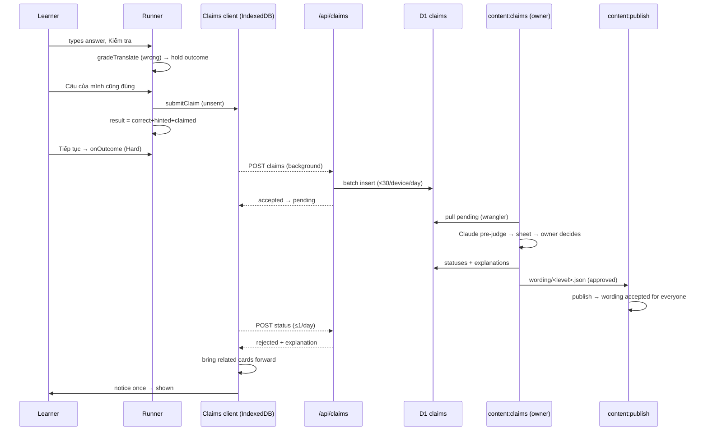

# Technical Design: Translate a sentence into English

Paths are relative to `apps/learn-english/`. `file:line` citations come from `exploration.md` (same folder).

## Scope

In scope:

- A new exercise kind `translate`: generator, grader, View, registry entry, planning in the daily lesson, Ôn tập and the library.
- Claiming a wrong answer as correct: runner support, a claim outbox and pending list in IndexedDB that backups and sync carry, a claims API over a new D1 table, and a rejected-claim notice that brings cards forward.
- A new content kind `wording` that holds owner-approved alternative wordings per sentence, published like any other kind.
- An owner script `content:claims` that pulls claims from D1, pre-judges them with Claude, writes a decision sheet, and applies the decisions (wording files + claim statuses in D1).

Out of scope: everything in the spec's Out of Scope table. No cron Worker, no owner API endpoint, no AI in `src/`.

## Research Summary

No new technology. Everything reuses what the app already has: Workers rate-limit bindings, D1 via Drizzle, `idb`, sonner/dialog, and the Anthropic SDK in scripts only (`scripts/draft-content.ts:13-14,57-61`).

## Patterns & Reuse

### Conventions to Follow

| Pattern | Project Uses | Avoid | Reference |
|---------|-------------|-------|-----------|
| Exercise module | `buildX(input)`, `gradeX(instance, answer)`, `canX(sentence)` | building to probe eligibility | src/learning/exercises/dictation.ts:48-63,192-197 |
| Route | body cap, Zod parse, rate limiter, one `db.batch()`, Vietnamese `*_MESSAGES`, `no-store` | logic in the route | src/app/api/leaderboard/route.ts:16-46 |
| Device key | SHA-256 of deviceId + day + `STATS_SALT` | storing the raw deviceId | src/server/stats/stats.service.ts:34-38 |
| Retention | bounded in-request cleanup, `LIMIT 50` | cron | src/server/leaderboard/leaderboard.service.ts:36-41 |
| IndexedDB store | `STORES` entry with `since`, bump `DB_VERSION`, writes call `notifyChanged` | keeping durable data under a `meta` key (wiped by `replaceAll`) | src/storage/db.ts:5,39-48; src/storage/replace.ts:13,32-43 |
| Snapshot list | `LearnerState` + `SnapshotData` field, version bump with a migration, `unionBy` merge | a new `Profile` key (breaks older tabs mid-sync) | src/learning/snapshot.ts:24,266-274; src/learning/merge.ts:79-92 |
| Background sender | fire-and-forget, errors swallowed, never in the answer path | awaiting the network before moving on | src/stats/stats-client.ts:56-68 |
| Owner script | `tsx scripts/x.ts`, usage header, `parseArgs`, pure helpers + I/O section, D1 via `wrangler d1 execute --json` | an owner HTTP endpoint | scripts/stats-report.ts:1-12,91-127 |
| Anthropic | `MODEL = "claude-opus-5-5"`, cached system prompt, `output_config.format` JSON schema | SDK imports in `src/` | scripts/draft-content.ts:57-61,102-111 |
| Add-on content kind | id mirrors the parent, own status, references checked at publish | appending fields to approved items | src/content/schema.ts:107-125; scripts/publish-content.ts:176-191 |

### Existing Code to Reuse

| Component | Location | How to Use |
|-----------|----------|------------|
| `normalize` | src/learning/normalize.ts:21-25 | base of the answer key (case, curly quotes, spaces) |
| `expansions` | src/learning/exercises/dictation.ts:85-95 | contraction ↔ full form when building the answer key |
| `acceptedText` | src/learning/exercises/tiles.ts:39-41 | the other accepted orders as sentences |
| `EnglishInput` | src/components/exercise/english-input.tsx:14-35 | the answer box (Telex/VNI warning included) |
| `CorrectSentence` | src/components/exercise/sentence-exercises.tsx:22-34 | result card: en, vi, play button |
| `FeedbackPanel` | src/components/exercise/feedback-panel.tsx:13-51 | wrong panel with "Đáp án" and grammar link; gains a claimed state |
| `sentenceRelated` | src/lib/session/prepare.ts:59-68 | related cards and link for the step and for the claim |
| `bringForward` | src/lib/session/record.ts:58-61 | export it; reused when a rejection arrives |
| `hashDevice` pattern | src/server/stats/stats.service.ts:35-38 | per-day device hash for the claim limit |
| `getCloudflareContext` limiter | src/server/leaderboard/secret.ts:16-27 | per-IP limiter for both claim endpoints |
| `localDate` | src/learning/attendance.ts:10 | "once per local day" polling |
| `sqliteDb()` | src/test-utils/sqlite-d1.ts:31-60 | claims service tests on real SQL |

## Data Model

### Entities

| Entity | Purpose |
|--------|---------|
| `TranslateInstance` (new) | One exercise: prompt, reference, accepted keys, item to record against |
| `TranslateAnswer` (new) | The typed text |
| `GradeResult` (extended) | Gains `claimed?` so the feedback panel can show the claimed state |
| `wording` content item (new) | Owner-approved alternative wordings of one sentence |
| `StoredClaim` (new, IndexedDB `claims` store) | A claim on the device, from unsent to shown |
| `claims` (new, D1 table) | The server queue and decisions |
| `ExerciseDescriptor` (unchanged shape) | For Ôn tập, `itemIds: [cardId, sentenceId]` |

#### TranslateInstance (new, `src/learning/exercises/translate.ts`)

- `kind` ("translate")
- `sentenceId` (string): the sentence prompted
- `cardId?` (CardItemId): set in Ôn tập; the attempt and the reschedule go to this card instead of the sentence
- `vi`, `en`, `audio` (string): from the sentence body (src/content/schema.ts:60-62)
- `accepted` (string[]): answer keys of `en`, every `acceptedText(body, order)` (src/learning/exercises/tiles.ts:39-41) and every approved wording of the sentence

#### GradeResult (src/learning/exercises/types.ts:8-19)

- `correct` (:10), `typo?` (:12), `hinted?` (:14), `expected` (:16), `explanationVi?` (:18): unchanged
- `claimed?` (boolean): new; set by the runner after a claim, read by `FeedbackPanel`. Never set by a grader

#### wording content item (new kind in `CONTENT_KINDS`, src/content/schema.ts:10)

- `id`: `wording:<sentence slug>` (mirrors the sentence, like `forms:` mirrors its word, src/content/schema.ts:107-125)
- `level`: the sentence's level (sentences have real levels, set ones included, src/content/schema.ts:127)
- `body.sentenceId` (sentence id), `body.accepted` (non-empty strings, ≥ 1)
- `status` / `reviewNotes?` (src/content/schema.ts:163-168): written `approved` by `content:claims apply`, because the owner's claim decision is the review
- Levelled: added to `LEVELLED_KINDS` (src/server/content/content.schema.ts:8-12) and fetched per level with `sentence` (src/hooks/use-content-index.ts:25-32)

#### ContentIndex (src/lib/session/content-index.ts:18-29)

- New member `wordings: ReadonlyMap<sentenceId, readonly string[]>`, filled from `wording` items in `buildContentIndex` (:33-86). Wording items are not added to `lesson.sentences`.

#### StoredClaim (new, `src/storage/claims.ts`, store `claims`, keyPath `id`, index `status`)

- `id` (string): random UUID made on the device; the only reference the server and device share
- `sentenceId` (string), `answer` (string, trimmed, as typed), `expected` (string), `vi` (string): enough to show the notice without content
- `related` (CardItemId[]): from the step's `related.cardIds` (src/components/exercise/exercise-runner.tsx:27)
- `createdAt` (number), `sentAt?` (number), `checkedAt?` (number)
- `status`: `unsent` → `pending` → `approved` | `rejected` | `dropped` → (`rejected` only) `shown`
- `explanationVi?` (string): from the owner, for the notice

#### LearnerState / SnapshotData (src/learning/snapshot.ts:32-39, 48-55)

- New member `claims: StoredClaim[]` in both. `SNAPSHOT_VERSION` 3 → 4 (:24) with a migration adding `claims: []` (:266-274). `buildSnapshot` keeps claims that aren't `approved` or `dropped`, plus `shown` ones from the last 30 days (so a second device doesn't show the notice again).
- Merge (src/learning/merge.ts:79-92): `unionBy` id, keeping the later status in the order `unsent < pending < approved | dropped < rejected < shown`.
- `replaceAll` writes the `claims` store (src/storage/replace.ts:13,32-43).

#### claims (new D1 table, `src/server/db/schema.ts`, `migrations/0004_claims.sql`)

| Column | Type | Notes |
|--------|------|-------|
| `id` | text PK | the device's UUID |
| `sentence_id` | text NOT NULL | |
| `answer` | text NOT NULL | ≤ 500 chars |
| `device_hash` | text NOT NULL | SHA-256(deviceId + day + `STATS_SALT`) |
| `day` | text NOT NULL | UTC `YYYY-MM-DD` |
| `created_at` | integer NOT NULL | |
| `status` | text NOT NULL default `pending` | `pending` / `approved` / `rejected` / `dropped` |
| `explanation_vi` | text | rejected only |
| `decided_at` | integer | |

Indexes: `(status)`, `(device_hash, day)`.

### Relationships

`wording.body.sentenceId` → sentence id (row or set-embedded, scripts/publish-content.ts:170-174). `claims.sentence_id` → sentence id (not enforced; the script drops claims whose sentence is gone). `StoredClaim.id` = `claims.id`.

### API Contracts

| Endpoint | Method | Request | Response |
|----------|--------|---------|----------|
| `/api/claims` | POST | `{ deviceId: uuid, claims: [{ id: uuid, sentenceId: "sentence:…", answer: 1..500 chars }] }` (1 to 10 claims, body ≤ 8 KB) | `200 { accepted: string[] }`; refused ids are left out. `400` / `413` / `429` with the error shape |
| `/api/claims/status` | POST | `{ ids: uuid[] }` (1 to 50) | `200 { claims: [{ id, status: "pending" \| "approved" \| "rejected" \| "dropped", explanationVi? }] }`; unknown ids left out |

Both: per-IP limiter `CLAIMS_LIMITER` (new `ratelimits` entry, namespace 1003), `Cache-Control: no-store`, Vietnamese messages. POST for the status read so ids stay out of URLs and caches.

`POST /api/claims` is one `db.batch()`: one conditional insert per claim, `INSERT OR IGNORE … SELECT … WHERE (SELECT COUNT(*) FROM claims WHERE device_hash = ? AND day = ?) < 30` (statements in a batch run in order, so each insert sees the ones before it), then `SELECT id FROM claims WHERE id IN (…) AND device_hash = ?` for the accepted ids, then the retention delete (decided more than 90 days ago, `LIMIT 50`).

### Currently Exposed Fields

| AC ID | Field | Source (file:line) | Currently Exposed? | Gap? |
|-------|-------|--------------------|--------------------|------|
| AC-001 | Vietnamese prompt | src/content/schema.ts:61 | yes | none |
| AC-003 | learner's answer | none | no | must add (View keeps it, shown on the result) |
| AC-003 | reference sentence | src/content/schema.ts:60 | yes | none |
| AC-003 | Vietnamese translation | src/content/schema.ts:61 | yes | none |
| AC-003 | play button audio | src/content/schema.ts:62 | yes | none |
| AC-003 | grammar link | src/lib/session/prepare.ts:59-68 | yes | none |
| AC-004 | approved wordings | none | no | must add (`wording` kind + index) |
| AC-009 | claim payload | none | no | must add (id, sentenceId, answer, deviceId only) |
| AC-013 | rejection explanation | none | no | must add (`claims.explanation_vi`) |
| AC-015 | answer, reference, explanation on the notice | none | no | must add (`StoredClaim`) |

## Decisions

| Decision | Rationale |
|----------|-----------|
| Kind literal `translate` | `tile-translate` is a legacy kind kept for old data (feature 015) and must not be reused |
| Answer key = `normalize` + drop punctuation + expand contractions to full forms | Covers exactly the forgiveness in decisions.md; one key function for grading, dedupe and the script's grouping, shared via `src/learning/exercises/translate.ts` |
| Approved wordings as a `wording` content kind, written `approved` by the claims script | Approved sentences can't take new fields (knowledge 008). The owner's claim decision is the review, so it needs no second pass through `content:review` |
| Runner holds the outcome of a wrong claimable answer until Continue, Claim or Exit | Recording at check time would save a wrong attempt and bring cards forward, and neither can be undone. Holding is invisible to the learner, and the lesson's resume position is saved with it on Continue |
| `Entry.claimOf?(instance, answer)` marks a kind claimable and builds the claim | Keeps the runner generic: only `translate` returns a claim; `onClaim` reaches only Views whose entry has it |
| Claim = `GradeResult { correct: true, hinted: true, claimed: true }` | `rate()` already gives Hard for hinted (src/learning/rating.ts:18); `selfMarked` would force Good |
| The runner calls `submitClaim` directly (like `playAnswerSound`) | Claims must work in library retry rounds too, where `onOutcome` isn't called |
| Ôn tập descriptor `itemIds: [cardId, sentenceId]`; `itemIdOf` returns `cardId ?? sentenceId` | The reviewed card gets rescheduled (exploration absence claim, src/lib/session/record.ts:30-33), and `prepareStep` still finds its target first |
| Words rotate `translate` in with the other review kinds when they have a translatable example; grammar alternates gap-fill and translate | "Sometimes" (AC-019) without starving the existing kinds; the example rotates with `reps` |
| Claims in their own IndexedDB store + snapshot v4 | `meta` is wiped on restore and sync (src/storage/replace.ts:13); claims must survive both and reach other devices |
| Two POST endpoints, no owner endpoint, no cron | Owner tooling already uses the logged-in wrangler (scripts/stats-report.ts:93-100); retention runs in-request like the leaderboard |
| Server limit by day-hashed device id, client limit by length | The server can't see the reference sentence, so the 3× length rule is client-side (the claim action is hidden); the server enforces the hard 500-char cap |
| Pending claims are polled at most once per local day, on app open | Cheap, and decisions are batched by the owner anyway. The last check time lives on the claims themselves (`checkedAt`), so a wiped `meta` doesn't cause extra polling |
| Bring cards forward when a rejection arrives, and show the notice until dismissed | Idempotent: `rejected` → bring forward + notice → `shown` on dismiss |
| `STEP_SECONDS.translate = 40`, `SENTENCE_RESERVE_SECONDS` 35 → 40 | Typing a whole sentence from memory is the slowest sentence task; the lesson stays within its 15 minutes |
| Claims are not stats, so `statsOptOut` doesn't block them | A claim is an explicit learner action; the payload carries nothing personal (AC-009) |

## Component Design

| Component | File | Action | Responsibility |
|-----------|------|--------|----------------|
| Translate exercise | src/learning/exercises/translate.ts (+ test) | new | `answerKey`, `canTranslate`, `buildTranslate`, `gradeTranslate`, `canClaim` (length rule) |
| Kinds | src/learning/types.ts | modify | add `translate` to `EXERCISE_KINDS` |
| GradeResult | src/learning/exercises/types.ts | modify | `claimed?` |
| View | src/components/exercise/translate-exercise.tsx | new | instruction "Dịch câu sau sang tiếng Anh", `vi`, `EnglishInput`, after the result: their answer, `CorrectSentence`, claim button "Câu của mình cũng đúng" |
| Registry | src/components/exercise/registry.tsx | modify | union, entry with `claimOf`, `itemIdOf` uses `cardId` |
| View props | src/components/exercise/types.ts | modify | `onClaim?: () => void` |
| Runner | src/components/exercise/exercise-runner.tsx (+ test) | modify | hold the wrong claimable outcome; `handleClaim` (result, score, retry list, `submitClaim`); flush on Continue and Exit |
| Feedback | src/components/exercise/feedback-panel.tsx | modify | claimed state: "Đã tính là đúng", "Câu của bạn sẽ được kiểm tra sau." |
| Prepare | src/lib/session/prepare.ts | modify | `translate` case (sentence target or `[card, sentence]`), `canPrepareSentenceStep` |
| Record | src/lib/session/record.ts | modify | export `bringForward` |
| Content index | src/lib/session/content-index.ts, src/hooks/use-content-index.ts | modify | load `wording` per level, `wordings` map |
| Planner | src/learning/lesson-plan.ts (+ test) | modify | `SENTENCE_KINDS`, `supports`, `STEP_SECONDS`, reserve, `reviewExercises` takes `exampleOf` |
| Review session | src/lib/session/review.ts | modify | pass `exampleOf` (first translatable example rotated by `reps`) |
| Library | src/components/library/exercise-sets.ts (+ test) | modify | `SENTENCE_TYPES`, `TYPE_LABELS.translate = "Dịch câu"` |
| Content schema | src/content/schema.ts, src/server/db/schema.ts, src/server/content/content.schema.ts | modify | `wording` kind, levelled |
| Claims store | src/storage/db.ts, src/storage/claims.ts (+ test), src/storage/replace.ts | new/modify | `claims` store (`DB_VERSION` 3), queries by status, `notifyChanged` |
| Snapshot | src/learning/snapshot.ts, src/learning/merge.ts (+ tests), src/components/settings/backup-actions.ts | modify | v4, migration, merge, export/restore |
| Claims client | src/claims/claims-client.ts (+ test) | new | `submitClaim` (dedupe by sentence + answer key, store, flush), `flushClaims`, `checkClaims` (daily), `dismissRejected` |
| Claims runner + notice | src/components/claims/claims-runner.tsx, claims-notice.tsx | new | run on mount and on visible; dialog "Câu bạn gửi chưa đúng" listing answer, reference, explanation; "Đã hiểu" |
| Layouts | src/app/(app)/layout.tsx | modify | mount `ClaimsRunner` (not in `(focus)`: a notice mid-lesson would interrupt; the runner sends claims at once and the next app page retries) |
| Claims API | src/app/api/claims/route.ts, src/app/api/claims/status/route.ts (+ tests) | new | parse → limiter → service |
| Claims service | src/server/claims/claims.schema.ts, claims.service.ts (+ test) | new | schemas shared with the client; batch insert, status read, retention |
| D1 | src/server/db/schema.ts, migrations/0004_claims.sql | new/modify | `claims` table via `drizzle-kit generate` |
| Bindings | wrangler.jsonc, cloudflare-env.d.ts | modify | `CLAIMS_LIMITER` (namespace 1003), `pnpm cf:typegen` |
| Claims script | scripts/claims.ts, scripts/lib/claims-sheet.ts (+ tests), package.json | new | `content:claims pull [--remote] [--no-ai]` → `content/.claims/<date>.{json,html}`; `content:claims apply <decisions.json> [--remote]` |
| Publish / review | scripts/publish-content.ts, scripts/review.ts | modify | accept `wording` (references to row or set sentences); review skips it |
| Fixtures | scripts/fixtures/content/wording/A1-claims.json | new | one approved wording for e2e |
| E2E | e2e/specs/translate.spec.ts | new | library translate: correct answer, wrong → claim → continues; approved fixture wording accepted |

## Data Flow

## Requirements Traceability

| Requirement | Component | File | Status |
|-------------|-----------|------|--------|
| AC-001 | View | src/components/exercise/translate-exercise.tsx | Done |
| AC-002 | `answerKey`, `gradeTranslate` | src/learning/exercises/translate.ts | Done |
| AC-003 answer | View | src/components/exercise/translate-exercise.tsx | Done |
| AC-003 reference, translation, play | `CorrectSentence` | src/components/exercise/sentence-exercises.tsx:22-34 | Done |
| AC-003 grammar link | `FeedbackPanel` + `sentenceRelated` | src/components/exercise/feedback-panel.tsx:37-47; src/lib/session/prepare.ts:59-68 | Done |
| AC-004 | `wording` kind, `wordings` index, `buildTranslate` | src/content/schema.ts; src/lib/session/content-index.ts; src/lib/session/prepare.ts | Done |
| AC-005 | `recordOutcome`, `itemIdOf` | src/lib/session/record.ts; src/components/exercise/registry.tsx | Done |
| AC-006 | View claim button, runner `onClaim` | translate-exercise.tsx; exercise-runner.tsx | Done |
| AC-007 | runner `handleClaim`, `submitClaim` | exercise-runner.tsx; src/claims/claims-client.ts | Done |
| AC-008 | `flushClaims` on open / visible | src/claims/claims-client.ts; claims-runner.tsx | Done |
| AC-009 | request schema | src/server/claims/claims.schema.ts | Done |
| AC-010 | `canClaim`, server cap + daily count | translate.ts; claims.service.ts | Done |
| AC-011 | `pull` (group by key, Claude verdict) | scripts/claims.ts | Done |
| AC-012 | `apply` → wording file; publish | scripts/claims.ts; scripts/publish-content.ts | Done |
| AC-013 | `apply` → status + explanation | scripts/claims.ts | Done |
| AC-014 | `pull` reads `status = 'pending'` only | scripts/claims.ts | Done |
| AC-015 | `checkClaims`, notice | claims-client.ts; claims-notice.tsx | Done |
| AC-016 | `bringForward` on rejection | src/lib/session/record.ts; claims-client.ts | Done |
| AC-017 | approved → status only | claims-client.ts | Done |
| AC-018 | `SENTENCE_KINDS` | src/learning/lesson-plan.ts | Done |
| AC-019 | `reviewExercises` `exampleOf` | src/learning/lesson-plan.ts; src/lib/session/review.ts | Done |
| AC-020 | `SENTENCE_TYPES`, label | src/components/library/exercise-sets.ts | Done |

## Test Strategy

### Infrastructure

| Aspect | Detail |
|--------|--------|
| Framework | Vitest (happy-dom, fake-indexeddb), Playwright |
| Command | `pnpm test`, `pnpm e2e` (in `apps/learn-english`) |
| Location | next to the code; `e2e/specs/` |

### Reference Tests

| File | What It Tests |
|------|---------------|
| src/learning/exercises/dictation.test.ts | typed sentence grading |
| src/components/exercise/exercise-runner.test.tsx:369 | runner per-kind describe block |
| src/lib/session/session.test.ts | prepareStep / recordOutcome on real IndexedDB |
| src/server/leaderboard/leaderboard.service.test.ts | `sqliteDb()` service tests |
| src/app/api/stats/route.test.ts | route with mocked service and env |
| src/learning/snapshot.test.ts:105,170 | snapshot migrations |
| scripts/stats-report.test.ts | script pure helpers |

### New Tests

| Component | Test File | Scenarios |
|-----------|-----------|-----------|
| translate | src/learning/exercises/translate.test.ts | key forgives case/punct/space/apostrophes/contractions and nothing else; accepted orders and wordings; `canClaim` length rule |
| runner | exercise-runner.test.tsx | wrong → no outcome until Continue; claim → one outcome correct+hinted, score counts, not retried, `submitClaim` called; exit flushes |
| prepare/record | session.test.ts | sentence and `[card, sentence]` descriptors; wordings feed `accepted`; review attempt lands on the card |
| planner | lesson-plan.test.ts | translate in rotation; Ôn tập uses it for words with examples and alternates for grammar |
| library | exercise-library.test.tsx | type listed with label |
| claims store/client | src/storage/claims.test.ts, src/claims/claims-client.test.ts | dedupe, flush marks pending/dropped, offline keeps unsent, daily check, rejection brings forward once, dismiss → shown |
| snapshot/merge | snapshot.test.ts, merge.test.ts | v3 → v4 migration, status precedence |
| API | route tests + claims.service.test.ts | validation, 30/day limit, accepted ids, status read, retention |
| script | scripts/claims.test.ts | grouping by key, dropping unknown sentences, auto-approve already-accepted, apply writes wording file + SQL |
| e2e | e2e/specs/translate.spec.ts | answer, claim, accepted fixture wording |

## Considerations

### Error Handling

- Learner side: every network call is background and silent. A failed POST leaves the claim `unsent` for the next flush; a refused claim becomes `dropped` with no notice. The status poll failing just waits for the next day.
- If the learner closes the tab on a held wrong result, the outcome is lost and the step replays on resume (lesson) or is simply not recorded (library). Acceptable, and the same as closing before checking.
- Script: `pull` writes nothing to D1. `apply` writes the wording files first, then the SQL; re-running it is safe (upsert wordings, `UPDATE … WHERE status = 'pending'`).

### Security

- AC-009: the payload is a random claim id, the sentence id, the answer and the random device id; the server stores only a day-salted hash of the device id, so devices can't be followed across days. No name, sync code or leaderboard token.
- Abuse: per-IP limiter, 30 claims per device-day, 500-char cap, 10 claims and 8 KB per request. Learner text is never shown to other learners until the owner approves it.
- The status endpoint only answers for ids the caller already knows (random UUIDs).

### Rollout

- Apply `migrations/0004_claims.sql` remotely before deploying (knowledge 007), and add the `CLAIMS_LIMITER` binding.
- Old tabs: a v4 snapshot from a new tab is unknown to an old tab's parser, as with the 013 bump (v3); the next reload fixes it. The stats API rejects an unknown `translate` count until deployed, so deploy the server with the client (same Worker).

## Open Questions

- None.
