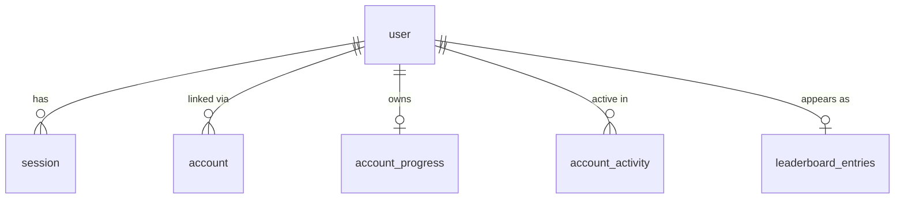

# Technical Design: Sign in with Google

Paths are relative to `apps/learn-english/` unless they start with `.artifacts/` or `.agents/`.

## Scope

**In scope:**
- Google sign-in through Better Auth on the existing Worker and D1.
- A session check in the API routes only. Pages stay prerendered static shells.
- Account-keyed progress sync that reuses the sync-code machinery.
- Moving device progress into the account at first sign-in.
- Guest gating in the UI and in the locked API routes.
- A preview of locked areas for guests.
- Sign-out and account deletion.
- Retiring sync codes, with a 7-day merge window.
- Per-account weekly usage counts in the owner's report.
- A privacy page, a one-time notice for existing learners, and copy and tour updates.

**Out of scope:**
- Other sign-in providers.
- Live cross-device push. Devices sync on open, on change and on reconnect, as today.
- Server-side merging. The server keeps an opaque blob per account, as it does per code today.
- Moving progress between two accounts.

## Research Summary

> From `.artifacts/research/learn-english-cloudflare-backend.md` (2026-10-26, within its 90-day TTL; Better Auth is now 1.7.15)

- Better Auth with only the Google provider is the recommended choice. It is stable and maintained, and Auth.js v5 is still beta and in maintenance mode. It works with D1 through `drizzleAdapter(db, { provider: "sqlite" })`, where `transaction` defaults to `false`. Its own D1 dialect throws on interactive transactions.
- Build the auth instance per request, because bindings exist only inside a request. Mount it at `/api/auth/[...all]` with `toNextJsHandler`. `nextCookies()` must be the last plugin.
- The session cookie is `better-auth.session_token` (`__Secure-` on https), httpOnly, `sameSite: lax`. `expiresIn` defaults to 7 days and `updateAge` to 1 day. The cookie cache is off by default.
- Google needs the redirect URI `{baseURL}/api/auth/callback/google`, set up with `prompt: "select_account"`. No refresh tokens are needed.
- Better Auth's env reader only looks at `process.env`. This app reads secrets from `getCloudflareContext().env` (`src/server/env.ts:15-18`), so the factory passes every value explicitly.
- Free plan limits: 10 ms CPU per request (I/O wait doesn't count), 50 D1 queries per invocation, 100 k rows written per day. Better Auth pulls in kysely, jose and zod, so its startup and per-request CPU must be measured before committing (T1).

## Patterns & Reuse

### Conventions to Follow

| Pattern | Project Uses | Avoid | Reference |
|---------|-------------|-------|-----------|
| Route handler | Thin: parse, call the service, respond. One `getDb()` per request; one D1 call or one `db.batch()` | Logic in routes; `db.transaction()` | `src/app/api/sync/route.ts:73-133`, `src/server/db/index.ts:9` |
| Error shape | `{ error: { message, issues? } }` with a Vietnamese message, built by `jsonError` | Ad hoc shapes; English messages | `src/lib/http.ts:3-5` |
| Body parsing | `parseBody(request, schema)` returning `{data} \| {response}` | Unchecked `request.json()` | `src/lib/http.ts:12-30` |
| Secrets | `getEnv()`: Zod over `getCloudflareContext().env`, cached per request; wrangler secrets, `.dev.vars` locally | `.env*` files (OpenNext inlines them); `process.env` for secrets | `src/server/env.ts:6-26` |
| Server-only modules | `import "server-only"` in services, db, env; `*.schema.ts` shared with the client without it | Importing `src/server/**` from client components | `src/server/env.ts:1`, `src/server/content/content.schema.ts:4-5` |
| Rate limits | Workers rate-limit binding keyed on `cf-connecting-ip`, failing open | Counting in D1 for bursts | `src/server/sync/throttle.ts:12-23` |
| Client data | TanStack Query over IndexedDB (`useStorageQuery`), invalidated by `notifyChanged` | Reading IndexedDB in render | `src/hooks/use-storage-query.ts:21`, `src/storage/broadcast.ts:29,46-56` |
| Empty and error states | `EmptyState` (owl mood + children), `ContentError`, `ListSkeleton` | New one-off placeholders | `src/components/shell/load-states.tsx:7,17,29-54` |
| Confirmations | `AlertDialog` with an export-first step and a destructive action | `window.confirm` | `src/components/settings/backup-panel.tsx:155-175` |
| Migrations | `drizzle-kit generate` into flat `migrations/000N_*.sql`, applied with `wrangler d1 migrations apply`; split drop+add | Mixing in `wrangler d1 migrations create` | `drizzle.config.ts:5-9`, `.agents/knowledge.md` (drizzle-kit gotcha) |
| Event handlers | Named `handleX` when the body is more than one short call | Multi-line inline handlers | `.claude/rules/learn-english/05-event-handlers.md` |

### Existing Code to Reuse

| Component | Location | How to Use |
|-----------|----------|------------|
| Snapshot build, parse and encode | `src/learning/snapshot.ts:280-294, 320-352, 376-401` | The account blob is the same gzipped base64 snapshot that sync codes store |
| Merge | `src/learning/merge.ts:89-112` | First sign-in, cross-device sync and the sync-code merge window all use `mergeSnapshots` unchanged |
| Sync orchestration | `src/sync/sync-client.ts:151-192` (`reconcile`), `:316-399` (`startAutoSync`), `:35,67-94` (fingerprint), `:36,99-105` (Web Lock) | Generalised over a "remote" (code or account): same rev-based optimistic concurrency, auto-sync loop, lock and fingerprint |
| Sync service | `src/server/sync/sync.service.ts:55-111` | Pattern for the account progress service: conditional `UPDATE … WHERE rev = ?` batched with a SELECT, 409 with the stored rev |
| Sync client errors | `src/sync/api.ts:12-33, 49, 89-106` | Same `SyncError` kinds, plus `unauthorized`; copy talks about the account instead of the code |
| Whole-state read and replace | `src/storage/replace.ts:14-47` | `readLearnerState` and `replaceAll` for the move and for sign-out |
| Device reset | `src/storage/replace.ts:50-54` | Base for `clearDevice()` on sign-out and deletion, extended to also clear the sync fingerprint |
| Summary | `src/learning/snapshot.ts:268-277` (`summarize`) | Extended with grammar and hard-word counts for the AC-014 message |
| Edge cache | `src/app/api/content/items/route.ts:19-25, 41, 66` | Kept for public kinds; skipped for locked kinds |
| Sync row test harness | `src/test-utils/sqlite-d1.ts:31-53` | Real-SQL tests for the auth, progress and report services |
| Route test pattern | `src/app/api/content/items/route.test.ts:6-10`, `src/app/api/sync/route.test.ts:17-18` | `vi.mock` of the service, `@/server/env` and `@opennextjs/cloudflare` |
| Reset confirmation | `src/components/settings/backup-panel.tsx:155-175` | Model for the "Đăng xuất" and "Xoá tài khoản" dialogs |
| Grammar topic metadata | `src/lib/topics.ts:1-2` (`content/grammar-topics.json`) | Grammar list preview for guests without the locked `grammar` kind |

## Data Model

### Entities

| Entity | Purpose |
|--------|---------|
| `user` (new, Better Auth) | One row per Google account; plus `stats_opt_out` |
| `session` (new, Better Auth) | Signed-in browser sessions; 30-day rolling expiry |
| `account` (new, Better Auth) | Google link (provider account id) per user |
| `verification` (new, Better Auth) | OAuth state for the sign-in round trip |
| `account_progress` (new) | One opaque progress snapshot per user, with a revision |
| `account_activity` (new) | One row per user per ISO week per device hash, for AC-027 |
| `Profile.account` (new, device-only) | Which account this device's progress belongs to, cached for offline |
| `sync_profiles` (existing) | Sync-code blobs; read-only for 7 days after release, then deleted |
| `leaderboard_entries` (existing) | Gains `user_id` so account deletion removes the entry |
| `claims` (existing) | Unchanged columns; the route now requires a session |

#### user / session / account / verification (Better Auth core schema, generated)

- `user`: `id`, `name`, `email`, `emailVerified`, `image`, `createdAt`, `updatedAt` (Better Auth core schema, generated by `npx auth generate` into `src/server/db/schema.ts`)
- `user.statsOptOut` (boolean, default false), added through Better Auth `user.additionalFields`
- `session`: `id`, `userId`, `token`, `expiresAt`, `ipAddress`, `userAgent`, `createdAt`, `updatedAt`
- `account`: `id`, `userId`, `accountId`, `providerId`, `accessToken`, `refreshToken`, `idToken`, `accessTokenExpiresAt`, `refreshTokenExpiresAt`, `scope`, `password`, `createdAt`, `updatedAt` (checked against `@better-auth/core` 1.7.15 `getAuthTables` in T002; hand-written in `src/server/db/schema.ts`)
- `verification`: `id`, `identifier`, `value`, `expiresAt`, `createdAt`, `updatedAt`
- Absence today: `src/server/db/schema.ts:7-104` has only `content_items`, `content_meta`, `sync_profiles`, `stats_daily`, `stats_devices`, `leaderboard_entries` and `claims`; the latest migration is `migrations/0004_claims.sql`

#### account_progress (new)

- `user_id` (text, PK, references `user.id` on delete cascade)
- `data` (blob): gzipped snapshot, the same encoding as `sync_profiles.data` (`src/server/db/schema.ts:32-39`, `src/server/sync/sync.schema.ts:35`)
- `rev` (integer), `size` (integer), `created_at`, `updated_at` (integer ms), mirroring `sync_profiles`

#### account_activity (new)

- `user_id` (text, references `user.id` on delete cascade)
- `week` (text, ISO week `YYYY-Www`)
- `device_hash` (text): SHA-256 of `deviceId + userId + STATS_SALT`. It is stable per account and device, so it can count devices, and unlike `stats_devices` (`src/server/stats/stats.service.ts:34-38`) it isn't rotated daily. It is never shown and is removed with the account
- PK (`user_id`, `week`, `device_hash`); written with `INSERT … ON CONFLICT DO NOTHING`

#### Profile (existing, `src/learning/types.ts:169-194`)

- Read and kept: `displayName`, `level`, `placement`, `vocabSet`, `statsOptOut` (`:180`), `leaderboard` (`:181-186`, `:196`), `deviceId` (`:189-190`), `sync` (`:162-167`), `fieldUpdatedAt`
- New, **device-only**: `account?: { userId: string; name: string; email: string; image: string | null; linkedAt?: number; expired?: boolean }`. It is excluded from snapshots and merges exactly like `deviceId` and `sync` (`SnapshotMeta` at `src/learning/snapshot.ts:52`, meta schema `:178-199`, `mergeProfile` at `src/learning/merge.ts:73`). Because it never enters `fieldUpdatedAt`, it avoids the gotcha where a new synced profile field breaks older tabs (`.agents/knowledge.md`, Gotchas)
- `linkedAt` is set after the first successful push to the account. A missing `linkedAt` with `account` present means the move is still pending (AC-018)
- `sync` is removed at the end of the sync-code merge window

#### sync_profiles (existing, `src/server/db/schema.ts:32-39`)

- Read by `GET /api/sync` (`src/app/api/sync/route.ts:92`) until `SYNC_CODES_UNTIL`; `POST`, `PUT` and `DELETE` are refused from release (create) or used only for the post-merge delete. The table is dropped in a follow-up migration after the window

#### leaderboard_entries (existing, `src/server/db/schema.ts:70-83`)

- New `user_id` (text, nullable, references `user.id` on delete cascade); set on submit from the session. The existing id and token pair stays (`src/lib/leaderboard-client.ts:26-29`, `src/server/leaderboard/leaderboard.service.ts:94,101`)

### Relationships



### API Contracts

| Endpoint | Method | Request | Response |
|----------|--------|---------|----------|
| `/api/auth/[...all]` (new) | GET, POST | Better Auth: `sign-in/social` `{provider: "google", callbackURL}`, `callback/google`, `get-session`, `sign-out` | Better Auth responses; session cookie |
| `/api/progress` (new) | GET | Session cookie | 200 `{rev, data, updatedAt}`; 404 when the account has no progress yet; 401 |
| `/api/progress` (new) | PUT | `{rev, data, deviceId, countMe}` (`rev` 0 creates) | 200 `{rev}`; 409 `{error, rev}`; 413; 401 |
| `/api/account` (new) | DELETE | Session cookie | 204; then the client signs out locally. Deletes `user`, which cascades to session, account, `account_progress`, `account_activity` and the `leaderboard_entries` row |
| `/api/content/items` (modify) | GET `?kind&level&v` | Session cookie for `grammar`, `writing` | Public kinds as today. Locked kinds: 401 for guests; for a session, `Cache-Control: private, max-age=86400`, no edge cache |
| `/api/leaderboard` (modify) | GET, POST, DELETE | Session cookie, plus the existing `x-board-id` or `{id, token}` | 401 without a session; POST stores `user_id` |
| `/api/claims`, `/api/claims/status` (modify) | POST | Session cookie | 401 without a session |
| `/api/sync` (modify) | POST | none | 410 from release ("Mã đồng bộ không còn được tạo mới…") |
| `/api/sync` (modify) | GET, DELETE | `x-sync-code`, session cookie | GET as today until `SYNC_CODES_UNTIL`, then 410; DELETE after the merge |
| `/api/stats` | POST | unchanged | unchanged (anonymous beacon for guests and accounts) |

### Currently Exposed Fields

| AC ID | Field | Source (file:line) | Currently Exposed? | Gap? |
|-------|-------|--------------------|--------------------|------|
| AC-002 | first name in the corner | `src/components/shell/account-link.tsx:31-38` (shows `displayName`) | no (nickname only) | must add: `account.name` first word |
| AC-002 | Google picture | `src/components/shell/account-link.tsx:50` (icon `CircleUserRound`) | no | must add: `account.image` with an initials fallback |
| AC-014 | words moved | `src/learning/snapshot.ts:268-277` (`summarize().wordsLearned`) | yes | none |
| AC-014 | streak moved | `src/learning/snapshot.ts:268-277` (`summarize().streak`) | yes | none |
| AC-014 | points moved | `src/learning/snapshot.ts:268-277` (`summarize().points`) | yes | none |
| AC-014 | grammar topics moved | none | no | must add: count of `grammar:` cards |
| AC-022 | account name | none | no | must add: `account.name` |
| AC-022 | account email | none | no | must add: `account.email` |
| AC-022 | account picture | none | no | must add: `account.image` |
| AC-024 | public name | `src/learning/leaderboard.ts:104` (`checkBoardName`), `leaderboard_entries.name` (`src/server/db/schema.ts:70-83`) | yes | none: the board keeps the chosen nickname |
| AC-027 | accounts created per week | `user.createdAt` (new) | no | must add |
| AC-027 | accounts active per week | `account_activity` (new) | no | must add |
| AC-027 | accounts back after week 1 | `account_activity` + `user.createdAt` (new) | no | must add |
| AC-027 | accounts on 2+ devices | `account_activity.device_hash` (new) | no | must add |

## Decisions

| Decision | Rationale |
|----------|-----------|
| **Session checks only in `/api/*` routes; pages stay prerendered** | Keeps the static-shell architecture (`.claude/rules/learn-english/04-architecture.md`) and the free plan: no page render reads cookies. The client asks `get-session` once per visit and caches the answer in `Profile.account` for offline use (AC-017) |
| **Better Auth, Google only, built per request from `getEnv()`** | Research recommendation. Values are passed explicitly because its env reader only sees `process.env`, which this app keeps secret-free. Fallback if T1 fails the CPU budget: `arctic` for the OAuth round trip plus our own `session` table and cookie, behind the same `getSessionUser()` seam |
| **Session: `expiresIn` 30 days, `updateAge` 1 day, cookie cache 5 minutes** | AC-004: 30 days since the last activity, renewed at most once a day. The signed cookie cache spares a D1 read on most API calls, and 5 minutes bounds how long a deleted account's cookie keeps working |
| **One `getSessionUser(request)` seam** (`src/server/auth/session.ts`) returning the user or `null`, and a `requireUser` wrapper that returns a Vietnamese 401 `jsonError` | Every locked route uses the same check, and tests mock one module. Swapping Better Auth for the fallback touches only this file and the auth route |
| **Account progress is an opaque snapshot blob per user, merged in the browser** | Reuses `mergeSnapshots`, `reconcile` and the rev protocol that already handle concurrent devices. The server never parses progress, which keeps CPU low; the 1 MiB cap (`SYNC_MAX_BYTES`, `src/server/env.ts:10`) stays |
| **Generalise `sync-client` over a `Remote` (account or code) instead of writing a second loop** | One auto-sync loop, Web Lock and fingerprint. The code remote is kept only for the 7-day merge flow, then deleted with the table |
| **First sign-in: GET the account blob; 404 → PUT local with rev 0; else merge → `replaceAll` → PUT** | Covers AC-014 and AC-015 with the existing union rules. Unions by key make a retry harmless (AC-018); `linkedAt` marks completion |
| **Snapshot trimming stays for the account blob** | `buildSnapshot` drops lessons older than 14 days and attempts beyond the last 30 days plus the latest 8 per item (`src/learning/snapshot.ts:236-253, 287-291`). Hard words read at most the last 8 attempts per word (`src/learning/hard-words.ts:11-16`) and cards, attendance and extra-lesson purchases aren't trimmed, so everything a learner sees survives. The migration test (Success Criteria) compares those learner-visible results, not raw rows |
| **Device-only `Profile.account`, never in snapshots** | Avoids the known break of older tabs when a synced profile field is added (`.agents/knowledge.md` Gotchas). Account identity comes from the session, not from progress |
| **Sign-out clears the device** (`clearDevice()` = `resetAll` + the sync fingerprint + `learn-english:backup-reminder-dismissed`) | AC-005 and the shared-device edge case. A pending unsynced change gets a last `pushNow` first; the dialog warns if that fails |
| **A different account signing in on a device whose `account` is set but expired** | The previous account's unsynced progress can't be sent without its session. Ask first ("Thiết bị này còn tiến độ chưa đồng bộ của {name}…"); continuing clears the device, so it is never merged into the wrong account |
| **Guest gating in the UI is one `<SignInGate area>` client component** over a `useAccount()` hook | Every locked leaf wraps its content the same way, and the prompt copy lives in one map keyed by area. Signed-in learners see the children; while the session is unknown, the leaf's existing skeleton shows |
| **Lock content kinds by purpose, not by page** | `grammar` and `writing` exist only for locked areas, so they need a session. `word`, `set`, `sentence`, `wording`, `placement` and `forms` feed vocabulary, placement and the verb preview and stay public; exercises built from them are locked in the UI only (spec AC-013). `forms` stays whole because the verb dialog shows its practice sentences as examples (`src/components/verbs/verb-dialog.tsx:86`), so a preview copy would hide nothing a guest can't already read (changed in T009) |
| **Locked kinds bypass the edge cache and are `private`** | The items route caches `public, immutable` at the edge keyed by URL (`src/app/api/content/items/route.ts:15,41,66`); a shared cache would hand locked bodies to guests. `private, max-age=86400` keeps the browser copy, and the version check still invalidates it |
| **Guest content loading uses a vocabulary-only index** | `useContentIndex` loads `grammar`, `forms` and `writing` for vocabulary and follow-set today (`src/hooks/use-content-index.ts:24-37`, `src/components/vocabulary/vocabulary-browser.tsx:85`, `src/components/vocabulary/use-follow-set.ts:38`). Guests would get 401s, so the index takes the session state and skips locked kinds; a missing kind yields empty arrays, not an error |
| **Grammar preview from static topic metadata** | `content/grammar-topics.json` through `src/lib/topics.ts:1-2` already carries titles and levels, so the guest list needs no locked content. In the exercise library, guests see grammar cards from the same metadata without the practice count |
| **Usage counts: `account_activity` written on progress PUT, at most one row per user, week and device** | Gives created, active, returning and multi-device counts (AC-027) with one cheap `INSERT OR IGNORE` in the same batch as the PUT. The PUT carries `countMe = !statsOptOut`; the server stores it on `user.stats_opt_out`, and the report filters on it (AC-028) |
| **Sync codes: `SYNC_CODES_UNTIL` env value (release + 7 days)** | One date gates GET (merge) and is shown in Settings. POST returns 410 from release. A follow-up task after the date drops `sync_profiles` and the route (AC-021) |
| **Privacy note as a static page `/privacy`** | Prerendered and linkable from prompts and Settings (AC-025); no request-time data |
| **No `proxy.ts`** | Nothing at the edge needs the session: pages are static and the APIs check the session themselves. Avoids a cookie check on every asset request |

## Component Design

| Component | File | Action | Responsibility |
|-----------|------|--------|----------------|
| Env | `src/server/env.ts` | modify | `SYNC_CODES_UNTIL` (optional ISO date) in `getEnv()`. The sign-in values (`BETTER_AUTH_SECRET` min 32, `BETTER_AUTH_URL`, `GOOGLE_CLIENT_ID`, `GOOGLE_CLIENT_SECRET`) are in a separate `getAuthEnv()`, so the content, stats and other routes don't fail where those secrets aren't set yet (changed in T001) |
| Wrangler and types | `wrangler.jsonc`, `cloudflare-env.d.ts`, `.dev.vars.example` | modify | `vars.BETTER_AUTH_URL`, `vars.SYNC_CODES_UNTIL`; secrets documented; `pnpm cf:typegen` |
| Auth schema | `src/server/db/schema.ts`, `migrations/0005_auth.sql` | modify / new | `user` (+ `stats_opt_out`), `session`, `account`, `verification`, `account_progress`, `account_activity`, `leaderboard_entries.user_id` |
| Auth factory | `src/server/auth/auth.ts` | new | `getAuth()` per request (`cache`): Better Auth with `drizzleAdapter(getDb(), {provider: "sqlite", schema})`, Google (`prompt: "select_account"`), session 30 d / 1 d, cookie cache 5 min, `user.additionalFields.statsOptOut`, `nextCookies()` last |
| Session seam | `src/server/auth/session.ts` | new | `getSessionUser(request)`, `requireUser(request)` → `{user} \| {response: 401}` |
| Auth route | `src/app/api/auth/[...all]/route.ts` | new | `toNextJsHandler(getAuth())` GET and POST |
| Progress service + schema | `src/server/progress/progress.service.ts`, `progress.schema.ts` | new | Get and put by `user_id` with the rev check (pattern of `sync.service.ts:88-108`); activity upsert and `stats_opt_out` update in the same batch |
| Progress route | `src/app/api/progress/route.ts` | new | GET and PUT behind `requireUser`; size cap as in sync (`route.ts:47-50`) |
| Account route | `src/app/api/account/route.ts` | new | DELETE behind `requireUser`: one batch deleting the `user` row (cascades) |
| Content items route | `src/app/api/content/items/route.ts`, `src/server/content/content.schema.ts` | modify | `LOCKED_KINDS` (`grammar`, `writing`); session check before the edge-cache lookup; `private` headers, no edge put |
| Leaderboard and claims routes | `src/app/api/leaderboard/route.ts`, `src/app/api/claims/route.ts`, `src/app/api/claims/status/route.ts`, `leaderboard.service.ts` | modify | `requireUser`; submit stores `user_id` |
| Sync route | `src/app/api/sync/route.ts` | modify | POST → 410; GET → 410 after `SYNC_CODES_UNTIL` |
| Auth client | `src/lib/auth-client.ts` | new | `createAuthClient()` from `better-auth/react`; `signInWithGoogle(callbackURL)`, `signOut()` |
| Account hook | `src/hooks/use-account.ts` | new | Query `get-session` once per visit; write and read `Profile.account`; states `unknown`, `guest`, `signed-in`, `expired`; offline uses the cached account |
| Profile type | `src/learning/types.ts`, `src/learning/snapshot.ts`, `src/learning/merge.ts` | modify | Device-only `account`; excluded from `SnapshotMeta` and merge like `deviceId` and `sync` |
| Summary | `src/learning/snapshot.ts` | modify | `summarize` adds `grammarLearned` and `hardWords` |
| Sync client | `src/sync/sync-client.ts`, `src/sync/api.ts` | modify | `Remote` interface (`get`, `put`), account remote over `/api/progress`; `linkAccount()` for the first move; `unauthorized` error marks `account.expired`; the code remote is kept only for `mergeSyncCode()` |
| Sync runner | `src/components/sync/sync-runner.tsx` | modify | Start auto-sync for the account when signed in; nothing for guests |
| Device clear | `src/storage/replace.ts` | modify | `clearDevice(now)` |
| Sign-in prompt | `src/components/account/sign-in-prompt.tsx` | new | `EmptyState` with owl, area copy, "Đăng nhập với Google" button and privacy link |
| Gate | `src/components/account/sign-in-gate.tsx` | new | `<SignInGate area>`: children for signed-in learners, the prompt for guests |
| Sign-in button | `src/components/account/sign-in-button.tsx` | new | Calls `signInWithGoogle` with the current URL (AC-012); toast on cancel (AC-003, reading `?error=` on return) |
| Corner | `src/components/shell/account-link.tsx` | modify | Guest: sign-in button. Signed in: first name and picture (initials fallback) |
| Move-on-sign-in | `src/components/account/account-linker.tsx` | new | After sign-in, runs `linkAccount()` and shows the "Đã chuyển …" toast; resolves the different-account dialog |
| Settings account card | `src/components/settings/account-card.tsx`, `src/app/(app)/settings/page.tsx` | new / modify | Name, email, picture, "Đăng xuất" and "Xoá tài khoản" dialogs (backup first); guest sign-in |
| Sync panel | `src/components/settings/sync-panel.tsx` | modify | No "Bật đồng bộ"; signed-in learners can enter a code until the date; copy for accounts |
| Backup panel | `src/components/settings/backup-panel.tsx` | modify | Copy: progress is kept in the account; export stays; import merges |
| Gated leaves | `today-lesson.tsx`, `streak-summary.tsx`, `lesson-player.tsx`, `extra-lesson-player.tsx`, `review-overview.tsx`, `review-session.tsx`, `hard-words-view.tsx`, `attendance-summary.tsx`, `progress-insights.tsx` | modify | Wrap in `<SignInGate>` (AC-010, AC-011) |
| Preview leaves | `grammar-browser.tsx`, `grammar-topic.tsx`, `exercise-library.tsx`, `verbs-browser.tsx`, `verb-dialog.tsx` | modify | Guest list or preview; opening a topic, starting a set or a drill shows the prompt (AC-009) |
| Content index | `src/hooks/use-content-index.ts` | modify | Skip locked kinds for guests |
| Hero, CTA and site copy | `home-hero.tsx`, `closing-cta.tsx`, `src/lib/site.ts` | modify | AC-011 links to sign-in for guests; AC-029 copy |
| Guest notice | `src/components/account/guest-notice.tsx`, `src/app/(app)/layout.tsx`, `src/app/(focus)/layout.tsx` | new / modify | One-time dialog (localStorage flag) when a guest device holds progress (AC-026) |
| Tour | `src/components/tour/tour-steps.ts`, `app-tour.tsx` | modify | Locked steps say they need sign-in for guests (AC-030); the prompt keeps `data-tour="lesson-card"` |
| Privacy page | `src/app/(app)/privacy/page.tsx` | new | Static Vietnamese privacy note (AC-025) |
| Usage report | `scripts/stats-report.ts` | modify | Weekly accounts created, active, returning and multi-device, filtered by `stats_opt_out` (AC-027, AC-028) |

## Data Flow

### Sign-in and first move (AC-002, AC-012, AC-014, AC-015)

```mermaid
sequenceDiagram
  participant B as Browser (static page)
  participant A as /api/auth
  participant G as Google
  participant P as /api/progress
  B->>A: sign-in/social {google, callbackURL = current page}
  A-->>B: redirect to Google
  B->>G: choose account
  G-->>A: callback/google?code
  A->>G: exchange code (I/O)
  A-->>B: Set-Cookie session, redirect to callbackURL
  B->>A: get-session
  A-->>B: {user}
  B->>B: Profile.account = user (device-only)
  B->>P: GET
  alt 404 (new account)
    B->>P: PUT {rev 0, local snapshot}
  else account has progress
    B->>B: mergeSnapshots(local, remote) → replaceAll
    B->>P: PUT {rev, merged}
  end
  P-->>B: {rev}
  B->>B: account.linkedAt = now; toast "Đã chuyển …"
```

### Guest gating

1. A static page renders. `useAccount()` resolves `guest` (no session, no cached account) or `signed-in`.
2. Locked leaves render `<SignInGate area>`: the prompt for guests, children for learners. Preview leaves render their list and intercept "open" actions.
3. Locked API calls from a guest get 401 with a Vietnamese message. The UI never issues them for guests.

### Session expiry (AC-006)

1. A progress PUT returns 401.
2. The sync client marks `account.expired` and stops the loop. Local writes continue.
3. The corner and Settings ask the learner to sign in again.
4. If the same `userId` signs back in, sync resumes and pushes. A different user gets the confirm-and-clear dialog.

## Requirements Traceability

| Requirement | Component | File | Status |
|-------------|-----------|------|--------|
| AC-001 | Corner sign-in button; Settings account card | `src/components/shell/account-link.tsx`, `src/components/settings/account-card.tsx` | Planned |
| AC-002 | Sign-in round trip back to the current page | `src/components/account/sign-in-button.tsx`, `src/app/api/auth/[...all]/route.ts` | Planned |
| AC-002 (first name) | Corner shows `account.name` first word | `src/components/shell/account-link.tsx` | Planned |
| AC-002 (picture) | Corner shows `account.image` or initials | `src/components/shell/account-link.tsx` | Planned |
| AC-003 | Cancel toast, guest unchanged | `src/components/account/sign-in-button.tsx` | Planned |
| AC-004 | 30-day rolling session | `src/server/auth/auth.ts` | Planned |
| AC-005 | Sign-out dialog, last push, `clearDevice` | `src/components/settings/account-card.tsx`, `src/storage/replace.ts` | Planned |
| AC-006 | 401 → expired, keep local, resume | `src/sync/sync-client.ts`, `src/hooks/use-account.ts` | Planned |
| AC-007 | Vocabulary unchanged for guests, guest index | `src/hooks/use-content-index.ts` | Planned |
| AC-008 | Placement unchanged | `src/components/placement/placement-test.tsx` (no change) | Planned |
| AC-009 | Grammar, exercises and verbs previews | `grammar-browser.tsx`, `exercise-library.tsx`, `verbs-browser.tsx`, `verb-dialog.tsx` | Planned |
| AC-010 | Gated lesson, extra lesson, review, review session, hard words, profile | `sign-in-gate.tsx` + the leaves listed in Component Design | Planned |
| AC-011 | Home lesson card and streak gated; "Vào bài hôm nay" to sign-in | `today-lesson.tsx`, `streak-summary.tsx`, `home-hero.tsx`, `closing-cta.tsx` | Planned |
| AC-012 | `callbackURL` = the attempted URL | `src/components/account/sign-in-button.tsx` | Planned |
| AC-013 | 401 on locked kinds, leaderboard, claims, progress | `src/server/auth/session.ts`, items, leaderboard, claims and progress routes | Planned |
| AC-014 | First move and summary toast | `src/components/account/account-linker.tsx`, `src/sync/sync-client.ts`, `src/learning/snapshot.ts` | Planned |
| AC-014 (words, streak, points) | `summarize()` | `src/learning/snapshot.ts:268-277` | Planned |
| AC-014 (grammar) | `summarize().grammarLearned` | `src/learning/snapshot.ts` | Planned |
| AC-015 | `mergeSnapshots` | `src/learning/merge.ts:89-112` (no change) | Planned |
| AC-016 | Auto-sync on open, change and reconnect | `src/sync/sync-client.ts:316-399` | Planned |
| AC-017 | Offline: cached account, queued push | `src/hooks/use-account.ts`, `src/sync/sync-client.ts:382` | Planned |
| AC-018 | Retry until `linkedAt`; union merge idempotent | `src/sync/sync-client.ts` | Planned |
| AC-019 | POST /api/sync 410; panel copy | `src/app/api/sync/route.ts`, `src/components/settings/sync-panel.tsx` | Planned |
| AC-020 | `mergeSyncCode()` until the date | `src/sync/sync-client.ts`, `sync-panel.tsx` | Planned |
| AC-021 | GET 410 after the date; follow-up drop migration | `src/app/api/sync/route.ts`, `migrations/0006_drop_sync.sql` (follow-up) | Planned |
| AC-022 (name) | Account card | `src/components/settings/account-card.tsx` | Planned |
| AC-022 (email) | Account card | `src/components/settings/account-card.tsx` | Planned |
| AC-022 (picture) | Account card | `src/components/settings/account-card.tsx` | Planned |
| AC-023 | Delete dialog, export first, DELETE /api/account, `clearDevice` | `account-card.tsx`, `src/app/api/account/route.ts` | Planned |
| AC-024 | Board keeps the nickname | `src/learning/leaderboard.ts:104` (no change) | Planned |
| AC-025 | Privacy page and links | `src/app/(app)/privacy/page.tsx`, `sign-in-prompt.tsx`, `account-card.tsx` | Planned |
| AC-026 | One-time guest notice | `src/components/account/guest-notice.tsx` | Planned |
| AC-027 (created) | Report query on `user.created_at` | `scripts/stats-report.ts` | Planned |
| AC-027 (active) | Report query on `account_activity` | `scripts/stats-report.ts` | Planned |
| AC-027 (returning) | Report query: active in a week after the week of `created_at` | `scripts/stats-report.ts` | Planned |
| AC-027 (multi-device) | Report query: ≥2 `device_hash` in the week | `scripts/stats-report.ts` | Planned |
| AC-028 | `countMe` → `user.stats_opt_out`; report filters | `progress.service.ts`, `scripts/stats-report.ts` | Planned |
| AC-029 | Copy without "Không cần tài khoản" | `home-hero.tsx`, `closing-cta.tsx`, `src/lib/site.ts`, `sync-panel.tsx`, `backup-panel.tsx` | Planned |
| AC-030 | Tour copy for locked steps | `src/components/tour/tour-steps.ts` | Planned |

## Test Strategy

### Infrastructure

| Aspect | Detail |
|--------|--------|
| Framework | Vitest 4 (happy-dom, `fake-indexeddb/auto`), Playwright for e2e |
| Command | `pnpm --filter learn-english test`, `pnpm --filter learn-english e2e` |
| Location | `src/**/*.test.{ts,tsx}` next to the code, `scripts/**/*.test.ts`, `e2e/specs/*.spec.ts` |

### Reference Tests

| File | What It Tests |
|------|---------------|
| `src/app/api/sync/route.test.ts` | Route test with mocked env and Cloudflare context, status codes |
| `src/server/leaderboard/leaderboard.service.test.ts` | Real SQL through `sqliteDb()` with migrations applied |
| `src/learning/merge.test.ts` | Merge rules per store |
| `src/components/settings/sync-panel.test.tsx` | Settings flows with dialogs and toasts |
| `e2e/specs/sync.spec.ts` | Two-device flow against the preview build |

### New Tests

| Component | Test File | Scenarios |
|-----------|-----------|-----------|
| Session seam | `src/server/auth/session.test.ts` | No cookie → null; valid → user; `requireUser` gives a Vietnamese 401 |
| Progress service | `src/server/progress/progress.service.test.ts` | Create at rev 0, conflict 409 with rev, activity row once per week and device, opt-out stored, cascade on user delete |
| Progress route | `src/app/api/progress/route.test.ts` | 401 guest, 413 size, 200 and 409 |
| Content items route | `src/app/api/content/items/route.test.ts` | Locked kinds 401 for guests; `private` and no edge read or put with a session; public kinds unchanged |
| Leaderboard, claims and sync routes | existing route tests | 401 without a session; sync POST 410; GET 410 after the date |
| Account route | `src/app/api/account/route.test.ts` | Deletes the user and the cascade rows |
| Sync client | `src/sync/sync-client.test.ts` | First move (404 → PUT rev 0), merge path, retry after a failure without duplicates, 401 → expired, code merge before and after the date |
| Device clear | `src/storage/replace.test.ts` | Clears learner stores, meta and the fingerprint key; keeps the content cache |
| Summary | `src/learning/snapshot.test.ts` | `grammarLearned` and `hardWords` counts |
| Gate and prompt | `src/components/account/sign-in-gate.test.tsx` | Guest prompt per area; children when signed in; skeleton while unknown |
| Previews | `grammar-browser.test.tsx`, `exercise-library.test.tsx`, `verbs-browser.test.tsx` | Guest list renders; open, start and drill show the prompt; signed-in path unchanged |
| Home | `src/app/(app)/page.test.tsx` | Guest prompt in place of the lesson; new copy |
| Account card | `src/components/settings/account-card.test.tsx` | Sign-out dialog, delete dialog with export first |
| Report | `scripts/stats-report.test.ts` | Weekly created, active, returning and multi-device counts; opt-out excluded |
| E2E | `e2e/specs/sign-in.spec.ts` + helper | Guest limits; signed-in flows through a test-only session fixture (see Open Questions) |
| Migration check | `src/sync/account-move.test.ts` | A pre-feature fixture state moved, then read back on an empty device: cards, attendance, points, streak and hard words are identical |

## Considerations

### Error Handling

- Every new route returns `{ error: { message } }` in Vietnamese through `jsonError` (`src/lib/http.ts:5`): 401 "Bạn cần đăng nhập để tiếp tục.", 409 with `rev`, 413, 410 for sync codes.
- The sync client maps 401 to a new `unauthorized` `SyncError` kind, which isn't transient, so it stops the loop and marks the account as expired. Other kinds keep the existing back-off (`src/sync/api.ts:49`).
- A Google failure or cancel returns to the callback URL with `?error=`. The sign-in button shows a toast and strips the parameter (AC-003). Guest access is unaffected.
- When D1's free daily caps run out, queries error until 00:00 UTC. Locked routes return 503 with the existing "try again" message, and progress stays on the device.
- If IndexedDB is unavailable, `getDb()` falls back to memory (`src/storage/db.ts:187-253`). Signed-in learners still load the account blob, and `StorageBanner` explains that the device can't keep progress offline.

### Security

- The session cookie is httpOnly, `__Secure-`, `sameSite: lax`. Better Auth checks the OAuth state (`verification`). No tokens are stored in localStorage; `Profile.account` holds only display data.
- `BETTER_AUTH_SECRET`, `GOOGLE_CLIENT_SECRET` and `GOOGLE_CLIENT_ID` are wrangler secrets, never `.env*`. Locally they live in `.dev.vars`.
- Locked content is never stored in a shared cache: no edge put, `Cache-Control: private`. `Vary: Cookie` isn't relied on.
- Account deletion cascades in one statement. The 5-minute cookie cache can keep a deleted account's session for up to 5 minutes; the DELETE also signs out the current device.
- Public surfaces show only the nickname (AC-024). `device_hash` in `account_activity` is salted and is removed with the account.
- Rate limits: the auth routes get a limiter binding (`AUTH_LIMITER`, 20 per 60 s per IP) on `sign-in/social` and `callback`, against abuse of the Google round trip.

### Hosting budget (Goal: free plan)

- **T1 spike** measures CPU for `callback/google`, `get-session` (with and without the cookie cache) and the progress PUT on the deployed Worker, using `wrangler tail` CPU time and the dashboard. Budget: under 10 ms at p99.
- If Better Auth exceeds the budget, switch to the `arctic` fallback behind `session.ts`. If that also fails, the decision goes to the owner: Workers Paid at $5/month.
- D1 per signed-in visit: about 1 session read (often skipped by the cookie cache), 1 progress GET, 1 PUT batch per minute of activity. Well inside 5 M reads and 100 k writes per day.

### Rollout

- Apply migration 0005 with `--remote` before deploying (`.agents/knowledge.md` Gotchas).
- Set the secrets and `SYNC_CODES_UNTIL` = release date + 7 days.
- Register the Google OAuth client. Redirect URIs: `https://english.huyle.work/api/auth/callback/google`, `http://localhost:3002/api/auth/callback/google`, `http://localhost:3102/api/auth/callback/google` (e2e preview).
- After the 7-day window: migration 0006 drops `sync_profiles`, and the sync route, the code remote and the sync-code UI go.

## Open Questions

- [ ] E2E sign-in: Google can't be automated. Proposal: a test-only route, enabled only when `E2E_AUTH=1` is set in the preview's `.dev.vars` (never in production), that creates a user and session through Better Auth's internal API. Confirm during T1 that this is possible without exposing it in the production bundle
- [ ] Better Auth's `npx auth generate` needs an importable config; with a per-request factory it may not find a static export (research Uncertainties). Fallback: hand-write the Drizzle tables from the documented core schema and check them against the generator's output in T2
