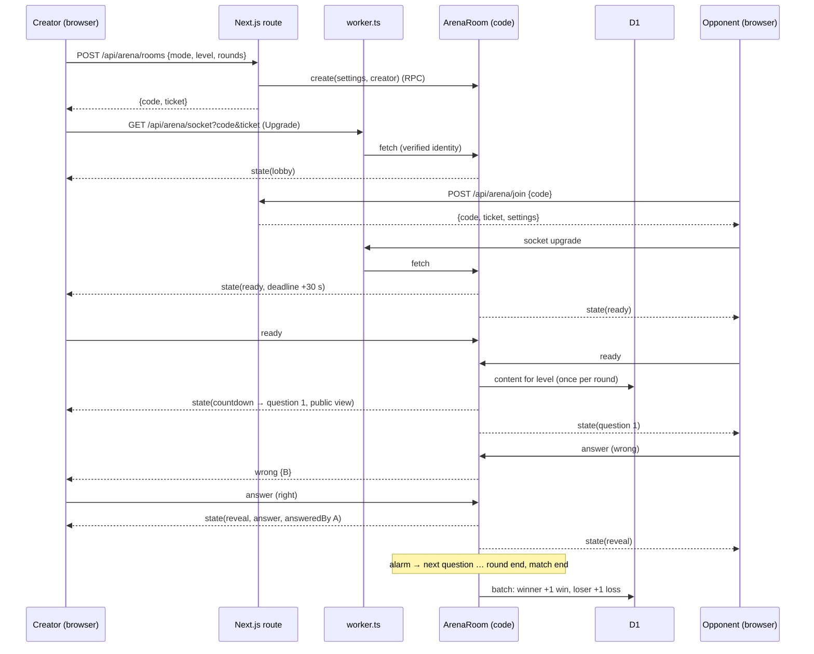

# Technical Design: Arena (1-on-1 duels)

Paths are relative to `apps/learn-english/` unless they start with `apps/` or `.artifacts/`.

## Scope

**In scope:** live 1-on-1 rooms (create, join by code or invite link, QR), the Ready window, rounds of 12 timed questions in three types, first-correct scoring, reveals, sudden death, best of 1 or 3, disconnect pause and forfeit, rematch, win/loss stats in D1 shown on Hồ sơ, "Đấu trường" in the menus and the tour, and an e2e way to sign in two players.

**Out of scope:** group rooms, matchmaking, spectators, match review, any effect on points, streak, leaderboard or Ôn tập (spec Out of Scope). The room protocol keeps a player list rather than two fixed seats so group rooms can reuse it, but nothing else is built for them.

## Research Summary

> From `.artifacts/research/learn-english-realtime-arena.md`

- Durable Objects run on Workers Free (SQLite backend only): 100,000 requests, 100,000 rows written and 13,000 GB-s per day. Incoming WebSocket messages bill at 20:1; alarms count as requests and each `setAlarm()` as a row written. Budget is about 400 best-of-3 duels a day, bounded by rows written.
- With the hibernation API (`ctx.acceptWebSocket`, `webSocketMessage`, `webSocketClose`), idle rooms leave memory while sockets stay open; in-memory state is lost and the constructor runs again. `setTimeout` prevents hibernation, so every deadline is an alarm (one per object; a new one replaces the old).
- OpenNext supports a custom worker entry (`main` → own file that imports `.open-next/worker.js` and exports extra classes). Multi-worker is possible but loses the standard deploy and preview URLs.
- Unverified: exporting our own DO class from the custom entry through `opennextjs-cloudflare build/preview/deploy`. Task T001 is a spike that proves it before anything else.

## Patterns & Reuse

### Conventions to Follow

| Pattern | Project Uses | Avoid | Reference |
|---------|-------------|-------|-----------|
| Layers | Pure rules in `src/learning/**`, services in `src/server/{domain}/*.service.ts` with `import "server-only"`, thin routes | Game rules inside the Durable Object class or React | `.claude/rules/learn-english/04-architecture.md` |
| Route shape | `requireUser`, own `readBody` with a byte cap, per-IP limiter, then a service; `NO_STORE` responses | `parseBody` (defined but unused by routes) | src/app/api/leaderboard/route.ts:45, 64, 82, 112; src/lib/http.ts:12 |
| Errors | `jsonError(message, status)` with a Vietnamese message | English messages to the learner | src/lib/http.ts:5 |
| Limiter | `env.X_LIMITER?.limit({ key: cf-connecting-ip })`, missing binding means no throttle | Throwing when the binding is absent | src/server/leaderboard/secret.ts:16-27 |
| DB in services | `db.batch([...])` for multi-statement writes; `getDb()` per request | `getDb()` at module scope, or inside the Durable Object (no Next.js context there) | src/server/db/index.ts:9-11; src/server/leaderboard/leaderboard.service.ts:102 |
| Locked areas | `<SignInGate area=…>` in the page; copy in `COPY` keyed by `LockedArea` | A `locked` flag on nav items | src/components/account/sign-in-gate.tsx:7-26; src/components/account/sign-in-prompt.tsx:7-17 |
| Routes | Query params, not dynamic segments (`/arena/room?code=K7P2QX`) | `/arena/[code]` | `.claude/rules/learn-english/04-architecture.md` |
| Client fetch | Plain `fetch` per client module with an error mapper | A new shared fetch layer | src/lib/leaderboard-client.ts:31-43 |
| Inline handlers | Named `handleX` for anything beyond one short call | Multi-line inline handlers | `.claude/rules/learn-english/05-event-handlers.md` |

### Existing Code to Reuse

| Component | Location | How to Use |
|-----------|----------|------------|
| `buildListeningChoice`, `gradeListeningChoice` | src/learning/exercises/listening.ts:39-78, 94 | "Nghe và chọn từ" questions; 4 options, lookalike distractors, seeded |
| `buildRecall`, `gradeRecall` | src/learning/exercises/recall.ts:20, 52-63 | "Nhớ lại từ"; `typo: true` counts as correct, as in solo play |
| `buildTranslate`, `gradeTranslate`, `canTranslate` | src/learning/exercises/translate.ts:83, 87-104 | "Viết câu" with the level's wordings |
| `createRng`, `shuffle`, `pick` | src/learning/exercises/random.ts:7-28 | Seeded question selection, one seed per round |
| `contentItemSchema` | src/content/schema.ts:159-170 | Parse rows the room reads from `content_items` |
| `audioUrl` | src/components/exercise/audio-button.tsx:12-20 | Play the listening clip from its key |
| `requireUser`, `SessionUser` | src/server/auth/session.ts:6-11, 28 | Signed-in check before a ticket is issued |
| `SignInGate`, `useAccount` | src/components/account/sign-in-gate.tsx:21; src/hooks/use-account.ts:53 | Lock the page; know who "me" is |
| `PageHero`, `EmptyState`, owl moods | src/components/mascot/owl.tsx; existing page heroes | Arena page header, empty stats invite |
| `sqliteDb()` | src/test-utils/sqlite-d1.ts:31-53 | Service tests with real SQL |

## Data Model

### Entities

| Entity | Purpose |
|--------|---------|
| `user` (existing) | Player identity: name and avatar shown in the room |
| `content_items` (existing) | Words, sentences and wordings the room builds questions from |
| `arena_stats` (new D1 table) | Wins, losses, current and best win streak per user |
| Room state (new, Durable Object storage) | Everything a live room needs to survive hibernation |
| Ticket (new, signed token) | Proof from a signed-in route that a user may open a socket to a room |

#### user

- `id` (text PK), `name` (text, not null), `image` (text, nullable) -- src/server/db/schema.ts:112-121
- Read through `requireUser` → `SessionUser { id, name, email, image }` -- src/server/auth/session.ts:6-11

#### content_items

- `id`, `kind`, `level`, `topic`, `sort`, `body` (json), `deleted` -- src/server/db/schema.ts:7-20
- Bodies read: `wordBodySchema` (`headword`, `variants`, `pos`, `ipa`, `meaningsVi`, `audio`) -- src/content/schema.ts:21-33; `sentenceBodySchema` (`en`, `vi`, `audio`, `tokens`, `acceptedOrders`, `wordIds`) -- schema.ts:58-85; `wordingBodySchema` (`sentenceId`, `accepted`) -- schema.ts:131-134

#### arena_stats (new, `src/server/db/schema.ts`, migration `0006_arena.sql`)

- `user_id` (text PK, FK → `user.id` ON DELETE CASCADE, written by hand in the SQL: drizzle-kit drops it, knowledge.md gotcha 022)
- `wins`, `losses` (integer, default 0)
- `streak` (integer, current win streak), `best_streak` (integer)
- `updated_at` (integer ms)

#### Room state (Durable Object storage, one key `room`)

- `code`, `settings { mode: "listen" | "recall" | "write" | "mixed", level, rounds: 1 | 3 }`, `creatorId`
- `players: { id, name, image, connected, ready, roundsWon, score }[]` (max 2 in v1)
- `phase: "lobby" | "ready" | "countdown" | "question" | "reveal" | "round-end" | "paused" | "match-end" | "closed"`
- `round`, `questionIndex`, `suddenDeath` (0 to 3), `seed`
- `questions: ServerQuestion[]` for the current round (with answer keys); `answeredBy`, `lockedOut: string[]` (wrong pick in choice), `answerTimes` per player (for the unresolved sudden-death rule)
- `deadline` (epoch ms of the next alarm), `pausedFor` (user id) and `resumePhase`
- `rematch: string[]` (players who asked)

Per-socket attachment: `{ userId }` (`serializeAttachment`, under 16 KiB).

#### Ticket

- `{ uid, name, image, code, exp }`, base64url JSON + HMAC-SHA256 with `ARENA_SECRET`, valid 60 s.

### Relationships

`arena_stats.user_id` → `user.id` (1:1, cascade on account delete, like `account_progress` -- src/server/db/schema.ts:177-186). A room references users only by id inside its own storage; nothing in D1 points at a room.

### API Contracts

| Endpoint | Method | Request | Response |
|----------|--------|---------|----------|
| `/api/arena/rooms` | POST | `{ mode, level, rounds }` | 201 `{ code, ticket }`; 401/503 sign-in; 422 invalid; 429 throttled |
| `/api/arena/join` | POST | `{ code }` | 200 `{ code, ticket, settings }`; 404 "Không tìm thấy phòng"; 409 full or started; 403 own room as second player is allowed only for the creator's reconnect |
| `/api/arena/stats` | GET | none | 200 `{ wins, losses, streak, bestStreak }` (zeros when no row) |
| `/api/arena/socket?code=&ticket=` | GET + `Upgrade: websocket` | handled by the custom worker, never by Next.js | 101 socket; 401 bad or expired ticket; 404 unknown room |

**Socket messages** (Zod in `src/learning/arena/protocol.ts`, JSON text frames):

Client → room: `ready`, `start` (creator, after the window closed), `answer { q, text }` (typed), `choose { q, choice }` (0 to 3), `typing { q }` (once per question), `rematch`, `leave`. Any other field, including an identity, is stripped.

Room → client: `state { room: PublicRoom, serverNow }` (full snapshot on join, reconnect and every change of phase or score; a point shows as `reveal.answeredBy`, so there is no separate `scored` frame), `typing { userId }`, `wrong { userId }`, `error { message }` (Vietnamese). Close codes: 4000 room closed, 4001 replaced by a newer tab, 1009 frame too big.

`PublicRoom` carries players, phase, round, scores, `deadline`, `lockedOut`, round results, and the current question's public view only: listening `{ audio, options }`; recall `{ meaningsVi, pos, mask }` (`mask` is the headword with letters as `_`, for the letter slots; no headword, no audio before the reveal: the clip says the word); write `{ vi }`. In `reveal` it adds `answer` (headword or English sentence), `answerIndex` for listening, `ipa` and `audio` for words, and `answeredBy`.

### Currently Exposed Fields

| AC ID | Field | Source (file:line) | Currently Exposed? | Gap? |
|-------|-------|--------------------|--------------------|------|
| AC-004 | player name | src/server/db/schema.ts:112-121 (`user.name`); session.ts:6-11 | yes, via `requireUser` | must map into the ticket and `PublicRoom.players` |
| AC-004 | player avatar | schema.ts:112-121 (`user.image`, nullable) | yes | must map; fallback initials when null |
| AC-030 | wins | none | no | must add (`arena_stats.wins`) |
| AC-030 | losses | none | no | must add (`arena_stats.losses`) |
| AC-030 | longest win streak | none | no | must add (`arena_stats.best_streak`, with `streak` to compute it) |

## Decisions

| Decision | Rationale |
|----------|-----------|
| One Worker: custom entry `worker.ts` routes `/api/arena/socket` upgrades to an `ArenaRoom` Durable Object and everything else to OpenNext | Keeps `opennextjs-cloudflare deploy`, preview and the single domain; multi-worker loses them (research) |
| A pure state machine `src/learning/arena/machine.ts` (`reduce(state, event, now) → { state, send[], alarmAt }`), wrapped by a thin `ArenaRoom` class | Rules are unit-testable without Workers APIs and follow the layer rules; the class only persists, broadcasts and sets the alarm |
| Every deadline is the room's single alarm (`deadline` in state); `alarm()` dispatches a `tick` event; handlers check phase and deadline first | `setTimeout` blocks hibernation and bills duration; alarms can retry, so ticks must be idempotent |
| "First" is processing order in the room; answers arriving after `deadline` are ignored even if the alarm is late | The object handles one event at a time (spec AC-016, edge cases); alarm precision is undocumented |
| Sign-in reaches the socket as a 60 s HMAC ticket from a signed-in route, not by running Better Auth in the worker | `getAuth()` needs the Next.js request context (src/server/db/index.ts:9-11); one auth seam stays in `session.ts` |
| Rooms read content straight from D1 (`kind IN ('word','sentence','wording') AND level = ?`) with Drizzle on `this.env.DB`, once per match: when the countdown ends (`needsPool`) the machine builds every round's 12 questions plus 3 sudden-death ones and keeps them in the room state | No Next.js context in the object. A hibernating room loses its memory, so loading per question or per round would re-read the level (about 3,000 rows) after every wake; once per match keeps a duel near 3,000 rows read |
| Stats are written by the room at match end in one `db.batch` through `recordResult(db, winnerId, loserId)` in `arena.service.ts`, which takes `db` as a parameter | Same service from routes (tests) and the object; batch keeps both rows consistent |
| Room code: 6 characters from `ABCDEFGHJKMNPQRSTUVWXYZ23456789`; the object named by the code is claimed through an RPC `create(settings, creator)` that fails if already used; the route retries up to 5 times | No D1 table for codes; 31^6 ≈ 887 million codes |
| Mid-match, leaving on purpose (`leave`) is an immediate forfeit; a drop pauses the match for 30 s. On return an interrupted question restarts with full time, and a countdown, reveal or round result runs again | Quitting must not dodge a loss (decisions.md, Disconnects) |
| Lobby disconnects get the same 30 s grace as in-match ones before counting as leaving | Phones drop sockets when an app is backgrounded for a moment (tentative, decisions.md) |
| Client clock: every `state` carries `serverNow`; the client keeps `offset = serverNow - Date.now()` and draws countdowns from `deadline - (Date.now() + offset)` | Both screens show the same countdown (AC-007, AC-012) |
| Which items a type can ask: "Nghe" only words with a clip; "Nhớ từ" every word with a meaning; "Viết câu" only translatable sentences of at most 12 tokens (`MAX_WRITE_TOKENS`). A mode is offered when each of its types has a round plus sudden death: 15 items, or 5 each in "Hỗn hợp" (`availableModes`) | A 30 s question must be typeable; a listening question needs its clip |
| Within a round an item is asked once, even across types (a word is never both heard and recalled); items asked earlier in the match come last and are reused only when a type runs out | Fair, varied rounds on small levels |
| Recall typos (`typo: true`) count as correct | Same as solo play; a race shouldn't punish a one-letter slip on long words |
| Message limits per socket: at most 5 `answer` per second (extra dropped), one `typing` per question, frames over 2 KB closed with 1009 | Edge case on flooding; keeps billed requests low |
| Second tab: a new socket for a user closes the older one with code 4001 ("Phòng đã mở ở tab khác") | Edge case; the newest tab wins |
| QR code rendered client-side as SVG with the `qrcode` package (exact version pinned in the app's `package.json`, not the catalog) | Small, MIT, no network; only one app uses it (knowledge.md gotcha on `pnpm add` and the catalog) |
| New secret `ARENA_SECRET` (min 32 chars) in `getAuthEnv()`-style parsing in `src/server/env.ts`, plus `.dev.vars` | Separate from `BETTER_AUTH_SECRET` so rotating one doesn't sign out or break the other |
| E2E sign-in: a test-only helper inserts a `user` and `session` row into the e2e D1 and sets Better Auth's signed session cookie, using the e2e `.dev.vars` secret | The Arena needs two signed-in players; e2e has no sign-in today (e2e/helpers.ts:4-36). Cookie format to be confirmed in T001 |

## Component Design

| Component | File | Action | Responsibility |
|-----------|------|--------|----------------|
| Custom worker entry | `worker.ts` | new | Route socket upgrades (verify ticket, forward to `ARENA_ROOM.getByName(code)`), else `handler.fetch`; `export { ArenaRoom }` |
| Wrangler config | `wrangler.jsonc` | modify | `main: "worker.ts"`; `durable_objects.bindings [{ name: "ARENA_ROOM", class_name: "ArenaRoom" }]`; `migrations [{ tag: "v1", new_sqlite_classes: ["ArenaRoom"] }]`; `ARENA_LIMITER` ratelimit |
| Env types | `cloudflare-env.d.ts` | regenerate | `pnpm cf:typegen` |
| Arena protocol | `src/learning/arena/protocol.ts` | new | Zod schemas and types for socket messages, settings, `PublicRoom` |
| Questions | `src/learning/arena/questions.ts` | new | `buildRound(pool, settings, seed) → ServerQuestion[]` (12, or 1 for sudden death); `publicView(q)`; `grade(q, answer)` delegating to the exercise graders; which modes a level can offer |
| State machine | `src/learning/arena/machine.ts` | new | Phases, events (`join`, `disconnect`, `ready`, `start`, `answer`, `typing`, `tick`, `rematch`, `leave`), timings constants (30 s ready, 3 s countdown, 15/15/30 s questions, 3 s reveal, 5 s round result, 30 s grace, 10 min idle), scoring, ties, forfeits |
| Room object | `src/server/arena/room.ts` | new | `ArenaRoom extends DurableObject`: `create()` RPC, `fetch()` accepts sockets with hibernation, `webSocketMessage/Close`, `alarm()`; loads and saves `room`, sends messages, sets the alarm, loads content, records stats |
| Tickets | `src/server/arena/ticket.ts` | new | `signTicket`, `verifyTicket` (Web Crypto HMAC) |
| Arena service | `src/server/arena/arena.service.ts` | new | `createRoom` (codes + RPC + retry), `joinRoom` (room status RPC), `recordResult(db, …)`, `getStats(db, userId)` |
| Arena schemas | `src/server/arena/arena.schema.ts` | new | Request/response Zod for the three routes |
| Content loader | `src/server/arena/content.ts` | new | One D1 query for a level's words, sentences and wordings, parsed with `contentItemSchema` |
| Routes | `src/app/api/arena/rooms/route.ts`, `join/route.ts`, `stats/route.ts` | new | Thin: `requireUser`, `readBody`, limiter, service |
| Env | `src/server/env.ts` | modify | `ARENA_SECRET` |
| DB schema + migration | `src/server/db/schema.ts`, `migrations/0006_arena.sql` | modify / new | `arena_stats` with a hand-written cascade |
| Arena hub page | `src/app/(app)/arena/page.tsx` | new | Static shell in the app layout: `PageHero`, `<SignInGate area="arena">`, `ArenaHub` (create, join, own stats); metadata via `pageMetadata` |
| Room page | `src/app/(focus)/arena/room/page.tsx` | new | Static shell in the focus layout (no menu), `?code=`: lobby, duel and results full screen; `index: false` |
| Arena client | `src/lib/arena-client.ts` | new | `createRoom`, `joinRoom`, `fetchArenaStats` with Vietnamese error mapping |
| Room hook | `src/components/arena/use-arena-room.ts` | new | Socket lifecycle, reconnect with backoff, clock offset, state from `state` frames, actions |
| Screens | `src/components/arena/{arena-hub,create-room,join-room,room-screen,lobby,invite-panel,scoreboard,timer-bar,duel,question-listen,question-recall,question-write,letter-slots,answer-reveal,opponent-status,round-result,match-result}.tsx` | new | See UI & Experience Direction |
| Game pieces | `src/components/arena/tile.tsx` | new | `cva` tile (`face`, `state`, `size`) for code letters, options, letter slots and reveals; composes theme tokens, never edits `components/ui/` |
| Arena tokens | `src/app/globals.css` | modify | `--arena-rival` (per accent, light and dark), `--arena-gold`; `tile-flip`, `tile-shake`, `score-pop` keyframes, all off under `prefers-reduced-motion` |
| Locked area copy | `src/components/account/sign-in-prompt.tsx` | modify | `LockedArea` gets `"arena"` and its `COPY` entry |
| Navigation | `src/components/shell/nav.ts` | modify | `{ href: "/arena", label: "Đấu trường", icon: Swords, tour: "arena" }` after "Bài tập"; not in `MOBILE_PRIMARY`, so it sits in "Thêm" |
| Tour | `src/components/tour/tour-steps.ts`, `tour-steps.test.ts` | modify | Step "Đấu trường" (locked) after "Bài tập"; update the order tests |
| Profile stats | `src/components/profile/arena-stats.tsx`, `src/app/(app)/profile/page.tsx` | new / modify | Section with wins, losses, best streak, or an invite to the Arena |
| Sitemap | `src/app/sitemap.ts` | modify | `/arena` listed (the page shell is public; the room is not) |
| E2E sign-in helper | `e2e/helpers.ts`, seed script | modify | `signInAs(context, user)` |

## UI & Experience Direction

Settled with the `ui-ux-pro-max` skill on 2026-11-04 (product match: "Trivia & Quiz Game": block-based pieces, micro-interactions, correct green, wrong red, a gold for winning). Its generated palette (green and amber) and fonts (Fredoka, Nunito) were **not** taken: the Arena must look like the rest of Streak Daily, and Fredoka has no Vietnamese subset on Google Fonts (only hebrew, latin-ext and latin, checked 2026-11-04), so Vietnamese diacritics would fall back to another font. What is taken: the tile-based game look, the motion rules and the checklist.

### Principles

1. **Same app, game mode.** Theme tokens only (`bg-card`, `text-muted-foreground`, `--primary` from the learner's accent, `--success`, `--destructive`), Be Vietnam Pro, `--radius`, lucide icons, the owl. The game feel comes from shape and motion, not a new palette.
2. **Tiles are the signature.** Everything the player reads or taps as part of the puzzle is a tile: the room code, the answer options, the letter slots of "Nhớ lại từ", the revealed answer. One `Tile` component, chunky and pressable: `rounded-lg border-2 border-b-4` with a 1 px press-down on `:active`, `font-bold tabular-nums`, 44 px minimum.
3. **One focus per screen.** The duel is full screen in the focus layout (no menu): scoreboard on top, the question in the middle, the answer area at the bottom near the thumb. Only the timer and the latest event move.
4. **You vs rival, never by colour alone.** You are `--primary` (the learner's own accent) and labelled "Bạn"; the rival is `--arena-rival` and labelled with their name. Every event also has an icon and text.
5. **Fast and forgiving.** The answer box keeps focus between tries, a wrong typed answer stays selected for a quick fix, keys work everywhere (1–4 for options, Enter to send, Space to replay audio).

### Colour additions (in `globals.css`, next to the accent blocks)

| Token | Use | Values |
|-------|-----|--------|
| `--arena-rival` | Opponent chip ring, their score, their "+1" | A hue far from each accent: indigo/blue → orange `oklch(0.646 0.222 41.116)`; teal → pink `oklch(0.592 0.249 0.584)`; orange/pink → indigo `oklch(0.585 0.233 277.117)`; dark mode uses the lighter variants already in the accent blocks |
| `--arena-gold` | Round pips won, the winner's crown, best streak | light `oklch(0.769 0.188 70.08)` on text only at large size; dark `oklch(0.828 0.189 84.429)` |
| (existing) `--success` / `--destructive` | Correct / wrong tiles and input | unchanged |

Each pair is checked for 4.5:1 text contrast (3:1 for large numbers and icons) in light and dark before merging; where gold fails as text it is used as a fill behind `foreground` text instead.

### Screens

**Hub `/arena`** (app layout, `PageHero` with the owl "cheer")
```
┌───────────────────────────────────────────┐
│ Đấu trường                      (owl)     │
│ Thách đấu bạn bè, ai nhanh hơn thắng.     │
├──────────────────────┬────────────────────┤
│ [ ⚔ Tạo phòng ]      │ Vào phòng bằng mã  │
│ primary, large       │ [K][7][P][2][Q][X] │  6 tile inputs, paste fills all
│                      │ [ Vào phòng ]      │
├──────────────────────┴────────────────────┤
│ Thành tích: 12 thắng · 5 thua · Chuỗi 4  │  (lucide Trophy icon)
└───────────────────────────────────────────┘
```
"Tạo phòng" opens a sheet (bottom sheet on phones, dialog on desktop) with three segmented `ToggleGroup`s: **Chế độ** (Nghe · Nhớ từ · Viết câu · Hỗn hợp, each with an icon and one-line hint), **Trình độ** (A1–C1, own level preselected; levels short of items disabled with a reason), **Số hiệp** (1 hiệp · 3 hiệp, "thắng 2"). One primary button "Tạo phòng".

**Lobby** (focus layout, `/arena/room?code=`)
```
┌─────────────────────────────┐
│ ← Rời phòng        Hỗn hợp · B1 · 3 hiệp
│                             │
│   [K][7][P][2][Q][X]  ⧉     │  code as big tiles, copy button
│   [ Sao chép liên kết ] [QR]│  QR in a popover / sheet
│                             │
│  (avatar) Bạn      ✓ Sẵn sàng
│  (avatar) Minh     … đang chờ
│                             │
│   ◔ 24 s                    │  ring countdown once both are here
│ [      Sẵn sàng      ]      │  big toggle, turns success when on
└─────────────────────────────┘
```
Waiting for the rival: their row is a dashed placeholder "Đang chờ đối thủ…" with the owl "think". After the window closes the creator sees "Bắt đầu lại", the other player "Chờ chủ phòng bắt đầu".

**Duel** (focus layout)
```
┌─────────────────────────────┐
│ (A) Bạn 5   ●●○   7 Minh (B)│  scoreboard: chips, scores, round pips
│ ▓▓▓▓▓▓▓▓▓▓▓▓░░░░░  11 s     │  timer bar drains; warning <5 s, destructive <3 s
│ Câu 6/12 · Nghe và chọn từ  │
│                             │
│   question area (per type)  │
│                             │
│ Minh đang gõ…               │  opponent-status line (aria-hidden; live region separate)
│ answer area (per type)      │
└─────────────────────────────┘
```
- **Nghe và chọn từ:** a large round play button (auto-plays once; Space or tap replays), then a 2×2 grid of option tiles with 1–4 badges. A wrong pick turns that tile `destructive`, locks the others for you and shows "Bạn đã chọn sai, chờ đối thủ…".
- **Nhớ lại từ:** the Vietnamese meaning large, part of speech as a `Badge`, then **letter slots**: one empty tile per letter of the headword (spaces and hyphens shown as gaps), filled live as the player types in a real `<input>` beneath (the slots are `aria-hidden`; the input has the label). This is the word-puzzle moment, and the slot count is the same hint for both players.
- **Viết câu:** the Vietnamese sentence in a `bg-muted` card, a two-line `Textarea` with "Gõ câu tiếng Anh…", Enter sends and Shift+Enter is a new line. A wrong try shakes the box and keeps the text selected.
- **Rival events:** "đang gõ…" (three dots, static under reduced motion) and a short "✕ sai" flash on their chip; never their text.

**Reveal** (3 s, slides up over the answer area)
- Answer as tiles flipping in left to right (letters for a word, words for a sentence; 250 ms flip, 30 ms stagger, plain fade under reduced motion).
- Headline: "Bạn nhanh hơn! +1" (primary, `score-pop` on your chip), "Minh nhanh hơn" (rival colour), or "Hết giờ, không ai đúng" (muted, owl "sleepy").
- For words: IPA and the speaker button, so the reveal still teaches.

**Round result** (5 s, card over the duel): "Hiệp 1: Bạn thắng 7–5", pips update in gold, owl "cheer" or "think". A tied round goes straight from the last reveal to the sudden-death question (`suddenDeath > 0`), which shows a gold border, "Hòa 6–6" and the label "Câu quyết định". The last round has no result card: the match result follows the last reveal.

**Match result**
```
┌─────────────────────────────┐
│        (owl cheer)         │  flat SVG owl; the 3D model stays on the home page
│        Bạn thắng!           │  or "Minh thắng" / "Minh đã rời trận, bạn thắng"
│   Hiệp 1 7–5 · Hiệp 2 8–4   │
│   Thành tích: 13 thắng · 5 thua
│ [   Đấu lại   ] [ Về Đấu trường ]
└─────────────────────────────┘
```
A light confetti of 12 accent-coloured tiles on a win (CSS only, once, none under reduced motion). "Đấu lại" shows "Đang chờ Minh…" until both choose it.

**Paused:** a dimmed overlay "Đang chờ Minh kết nối lại…" with a 30 s ring for the one who stayed; the one who dropped sees "Đang kết nối lại…" and the same ring.

### Motion

| Moment | Animation | Duration / easing |
|--------|-----------|-------------------|
| Question enters | card fades and rises 8 px | 200 ms ease-out |
| Timer | width transition, linear (it is a clock) | per second |
| Wrong try | `tile-shake` 3 small x steps | 250 ms |
| Score | `score-pop` scale 1 → 1.15 → 1 on the chip, "+1" floats up | 300 ms ease-out |
| Reveal | `tile-flip` per tile, 30 ms stagger | 250 ms each |
| Win | confetti tiles once | 1.2 s |

At most two elements animate at once; every keyframe is disabled by `@media (prefers-reduced-motion: reduce)` (fade only). No looping animation except the typing dots and the connection spinner.

### Accessibility and responsiveness

- A polite `aria-live` region announces: question number and type, "Còn 5 giây", who scored, the answer, round and match results. The timer bar itself is `aria-hidden`.
- Focus goes to the answer input (or the first option) on each question and to the main button on lobby and results; Escape on a dialog only.
- Touch targets ≥ 44 px, 8 px gaps; option grid becomes one column below 360 px.
- Mobile first: the answer area sits at the bottom with safe-area padding, and the on-screen keyboard must not cover the input (`scrollIntoView` on focus within the focus layout).
- Light and dark mode via tokens only; contrast checked for every new pair.

### Visual QA before done

Screenshots of hub, lobby, each question type, reveal, round result and match result at 375, 768 and 1280 px in light and dark, saved in `.artifacts/features/learn-english/023-arena/designs/`, and the `ui-ux-pro-max` pre-delivery checklist ticked.

## Data Flow



1. A signed-in route creates or checks the room and issues a ticket.
2. The browser opens the socket through the custom worker, which forwards it with the ticket's identity.
3. The room runs every phase from alarms and messages, saving its state after each event.
4. At match end the room writes both players' stats to D1.

## Requirements Traceability

| Requirement | Component | File | Status |
|-------------|-----------|------|--------|
| AC-001 | ArenaHub (create / join) | src/components/arena/arena-hub.tsx | Planned |
| AC-002 | CreateRoom, settings schema, mode availability | src/components/arena/create-room.tsx; src/learning/arena/protocol.ts; questions.ts | Planned |
| AC-003 | createRoom service + InvitePanel (code, link, QR) | src/server/arena/arena.service.ts; src/components/arena/invite-panel.tsx | Planned |
| AC-004 | join route, ticket, `PublicRoom.players` name | src/app/api/arena/join/route.ts; src/learning/arena/machine.ts | Planned |
| AC-004 | `PublicRoom.players` avatar | src/learning/arena/machine.ts; src/components/arena/lobby.tsx | Planned |
| AC-005 | joinRoom errors (404, 409) | src/server/arena/arena.service.ts; src/lib/arena-client.ts | Planned |
| AC-006 | SignInGate `arena`, `?code=` kept through sign-in | src/app/(focus)/arena/room/page.tsx; src/components/account/sign-in-prompt.tsx | Planned |
| AC-007 | machine `ready` phase on join, countdown | machine.ts; countdown.tsx | Planned |
| AC-008 | machine `ready` events → `countdown` | machine.ts | Planned |
| AC-009 | `tick` in `ready` → lobby; `start` by creator | machine.ts; lobby.tsx | Planned |
| AC-010 | `leave` / lobby grace → notify, creator leaving closes | machine.ts; room.ts | Planned |
| AC-011 | `buildRound` per mode and level, same for both | questions.ts | Planned |
| AC-012 | timings per type | machine.ts; question-view.tsx | Planned |
| AC-013 | private answer box, `typing` / `wrong` relays | answer-box.tsx; opponent-status.tsx; machine.ts | Planned |
| AC-014 | lock-out on wrong choice, retries on typed | machine.ts | Planned |
| AC-015 | `grade` via exercise graders | questions.ts | Planned |
| AC-016 | first processed correct answer scores | machine.ts | Planned |
| AC-017 | `tick` in `question` → reveal, no point | machine.ts | Planned |
| AC-018 | `reveal` phase, 3 s | machine.ts; question-view.tsx | Planned |
| AC-019 | `publicView` strips answers and recall audio | questions.ts | Planned |
| AC-020 | round end scoring | machine.ts; round-result.tsx | Planned |
| AC-021 | sudden death up to 3 | machine.ts | Planned |
| AC-022 | match end at 1/1 or 2/3 | machine.ts; match-result.tsx | Planned |
| AC-023 | no writes outside `arena_stats` | room.ts; arena.service.ts | Planned |
| AC-024 | `disconnect` → `paused`, 30 s | machine.ts; duel.tsx | Planned |
| AC-025 | reconnect restarts the question | machine.ts; use-arena-room.ts | Planned |
| AC-026 | grace `tick` → forfeit | machine.ts | Planned |
| AC-027 | rematch | machine.ts; match-result.tsx | Planned |
| AC-028 | nav item, "Thêm" sheet | src/components/shell/nav.ts | Planned |
| AC-029 | `recordResult` batch | src/server/arena/arena.service.ts; room.ts | Planned |
| AC-030 | wins | src/components/profile/arena-stats.tsx; stats route | Planned |
| AC-030 | losses | arena-stats.tsx; stats route | Planned |
| AC-030 | longest win streak | arena-stats.tsx; `best_streak` | Planned |
| AC-030 | invite when no duels | arena-stats.tsx | Planned |

## Test Strategy

### Infrastructure

| Aspect | Detail |
|--------|--------|
| Framework | Vitest 4 (happy-dom; `// @vitest-environment node` for SQL and Web Crypto), Playwright on the Cloudflare preview |
| Command | `pnpm --filter learn-english test`, `pnpm --filter learn-english e2e` |
| Location | `*.test.ts(x)` next to the source; `e2e/specs/arena.spec.ts` |

### Reference Tests

| File | What It Tests |
|------|---------------|
| src/server/progress/progress.service.test.ts | Service over `sqliteDb()` with migrations applied |
| src/app/api/progress/route.test.ts | Route with mocked `requireUser` and service |
| src/learning/exercises/*.test.ts | Pure builders and graders with seeds |
| src/components/account/locked-pages.test.tsx | Locked page with a stubbed session |
| src/components/tour/tour-steps.test.ts:82-100 | Every nav item has a tour step; exact step order |

### New Tests

| Component | Test File | Scenarios |
|-----------|-----------|-----------|
| State machine | src/learning/arena/machine.test.ts | Ready window open/expire/restart; countdown; first correct wins; wrong choice lock-out; typed retries; late answer ignored; timeout no point; reveal; 12 questions then round end; tie → sudden death ×3 → time rule; 1-round and best-of-3 ends (2-0 stops); disconnect pause, reconnect restart, forfeit; lobby leave; creator leave closes; rematch; idle close; idempotent duplicate `tick` |
| Questions | src/learning/arena/questions.test.ts | 12 per round, same seed same list; mixed mode spread; public view has no answer, recall has no audio; grading per type incl. wordings and recall typos; mode unavailable when a level runs short |
| Protocol | src/learning/arena/protocol.test.ts | Rejects unknown types, oversized text, bad settings |
| Tickets | src/server/arena/ticket.test.ts | Round trip; expired; tampered; wrong code |
| Service | src/server/arena/arena.service.test.ts | `recordResult` wins, losses, streak reset, best streak; `getStats` zeros; cascade on user delete |
| Routes | src/app/api/arena/*/route.test.ts | 401 guest, 422 bad body, 429 throttled, 201/200 shapes, 404/409 join |
| Room hook | src/components/arena/use-arena-room.test.ts | Applies `state` frames, clock offset, reconnect backoff, 4001 handling (fake WebSocket) |
| Screens | src/components/arena/*.test.tsx | Create form options, invite link and QR present, Ready countdown, answer box sends, opponent hint, reveal, results, rematch |
| Profile stats | src/components/profile/arena-stats.test.tsx | Numbers shown; invite when zero |
| Nav and tour | nav and tour tests | "Đấu trường" listed, tour step present, orders updated |
| E2E | e2e/specs/arena.spec.ts | Two signed-in contexts: create, join by link, both Ready, answer first correct, round result, match result, stats on Hồ sơ; disconnect and reconnect |

## Considerations

### Error Handling

- Routes answer with Vietnamese `jsonError` messages, as elsewhere. Over a free-plan limit, Durable Object calls throw; the route and worker answer 503 "Đấu trường đang tạm nghỉ, bạn thử lại sau nhé." and the client shows it.
- The client reconnects with backoff (1, 2, 4 s, up to the 30 s grace); after the grace it shows the match result it receives, or "Mất kết nối với phòng" with a way back to the Arena.
- A room whose content load fails cancels the match without recording stats and tells both players.
- The room validates every frame with Zod and ignores bad ones; repeated bad frames close the socket.

### Security

- Answers never leave the room before the reveal; recall clips are withheld because they say the word (AC-019).
- Tickets are short-lived, bound to one code, and HMAC-signed with a Worker secret; the socket path refuses connections without one.
- Identity in the room comes only from the ticket, never from client frames.
- Per-IP limiter on create and join; per-socket message limits in the room.
- Stats rows cascade on account deletion, like the other per-user tables.

### Concerns

- `next dev` cannot run the custom worker, so live rooms are tested on `pnpm cf:preview` and in e2e; the screens are built against a mocked hook so most UI work still happens in `next dev`.
- Free-plan budget: one alarm per phase change and one storage write per event keep a best-of-3 duel near 250 rows written. Typing signals are one per question.

## Open Questions

- [ ] T001 spike confirms: OpenNext builds, previews and deploys a TypeScript `worker.ts` that exports our own Durable Object (and resolves the `@/` alias); WebSockets hibernate under preview; Better Auth's session cookie can be forged for e2e from a known secret.
- [ ] Owner: create `ARENA_SECRET` with `wrangler secret put` before the first deploy (and add it to `.dev.vars`).
