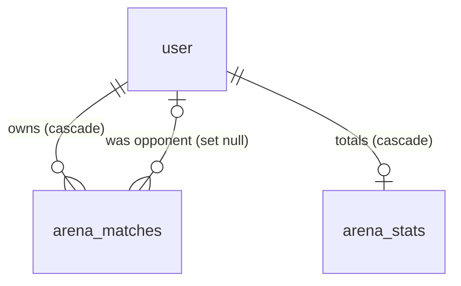
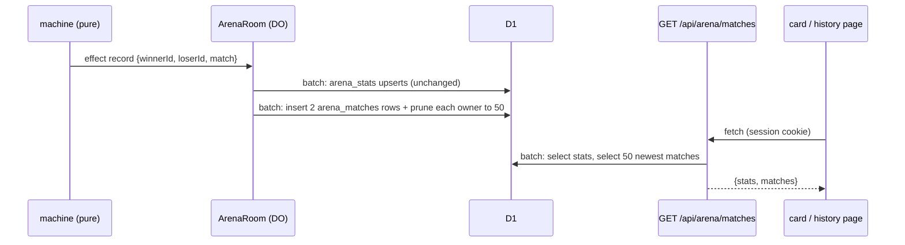

# Technical Design: Arena match history

## Scope

**In scope:** a new D1 table with one row per player per finished match. The room machine emits the full match summary at match end, and the room writes it next to the existing stats. A read route returns the stats and the 50 newest matches in one D1 round trip. The Arena hub gets a "Lịch sử đấu" card, there's a new static page `/arena/history` with a list and a per-match dialog, and account deletion blanks the deleted player's name and picture in other learners' history. The privacy page gets one line.

**Out of scope:** backfilling past matches, team matches, head-to-head totals, filters, deleting single matches, and showing round questions.

## Research Summary

No new technology. Everything uses what feature 023 already runs: Durable Object → D1 through Drizzle, `db.batch()`, TanStack Query on the client, and shadcn `Dialog`, `Avatar`, `Badge` and `Skeleton`.

## Patterns & Reuse

### Conventions to Follow

| Pattern | Project Uses | Avoid | Reference |
|---------|-------------|-------|-----------|
| Data module the room imports | Plain module taking `db: Db`, no `server-only` (bundled into `worker.ts`) | `getDb()` or `server-only` in code the room calls | src/server/arena/stats.ts:1-8 |
| Multi-statement writes | One `db.batch([...])` | Separate awaits per statement | src/server/arena/stats.ts:21-45 |
| Room side effects | The pure machine emits an effect, and `room.run()` carries it out in try/catch so the match still ends | DB calls inside the machine | src/learning/arena/machine.ts:126-127, src/server/arena/room.ts:214-221 |
| Thin routes | `requireUser` → service → `json` / `error(MESSAGES.unavailable, 503)` | Logic in the route | src/app/api/arena/stats/route.ts:7-18 |
| API error shape | `{ error: { message } }`, Vietnamese | English messages | src/server/arena/request.ts:18-20 |
| Client fetch | `request<T>()` in the Arena client, throws `ArenaError` with a Vietnamese message | Raw `fetch` in components | src/lib/arena-client.ts:20-32, 48-50 |
| Query keys | Exported `const` tuple next to the component | Inline string keys | src/components/arena/arena-record.tsx:8 |
| Locked page | Static page shell + `SignInGate area="arena"` around the client leaf | Session reads in the page | src/app/(app)/arena/1v1/page.tsx:13-25 |
| Back link | `BackToHub` | A new back link | src/components/arena/duel-setup.tsx:128-134 |
| FK and deletion | `references(() => user.id, { onDelete: "cascade" })`, so deleting the account is one statement | Manual per-table deletes | src/server/db/schema.ts:205-214, src/server/account/account.service.ts:11-14 |
| Migrations | `drizzle-kit generate` → `migrations/NNNN_*.sql`, applied with `wrangler d1 migrations apply` | Hand-written SQL without a snapshot | drizzle.config.ts, migrations/0006_arena.sql |

### Existing Code to Reuse

| Component | Location | How to Use |
|-----------|----------|------------|
| `PlayerAvatar`, `initials` | src/components/arena/players.tsx:6-17 | Opponent picture with fallback initials (`you={false}` gives the rival ring color) |
| `settingsLine` | src/components/arena/settings-fields.tsx:30-34 | "Hỗn hợp · A2 · 3 hiệp" under each row |
| `wonOnTime` | src/components/arena/results.tsx:20-22 | Detects a round decided on time (level points) in the dialog |
| `BackToHub` | src/components/arena/duel-setup.tsx:128-134 | Back to `/arena` on the history page (AC-013) |
| `SignInGate`, `SignInPrompt` (`arena`) | src/components/account/sign-in-gate.tsx:21-26 | Guests on the history page (AC-007, AC-011) |
| `ARENA_STATS_KEY`, `fetchArenaStats` | src/components/arena/arena-record.tsx:8, src/lib/arena-client.ts:48 | Pattern for the new key and fetcher; the results screen already refetches stats on mount (results.tsx:91) |
| `sqliteDb` test D1 (supports `batch`) | src/test-utils/sqlite-d1.ts:41 | Service tests |
| `recordResult` | src/server/arena/stats.ts:21-45 | Stays as it is; the history write runs after it |

## Data Model

### Entities

| Entity | Purpose |
|--------|---------|
| `RoomState` (existing) | Source of everything a finished match knows |
| `Player` (existing) | Name, picture and rounds won per player |
| `RoundResult` (existing, gains `suddenDeath`) | Points per player per round and the round winner |
| `ArenaSettings` (existing) | Mode, level, rounds |
| `Effect` `record` (existing, extended) | Carries the match summary from the machine to the room |
| `arena_matches` (new table) | One row per owner per finished match |
| `user` (existing) | FK target; its deletion clears opponent details |

#### RoomState (src/learning/arena/machine.ts:66-101)

- `settings` (ArenaSettings), machine.ts:68, read
- `players` (Player[]), machine.ts:71, read
- `suddenDeath` (number, sudden-death questions asked this round), machine.ts:85, read in `endRound`
- `rounds` (RoundResult[]), machine.ts:93, read
- `winnerId` (string | null), machine.ts:94, read
- `endReason` ("won" | "forfeit" | "cancelled" | null), machine.ts:95, read. `cancelled` never reaches `endMatch` (machine.ts:376), so AC-002 holds without new code.

#### Player (src/learning/arena/machine.ts:40-58)

- `id` (string, the signed-in user id from the ticket), machine.ts:41
- `name` (string, chosen or Google name), machine.ts:42
- `image` (string | null), machine.ts:43
- `roundsWon` (number), machine.ts:51

#### RoundResult (src/learning/arena/protocol.ts:106-111)

- `round` (int), protocol.ts:107
- `scores` (record userId → int points), protocol.ts:108
- `winnerId` (string), protocol.ts:109
- **new** `suddenDeath` (boolean, optional): true when `state.suddenDeath > 0` at `endRound` (machine.ts:364-365). Optional, because room state saved before the deploy has no field.

#### ArenaSettings (src/learning/arena/protocol.ts:15-20)

- `mode` ("listen" | "recall" | "write" | "mixed"), protocol.ts:16
- `level` (LEVELS), protocol.ts:17
- `rounds` (1 | 3), protocol.ts:18

#### Effect `record` (src/learning/arena/machine.ts:126-127, emitted at machine.ts:380)

- today: `winnerId`, `loserId`
- **new** `match: FinishedMatch` = `{ endedAt: number; reason: "won" | "forfeit"; settings: ArenaSettings; players: [PlayerIdentity & { roundsWon }, …]; rounds: RoundResult[] }`, built from the ended state in `endMatch`

#### arena_matches (new, src/server/db/schema.ts after line 214)

- `match_id` text: one UUID per match, made by the room (`crypto.randomUUID()`). PK part 1.
- `user_id` text NOT NULL, FK `user.id` ON DELETE CASCADE: the owner. PK part 2.
- `opponent_id` text NULL, FK `user.id` ON DELETE SET NULL
- `opponent_name` text NULL: name at match time; null after the opponent deletes their account
- `opponent_image` text NULL
- `won` integer (boolean) NOT NULL
- `forfeit` integer (boolean) NOT NULL
- `rounds_won` integer NOT NULL, `opponent_rounds_won` integer NOT NULL
- `rounds` text (JSON) NOT NULL: `[{ round, mine, theirs, won, suddenDeath, onTime }]` from the owner's side
- `mode` text, `level` text, `best_of` integer, all NOT NULL
- `ended_at` integer (epoch ms) NOT NULL
- index `arena_matches_user_ended` on (`user_id`, `ended_at`)

### Relationships



Each finished match writes two `arena_matches` rows with the same `match_id`, one per owner.

### API Contracts

| Endpoint | Method | Request | Response |
|----------|--------|---------|----------|
| `/api/arena/matches` | GET | session cookie | 200 `ArenaMatchesResponse`, 401 (guest, from `requireUser`), 503 `unavailable` |

```ts
// src/server/arena/arena.schema.ts (shared with the browser)
interface ArenaMatchesResponse { stats: ArenaStatsResponse; matches: ArenaMatch[] } // newest first, ≤ 50
interface ArenaMatch {
  id: string;            // match_id
  endedAt: number;       // epoch ms
  won: boolean;
  forfeit: boolean;
  score: { mine: number; theirs: number };          // rounds won
  opponent: { name: string; image: string | null } | null; // null: account deleted
  settings: ArenaSettings;
  rounds: { round: number; mine: number; theirs: number; won: boolean; suddenDeath: boolean; onTime: boolean }[];
}
```

`Cache-Control: no-store` via `json()` (request.ts:14-16). Stats and matches are read in one `db.batch([select stats, select matches])`, one D1 round trip.

### Currently Exposed Fields

| AC ID | Field | Source (file:line) | Currently Exposed? | Gap? |
|-------|-------|--------------------|--------------------|------|
| AC-001 | time it ended | none (room uses `Date.now()` at room.ts:216) | no | must add `endedAt` to the record effect |
| AC-001 | players' name | machine.ts:42 | in state, not in effect | must add to effect |
| AC-001 | players' picture | machine.ts:43 | in state, not in effect | must add to effect |
| AC-001 | rounds each won | machine.ts:51 | in state, not in effect | must add to effect |
| AC-001 | points of each round | protocol.ts:108 | in state, not in effect | must add to effect |
| AC-001 | who won | machine.ts:127 | yes (`winnerId`) | none |
| AC-001 | forfeit | machine.ts:95 | in state, not in effect | must add to effect |
| AC-001 | mode, level, rounds | protocol.ts:16-18 | in state, not in effect | must add to effect |
| AC-003 | result | `won` (new column) | no | must add |
| AC-003 | score from their side | `rounds_won`/`opponent_rounds_won` (new) | no | must map per owner |
| AC-003 | opponent name, picture | `opponent_name`/`opponent_image` (new) | no | must add |
| AC-003 | date and time | `ended_at` (new) | no | must add + format in the learner's time zone |
| AC-003 | mode and level | `mode`/`level` (new) | no | must add; displayed with `settingsLine` (settings-fields.tsx:31) |
| AC-004 | forfeit label | `forfeit` (new) | no | must add |
| AC-009 | wins, losses | stats.ts:11-17 | yes (`/api/arena/stats`) | none; read in the same batch |
| AC-009 | latest match | first item of `matches` | no | must add |
| AC-014 | round points both sides | `rounds[].mine/theirs` (new) | no | must map per owner |
| AC-014 | round winner | `rounds[].won` (new) | no | must map |
| AC-014 | sudden death | `RoundResult.suddenDeath` (new) | no | must add at machine.ts:365 |
| AC-014 | won on time | `wonOnTime(scores)` (results.tsx:21) | derivable | compute `onTime` when saving |

## Decisions

| Decision | Rationale |
|----------|-----------|
| One row per owner per match (two rows per match), snapshot of the opponent | Reads are a single indexed `WHERE user_id = ?` with no join; each row already holds the owner's side. The snapshot keeps the name as it was in the match (edge case). Pruning to 50 is per owner. |
| The pure machine adds the match summary to the existing `record` effect; the room only adds `match_id` and writes | Keeps game rules testable without a room or DB (04-architecture). The machine has no UUID source, so the room makes the id. |
| The room runs two separate writes in their own try/catch: stats first (unchanged), then history | The spec's edge case: a failed history write must not lose the totals. Each is one `db.batch`. |
| History write = one batch: insert both rows (`ON CONFLICT DO NOTHING` on the PK), then per owner `DELETE … WHERE user_id = ? AND match_id NOT IN (SELECT match_id … ORDER BY ended_at DESC, match_id DESC LIMIT 50)` | Keeps the 50 newest (AC-005) in the same transaction. The PK plus `DO NOTHING` make a retried effect harmless (Goal 2: nothing counted twice). |
| Order is `ended_at DESC, match_id DESC` everywhere | A stable order when two matches end in the same millisecond (edge case) |
| The read route returns `{ stats, matches }` from one `db.batch` of two selects | The card needs both; one D1 round trip (Success Criteria). The page and card share one query key, so the hub and page don't fetch twice. |
| Rounds stored as JSON text, validated with Zod on read | Max 3 rounds, always read with the row, never queried. A child table would cost a second write and a join for nothing. |
| Account deletion becomes `db.batch([UPDATE arena_matches SET opponent_name = NULL, opponent_image = NULL WHERE opponent_id = ?, DELETE user …])` | `ON DELETE SET NULL` clears only `opponent_id`, so the deleted player's name and picture would stay in other learners' rows. Blanking them in the same transaction honours "delete everything that belongs to it" (022 AC-023). Still one D1 call. |
| UI: hub card (client leaf) → static page with a list; tapping a row opens a `Dialog` | Matches the user's choice (decisions.md). A dialog keeps the list's scroll and returns focus to the row on close (AC-016) with no route state. |
| `suddenDeath` on `RoundResult` is optional | Room state persisted before the deploy lacks it; Zod and readers treat a missing value as false |

## Component Design

| Component | File | Action | Responsibility |
|-----------|------|--------|----------------|
| Match summary in the record effect | src/learning/arena/machine.ts | modify | `endRound` sets `suddenDeath`; `endMatch` adds `match` to `record` |
| Round result schema | src/learning/arena/protocol.ts | modify | `suddenDeath: z.boolean().optional()` |
| History entries (pure) | src/learning/arena/history.ts | new | `historyEntries(match, matchId)` → two owner-side entries (score, rounds with `won`/`onTime`, opponent snapshot) |
| Table + migration | src/server/db/schema.ts, migrations/0007_arena_matches.sql (+ meta) | modify / new | `arenaMatches` table and index |
| History data module | src/server/arena/history.ts | new | `recordMatch(db, entries)` (insert + prune batch), `listHistory(db, userId)` (stats + 50 matches batch, Zod-parse rounds). No `server-only` (the room imports it). |
| Room write | src/server/arena/room.ts:214-221 | modify | After `recordResult`, `recordMatch(this.db(), historyEntries(effect.match, crypto.randomUUID()))` in its own try/catch |
| Account deletion | src/server/account/account.service.ts:11-14 | modify | Batch: blank the opponent snapshot, then delete the user |
| Response types | src/server/arena/arena.schema.ts | modify | `ArenaMatch`, `ArenaMatchesResponse` |
| Route | src/app/api/arena/matches/route.ts | new | GET: `requireUser` → `listHistory` → `json` / 503 |
| Client fetcher | src/lib/arena-client.ts | modify | `fetchArenaMatches()` |
| Time label | src/components/arena/match-when.ts | new | "20:14 hôm nay", "20:14 hôm qua", "20:14 · 03/11/2026" in the browser's time zone (`Intl.DateTimeFormat("vi-VN")`) |
| Hub card | src/components/arena/arena-history-card.tsx | new | Client leaf. Guest: invitation + link. Signed in: totals, latest match or "first match" line, link to `/arena/history`. Skeleton while loading; on error just the title + link. |
| Hub | src/components/arena/arena-hub.tsx | modify | Render the card full width under the mode cards (`sm:col-span-2`) |
| History page | src/app/(app)/arena/history/page.tsx | new | Static shell: metadata, `BackToHub`, h1 "Lịch sử đấu", `SignInGate area="arena"` around `MatchHistory` |
| List | src/components/arena/match-history.tsx | new | Query (`ARENA_MATCHES_KEY` from match-parts); `<ol>` of rows; skeleton; empty state (owl + link to 1-1); error + "Thử lại" (`refetch`) |
| Shared parts | src/components/arena/match-parts.tsx | new | Query key, `/arena/history` path, result/score/forfeit labels, `OpponentAvatar`, `ResultBadge`; shared by the row, dialog and card so none of them import each other (added during implementation) |
| Row | src/components/arena/match-row.tsx | new | A `button` row ≥ 44 px opening the dialog: avatar, name (truncate), settings and time line, result badge (icon + text, not color alone) and score |
| Details dialog | src/components/arena/match-details.tsx | new | `Dialog` with title ("Thắng 2–1"), opponent, time; one line per round with the winner marked, plus "câu quyết định" / "nhanh hơn" notes; forfeit note |
| Results refresh | src/components/arena/results.tsx:91 | modify | Also invalidate `ARENA_MATCHES_KEY` on mount, so the hub and page show the match just played |
| Privacy note | src/app/(app)/privacy/page.tsx | modify | One line: the Arena keeps your 50 newest matches, with the opponent's name and picture |

### Visual direction (ui-ux-pro-max)

The app's existing system applies: PageHero-less inner page like `/arena/1v1` (`pt-[4.25rem]`, `max-w-2xl`), `bg-card` rounded-2xl cards, `text-primary` for you and `arena-rival` for the opponent (players.tsx:14-16), `tabular-nums` scores.

- **Card on the hub:** the same `CARD` shell as the mode cards (arena-hub.tsx:8), full width, with a `History` icon tile. Line 1 is "Lịch sử đấu" with the totals on the right. Line 2 is the latest match ("Thắng 2–1 · Minh · 20:14 hôm qua"). An arrow affordance with the same hover and focus ring as the 1-1 card. The whole card is one link.
- **List row (mobile first, 320 px):** a 3-column grid `[avatar 40px] [min-w-0 name / meta] [result + score]`. The name uses `truncate`. Meta is `settingsLine · time` in `text-muted-foreground text-sm`, wrapping under the name. The result is a `Badge` with an icon (Trophy for Thắng, a neutral icon for Thua) and the text, so color is never the only signal. The forfeit label is a small muted line under the badge.
- **Dialog:** `DialogHeader` / `DialogTitle` / `DialogDescription` (shadcn rule). Rounds are an `<ol>` of pills like the results screen (results.tsx:108), winner side tinted primary or rival.
- **States:** skeleton rows reserve height (no layout shift); the empty state uses the owl `cheer` and a primary link button "Đấu 1-1 ngay"; the error state has a Vietnamese message and an outline "Thử lại" button.
- **Motion:** only the existing 200 ms hover and active transitions, with `motion-reduce` guards.
- **A11y:** the list is `<ol aria-label="Các trận gần đây">`; each row button has an accessible name ("Thắng 2–1 với Minh, 20:14 hôm qua"); focus returns to the row on dialog close (Base UI default); 4.5:1 contrast with tokens in both themes.

## Data Flow



## Requirements Traceability

| Requirement | Component | File | Status |
|-------------|-----------|------|--------|
| AC-001 time ended | record effect `endedAt` → `ended_at` | machine.ts, history.ts (both) | Planned |
| AC-001 names, pictures | effect `players` → `opponent_name/image` | machine.ts, src/learning/arena/history.ts | Planned |
| AC-001 rounds won | `rounds_won`, `opponent_rounds_won` | src/learning/arena/history.ts | Planned |
| AC-001 points per round | `rounds` JSON | src/learning/arena/history.ts | Planned |
| AC-001 who won | `won` | src/learning/arena/history.ts | Planned |
| AC-001 forfeit | `forfeit` | src/learning/arena/history.ts | Planned |
| AC-001 mode, level, rounds | `mode`, `level`, `best_of` | schema.ts, src/server/arena/history.ts | Planned |
| AC-001 once per player | PK (match_id, user_id) + DO NOTHING | schema.ts, src/server/arena/history.ts | Planned |
| AC-002 | `endMatch` only path to `record` | machine.ts:376-380 (test) | Planned |
| AC-003 | list + row | match-history.tsx, match-row.tsx, match-when.ts | Planned |
| AC-004 | forfeit label | match-row.tsx | Planned |
| AC-005 | prune in batch | src/server/arena/history.ts | Planned |
| AC-006 | empty state | match-history.tsx | Planned |
| AC-007 | SignInGate | history/page.tsx | Planned |
| AC-008 | error + Thử lại | match-history.tsx | Planned |
| AC-009 | hub card | arena-history-card.tsx, arena-hub.tsx | Planned |
| AC-010 | card is a link | arena-history-card.tsx | Planned |
| AC-011 | guest card | arena-history-card.tsx | Planned |
| AC-012 | no-match card line | arena-history-card.tsx | Planned |
| AC-013 | BackToHub | history/page.tsx | Planned |
| AC-014 | details dialog | match-details.tsx, machine.ts (`suddenDeath`) | Planned |
| AC-015 | finished rounds + forfeit note | match-details.tsx | Planned |
| AC-016 | Dialog focus return | match-details.tsx | Planned |
| Edge: rematch | new `match_id` per `record` | room.ts | Planned |
| Edge: history write fails | separate try/catch | room.ts | Planned |
| Edge: opponent deleted | batch blank + set null; UI label | account.service.ts, match-row.tsx | Planned |
| Edge: learner deleted | cascade on `user_id` | schema.ts | Planned |
| Edge: same second | `ended_at DESC, match_id DESC` | src/server/arena/history.ts | Planned |
| Edge: 320 px | grid + truncate | match-row.tsx | Planned |
| Edge: others' history | `WHERE user_id = session.user.id` only, no parameter | matches/route.ts | Planned |

## Test Strategy

### Infrastructure

| Aspect | Detail |
|--------|--------|
| Framework | Vitest (+ Testing Library), Playwright for e2e |
| Command | `pnpm --filter learn-english test`, `pnpm --filter learn-english e2e` |
| Location | Next to the source (`*.test.ts(x)`), `e2e/` |

### Reference Tests

| File | What It Tests |
|------|---------------|
| src/server/arena/stats.test.ts | D1 data module on `sqliteDb` with FK on |
| src/app/api/arena/routes.test.ts | Routes with mocked session and data module |
| src/learning/arena/machine.play.test.ts | Driving a match to its end through the reducer |
| src/components/arena/results.test.tsx | Arena component with a mocked query |

### New Tests

| Component | Test File | Scenarios |
|-----------|-----------|-----------|
| machine | src/learning/arena/machine.play.test.ts | `record` carries the match (scores, players, settings, forfeit, endedAt); sudden death flagged; cancelled lobby emits no `record` |
| historyEntries | src/learning/arena/history.test.ts | Two mirrored entries; `onTime` on level points; forfeit mid-round keeps the finished rounds |
| data module | src/server/arena/history.test.ts | Insert + read newest first; 55 → 50 kept; same `ended_at` stable; duplicate `match_id` ignored; learner deletion cascades; opponent deletion blanks name/image and nulls the id |
| account service | src/server/account/account.service.test.ts (new or existing) | Deleting blanks the opponent snapshot |
| route | src/app/api/arena/routes.test.ts | 200 shape, 401 guest, 503 on failure |
| match-when | src/components/arena/match-when.test.ts | hôm nay / hôm qua / older date |
| UI | src/components/arena/match-history.test.tsx, arena-history-card.test.tsx | List, forfeit labels, deleted opponent, empty, error + retry, dialog rounds; card guest / empty / latest |
| e2e | e2e/arena*.spec.ts | Play a match on the preview, then open Lịch sử đấu with both accounts |

## Considerations

### Error Handling

- A failed history write is logged (`console.error("Arena history not saved:", …)`), and the match ends normally. The stats write is untouched.
- The route answers 503 with `ARENA_MESSAGES.unavailable` on any D1 error. The page shows it with "Thử lại". The card falls back to its title and link.
- A rounds JSON that fails Zod parsing (it shouldn't) is read as an empty rounds list, so a single bad row can't break the page.

### Security

- The route takes no user id. It reads only the session user's rows (spec edge case).
- The opponent's picture URL comes from Google via the ticket. It's rendered with `referrerPolicy="no-referrer"`, as `PlayerAvatar` already does.
- The free plan: the read is one D1 round trip. The write is one extra batch per match (2 inserts and 2 deletes). Rows written stay well inside 100k a day at the ~400 duels a day budget (023 design).

### Concerns

- The room's state type changes (`RoundResult.suddenDeath`), so the field is optional to keep rooms that are live during the deploy working.

## Open Questions

- [ ] None
