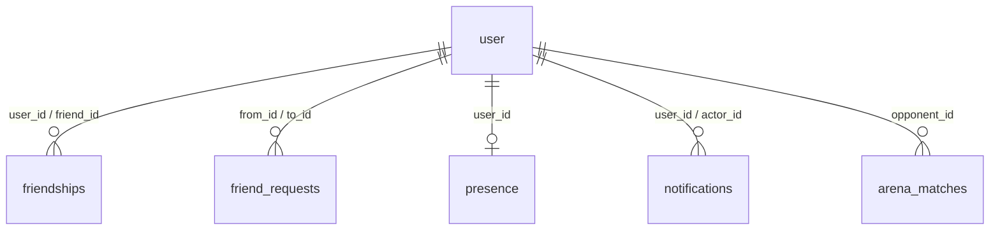

# Technical Design: Arena friends

Paths are relative to `apps/learn-english/`.

## Scope

In scope: four D1 tables (friendships, friend requests, presence, notifications) and one migration; services in `src/server/social/*.service.ts` with their routes under `/api/social/*`; a heartbeat ("pulse") that every open tab sends once a minute and that returns friends, their presence, pending request ids and the unread count; a leave beacon from the last open tab; the sidebar "Bạn bè" section (and its collapsed icon); the header bell with its popover; the "Kết bạn" button on Arena lobby and result cards and in match details; the phone friends section on the Đấu trường hub; account deletion and the privacy page.

Out of scope: real-time push (WebSocket or Durable Object), duel invites, friend search or codes, hiding status, notification kinds other than the friend ones (the table allows more later).

## Research Summary

No new library or service. Two platform facts drive the presence design (Cloudflare docs, Workers free plan, checked against the codebase's existing limits in `wrangler.jsonc`):

- D1 free plan: 5 million rows read and 100,000 rows written per day. A write per tab per minute would be the largest cost, so the pulse writes only when the stored time is stale (see Decisions).
- `navigator.sendBeacon` sends a same-origin POST with cookies during `pagehide`, which is the only reliable moment to say goodbye; it can't wait for an answer.

## Patterns & Reuse

### Conventions to Follow

| Pattern | Project Uses | Avoid | Reference |
|---------|-------------|-------|-----------|
| Route auth | `requireUser(request)`, return `session.response` on failure | Reading cookies in routes | `src/server/auth/session.ts:28` |
| Route JSON | `no-store` JSON helpers and a capped body reader per route family | Bare `Response.json` without cache headers | `src/server/arena/request.ts:15` |
| Services take `db` | `listHistory(db, userId)` with `getDb()` in the route | Calling `getDb()` inside services | `src/server/arena/history.ts:72`, `src/app/api/arena/matches/route.ts:13` |
| Mirrored rows per user | `arena_matches` keeps one row per owner, PK `(match_id, user_id)` | One row per pair with OR queries | `migrations/0007_arena_matches.sql` |
| FK cleanup | `ON DELETE CASCADE` to `user`, batch in `deleteAccount` | Manual deletes per table | `src/server/account/account.service.ts:13` |
| Client fetch | `request<T>()` wrapper with Vietnamese errors, a typed error class | Raw `fetch` in components | `src/lib/arena-client.ts:20` |
| Server state in UI | TanStack Query with a shared key, `enabled: signedIn` | Ad-hoc `useEffect` fetches | `src/components/arena/arena-history-card.tsx:23` |
| Shared types | Zod schemas + message constants in a `*.schema.ts` without `server-only` | Duplicating shapes in the client | `src/server/arena/arena.schema.ts:1` |
| Avatars | `AccountAvatar` (no referrer for Google images) | `` with referrer | `src/components/account/account-avatar.tsx:19` |
| Migrations | drizzle-kit generate into `migrations/NNNN_name.sql`, applied remotely before deploy | Hand-written SQL that drifts from `schema.ts` | `.agents/knowledge.md` (feature 007, 013 gotchas) |

### Existing Code to Reuse

| Component | Location | How to Use |
|-----------|----------|------------|
| `requireUser` | `src/server/auth/session.ts:28` | Every social route |
| `json`, `error`, `readBody` pattern | `src/server/arena/request.ts:15` | Copy into `src/server/social/request.ts` with social messages (route families keep their own helpers, as the comment there says) |
| `useAccount` | `src/hooks/use-account.ts:52` | `signedIn` gate for the pulse, bell and sections; guests see none (AC-018, AC-030) |
| `AccountAvatar` | `src/components/account/account-avatar.tsx:19` | Friend rows and notifications |
| `PlayerRow` | `src/components/arena/players.tsx:33` | Gets an optional trailing slot for the friend button |
| Sidebar primitives | `src/components/ui/sidebar.tsx` | `SidebarGroup`, `SidebarGroupLabel`, `SidebarMenu*`, `useSidebar` for the collapsed state |
| `AlertDialog` | `src/components/ui/alert-dialog.tsx` | "Xóa bạn" confirmation (AC-020) |
| `matchWhen` style | `src/components/arena/match-when.ts:13` | Model for the new relative-time formatter (same `vi-VN` formatters) |
| `isThrottled` pattern | `src/server/arena/request.ts:43` | New `SOCIAL_LIMITER` for request sends |

New shadcn primitives: `popover` (bell) and `dropdown-menu` (friend row menu), added with the shadcn CLI. Check the `cn` import after generating (knowledge, feature 002 gotcha).

## Data Model

### Entities

| Entity | Purpose |
|--------|---------|
| `user` (existing) | Name and picture shown for friends and in notifications |
| `arena_matches` (existing) | Source of the opponent id for "Kết bạn" in match history |
| `friendships` (new) | Two mirrored rows per friendship |
| `friend_requests` (new) | Pending requests and the 7-day memory of declined ones |
| `presence` (new) | Last active time and whether the last tab said goodbye |
| `notifications` (new) | The bell's items |

#### user (read only)

- `id` (text PK) -- `src/server/db/schema.ts:113`
- `name` (text) -- `src/server/db/schema.ts:114`
- `image` (text, nullable) -- `src/server/db/schema.ts:117`

#### arena_matches (read only)

- `opponentId` (text, nullable, FK set null) -- `src/server/db/schema.ts:220`, `migrations/0007_arena_matches.sql`
- `opponentName`, `opponentImage` -- same table; `toMatch` maps them at `src/server/arena/history.ts:97` and drops the id today

#### friendships (new)

- `user_id` text, FK `user.id` cascade
- `friend_id` text, FK `user.id` cascade
- `created_at` integer (epoch ms)
- PK `(user_id, friend_id)`

#### friend_requests (new)

- `from_id` text, FK cascade
- `to_id` text, FK cascade
- `status` text enum `pending | declined`
- `updated_at` integer (epoch ms): when sent, or when declined
- PK `(from_id, to_id)`; index `(to_id, status)`

A declined row blocks a new request from `from_id` to `to_id` until `updated_at + 7 days`; sending after that turns it back into `pending`.

#### presence (new)

- `user_id` text PK, FK cascade
- `last_seen_at` integer (epoch ms)
- `left` integer boolean: true after the last tab's leave beacon

Online = `!left && last_seen_at > now - 150 s`.

#### notifications (new)

- `id` text PK (random)
- `user_id` text (recipient), FK cascade
- `kind` text enum `friend_request | friend_added | friend_accepted`
- `actor_id` text, FK cascade (who it is about)
- `created_at` integer, `read_at` integer nullable
- index `(user_id, created_at)`; unique `(user_id, kind, actor_id)` so a resend replaces instead of duplicating

`friend_request` turns into `friend_added` when the receiver accepts (AC-005). The sender gets a `friend_accepted` row (AC-028). Actor deletion cascades the row away (AC-029).

### Relationships



### API Contracts

All routes: signed-in only (`requireUser`, 401 in Vietnamese otherwise), `no-store`, the caller's id always comes from the session (AC-009, AC-031).

| Endpoint | Method | Request | Response |
|----------|--------|---------|----------|
| `/api/social/pulse` | POST | none | `{ now, friends: { id, name, image, online, lastSeenAt }[], outgoing: string[], incoming: string[], unread: number }` |
| `/api/social/leave` | POST (beacon) | none | 204 |
| `/api/social/requests` | POST | `{ userId }` | `{ state: "sent" \| "friends" }`; 404 `notFound`, 409 `tooMany`, 429 throttled |
| `/api/social/requests/respond` | POST | `{ userId, accept: boolean }` | `{ state: "friends" \| "declined" }`; 404 `gone` ("Lời mời này không còn nữa.") |
| `/api/social/friends/remove` | POST | `{ userId }` | 204 |
| `/api/social/notifications` | GET | none | `{ items: { id, kind, actor: { id, name, image }, createdAt, read, pending: boolean }[] }` (50 newest, 30 days) |
| `/api/social/notifications/read` | POST | none | 204 |
| `/api/arena/matches` (existing) | GET | none | `ArenaMatch.opponent` gains `id` |

`outgoing` = pending requests sent plus declined ones still in their 7 days (the card shows "Đã gửi lời mời", AC-003 and the decline edge case). `incoming` = pending requests received (the card's "Kết bạn" then accepts, AC-008). `pending` on a notification tells the bell whether to show the two buttons.

### Currently Exposed Fields

| AC ID | Field | Source (file:line) | Currently Exposed? | Gap? |
|-------|-------|--------------------|--------------------|------|
| AC-002 | opponent id in match history | `src/server/arena/history.ts:97`, `src/server/arena/arena.schema.ts:55` | no | must add `id` to `opponent` |
| AC-001 | player id on room cards | `src/learning/arena/machine.ts:41` (`PlayerIdentity.id`, the session user id: `src/server/arena/arena.service.ts:36`) | yes | none |
| AC-004 | sender name, picture | `src/server/db/schema.ts:114`, `:117` | no (no social API) | must add (notifications route) |
| AC-004 | arrival time | new `notifications.created_at` | no | must add |
| AC-010 | friend picture, name | `src/server/db/schema.ts:114`, `:117` | no | must add (pulse) |
| AC-012, AC-013 | online, last active | new `presence` | no | must add |
| AC-014 | online count | derived client side from `friends[].online` | no | must add |
| AC-023 | unread count | new `notifications.read_at` | no | must add (pulse) |

## Decisions

| Decision | Rationale |
|----------|-----------|
| Presence and freshness by polling: each tab POSTs `/api/social/pulse` on load, every 60 s (also in background tabs), and on `pageshow` from the back-forward cache | Meets the spec's two-minute windows without a socket. A global presence Durable Object would push instantly but wakes per message, needs hibernation handling and a second DO class; the Arena's DO is room-scoped. Polling reuses the plain route pattern and TanStack Query |
| The pulse writes presence only when stale: one upsert `ON CONFLICT DO UPDATE ... WHERE left = 1 OR last_seen_at < now - 45 s` | Several tabs and devices then cost at most about one written row per learner per 45 s; D1 counts no written row when the WHERE skips the update |
| Online window 150 s; the last tab sends a leave beacon on `pagehide` | 150 s covers one missed pulse. The beacon makes closing the app show offline within one viewer poll (60 s, AC-015). A sleeping device or crash falls back to the window: offline within 150 + 60 s, inside the five-minute edge case |
| "Last tab" is known through a `BroadcastChannel("tuxedo-presence")`: tabs announce themselves and keep a live set of others; on `pagehide` a tab with no others sends the beacon | `pagehide` can't wait for an async check such as `navigator.locks.query`. A wrong guess only costs one stale minute: the next pulse from a surviving tab sets `left` back to false |
| One pulse answers friends, presence, request ids and unread count | One request per tab per minute instead of three; the sidebar, bell, phone section and Arena cards read the same query key, so TanStack dedupes them inside a tab |
| Friends list and notifications show the Google account name and picture (`user.name`, `user.image`) | The Arena's chosen name lives in the learner's synced profile, not in a column other learners can read. The privacy page will say so (AC-021). Revisit if learners ask |
| Requests accept any existing user id; no "shared a room" check on the server | Lobby cards exist before any match row is saved, so the server can't prove the meeting. User ids are random and only visible to people who shared a room or a history row. The 20-pending cap and a per-IP `SOCIAL_LIMITER` (20/60 s) bound spam |
| Mirrored friendship rows (two per pair) | Same pattern as `arena_matches`; the friend list is one indexed query on `user_id` |
| Answered requests are deleted, declined ones kept as `declined` for 7 days | The decline stays silent for the sender (AC-006) while still blocking a quick resend; no separate cooldown table |
| Notifications older than 30 days are deleted when the learner opens the bell or receives a new one; reads also filter by age and take 50 | No cron job needed; write cost happens only when there is something to prune |
| The friend button appears in the lobby, the Ready window and the result, not during questions | Matches the updated AC-001; a button next to the scoreboard mid-question would steal taps from answers |
| "Kết bạn" and "Đồng ý" read then write in two D1 calls (one read batch, one write batch), against the one-call rule in `04-architecture.md` | D1 has no interactive transactions and the checks (existing friendship, reverse request, decline cooldown, pending cap) decide which writes run. Every write is idempotent (upserts, `ON CONFLICT DO NOTHING`, deletes), so two taps racing end in the same state |
| The pulse also deletes the learner's declined requests older than 7 days | The privacy page says declined requests are kept 7 days; this keeps it true without a cron job, and writes only when such a row exists |
| Remove is `POST /api/social/friends/remove` with a body, not `DELETE /friends/[userId]` | Same Zod body check and size cap as the other routes; no dynamic segment |
| Phones get the list as a section on the Đấu trường hub; the bell sits in `AccountLink`, which phones already show | Phones have no sidebar (`AppSidebar` is `hidden md:flex`, `src/components/shell/app-sidebar.tsx:113`) |

## Component Design

| Component | File | Action | Responsibility |
|-----------|------|--------|----------------|
| Tables | `src/server/db/schema.ts` | modify | `friendships`, `friendRequests`, `presence`, `notifications` |
| Migration | `migrations/0008_social.sql` | new (generated) | Creates the four tables and indexes |
| Shapes and messages | `src/server/social/social.schema.ts` | new | Zod bodies, response types, `SOCIAL_MESSAGES` (Vietnamese), constants `ONLINE_WINDOW_MS`, `PULSE_MS`, `DECLINE_COOLDOWN_MS`, `MAX_PENDING`, `NOTIFICATION_DAYS`, `NOTIFICATION_LIMIT` |
| Route helpers | `src/server/social/request.ts` | new | `json`, `error`, `readBody`, `isThrottled` on `SOCIAL_LIMITER` |
| Presence | `src/server/social/presence.service.ts` | new | `touchPresence` (batch statement), `leave`, `isOnline` |
| Friends | `src/server/social/friends.service.ts` | new | `sendRequest`, `respond`, `removeFriend`, and batch statements `friendsQuery`, `outgoingQuery`, `incomingQuery`, `pruneDeclined` (accept is one write batch: delete requests both ways, insert two friendships, turn the notification into `friend_added`, add `friend_accepted`) |
| Notifications | `src/server/social/notifications.service.ts` | new | `listNotifications` (prune, 50 newest, `pending` flag), `markAllRead`, and batch statements `unreadQuery`, `upsertNotification`, `pruneNotifications`, `dropRequestNotification` |
| Pulse | `src/server/social/pulse.service.ts` | new | One batch: touch presence, prune expired declines, friends, request ids, unread count |
| Routes | `src/app/api/social/{pulse,leave,requests,requests/respond,friends/remove,notifications,notifications/read}/route.ts` | new | Thin: session, body, service, response |
| Limiter binding | `wrangler.jsonc` | modify | `SOCIAL_LIMITER` (namespace 1006, 20 per 60 s); run `pnpm cf:typegen` |
| Match history id | `src/server/arena/history.ts:97`, `src/server/arena/arena.schema.ts:55` | modify | `opponent.id` |
| Account deletion | `src/server/account/account.service.ts` | modify (comment) | Cascades cover all four tables; update the doc comment and its test |
| Client API | `src/lib/social-client.ts` | new | `pulse`, `sendRequest`, `respond`, `removeFriend`, `fetchNotifications`, `markRead`, `SocialError` |
| Presence runner | `src/components/social/presence-runner.tsx` | new | Mounted once in the `(app)` layout: BroadcastChannel tab set, `pagehide` beacon, `pageshow` refetch |
| Social query | `src/components/social/use-social.ts` | new | `useSocial()`: TanStack query on `SOCIAL_KEY`, `refetchInterval: PULSE_MS`, `refetchIntervalInBackground: true`, `enabled` when signed in; `relation(userId)` → `none | sent | incoming | friends | self` |
| Relative time | `src/components/social/last-active.ts` | new | "Vừa mới hoạt động", "Hoạt động N phút/giờ trước", "Hoạt động hôm qua", "Hoạt động N ngày trước", date after 7 days, "Chưa hoạt động gần đây"; short forms for notifications ("5 phút trước", "hôm qua") |
| Friends list | `src/components/social/friends-list.tsx` | new | Rows (avatar with green or grey dot, name, status line), sorting, "N/M đang trực tuyến", empty state with link to Đấu trường, load error with retry, row menu "Xóa bạn" + confirm |
| Sidebar group | `src/components/social/sidebar-friends.tsx` | new | The "Bạn bè" `SidebarGroup` and its collapsed icon |
| Phone card | `src/components/social/arena-friends-card.tsx` | new | `FriendsList` in a card, `md:hidden`, signed-in only |
| Sidebar section | `src/components/shell/app-sidebar.tsx` | modify | A second `SidebarGroup` "Bạn bè" under the nav inside `SidebarContent`, its list in its own scroll area (`min-h-0 overflow-y-auto`) so the nav stays put (AC-011); collapsed: one icon button with the online count that calls `setOpen(true)` |
| Friend button | `src/components/social/friend-button.tsx` | new | "Kết bạn" / "Đã gửi lời mời" (disabled) / "Bạn bè" (badge) / nothing for self; optimistic update of `SOCIAL_KEY`; toasts errors |
| Arena cards | `src/components/arena/players.tsx`, `lobby.tsx`, `results.tsx`, `match-details.tsx` | modify | `PlayerRow` takes an `action` slot; lobby and Ready show it for the other player (and both for spectators); result screens show it next to the opponent; match details for `opponent.id` |
| Bell | `src/components/social/notification-bell.tsx` | new | Button with badge (count, "9+"), `aria-label="Thông báo"`; popover lists items newest first with unread dots; opening fetches the list and posts read; request items show "Đồng ý"/"Từ chối"; "Chưa có thông báo nào." |
| Header | `src/components/shell/account-link.tsx` | modify | Bell before the greeting, signed-in only |
| Phone section | `src/components/arena/arena-hub.tsx` | modify | `FriendsList` in a card, `md:hidden` (AC-017) |
| Layout | `src/app/layout.tsx` | modify | Mount `PresenceRunner` in the root layout, so focus screens (lessons, reviews) count as online too |
| Terms | `src/app/(app)/terms/page.tsx` | modify | Repeated friend requests count as spam |
| Privacy | `src/app/(app)/privacy/page.tsx` | modify | What friends see, what is stored, deletion (AC-021) |

## Visual Design Considerations

- **arena-hub-sidebar.png**: the sidebar has a lot of empty space under "Cài đặt". The "Bạn bè" group goes there with a small label row ("Bạn bè" + "2/7 đang trực tuyến"), then rows the height of nav items (`size="lg"`) with a 32 px avatar, a status dot at its bottom right, name on line one and status on line two in `text-muted-foreground`. The list scrolls inside the group; the "Nguồn dữ liệu" footer stays pinned.
- The bell is a round `outline` icon button the size of the avatar link (`size-11 md:size-10`) inside the existing pill in the top-right corner, with a small `bg-destructive` count badge.
- Online dot uses the app's `success` token; offline uses `muted-foreground`. Status text never relies on colour alone ("Đang trực tuyến").

## Data Flow

```mermaid
sequenceDiagram
  participant A as Minh (tab)
  participant API as /api/social
  participant D1
  participant B as Lan (tab, later)
  A->>API: POST requests {userId: lan}
  API->>D1: insert friend_requests pending + notifications(friend_request) for Lan
  API-->>A: {state: sent}
  Note over B: Lan opens the app
  B->>API: POST pulse
  API->>D1: upsert presence (if stale); read friends, request ids, unread
  API-->>B: {unread: 1, incoming: [minh], ...}
  B->>API: GET notifications (opens bell), POST read
  B->>API: POST requests/respond {userId: minh, accept: true}
  API->>D1: batch: delete requests, insert 2 friendships, notif -> friend_added, add friend_accepted for Minh
  A->>API: POST pulse (within 60 s)
  API-->>A: friends now include Lan, unread: 1
```

Leaving: last tab's `pagehide` → `sendBeacon('/api/social/leave')` → `presence.left = 1, last_seen_at = now` → friends see offline on their next pulse.

## Requirements Traceability

| Requirement | Component | File | Status |
|-------------|-----------|------|--------|
| AC-001 | FriendButton in lobby, Ready and result cards | `src/components/arena/{players,lobby,results}.tsx` | Done |
| AC-002 | `opponent.id` + FriendButton | `src/server/arena/history.ts`, `src/components/arena/match-details.tsx` | Done |
| AC-003 | `outgoing` ids, optimistic update | `src/components/social/{use-social.ts,friend-button.tsx}` | Done |
| AC-004 sender name | notifications route joins `user.name` | `src/server/social/notifications.ts` | Done |
| AC-004 sender picture | joins `user.image` | `src/server/social/notifications.ts` | Done |
| AC-004 arrival time | `notifications.created_at` | `src/server/social/notifications.ts` | Done |
| AC-004 buttons | bell item with `pending` | `src/components/social/notification-bell.tsx` | Done |
| AC-005 | `respond` accept batch | `src/server/social/friends.ts` | Done |
| AC-006 | `respond` decline: status declined, delete notification | `src/server/social/friends.ts` | Done |
| AC-007 | `relation()` = friends | `src/components/social/friend-button.tsx` | Done |
| AC-008 | `sendRequest` with reverse pending → accept | `src/server/social/friends.ts` | Done |
| AC-009 | session-only caller id, 401 | `src/app/api/social/**/route.ts` | Done |
| AC-010 friend picture | pulse `friends[].image` | `src/server/social/friends.ts` | Done |
| AC-010 friend name | pulse `friends[].name` | `src/server/social/friends.ts` | Done |
| AC-011 | own scroll area in sidebar group | `src/components/shell/app-sidebar.tsx` | Done |
| AC-012 | `isOnline` + green dot | `src/server/social/presence.ts`, `friends-list.tsx` | Done |
| AC-013 | `lastSeenAt` + formatter | `src/components/social/last-active.ts` | Done |
| AC-014 order | sort online, then `lastSeenAt` desc | `src/components/social/friends-list.tsx` | Done |
| AC-014 count | "N/M đang trực tuyến" | `src/components/social/friends-list.tsx` | Done |
| AC-015 | 60 s pulse + leave beacon | `presence-runner.tsx`, `use-social.ts` | Done |
| AC-016 | empty state | `src/components/social/friends-list.tsx` | Done |
| AC-017 | phone section | `src/components/arena/arena-hub.tsx` | Done |
| AC-018 | `enabled` only when signed in | `use-social.ts`, `app-sidebar.tsx` | Done |
| AC-019, AC-020 | row menu, confirm, `removeFriend` | `friends-list.tsx`, `src/server/social/friends.ts` | Done |
| AC-021 | privacy text | `src/app/(app)/privacy/page.tsx` | Done |
| AC-022 | bell in header | `src/components/shell/account-link.tsx`, `notification-bell.tsx` | Done |
| AC-023 | pulse `unread`, "9+" | `notification-bell.tsx` | Done |
| AC-024 | list, newest first, relative time, mark read on open | `notification-bell.tsx`, `notifications.ts` | Done |
| AC-025 | empty text | `notification-bell.tsx` | Done |
| AC-026 | pulse on first load | `use-social.ts` | Done |
| AC-027 | 60 s pulse updates `unread` | `use-social.ts` | Done |
| AC-028 | `friend_accepted` row; none on decline | `src/server/social/friends.ts` | Done |
| AC-029 | cascade on actor; 404 `gone` on respond | schema FKs, `friends.ts` | Done |
| AC-030 | bell hidden for guests | `account-link.tsx` | Done |
| AC-031 | notifications scoped to session user | `notifications.ts`, routes | Done |

## Test Strategy

### Infrastructure

| Aspect | Detail |
|--------|--------|
| Framework | Vitest + Testing Library; Playwright for e2e on the Cloudflare preview |
| Command | `pnpm --filter learn-english test`, `pnpm --filter learn-english e2e` |
| Location | Co-located `*.test.ts(x)`; e2e in `e2e/` |

### Reference Tests

| File | What It Tests |
|------|---------------|
| `src/server/arena/history.test.ts` | Service tests against a D1-shaped Drizzle db |
| `src/app/api/arena/routes.test.ts` | Route auth and status codes with mocked session |
| `src/components/arena/arena-hub.test.tsx` | Components with a mocked query client |
| `src/components/arena/match-when.test.ts` | Time formatting with a fixed `now` |
| `src/server/account/account.service.test.ts` | Deletion cascades |

### New Tests

| Component | Test File | Scenarios |
|-----------|-----------|-----------|
| presence | `src/server/social/presence.test.ts` | First pulse inserts; a fresh pulse writes nothing; stale or `left` updates; leave sets `left`; online window edges |
| friends | `src/server/social/friends.test.ts` | Send, duplicate send, reverse pending accepts, 20 cap, 7-day decline block and expiry, accept batch, decline silence, respond to a vanished request (gone), remove both ways then resend |
| notifications | `src/server/social/notifications.test.ts` | Newest 50, 30-day prune, `pending` flag, mark read, unread count, actor deletion cascades |
| routes | `src/app/api/social/routes.test.ts` | 401 for guests on every route, body validation, other user's data never returned |
| last active | `src/components/social/last-active.test.ts` | Each Vietnamese bucket, week boundary, never active |
| friends list | `src/components/social/friends-list.test.tsx` | Order, count, empty state, error retry, remove confirm |
| friend button | `src/components/social/friend-button.test.tsx` | Each relation state, optimistic sent, error toast |
| bell | `src/components/social/notification-bell.test.tsx` | Badge and "9+", open marks read, accept/decline, empty, gone message |
| presence runner | `src/components/social/presence-runner.test.tsx` | Beacon only when no other tab answered |
| account deletion | `src/server/account/account.service.test.ts` | Friend rows, requests, presence and notifications go |
| e2e | `e2e/arena-friends.spec.ts` | Minh sends from match history while Lan is away; Lan's bell shows 1; accept; both lists show each other online |

## Considerations

### Error Handling

- Service failures answer 503 with "Bạn bè đang tạm nghỉ, bạn thử lại sau nhé." and log the cause, as the Arena routes do.
- A failed pulse keeps the last good data in the query cache; with no data yet the list shows "Không tải được danh sách bạn bè." and a retry. The rest of the sidebar renders regardless.
- `FriendButton` updates optimistically and rolls back with a toast on failure (`notFound`, `tooMany`, throttled).
- The leave beacon is fire and forget; a lost beacon is covered by the 150 s window.

### Security

- Every route reads the caller from the session; no route takes the caller's id. Notifications and request ids are always filtered by `session.user.id`.
- Request bodies are capped (1 KB) and Zod-validated; `userId` is a bounded string and must exist (404 otherwise); a learner can't befriend themselves.
- Spam bounds: 20 outgoing pending, a 7-day block after decline, `SOCIAL_LIMITER` per IP on sends.
- Presence reveals activity only to accepted friends: the pulse returns presence for friends, never for arbitrary ids.
- Rollout: apply `0008_social.sql` remotely before pushing (Workers Builds deploys `main`); add the limiter binding in the same push. Old tabs simply never pulse until they reload.

## Open Questions

- None
