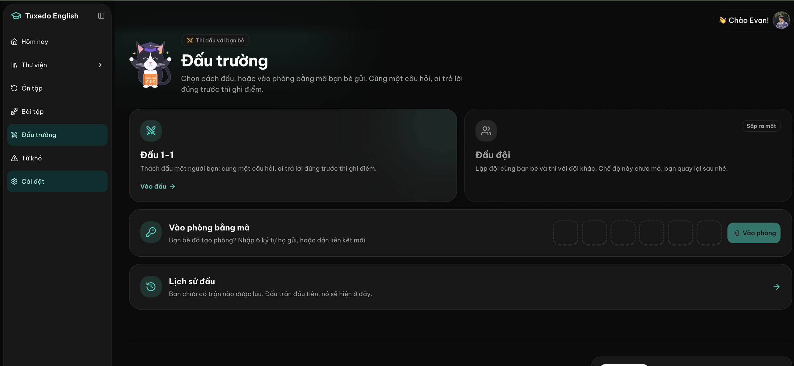

# Feature: Arena friends

## Overview

Learners meet in the Arena (features 023 to 028), but once a room closes they lose each other. The only way to play the same person again is to swap a room code outside the app, and nobody can tell whether a friend is studying right now. The owner wants learners who meet in the Arena to become friends, and to see their friends in the sidebar: who is online now, and for those who are not, when they were last active.

A friendship needs both sides to agree. One learner sends a request to someone they shared a room with, and the other accepts or declines. "Online" means the learner has Tuxedo English open, on any page.

Requests often go to someone who isn't online, for example when a learner goes back through their match history and sends a request to an old opponent. So each learner gets a notification bell in the page header. A request waits there until the receiver comes back, and they decide then whether to accept.

## Goals

- [x] A learner can send a friend request to the opponent of a duel they just played, and the other learner can accept it, without leaving the app or swapping codes
- [x] A signed-in learner sees all their friends in the sidebar on every app page, with who is online now and when each offline friend was last active
- [x] Nobody appears in another learner's friends list without having accepted
- [x] A learner who was offline when a request arrived sees it in the bell as soon as they open the app, and can answer it from there

## Out of Scope

| Feature | Reason |
|---------|--------|
| Inviting a friend straight into a duel | Not in v1 (owner's choice); rooms still start from a code or link |
| Adding a friend by code, name or search | Friends come only from the Arena in v1 |
| Hiding one's own online status | Not in v1 (owner's choice) |
| Chat or messages between friends | Not asked for |
| Blocking a learner | Declining and removing cover v1; revisit if abuse appears |
| Guests having friends | The Arena is signed-in only (feature 023) |
| Friends on the streak board or any other ranking | Not asked for |
| Notifications outside the app (email, push) | Not asked for |
| Bell notifications about anything other than friends (streak, lessons, Arena results) | v1 covers friend requests and accepted requests; the bell should allow more kinds later |
| Notification settings (muting kinds) | Only two kinds in v1 |

## User Stories

### P1: Send and accept a friend request

- As a learner who just played someone in the Arena, I want to send them a friend request, and as the learner who receives it, I want to accept or decline it, so that we can find each other again.
- **Why P1:** Without a way to connect, there is nothing to list.
- **Independent Test:** Minh and Lan finish a duel. Minh taps "Kết bạn" on Lan's card. Lan sees the request, accepts it, and each now has the other as a friend.

**Acceptance Criteria:**

- [x] AC-001: WHEN a signed-in learner sees another learner's card in an Arena room (the other player in the lobby, the Ready window or the match result, or either player while spectating those phases; not during a question, so it can't distract) and they are not friends and have no request between them THEN system SHALL show a "Kết bạn" button on that card
- [x] AC-002: WHEN a learner views a match in their match history (feature 025) whose opponent still has an account THEN system SHALL offer the same "Kết bạn" button for that opponent
- [x] AC-003: WHEN a learner taps "Kết bạn" THEN system SHALL send the request and show "Đã gửi lời mời" in place of the button everywhere that learner's card appears
- [x] AC-004: WHEN a learner receives a friend request THEN system SHALL add a notification to their bell with the sender's picture, "{tên} muốn kết bạn với bạn", when it arrived, and two buttons, "Đồng ý" and "Từ chối", whether or not the receiver was online when it was sent
- [x] AC-005: WHEN the receiver taps "Đồng ý" THEN system SHALL make the two learners friends of each other, show each in the other's friends list, and turn the notification into "Bạn và {tên} đã là bạn bè"
- [x] AC-006: WHEN the receiver taps "Từ chối" THEN system SHALL remove the request and its notification without telling the sender
- [x] AC-007: WHEN two learners are already friends THEN system SHALL show "Bạn bè" on each other's cards in place of "Kết bạn"
- [x] AC-008: WHEN a learner sends a request to someone who already sent them one THEN system SHALL make them friends at once instead of creating a second request
- [x] AC-009: WHEN a learner who is not signed in, or is not one of the two learners, tries to send, accept or decline a request by calling the service directly THEN system SHALL refuse it

### P1: See friends and who is online

- As a signed-in learner, I want my friends in the sidebar with who is online, so that I know who is around to play.
- **Why P1:** This is what the owner asked to see.
- **Independent Test:** Lan has Minh as a friend. With Minh's tab open, Lan's sidebar shows Minh as online. Minh closes the tab; a few minutes later Lan's sidebar shows Minh offline, "Hoạt động N phút trước".

**Acceptance Criteria:**

- [x] AC-010: WHEN a signed-in learner is on any app page with the desktop sidebar THEN system SHALL show a "Bạn bè" section under the navigation listing each friend's picture and name
- [x] AC-011: WHEN the friends list is taller than the space left in the sidebar THEN system SHALL scroll the list on its own, keeping the navigation in place
- [x] AC-012: WHEN a friend has Tuxedo English open in at least one tab THEN system SHALL show them as online with a green dot and "Đang trực tuyến"
- [x] AC-013: WHEN a friend has no tab open THEN system SHALL show them as offline with a grey dot and how long ago they were last active, in Vietnamese ("Vừa mới hoạt động", "Hoạt động 5 phút trước", "Hoạt động 3 giờ trước", "Hoạt động hôm qua", "Hoạt động 4 ngày trước"), and the date for anything older than a week
- [x] AC-014: WHEN the list shows THEN system SHALL put online friends first, then offline friends from most recently active, and SHALL show the count online ("2/7 đang trực tuyến")
- [x] AC-015: WHEN a friend opens or closes the app THEN system SHALL update their status in the learner's list within two minutes, without the learner reloading
- [x] AC-016: WHEN a learner has no friends THEN system SHALL show a small empty card that says friends come from the Arena, with no link (changed by quick 060)
- [x] AC-017: WHEN the screen is too narrow for the sidebar (phones) THEN system SHALL show the same friends list on its own page, reached from the Thêm sheet (changed by feature 032; it was a section on the Đấu trường page)
- [x] AC-018: WHEN a guest uses the app THEN system SHALL show no friends section

### P1: Notification bell

- As a learner who was away when someone sent me a request, I want a bell that keeps it for me, so that I see it when I come back and decide then.
- **Why P1:** Many requests go to learners who aren't online (match history), and without the bell they would never notice them.
- **Independent Test:** Lan is offline. Minh opens a past match with Lan in his history and taps "Kết bạn". Later Lan opens the app: the bell shows 1, and Lan accepts from the bell. Minh's bell then says Lan accepted.

**Acceptance Criteria:**

- [x] AC-022: WHEN a signed-in learner is on any app page, on desktop or phone THEN system SHALL show a bell button in the page header next to their greeting and picture, labelled "Thông báo" for screen readers
- [x] AC-023: WHEN a learner has unread notifications THEN system SHALL show their number on the bell (shown as "9+" above nine), and no number when there are none
- [x] AC-024: WHEN the learner opens the bell THEN system SHALL show their notifications, newest first, each with a picture, a short text and how long ago it arrived ("5 phút trước", "hôm qua"), unread ones marked, and SHALL count them all as read (since feature 034 these are the bell's "Cá nhân" tab; "Hệ thống" holds app announcements)
- [x] AC-025: WHEN the learner has no notifications THEN system SHALL show "Chưa có thông báo nào."
- [x] AC-026: WHEN a learner opens the app after a request arrived while they were away THEN system SHALL show it in the bell on the first page they load
- [x] AC-027: WHEN a notification arrives while the learner has the app open THEN system SHALL update the bell's number within two minutes, without a reload
- [x] AC-028: WHEN a learner's request is accepted THEN system SHALL add "{tên} đã đồng ý kết bạn" to the sender's bell; a declined request SHALL add nothing
- [x] AC-029: WHEN a request is cancelled by events (the two became friends another way, the sender deleted their account) THEN system SHALL remove its notification, or say "Lời mời này không còn nữa." if the receiver taps a button on it
- [x] AC-030: WHEN a guest uses the app THEN system SHALL show no bell
- [x] AC-031: WHEN someone calls the service directly to read or change another learner's notifications THEN system SHALL refuse it

### P2: Remove a friend

- As a learner, I want to remove someone from my friends, so that my list holds only the people I want.
- **Why P2:** Needed once lists grow, but the list works without it.

**Acceptance Criteria:**

- [x] AC-019: WHEN a learner opens a friend's menu in the list THEN system SHALL offer "Xóa bạn"
- [x] AC-020: WHEN the learner confirms "Xóa bạn" THEN system SHALL remove the friendship for both learners, without telling the other one, and both learners' cards SHALL show "Kết bạn" again; either can send a new request right away

### P2: Privacy notice covers friends

- As a learner, I want the privacy page to say what friends can see about me, so that I know before I accept anyone.
- **Why P2:** The privacy page (feature 029) must match what the app does.

**Acceptance Criteria:**

- [x] AC-021: WHEN a learner reads the privacy page THEN system SHALL say that friends see their name, picture, whether they are online and when they were last active, that the app stores friendships, requests, notifications and the last active time, and that deleting the account removes all of it

## Visual References

The Đấu trường hub today. The friends section goes in the empty sidebar space under "Cài đặt".

## Edge Cases

- WHEN a learner opens the app in several tabs or devices THEN system SHALL show them online while any one is open, and offline only after the last one closes
- WHEN a learner's tab stays open but the device sleeps or loses its connection, or the browser closes without saying goodbye, THEN system SHALL show them offline after at most five minutes, with the last active time of their last contact
- WHEN a learner deletes their account THEN system SHALL remove their friendships, requests and notifications, and they SHALL vanish from their friends' lists
- WHEN a learner taps "Kết bạn" on someone who deleted their account in the meantime THEN system SHALL say "Không tìm thấy người này." and leave the list unchanged
- WHEN the request was declined THEN system SHALL let the sender send a new request only after 7 days, showing "Đã gửi lời mời" until then
- WHEN a learner has 20 requests waiting to be answered from them THEN system SHALL refuse a new one from them with "Bạn đã gửi quá nhiều lời mời đang chờ."
- WHEN a learner taps their own card THEN system SHALL show no "Kết bạn" button
- WHEN a request is accepted or declined on another device THEN system SHALL update or drop its notification on this device within two minutes
- WHEN the bell is opened on one device THEN system SHALL count those notifications as read on the learner's other devices too
- WHEN a notification is older than 30 days THEN system SHALL remove it; a friend request removed this way stays unanswered and the sender may send again
- WHEN a learner has more than 50 notifications THEN system SHALL show the 50 newest
- WHEN the friends list can't load THEN system SHALL show "Không tải được danh sách bạn bè." with a retry button and keep the rest of the sidebar working
- WHEN a learner has never been active since this feature shipped THEN system SHALL show them offline with no time ("Chưa hoạt động gần đây")
- WHEN the sidebar is collapsed to icons THEN system SHALL hide the friends section and show one friends icon with the online count, which expands the sidebar when tapped

## Success Criteria

- [x] Two learners on different devices go from a finished duel to being friends in under 30 seconds
- [x] A friend's online or offline change shows up in the other learner's sidebar within two minutes in every test
- [x] A request sent while the receiver is offline is in their bell the first time they open the app afterwards, in every test
- [x] A learner never appears in a list of someone whose request they did not accept, including when the service is called directly
- [x] The service stays on the current free hosting plan at today's traffic

## Open Questions

- None

## Notes

- Owner's choices on 2026-11-08: requests need accepting; online means the app is open on any page; the list sits in the sidebar on every page; v1 actions are limited to removing a friend (no duel invites, no hidden status).
- 2026-11-08, owner added the notification bell: a request sent to an offline learner (for example from match history) must wait for them until they come back. Friend requests are answered from the bell only; the sidebar lists friends.
- Spectators show only as a count in a room (feature 026), so v1 offers "Kết bạn" on player cards and in match history, not on spectators.
- The 7-day wait, the 20 pending requests cap, the two- and five-minute windows and the 30-day, 50-item notification limits are proposals from the spec, not owner requirements; adjust in review.

## Baseline

### Current Behavior

- Signed-in learners play duels by sharing a room code or link (feature 023); up to three others can watch (feature 026); the host picks the next opponent (feature 027).
- Match history shows past opponents' names and pictures (feature 025).
- The desktop sidebar holds only the navigation; the space under it is empty. Phones use a bottom navigation bar.
- The page header shows only the greeting and the learner's picture, which links to Hồ sơ. The app has no notifications.
- The app stores no relationship between learners and no record of when a learner was last active.

### Gaps / Limitations

- Learners who meet in the Arena can't find each other again inside the app.
- Nobody can tell whether a friend is studying right now.
