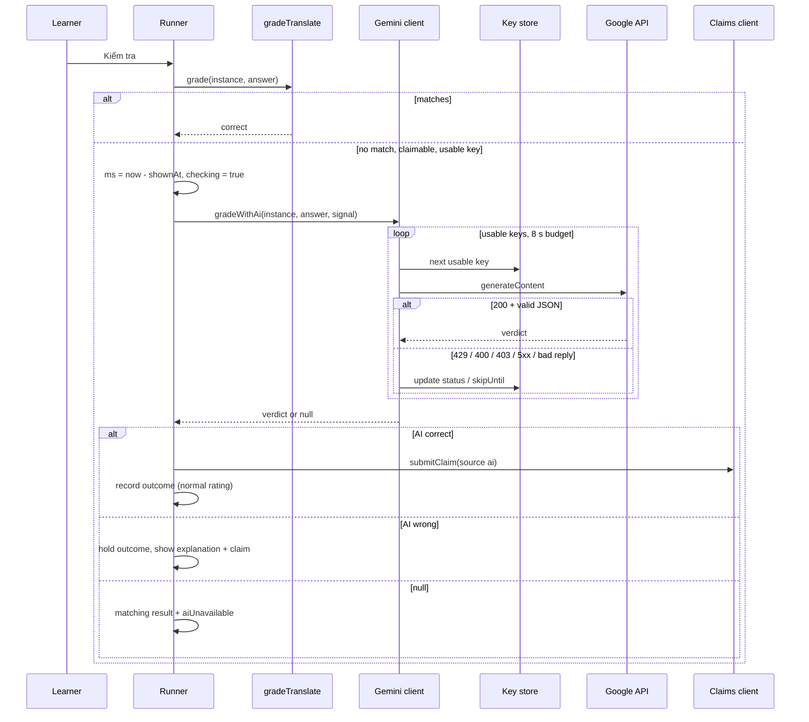

# Technical Design: AI grading for "Dịch câu" with the learner's own key

## Scope

In scope:

- A device-only key store (localStorage, as the sound and accent preferences already do) and a "Chấm điểm bằng AI" card in Cài đặt.
- A browser-only Gemini client that grades one translate answer, rotates keys on refusals and gives up within a fixed time budget.
- Pure helpers in `src/learning/` for the request, the response parsing, the error classification and the Pacific-midnight reset.
- Runner changes: an async second grading pass for translate, a "Đang chấm…" state, a normal-rated AI-correct result and a background claim marked `source: "ai"`.
- A `source` column on the server's claims (migration 0009), passed through the claims client, the API schema, the service and the owner's claim script.
- Sign-out and account deletion remove the keys. Privacy page text.

Out of scope: the Arena (it calls `gradeTranslate` directly at `src/learning/arena/questions.ts:160` and never goes through the runner, so it keeps matching with no change), other exercise kinds, any server-side AI, syncing keys.

## Research Summary

> From `.artifacts/research/learn-english-gemini-byok-grading.md` (2026-11-09)

- Endpoint: `POST https://generativelanguage.googleapis.com/v1beta/models/{model}:generateContent`, header `x-goog-api-key`. CORS is open to any origin, including on error responses, so plain `fetch` from the page works and error bodies are readable.
- Model: `gemini-3.5-flash-lite` (stable, free tier, structured output, default thinking `minimal`, no shutdown date). Fallback constant `gemini-3.1-flash-lite` (shuts down 2027-05-07).
- Thinking: `generationConfig.thinkingConfig.thinkingLevel: "minimal"`. Don't send `temperature`, `topP` or `topK` (ignored on 3.6+, to be rejected later).
- Structured output: REST examples now use `generationConfig.responseFormat`; the API reference still lists `responseMimeType` + `responseJsonSchema`. Which one the endpoint accepts is unconfirmed, so task 1 is a probe with a real key and the parser never depends on it (see Decisions).
- Errors: 400 `INVALID_ARGUMENT` with `ErrorInfo.reason: "API_KEY_INVALID"` for a bad key; 403 `PERMISSION_DENIED` for blocked keys, leaked keys or `FREE_TIER_VERIFICATION_REQUIRED`; 429 `RESOURCE_EXHAUSTED` with (community-reported, undocumented) `QuotaFailure.violations[].quotaId` containing `PerDay` or `PerMinute` and `RetryInfo.retryDelay`; 503 `UNAVAILABLE`; HTTP 200 with `promptFeedback.blockReason` or a non-`STOP` `finishReason` for blocked output.
- Daily quotas reset at midnight Pacific time. Quota is per Google Cloud project, not per key.
- `GET /v1beta/models` rejects a bad key with `API_KEY_INVALID`; a 200 does not prove the key can generate.
- Free tier: Google may use and human-review prompts and responses; users must be 18+; the free tier is not offered for EEA, UK and Swiss users.

## Patterns & Reuse

### Conventions to Follow

| Pattern | Project Uses | Avoid | Reference |
|---------|-------------|-------|-----------|
| Device-only preference | localStorage key `learn-english:*`, memory fallback when blocked, listeners for `useSyncExternalStore` | IndexedDB (it is what backup and sync export) or React context state | `src/lib/answer-sound.ts:7`, `:24-47`; `src/components/settings/sound-toggle.tsx:12` |
| Background network that must never block learning | Functions that swallow every error and return a value | Throwing into the runner | `src/claims/claims-client.ts:46-51`, `:58-84` |
| Pure rules apart from IO | `src/learning/**` has no fetch, React or storage | Prompt and parsing logic inside the fetch client | `.claude/rules/learn-english/04-architecture.md` |
| Grader per kind in the registry | `Entry.grade`, optional `claimOf` | `instance.kind === "translate"` checks in the runner | `src/components/exercise/registry.tsx:69-75`, `:106-107` |
| Zod at every boundary | Response parsed with `safeParse`, failure treated as "no answer" | Casting `response.json()` | `src/claims/claims-client.ts:71` |
| Settings card | `Card` + `CardHeader/CardTitle` + one client component per setting | A new page | `src/app/(app)/settings/page.tsx:59-75` |
| Event handlers | Named `handleX` above the return | Multi-line inline arrows | `.claude/rules/learn-english/05-event-handlers.md` |

### Existing Code to Reuse

| Component | Location | How to Use |
|-----------|----------|------------|
| `gradeTranslate` | `src/learning/exercises/translate.ts:104` | First pass, unchanged; AI runs only when it says wrong (AC-007) |
| `claimOfTranslate` / `canClaim` | `src/learning/exercises/translate.ts:118`, `:124` | Gate both the AI call and the AI claim, so blank and oversized answers never reach Google |
| `submitClaim` | `src/claims/claims-client.ts:47` | Send the AI-accepted wording, with `source: "ai"` |
| `GradeResult.explanationVi` | `src/learning/exercises/types.ts:17-18` | Carries the AI's Vietnamese explanation; `FeedbackPanel` already renders it (`src/components/exercise/feedback-panel.tsx:54`) |
| `rate()` | `src/learning/rating.ts:15-18` | Unchanged: an AI-correct result has no `hinted`/`typo`, so it rates good unless slow |
| `clearDevice` / `DEVICE_KEYS` | `src/storage/replace.ts:50-68` | Add the keys' localStorage key so sign-out and deletion remove them |
| `LegalSections` | `src/app/(app)/privacy/page.tsx:4`, `:64-75` | Add the Google AI line and the data-use paragraph |
| `Input`, `Button`, `Badge`, `Card`, `Label` | `src/components/ui/*` | Settings card; no new shadcn component needed |

## Data Model

### Entities

| Entity | Purpose |
|--------|---------|
| `AiKey` (new, localStorage) | One learner key, its order and its status |
| `GradeResult` (modify) | Marks a verdict as AI-made or a fallback |
| `StoredClaim` (modify) | Remembers whether the claim came from the learner or the AI |
| `claims` table (modify) | Stores the source for the owner's review |
| Claims API request (modify) | Carries the source |
| `ClaimRow` / `ClaimGroup` in the claim script (modify) | Shows the owner how many claims in a group were AI-accepted |

#### AiKey (new, `src/lib/ai-keys.ts`, localStorage `learn-english:ai-keys`)

- `id` (string, random UUID): stable reference for the list UI
- `key` (string): trimmed key text, never logged or sent anywhere but Google
- `status` ("working" | "quota" | "invalid")
- `skipUntil?` (number, ms epoch): set for `quota` (next Pacific midnight) and for a per-minute refusal (now + retry delay) while `status` stays "working"
- `reasonVi?` (string): Vietnamese reason shown for `invalid`
- The list's array order is the try order. At most `MAX_AI_KEYS = 5`.

#### GradeResult (`src/learning/exercises/types.ts:9-21`)

- `correct` (boolean), `typo?`, `hinted?`, `expected` (string), `explanationVi?`, `claimed?`: existing, lines 10-20
- `aiGraded?` (boolean): new. Set by the runner when the AI made the verdict
- `aiUnavailable?` (boolean): new. Set by the runner when AI grading was tried and every key failed, so matching decided (AC-016)

#### StoredClaim (`src/learning/types.ts:91-110`)

- `id`, `sentenceId`, `answer`, `expected`, `vi`, `related`, `createdAt`, `sentAt?`, `checkedAt?`, `status`, `explanationVi?`, `updatedAt`: existing, lines 93-109
- `source?` ("learner" | "ai"): new; missing means "learner" so stored claims and old backups stay valid
- Snapshot schema `claimSchema` (`src/learning/snapshot.ts:157-170`) gains `source: z.enum(CLAIM_SOURCES).optional()`; without it Zod would strip the field on restore.

#### claims table (`src/server/db/schema.ts:92-105`)

- `id`, `sentenceId`, `answer`, `deviceHash`, `day`, `createdAt`, `status`, `explanationVi`, `decidedAt`: existing, lines 95-103
- `source` (text enum "learner" | "ai", not null, default "learner"): new, migration `migrations/0009_claim_source.sql` (`ALTER TABLE claims ADD COLUMN source text DEFAULT 'learner' NOT NULL`)
- The conditional insert lists values by position (`src/server/claims/claims.service.ts:55-57`), so the new value goes in that SELECT list.

#### Claims request (`src/server/claims/claims.schema.ts:32-45`)

- `claimSchema`: `id`, `sentenceId`, `answer` (lines 33-35) plus new `source: z.enum(CLAIM_SOURCES).default("learner")`. An older client that omits it still validates.
- `CLAIM_SOURCES = ["learner", "ai"] as const` exported next to `CLAIM_STATUSES` (line 29).

#### Claim script (`scripts/claims.ts`)

- `ClaimRow` (lines 49-54): add `source`
- `PENDING_SQL` (line 375): select `source`
- `ClaimGroup` (lines 76-92): add `aiCount` (number), counted in `groupClaims` (lines 163-177), printed in the pull summary and written to the claims file

### Relationships

A `StoredClaim` maps 1:1 to a `claims` row by `id`. Keys have no relation to any stored entity and are never joined with progress.

### API Contracts

| Endpoint | Method | Request | Response |
|----------|--------|---------|----------|
| `/api/claims` (existing) | POST | `{ deviceId, claims: [{ id, sentenceId, answer, source? }] }` | unchanged `{ accepted: string[] }` |
| Google `v1beta/models` | GET | header `x-goog-api-key` | 200 = key accepted; 400 `API_KEY_INVALID`; 403 blocked |
| Google `v1beta/models/gemini-3.5-flash-lite:generateContent` | POST | `{ systemInstruction, contents: [{ role: "user", parts: [{ text }] }], generationConfig: { <JSON output field>, thinkingConfig: { thinkingLevel: "minimal" }, maxOutputTokens: 256 } }` | `candidates[0].content.parts[0].text` = JSON `{ "correct": boolean, "explanationVi": string }` |

### Currently Exposed Fields

| AC ID | Field | Source (file:line) | Currently Exposed? | Gap? |
|-------|-------|--------------------|--------------------|------|
| AC-003 | key masked (last 4) | none | no | must add (`AiKey.key`) |
| AC-003 | key status | none | no | must add (`AiKey.status`) |
| AC-009 | graded-by-AI label | none | no | must add (`GradeResult.aiGraded`) |
| AC-009 | reference sentence | `src/learning/exercises/translate.ts:19` (`en`), shown via `CorrectSentence` `src/components/exercise/translate-exercise.tsx:35` | yes | none |
| AC-010 | Vietnamese explanation | `src/learning/exercises/types.ts:18`, rendered `src/components/exercise/feedback-panel.tsx:54` | yes | must map (AI output into it) |
| AC-016 | "AI unavailable" notice | none | no | must add (`GradeResult.aiUnavailable`) |
| AC-017 | claim source | `src/server/claims/claims.schema.ts:32-36` | no | must add |
| AC-018 | AI-accepted count in review | `scripts/claims.ts:76-92` | no | must add (`ClaimGroup.aiCount`) |

## Decisions

| Decision | Rationale |
|----------|-----------|
| Keys in localStorage under `learn-english:ai-keys`, not IndexedDB | The backup file, sync code and account progress are all built from IndexedDB stores (`src/learning/snapshot.ts:44-61`), so keeping keys out of IndexedDB keeps them out of every export by construction (AC-005). Matches the owner's ask and the existing device-preference pattern |
| Two-pass grading: matching first, AI only on a mismatch | No quota or latency spent on answers matching already proves right (AC-007); Arena and every other kind are untouched |
| Async `aiGrade` on the registry `Entry`, translate only | Keeps the runner kind-agnostic, like `claimOf` |
| `ms` for the rating is taken when "Kiểm tra" is pressed, before the AI call | `rate()` marks answers over `SLOW_MS = 8000` (`src/learning/rating.ts:4`) as hard; the AI wait must not count as the learner's time |
| One 8 s budget per answer across all keys (one `AbortController` with a timer, chained to the step's controller) | AC-016 and the slow-reply edge case. Avoids `AbortSignal.any`, which older Safari lacks |
| The step's `AbortController` is aborted on continue, exit, retry start and unmount, and a late verdict is ignored when the step key changed | Edge case "learner leaves while grading"; prevents a double record |
| Failure classes: `quota-day` → `status: "quota"`, `skipUntil` = next Pacific midnight; `quota-minute`/unknown 429 → `skipUntil` = now + `retryDelay` (default 60 s), status stays working; 400 `API_KEY_INVALID` or 403 → `invalid` with `reasonVi`; 5xx, network, timeout of one call, unparseable or blocked reply → `transient` (try next key once, no status change) | Per the research and decisions.md. Unparseable replies get at most one more key, so a bad model day can't burn every key |
| Pacific midnight computed with `Intl.DateTimeFormat("en-US", { timeZone: "America/Los_Angeles" })` | Handles daylight saving without a library; pure and unit-testable |
| Structured output: send the JSON-output config chosen by the T1 probe, and always parse the reply text with Zod (strip code fences, `JSON.parse`, `safeParse`) | The REST field form is unconfirmed; the parser works whichever form is accepted, or even if the model ignores it and returns JSON text as instructed |
| The learner's answer is wrapped in `<answer>…</answer>` in the user turn; the system instruction says it is data to judge, never instructions | Prompt-injection edge case. Any wording that slips through still goes to owner review before other learners see it |
| An AI-correct answer is recorded at once (not held), with `{ correct: true, aiGraded: true }`, and sends a claim with `source: "ai"` when `claimOfTranslate` returns one | AC-009, AC-017; normal rating because neither `hinted` nor `typo` is set |
| An AI-wrong answer stays held as today, so "Câu của mình cũng đúng" still works and a claim from it is `source: "learner"` | AC-010 |
| Key check on add: `GET v1beta/models` with a 5 s timeout | No generation quota is known to be used; a 200 only means the key exists, so a later 403 on generate marks it invalid (edge case) |
| `MAX_AI_KEYS = 5` | decisions.md tentative |
| Keys removed in `clearDevice` | decisions.md: sign-out and account deletion |
| AI-accepted claims share the 30-per-day device cap (`src/server/claims/claims.schema.ts:8`) | A refused claim is dropped quietly and the learner's verdict stands; raising the cap is a one-line change if the owner sees it hit |

## Component Design

| Component | File | Action | Responsibility |
|-----------|------|--------|----------------|
| Grading rules | `src/learning/exercises/translate-ai.ts` | new | `buildGradingRequest(instance, answer)`, `parseGradingReply(json)`, `classifyFailure(status, body)`, `nextPacificMidnight(now)`, `usableKeys(keys, now)`; constants `AI_MODEL`, `AI_BUDGET_MS = 8000`, `KEY_CHECK_MS = 5000` |
| Key store | `src/lib/ai-keys.ts` | new | Read/write `learn-english:ai-keys` with memory fallback; `getAiKeys`, `addAiKey` (trim, dedupe, cap), `removeAiKey`, `moveAiKey`, `updateAiKey`, `hasUsableAiKey(now)`, `subscribeAiKeys`, `isAiKeyStorageBlocked` |
| Gemini client | `src/ai-grading/gemini-client.ts` | new | `checkAiKey(key)` and `gradeWithAi(instance, answer, signal, now)` looping usable keys under the budget, updating key statuses, returning `{ correct, explanationVi } \| null`; never throws |
| Grade result fields | `src/learning/exercises/types.ts` | modify | `aiGraded?`, `aiUnavailable?` |
| Registry | `src/components/exercise/registry.tsx` | modify | `Entry.aiGrade?`; translate entry gets `gradeWithAi` |
| View props | `src/components/exercise/types.ts` | modify | `checking?: boolean` so the input locks while grading |
| Runner | `src/components/exercise/exercise-runner.tsx` | modify | Async second pass in `handleCheck`, `checking` state, abort handling, AI claim, "Đang chấm…" button |
| Translate view | `src/components/exercise/translate-exercise.tsx` | modify | Lock input while `checking`; show the learner's answer and "Một cách nói khác" over the reference when `aiGraded` |
| Feedback panel | `src/components/exercise/feedback-panel.tsx` | modify | "Chấm bằng AI" line for `aiGraded`, fallback notice for `aiUnavailable`; AI-correct panels don't auto-hide |
| Claims client | `src/claims/claims-client.ts` | modify | `ClaimInput.source`, sent in `flushClaims` |
| Claim types | `src/learning/types.ts`, `src/learning/snapshot.ts` | modify | `StoredClaim.source?`, snapshot schema |
| Claims API | `src/server/claims/claims.schema.ts`, `claims.service.ts`, `src/server/db/schema.ts`, `migrations/0009_claim_source.sql` | modify/new | Accept and store `source` |
| Claim script | `scripts/claims.ts` | modify | Read `source`, `aiCount` per group, show it in the summary |
| Settings card | `src/components/settings/ai-grading-setting.tsx` | new | Explanation text, add form with check, ordered list with masked key, status badge, up/down/remove |
| Settings page | `src/app/(app)/settings/page.tsx` | modify | Card "Chấm điểm bằng AI" after "Âm thanh"; page description |
| Device clear | `src/storage/replace.ts` | modify | Add `learn-english:ai-keys` to `DEVICE_KEYS` |
| Privacy page | `src/app/(app)/privacy/page.tsx` | modify | Data and third-party sections, `UPDATED` |
| Docs | `.artifacts/features/learn-english/001-learn-english-app/decisions.md`, `016-translate-sentence/spec.md`, `.agents/baselines/learn-english/exercise-runner.md`, `.agents/knowledge.md` | modify | Pointers to 033, runner baseline, decisions and gotchas |

The settings card adds a section to an existing page, so `ui-ux-pro-max` is not required; it follows the other cards' layout. A 44 px minimum on every button, `aria-live` on the check result, and the key input set to `type="password"` with `autoComplete="off"` and a show/hide toggle.

## Data Flow

## Requirements Traceability

| Requirement | Component | File | Status |
|-------------|-----------|------|--------|
| AC-001 | Settings card text | `src/components/settings/ai-grading-setting.tsx` | Planned |
| AC-002 | `checkAiKey`, `addAiKey` | `src/ai-grading/gemini-client.ts`, `src/lib/ai-keys.ts` | Planned |
| AC-003 masked key | Settings card | `src/components/settings/ai-grading-setting.tsx` | Planned |
| AC-003 status | Settings card + `AiKey.status` | same + `src/lib/ai-keys.ts` | Planned |
| AC-003 reorder/remove | `moveAiKey`, `removeAiKey` | `src/lib/ai-keys.ts` | Planned |
| AC-004 | localStorage store | `src/lib/ai-keys.ts` | Planned |
| AC-005 | Keys outside IndexedDB; no server call takes them | `src/lib/ai-keys.ts`, test over snapshot + claims payloads | Planned |
| AC-006 | `hasUsableAiKey` gate | `src/components/exercise/exercise-runner.tsx` | Planned |
| AC-007 | Two-pass grading | `exercise-runner.tsx` | Planned |
| AC-008 | `checking` state | `exercise-runner.tsx`, `translate-exercise.tsx` | Planned |
| AC-009 | AI-correct result | `exercise-runner.tsx`, `feedback-panel.tsx`, `translate-exercise.tsx` | Planned |
| AC-010 | AI-wrong result | `exercise-runner.tsx`, `feedback-panel.tsx` | Planned |
| AC-011 | Same `onOutcome` path, `ms` before the call | `exercise-runner.tsx` | Planned |
| AC-012 | Arena unchanged | `src/learning/arena/questions.ts:160` (test only) | Planned |
| AC-013 | `classifyFailure` quota, rotation | `translate-ai.ts`, `gemini-client.ts` | Planned |
| AC-014 | `classifyFailure` invalid | same | Planned |
| AC-015 | `nextPacificMidnight`, `skipUntil` | `translate-ai.ts`, `ai-keys.ts` | Planned |
| AC-016 | Budget + `aiUnavailable` | `gemini-client.ts`, `exercise-runner.tsx`, `feedback-panel.tsx` | Planned |
| AC-017 | `source: "ai"` claim | `claims-client.ts`, `claims.schema.ts`, `claims.service.ts`, `0009_claim_source.sql` | Planned |
| AC-018 | `aiCount` | `scripts/claims.ts` | Planned |
| AC-019 | Existing rejection notice, unchanged | `src/claims/claims-client.ts:109-111` | Planned (test) |
| AC-020 | Privacy text | `src/app/(app)/privacy/page.tsx` | Planned |

## Test Strategy

### Infrastructure

| Aspect | Detail |
|--------|--------|
| Framework | Vitest (+ Testing Library), Playwright for e2e |
| Command | `pnpm --filter learn-english test`, `pnpm --filter learn-english e2e` |
| Location | Next to the source (`*.test.ts(x)`), `e2e/specs/*.spec.ts` |

### Reference Tests

| File | What It Tests |
|------|---------------|
| `src/components/exercise/exercise-runner.test.tsx` | Runner flows: check, claim, held outcome, auto-continue |
| `src/claims/claims-client.test.ts` | Background claim send with mocked fetch |
| `src/server/claims/claims.service.test.ts` | Conditional insert and daily cap |
| `scripts/claims.test.ts` | Grouping and auto decisions |
| `e2e/specs/translate.spec.ts` | Answer, claim, publish, accepted |

### New Tests

| Component | Test File | Scenarios |
|-----------|-----------|-----------|
| Grading rules | `src/learning/exercises/translate-ai.test.ts` | Request contains the Vietnamese, reference and delimited answer and no sampling params; reply parsing (plain JSON, fenced JSON, missing fields, blocked, `MAX_TOKENS`); each failure class from sample bodies; Pacific midnight across both DST switches; usable-key ordering with `skipUntil` |
| Key store | `src/lib/ai-keys.test.ts` | Trim, duplicate refused, cap of 5, move up/down, remove, persists across reads, memory fallback when localStorage throws, listeners fire |
| Gemini client | `src/ai-grading/gemini-client.test.ts` | Key 1 daily 429 → key 2 graded, key 1 `quota`; per-minute 429 → skip, still working; 400 invalid → `invalid`; all fail → null; budget timeout → null; abort → null without status changes; bad reply → one more key only; request carries `x-goog-api-key` and goes only to Google |
| Runner | `exercise-runner.test.tsx` (extend) | Match skips AI; AI correct → normal outcome recorded once, claim `source: "ai"`; AI wrong → held, explanation shown, claim button works; null → `aiUnavailable`; no keys → no AI call; leaving during grading records once and ignores the late verdict; `ms` excludes AI time |
| Arena | `src/learning/arena/questions.test.ts` (extend) | A non-matching but valid wording is wrong in the Arena even with keys set |
| Claims | `claims-client.test.ts`, `claims.service.test.ts`, `scripts/claims.test.ts`, snapshot test (extend) | `source` sent, stored, defaulted to learner, counted as `aiCount`, kept through a backup round trip; no payload contains a key |
| Device clear | `src/storage/replace.test.ts` (extend) | `clearDevice` removes the keys |
| Settings card | `src/components/settings/ai-grading-setting.test.tsx` | Add valid/invalid/offline/duplicate key, masked display, reorder, remove, blocked-storage notice |
| E2E | `e2e/specs/translate.spec.ts` (extend) | With Google stubbed via `page.route("https://generativelanguage.googleapis.com/**")`: add key in Cài đặt, a non-matching wording graded correct by AI, key 1 daily 429 → key 2, every key 429 → matching result with notice |

## Considerations

### Error Handling

- The Gemini client never throws; every failure becomes a key status change or a null verdict, and the runner falls back to matching (same rule as the claims client).
- Storage errors on the key store fall back to memory and the card says the keys won't be remembered.
- Errors from Google are mapped to short Vietnamese messages in the settings card ("Khóa không hợp lệ", "Đã hết lượt hôm nay", "Google yêu cầu xác minh tài khoản"); raw Google text is never shown.

### Security

- Keys go to exactly one host: `generativelanguage.googleapis.com`, in the `x-goog-api-key` header (not the URL, so they don't appear in logs or `Referer`). A test asserts no other request carries them.
- Keys live in localStorage, so any script running on the origin could read them. The app loads no third-party scripts today; this is recorded in knowledge.md so a future third-party script is weighed against it. Sign-out and account deletion clear them.
- The answer sent to Google is capped by `canClaim` (at most 500 characters and 3 times the reference), so the call is never used to send large text.
- Prompt injection can only flip the learner's own verdict; the wording still needs owner approval before it reaches anyone else.

## Open Questions

- [x] Which JSON-output field the REST endpoint accepts: no key was available for the T1 probe, so the client tries both (see tasks.md T001). Whether `thinkingLevel` must be uppercase is still unconfirmed; the client sends lowercase "minimal" as the docs' examples do, and a 400 on it would show up as a format error on both forms and fall back to matching.
