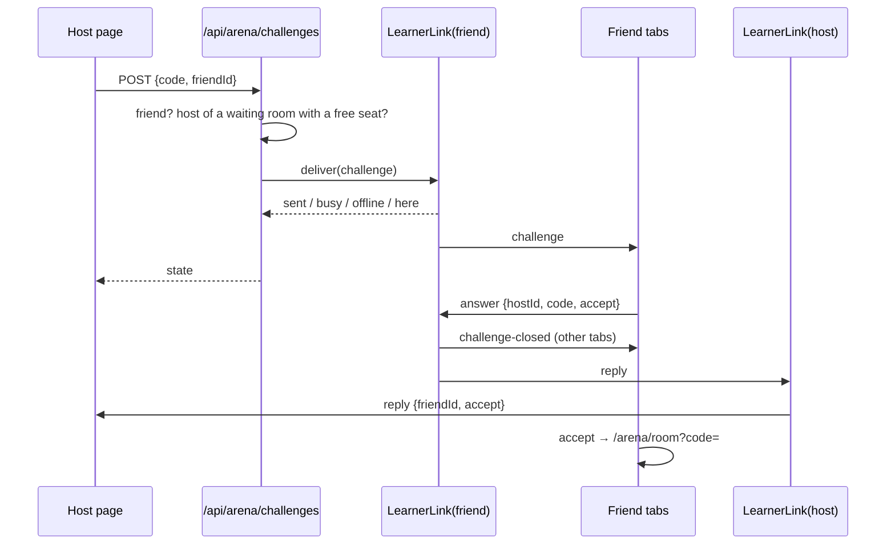

# Technical Design: Challenge a friend from the waiting room

## Scope

In: a per-learner socket ("link") for every signed-in tab, a challenge route, the lobby's friend list, the friend's toast. Out: see spec.md.

## Research Summary

No new technology. The link copies the Arena room's patterns: hibernated Durable Object sockets, an HMAC ticket in the subprotocol header, a custom-worker route before Next.js.

## Patterns & Reuse

### Conventions to Follow

| Pattern | Project Uses | Avoid | Reference |
|---------|-------------|-------|-----------|
| Socket identity | Signed ticket in `Sec-WebSocket-Protocol`, identity header set by the worker | Trusting ids from the browser | `src/server/arena/socket-route.ts` |
| Durable Object | Hibernation API, `getByName`, tags per user id | In-memory state that hibernation loses | `src/server/arena/room.ts` |
| Routes | `requireUser` → `readBody` → `isThrottled` → service; Vietnamese errors | Server Actions | `src/app/api/arena/join/route.ts` |
| Frames | Zod-parsed, pure protocol module shared with the browser | Ad-hoc JSON | `src/learning/arena/protocol.ts` |

### Existing Code to Reuse

| Component | Location | How to Use |
|-----------|----------|------------|
| `signTicket` / `verifyTicket` | `src/server/arena/ticket.ts` | Link tickets use the reserved code `LINK_CODE` (never a valid room code) |
| `ArenaRoom.status()` | `src/server/arena/room.ts` | Check the host owns a waiting room with a free seat |
| `useSocial` / `sortFriends` | `src/components/social/use-social.ts` | The lobby list and online states |
| `PlayerRow` look | `src/components/arena/players.tsx` | Same row style for friends |
| Sonner `toast` | `src/components/ui/sonner.tsx` | Friend's toast and the host's messages |

## Data Model

Nothing stored. A challenge lives only in the frames and in each side's memory; every message carries `hostId` + `code`, so the link objects stay stateless and hibernation loses nothing.

### Link frames (`src/learning/arena/link.ts`)

Browser → link: `{ type: "room", code: string | null }` (which room page this tab has open) · `{ type: "answer", hostId, code, accept }`.

Link → browser: `{ type: "challenge", from: {id,name,image}, code, settings }` · `{ type: "challenge-closed", hostId, code }` (cancelled, or answered in another tab) · `{ type: "reply", friendId, code, accept }`.

### API Contracts

| Endpoint | Method | Request | Response |
|----------|--------|---------|----------|
| `/api/arena/link` | POST | none | `{ ticket }` (60 s) |
| `/api/arena/link/socket` | GET (WebSocket) | subprotocol `["arena", ticket]` | 101 |
| `/api/arena/challenges` | POST | `{ code, friendId, name? }` | `{ state: "sent" \| "busy" \| "offline" \| "here" }`; 403 not host / not waiting, 404 not a friend, 409 seat taken |
| `/api/arena/challenges/cancel` | POST | `{ code, friendId }` | 204 |

## Decisions

| Decision | Rationale |
|----------|-----------|
| One `LearnerLink` Durable Object per user id | Reaches all of a learner's tabs with one `getByName`; same model as rooms |
| Challenge sent over HTTP, answers over the link | The route already has the session and D1 (friend check, one query); the answer only needs the friend's own identity, which the link has |
| Stateless links, timers in the browsers | Nothing to store or alarm; a stray answer for no pending challenge is ignored by the host's page |
| Busy from tab reports, not from rooms | No coupling between rooms and links |
| Host's page cancels on unmount | Leaving the room, or the seat filling, removes the list and with it every pending challenge |

## Component Design

| Component | File | Action | Responsibility |
|-----------|------|--------|----------------|
| Link protocol | `src/learning/arena/link.ts` | new | Frames, `CHALLENGE_MS`, `LINK_CODE`, parsers |
| `LearnerLink` | `src/server/arena/link.ts` | new | Sockets per learner; `deliver`, `cancel`, `reply` RPCs; room reports |
| Link socket route | `src/server/arena/socket-route.ts` | modify | `/api/arena/link/socket` → `LearnerLink` |
| Challenge service | `src/server/arena/challenge.service.ts` | new | Friend + room checks, then `deliver` / `cancel` |
| Routes | `src/app/api/arena/link/route.ts`, `src/app/api/arena/challenges/{,cancel/}route.ts` | new | Thin |
| Worker + wrangler | `worker.ts`, `wrangler.jsonc`, `cloudflare-env.d.ts` | modify | Export the class, binding `LEARNER_LINK`, migration `v2` |
| Link client | `src/lib/link-client.ts` | new | One socket per tab, reconnects, room report, listeners |
| `LinkRunner` | `src/components/arena/link-runner.tsx` | new | Root layout; opens the link when signed in; friend's toast |
| `ChallengeFriends` | `src/components/arena/challenge-friends.tsx` | new | Lobby list, pending rows, host messages |
| Lobby / room screen | `lobby.tsx`, `room-screen.tsx` | modify | Render the list; report the open room |

## Data Flow

## Requirements Traceability

| Requirement | Component | File | Status |
|-------------|-----------|------|--------|
| AC-001, AC-002 | ChallengeFriends | `src/components/arena/challenge-friends.tsx` | Done |
| AC-003 | Challenge route, LearnerLink.deliver, ChallengeFriends | `challenge.service.ts`, `src/server/arena/link.ts` | Done |
| AC-004 | LinkRunner | `src/components/arena/link-runner.tsx` | Done |
| AC-005, AC-006 | LinkRunner, LearnerLink.reply, ChallengeFriends | as above | Done |
| AC-007 | LearnerLink room reports, room screen | `src/server/arena/link.ts`, `room-screen.tsx` | Done |
| AC-008 | LearnerLink.deliver (no sockets) | `src/server/arena/link.ts` | Done |
| AC-009 | Browser timers on both sides | `challenge-friends.tsx`, `link-runner.tsx` | Done |
| AC-010 | Cancel route, unmount cancel | `challenge-friends.tsx`, `cancel/route.ts` | Done |
| AC-011 | LearnerLink answer → challenge-closed | `src/server/arena/link.ts` | Done |

## Test Strategy

### Infrastructure

| Aspect | Detail |
|--------|--------|
| Framework | Vitest + Testing Library |
| Command | `pnpm --filter learn-english test` |
| Location | next to the module |

### Reference Tests

| File | What It Tests |
|------|---------------|
| `src/server/arena/socket-route.test.ts` | Ticket checks before the Durable Object |
| `src/app/api/arena/routes.test.ts` | Route status codes and messages |
| `src/components/arena/lobby.test.tsx` | Lobby rendering with a fake handle |

### New Tests

| Component | Test File | Scenarios |
|-----------|-----------|-----------|
| Link protocol | `src/learning/arena/link.test.ts` | Valid and invalid frames |
| LearnerLink | `src/server/arena/link.test.ts` | offline / busy / here / sent; answer closes other tabs and replies to host |
| Challenge service | `src/server/arena/challenge.service.test.ts` | not friend, not host, not waiting, seat taken, delivered |
| Link socket route | `src/server/arena/socket-route.test.ts` | Link path needs a link ticket |
| ChallengeFriends | `src/components/arena/challenge-friends.test.tsx` | Button only for online friends; pending row; each reply's message; expiry |
| LinkRunner toast | `src/components/arena/link-runner.test.tsx` | Accept navigates and answers; decline answers; closed frame dismisses |

## Considerations

### Error Handling

- Link drops reconnect with backoff (1, 2, 4 … 30 s) and re-send the room report.
- Route errors use the Arena's Vietnamese messages; delivery failures from the Durable Object answer 503 "Đấu trường đang tạm nghỉ".

### Security

- Identity on both sockets comes only from signed tickets. Challenges are refused unless the two are friends (D1) and the caller hosts a waiting room. An answer can only speak for the learner who sends it.
- The per-IP `SOCIAL_LIMITER` throttles challenges with friend requests, so they never use up the creates and joins `ARENA_LIMITER` allows.

## Open Questions

- None
