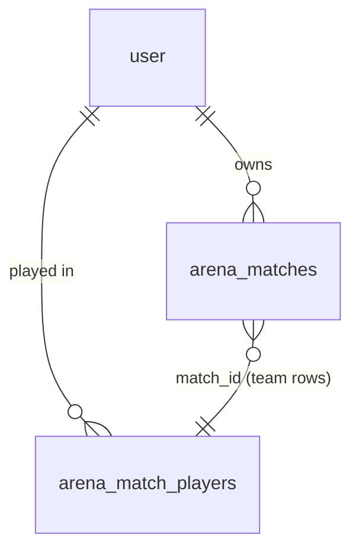

# Technical Design: Team Battle ("Đấu đội")

Paths are relative to `apps/learn-english/` unless they start with `apps/` or `.artifacts/`.

## Scope

**In scope:** team rooms for 2 to 10 players in the existing `ArenaRoom` Durable Object; a create route and the team screen at `/arena/team`; host team assignment and turn order; timed rounds with turns, the end-of-clock extra question, team hints, sudden-death pairs and draws; skip-on-disconnect; the team lobby, match and result screens inside `/arena/room`; team matches in "Lịch sử đấu"; the game guide; the hub card turned on.

**Out of scope:** everything in the spec's Out of Scope (more than two teams, spectators, Arena record changes, friend challenges into team rooms, chat). No change to how 1-1 duels play.

## Research Summary

> From `.artifacts/research/learn-english-realtime-arena.md`

- Free plan limits per day: 100,000 DO requests, 100,000 rows written, 5 million rows read. Rows written bind first: every `storage.put` and every `setAlarm()` is a row.
- Hibernation drops memory; the constructor reloads from storage. Deadlines are the single alarm, never `setTimeout`.
- **Budget for team matches (estimate, new):** a question costs about 4 rows written (open, reveal, two alarm changes), plus 1 for a hint. At a realistic 8 to 10 s per question, a 15-minute round is about 100 questions, so a 3 x 15-minute match is about 1,300 rows: roughly 75 such matches a day, or about 400 typical 1 x 5-minute ones. Fine for this app's audience; the design keeps typing signals and wrong typed answers out of storage to hold this.

## Patterns & Reuse

### Conventions to Follow

| Pattern | Project Uses | Avoid | Reference |
|---------|-------------|-------|-----------|
| Game rules | Pure reducer `reduce(state, event, now, …) → { state, effects }` + `nextAlarm(state)`; the DO only persists, runs effects and sets the alarm | Rules inside the DO class or React | src/learning/arena/machine.ts:543-582; src/server/arena/room.ts:176-198 |
| Socket frames | Zod discriminated unions, `parse*Frame` with a byte cap | Trusting identity or fields from the browser | src/learning/arena/protocol.ts:59-85 |
| Public view | `toPublic(state)` sends the open question without its answer, answer only in reveal | Sending the answer key early | machine.ts:584-611; questions.ts:136-153 |
| Routes | `requireUser` → `readBody(schema)` → `isThrottled` → service → `json`/`error` with Vietnamese messages | `parseBody`, English messages | src/app/api/arena/rooms/route.ts; src/app/api/arena/join/route.ts:15-36 |
| Code bundled by the worker | No `import "server-only"`, `db` passed in | `getDb()` inside the DO | knowledge.md gotcha (023); src/server/arena/history.ts:1-5 |
| Old stored state | Fill defaults where `ArenaRoom` loads state | Assuming new fields exist | room.ts:79-85; knowledge.md (026) |
| Event handlers | Named `handleX` beyond a one-line call | Multi-line inline handlers | `.claude/rules/learn-english/05-event-handlers.md` |

### Existing Code to Reuse

| Component | Location | How to Use |
|-----------|----------|------------|
| `ServerQuestion`, `ArenaPool`, `isCorrect`, `publicView`, `revealOf`, `letterMask`, `availableModes` | src/learning/arena/questions.ts:21-161 | Same questions and grading as 1-1 (spec AC-022) |
| `buildRound` | questions.ts:98-128 | Called in passes to build a long round deck (see Decisions) |
| `createRng`, `randomInt`, `shuffle` | src/learning/exercises/random.ts | Seeded decks and "Chia ngẫu nhiên" |
| `settingsSchema` fields, `QUESTION_TIMES`, `CODE_PATTERN`, `CLOSE_CODES`, `MAX_FRAME_BYTES`, `MAX_ANSWER_LENGTH` | protocol.ts:8-55 | Team settings reuse mode, level, seconds, rounds |
| `ArenaRoom` (DO) | src/server/arena/room.ts:72-246 | Same class and binding; dispatches on the stored room's kind. No new DO migration |
| `createRoom`/`joinRoom`/`playerName`/`randomCode` | src/server/arena/arena.service.ts:22-64 | Team create mirrors `createRoom`; `joinRoom` learns team capacity |
| `loadArenaPool` | src/server/arena/content.ts | Level content once per match |
| `recordMatch`, `listHistory` | src/server/arena/history.ts:25-88 | Extended for team rows |
| `useArenaRoom` socket loop | src/components/arena/use-arena-room.ts:59-163 | Socket, ticket refresh and reconnect core extracted and shared |
| `QuestionListen`, `QuestionRecall`, `QuestionWrite` | src/components/arena/question-views.tsx:37-211 | Turn player answers; everyone else gets `watching` |
| `LetterSlots` | src/components/arena/letter-slots.tsx:75 | Recall tiles; gains a hint prop for the first letter |
| `AnswerReveal`, `TimerBar`, `CountdownRing`, `SettingsFields` pieces, `InvitePanel`, `GameGuide` layout | src/components/arena/* | Same look as 1-1 |
| `SignInGate`, `useAccount`, `useProfile`, `learnerName` | room-screen.tsx:8-15, 114-127 | Team screen and room gate |
| `link.setRoom` | room-screen.tsx:46-52 | Friends see a learner in a team room as busy (feature 035) |

## Data Model

### Entities

| Entity | Purpose |
|--------|---------|
| `TeamRoomState` (new, DO storage key `room`) | Everything a live team room needs to survive hibernation, without its questions |
| Round decks (new, DO storage keys `deck:1` to `deck:3`) | Each round's questions with answer keys, written once when the match starts |
| `TeamSettings` (new) | What the host picks |
| `PublicTeamRoom` (new) | What browsers see |
| `RoomStatus` (existing, extended) | What the join route reads over RPC |
| `RoomTicket` (existing, extended) | Create/join response |
| `arena_matches` (existing, extended) | One history row per player per match |
| `arena_match_players` (new D1 table) | Who played on which team in a team match |
| `ArenaMatch` (existing, extended) | History response item |

#### TeamSettings (new, `src/learning/arena/team-protocol.ts`)

- `mode`, `level`, `seconds`, `rounds`: same schemas as `settingsSchema` -- protocol.ts:21-26
- `size` (int 2 to 10, host included)
- `minutes` (5 | 10 | 15): round length

#### TeamRoomState (new, `src/learning/arena/team-machine.ts`)

- `kind: "team"` (the duel `RoomState` has no `kind`; a stored state without it is a duel)
- `code`, `settings: TeamSettings`, `hostId`, `seed`
- `phase: "lobby" | "countdown" | "question" | "reveal" | "round-end" | "paused" | "match-end" | "closed"`
- `players: { id, name, image, connected, goneAt, left, answered, correct, recentAnswers }[]` (`left`: quit mid-match on purpose, out of the rotation for good; `answered`/`correct`: match totals for AC-041)
- `teams: { A: string[], B: string[] }`: ordered member ids = turn order (AC-010); a player in neither is "Chưa xếp đội"
- `cursor: { A: number, B: number }`: index of the member who answers that team's next question
- `round`, `starter: "A" | "B"` (who opens this round, AC-018), `turnTeam`, `turnPlayer`
- `deckIndex`: next question in this round's deck; `deckSizes: number[]` (0 until built)
- `asked: { A: number, B: number }`: main questions each team answered this round (AC-028)
- `roundEndsAt` (epoch ms) and `roundLeftMs` (frozen remaining time while paused)
- `stage: "main" | "extra" | "sudden"`, `suddenPair` (1 to 3), `pairResults: { A: boolean | null, B: boolean | null }`
- `scores: { A, B }`, `hints: { A, B }`, `roundsWon: { A, B }`
- `hinted: boolean` (current question already took a hint), `lastResult: { correct: boolean } | null`
- `deadline`, `idleUntil`, `pausedTeam: "A" | "B" | null`, `pausedFrom: Phase | null`
- `rounds: { round, scores: { A, B }, winner: "A" | "B" | null, suddenDeath: boolean }[]`
- `winner: "A" | "B" | "draw" | null`, `endReason: "won" | "forfeit" | "cancelled" | null`
- Not persisted on every keystroke: the "typing" relay keeps no state (one relay per question is checked against an in-memory set in the DO); a wrong typed answer only sends `wrong`, no state write.

#### Round deck (new)

- `ServerQuestion[]` -- questions.ts:29-32. Length `deckSize(settings) = ceil(minutes * 60_000 / MIN_TURN_MS) + 8` with `MIN_TURN_MS = 4_000` (fast answer + 2 s reveal), so 83 / 158 / 233 questions; `+8` covers the extra question and three sudden-death pairs. If play is even faster the deck wraps around (questions repeat late in the round). Built by calling `buildRound` in passes (each pass excludes nothing it can't refill), so short levels repeat items instead of running dry (spec edge case).

#### Room storage split

`room` holds the small `TeamRoomState`; `deck:{r}` keys hold decks. A 233-question deck with "Viết câu" items is about 150 to 250 KB; it is written once per match and read once per wake, so per-event writes stay a few KB. The DO keeps the current round's deck in memory and passes it to `reduceTeam`.

#### PublicTeamRoom (new)

- `kind: "team"`, `code`, `settings`, `hostId`, `phase`
- `players: { id, name, image, connected, answered, correct }[]`
- `teams: { A: TeamView, B: TeamView }`, `TeamView = { members: string[], score, hints, roundsWon }`
- `round`, `roundEndsAt | null`, `roundLeftMs | null` (paused), `stage`, `suddenPair`, `number` (questions asked this round, for "Câu 14")
- `turn: { team, userId } | null`, `deadline`, `question: PublicQuestion | null`, `questionType`, `hint: string | null` (AC-033/034), `lockedOut: boolean`
- `reveal: (Reveal & { correct: boolean; by: string }) | null` -- Reveal is protocol.ts:111-121
- `rounds`, `winner`, `endReason`, `pausedTeam`

#### RoomStatus (existing) -- room.ts:42-49

- `phase`, `creatorId`, `playerIds`, `spectatorIds`, `settings` + new `kind: "duel" | "team"`, `size: number` (2 for duels)

#### RoomTicket (existing) -- arena.schema.ts:47-52

- `code`, `ticket`, `settings: ArenaSettings` → `settings: ArenaSettings | TeamSettings` + new `kind: "duel" | "team"`

#### arena_matches (existing) -- src/server/db/schema.ts:227-249

- Read/written: `matchId`, `userId`, `opponentId`, `opponentName`, `opponentImage`, `won`, `forfeit`, `roundsWon`, `opponentRoundsWon`, `rounds` (JSON `HistoryRound[]`), `mode`, `level`, `bestOf`, `endedAt`
- New: `kind text NOT NULL DEFAULT 'duel'`, `team text` (null for duels; "A" or "B": the owner's team), `draw integer NOT NULL DEFAULT 0`
- Team rows: `opponent*` null; `roundsWon`/`opponentRoundsWon` are the owner's team vs the other team; `rounds` from the owner's team's side (`onTime` always false); `won` false on a draw.

#### arena_match_players (new) -- migration `0011_team_battle.sql`

- `match_id text`, `user_id text` (FK → `user.id` ON DELETE CASCADE, written by hand in the SQL, knowledge.md 022 gotcha), `team text` ("A" | "B"), `name text`, `image text`, `position integer` (turn order)
- PK (`match_id`, `user_id`); index on `match_id`
- One row per player per team match. A deleted account's row goes with it, so no snapshot of them survives (knowledge.md 025 gotcha), unlike the JSON-snapshot option.

#### ArenaMatch (existing) -- arena.schema.ts:62-74

- Existing members unchanged; new optional `team?: { mine: "A" | "B"; draw: boolean; members: { A: Member[]; B: Member[] } }`, `Member = { id, name, image }`. Duel entries never set it, so the duel history UI is untouched.

### Relationships



`arena_matches.match_id` groups a match's rows (one per owner); `arena_match_players.match_id` lists that match's members. No FK between them: both are written in the same batch and pruned together.

### API Contracts

| Endpoint | Method | Request | Response |
|----------|--------|---------|----------|
| `/api/arena/teams` (new) | POST | `{ mode, level, seconds, rounds, size, minutes, name? }` | 201 `RoomTicket` with `kind: "team"`; 401; 422; 429; 503 |
| `/api/arena/join` (existing) | POST | `{ code, name? }` | 200 `RoomTicket` now with `kind`; team rooms: 409 `full` when `playerIds.length >= size` or not in lobby, unless already seated |
| `/api/arena/matches` (existing) | GET | none | `ArenaMatchesResponse`; team entries carry `team` |
| `/api/arena/socket?code=` | GET upgrade | unchanged | unchanged; the DO picks the engine |

**Team socket frames** (`team-protocol.ts`):

Client → room: `assign { userId, team: "A" | "B" | null }`, `order { team, ids: string[] }`, `shuffle`, `start`, `typing { q }`, `answer { q, text }`, `choose { q, choice }`, `hint { q }`, `settings { settings: TeamSettings }`, `again`, `leave`. `q` is the round's question number.

Room → client: `team-state { room: PublicTeamRoom, serverNow }`, and the existing `typing`, `wrong`, `error` frames (protocol.ts:166-173).

### Currently Exposed Fields

| AC ID | Field | Source (file:line) | Currently Exposed? | Gap? |
|-------|-------|--------------------|--------------------|------|
| AC-004 | player name | ticket claims, room.ts:248-256 | yes | none |
| AC-004 | player avatar | room.ts:248-256 (`image`) | yes | none |
| AC-007 | settings line | settings-fields.tsx:31 (`settingsLine`) | duels only | must add team line (minutes, seconds, rounds) |
| AC-007 | seats filled | none | no | must add (`players.length`/`size`) |
| AC-017 | round clock | none | no | must add `roundEndsAt` |
| AC-017 / AC-030 | team scores, hint counts | none | no | must add `teams.*` |
| AC-020 | whose turn | none | no | must add `turn` |
| AC-033/034 | hint text | none | no | must add `hint` |
| AC-038 | each round's points | `RoundResult.scores` protocol.ts:123-130 (by player) | per player | must add team round results |
| AC-040 | history: teams' players | none | no | must add `arena_match_players` + `ArenaMatch.team` |
| AC-040 | history: round points | `arena_matches.rounds` schema.ts:242 | yes | must map from team side |
| AC-040 | history: result (draw) | `won` schema.ts:237 | win/loss only | must add `draw` |
| AC-041 | answered / correct per player | none | no | must add `players.answered/correct` |

## Decisions

| Decision | Rationale |
|----------|-----------|
| A separate pure machine `team-machine.ts` beside `machine.ts`, sharing `questions.ts` | The duel machine assumes two seats everywhere (`roundWinner` takes `[a, b]`, machine.ts:413-419; `endMatch` finds one loser, 438-451). Generalizing it would risk the shipped 1-1 duel for no gain |
| Same `ArenaRoom` DO and binding; it dispatches on `state.kind` (`"team"` vs absent). A small `engine` object per kind gives `reduce`, `nextAlarm`, `toFrame`, `needsPool` | One class means no new DO migration, the socket route and tickets stay as they are, and codes share one namespace |
| Questions live outside the state: one deck per round in `deck:{r}`, built for all rounds when the countdown ends (pool loaded once), passed into `reduceTeam` | A 15-minute round needs up to ~230 questions; keeping them in the `room` value would rewrite hundreds of KB on every answer, risking the 10 ms CPU limit |
| Deck length from the round length (`MIN_TURN_MS = 4 s`), wrapping if exceeded | A fixed count can't fit a timed round; wrapping avoids ending a round early |
| The match clock is `roundEndsAt`, a hard limit (changed 2026-11-10): while a question is open the alarm is the earlier of its deadline and `roundEndsAt`; at zero the question is revealed with no point and no other question opens | AC-027 (owner, after the first real match); AC-028 removed |
| Turn pick: from `cursor[team]`, the next member who is connected and not `left`; the cursor moves past them | Skips offline players (AC-042) and puts a returning player back in their place (AC-044) with no reordering |
| A whole team offline → phase `paused`, clock frozen in `roundLeftMs`, 30 s alarm → forfeit | AC-045; freezing keeps the other team from playing alone against the clock |
| Turn player drops mid-question → same question reopens for the next connected teammate with full time | AC-043 |
| Leaving mid-match on purpose sets `left` (out of rotation), not a forfeit; the match ends only if a whole team is gone | A 10-player match shouldn't end because one person quits; differs from 1-1 on purpose |
| No Ready window: host `start` when everyone is placed (decisions.md Tentative) | Fewer steps for 10 people |
| Hint mask is computed by the room, never on the client: recall `h****`, write first letter per word via the `letterMask` rule, from `instance.headword` / `instance.en` (translate.ts:19) | The answer never reaches a browser before the reveal (AC-026) |
| Typing relays and wrong typed answers don't write storage | Rows-written budget (Research Summary) |
| Team history: per-owner rows in `arena_matches` (kind, team, draw) plus members in `arena_match_players`, written and pruned in one `db.batch` | Reuses the duel list, pruning and route; a members table makes account deletion clean |
| One `/arena/room?code=` page for both kinds: the join ticket's `kind` picks `LiveDuel` or `LiveTeamRoom` | Invite links and the hub's code box keep working for both |
| Team create gets its own route `/api/arena/teams` | Keeps the duel body schema and its tests unchanged |
| Socket core extracted from `useArenaRoom` into `useRoomSocket(code, ticket, parse)`; `useArenaRoom` and `useTeamRoom` build on it | One reconnect/ticket loop; the duel hook's public API stays the same so its tests keep passing |
| Team assignment UI: tap a player for "Đội A / Đội B / Bỏ khỏi đội", up/down buttons for order | No drag-and-drop library; works with keyboard, screen readers and phones |

## Component Design

| Component | File | Action | Responsibility |
|-----------|------|--------|----------------|
| Team protocol | src/learning/arena/team-protocol.ts | new | `TeamSettings`, team client frames, `PublicTeamRoom`, `team-state` frame, `parseTeamFrame`, size/minutes constants |
| Team machine | src/learning/arena/team-machine.ts | new | `createTeamRoom`, `reduceTeam`, `nextTeamAlarm`, `toPublicTeam`, `teamNeedsDecks`, `buildTeamDecks`; lobby, assignment, turns, clock, extra question, hints, sudden-death pairs, draws, disconnects, play again |
| Hint mask | src/learning/arena/questions.ts | modify | `hintMask(question)`: first letter of a word / of each word, other letters masked, spaces, hyphens and apostrophes kept |
| Team history entries | src/learning/arena/history.ts | modify | `teamHistoryEntries(match, id)` → owner rows + member rows |
| Protocol | src/learning/arena/protocol.ts | modify | `RoomStatus`-facing `kind`; the team hook parses frames with the team schema, so `roomFrameSchema` is unchanged |
| Room DO | src/server/arena/room.ts | modify | Engine dispatch by kind; `createTeam` RPC; `status()` adds `kind`, `size`; deck storage and load in the constructor; `record-team` effect |
| Arena service | src/server/arena/arena.service.ts | modify | `createTeamRoom`; `joinRoom` uses `kind`/`size` (no spectators for teams); tickets carry `kind` |
| Schemas | src/server/arena/arena.schema.ts | modify | `createTeamBodySchema`; `RoomTicket.kind`; `ArenaMatch.team` |
| History service | src/server/arena/history.ts | modify | Insert team rows + members, prune members with their matches; `listHistory` reads members of the listed matches in the same batch |
| DB schema + migration | src/server/db/schema.ts; migrations/0011_team_battle.sql | modify/new | New columns on `arena_matches`, new `arena_match_players` |
| Account deletion | src/server/account/account.service.ts | check | Cascade covers member rows; verify with a test |
| Create route | src/app/api/arena/teams/route.ts | new | Team create |
| Client | src/lib/arena-client.ts | modify | `createTeamRoom`; `joinRoom` returns `kind` |
| Socket hook core | src/components/arena/use-room-socket.ts | new | Socket, subprotocol ticket, offset, reconnects, frame parse callback |
| Duel hook | src/components/arena/use-arena-room.ts | modify | Built on `useRoomSocket`, same API |
| Team hook | src/components/arena/use-team-room.ts | new | Team room state + `assign`, `order`, `shuffle`, `start`, `answer`, `choose`, `hint`, `typingStarted`, `changeSettings`, `again`, `leave` |
| Team page | src/app/(app)/arena/team/page.tsx | new | Static shell + `SignInGate` |
| Team setup | src/components/arena/team-setup.tsx | new | Size stepper, mode, level, minutes, seconds, rounds, "Tạo phòng", help button |
| Team settings fields | src/components/arena/team-settings-fields.tsx | new | Shared by setup and "Đổi cài đặt"; reuses `SettingsFields` parts; `teamSettingsLine` |
| Room screen | src/components/arena/room-screen.tsx | modify | Branch on ticket `kind`; shared header |
| Team lobby | src/components/arena/team-lobby.tsx | new | Seats "4/6 người", invite panel, columns Chưa xếp đội / Đội A / Đội B, host controls, start button with the missing reason |
| Team match | src/components/arena/team-match.tsx | new | Countdown, top bar (round clock, scores, hints), turn banner, question views, hint button, reveal, paused banner, leave dialog |
| Team results | src/components/arena/team-results.tsx | new | Winner or "Hòa", round table, members with answered/correct, "Chơi lại" for the host |
| Team guide | src/components/arena/team-game-guide.tsx | new | AC-048 |
| Letter slots | src/components/arena/letter-slots.tsx | modify | Optional `hint` shows the first letter in the first tile |
| Question views | src/components/arena/question-views.tsx | modify | Optional `hint` line under the prompt; pass to `LetterSlots` |
| Hub | src/components/arena/arena-hub.tsx | modify | "Đấu đội" becomes a link to `/arena/team` (AC-001) |
| History UI | src/components/arena/match-row.tsx, match-details.tsx | modify | Team rows: "Đội A 2–1 Đội B", "Hòa", members per team |
| Tests | see Test Strategy | new/modify | |

## Data Flow

```mermaid
sequenceDiagram
  participant H as Host browser
  participant API as /api/arena/teams, /join
  participant DO as ArenaRoom (team engine)
  participant D1
  participant P as Player browsers
  H->>API: POST teams {settings}
  API->>DO: createTeam(code, settings, host)
  API-->>H: {code, ticket, kind: team}
  P->>API: POST join {code}
  API->>DO: status() → kind, size, players
  API-->>P: ticket (or 409 full)
  H->>DO: socket; assign / order / start
  DO->>DO: countdown alarm
  DO->>D1: loadArenaPool(level) once
  DO->>DO: buildTeamDecks → put deck:1..3
  loop each question
    DO-->>H: team-state (turn, question, hint)
    DO-->>P: team-state
    P->>DO: answer / hint (turn player only)
    DO-->>P: team-state (reveal 2 s)
    DO->>DO: after reveal: clock left? next turn : extra question or round end
  end
  DO->>D1: db.batch(history rows + members, prune)
```

## Requirements Traceability

| Requirement | Component | File | Status |
|-------------|-----------|------|--------|
| AC-001 | Hub card | arena-hub.tsx | Planned |
| AC-002 | Team setup, create route, team settings | team-setup.tsx, teams/route.ts, team-protocol.ts | Planned |
| AC-003 | Invite panel reuse | team-lobby.tsx | Planned |
| AC-004 | Join service, room screen branch | arena.service.ts, room-screen.tsx | Planned |
| AC-005 | Join capacity + machine join | arena.service.ts, team-machine.ts | Planned |
| AC-006 | SignInGate on page and room | team/page.tsx, room-screen.tsx | Planned |
| AC-007 settings line | `teamSettingsLine` | team-settings-fields.tsx | Planned |
| AC-007 seats | Team lobby | team-lobby.tsx | Planned |
| AC-008–AC-013 | assign / order / shuffle | team-machine.ts, team-lobby.tsx | Planned |
| AC-014–AC-016 | start rules | team-machine.ts, team-lobby.tsx | Planned |
| AC-017 | round clock | team-machine.ts, team-match.tsx | Planned |
| AC-018, AC-019 | starter and cursor | team-machine.ts | Planned |
| AC-020, AC-021 | turn banner, watching views | team-match.tsx, question-views.tsx | Planned |
| AC-022–AC-024 | answer handling | team-machine.ts (questions.ts `isCorrect`) | Planned |
| AC-025 | 2 s reveal, next turn | team-machine.ts | Planned |
| AC-026 | public view | team-machine.ts `toPublicTeam` | Planned |
| AC-027 | round ends at zero | team-machine.ts, team-match.tsx | Done |
| AC-052–AC-054 | history tabs, team rows | match-history.tsx, match-row.tsx | Done |
| AC-029 | round result | team-machine.ts, team-match.tsx | Planned |
| AC-030, AC-031, AC-035, AC-036 | hint counts | team-machine.ts | Planned |
| AC-032 | hint button | team-match.tsx | Planned |
| AC-033 | recall mask + first tile | questions.ts `hintMask`, letter-slots.tsx | Planned |
| AC-034 | write mask | questions.ts `hintMask`, question-views.tsx | Planned |
| AC-037 | sudden-death pairs | team-machine.ts | Planned |
| AC-038, AC-039 | results, draw | team-machine.ts, team-results.tsx | Planned |
| AC-040 history players | members table | schema.ts, history.ts (server + learning), match-details.tsx | Planned |
| AC-040 round points | `rounds` from team side | learning/arena/history.ts | Planned |
| AC-040 result | `draw` column | schema.ts, history.ts, match-row.tsx | Planned |
| AC-040 no record change | no stats write for teams | room.ts | Planned |
| AC-041 | player answered/correct | team-machine.ts, team-results.tsx | Planned |
| AC-042–AC-047 | disconnects, leaving | team-machine.ts | Planned |
| AC-048 | team guide | team-game-guide.tsx | Planned |
| AC-049, AC-050 | settings change, size floor | team-machine.ts, team-lobby.tsx | Planned |
| AC-051 | play again | team-machine.ts, team-results.tsx | Planned |

## Test Strategy

### Infrastructure

| Aspect | Detail |
|--------|--------|
| Framework | Vitest (unit, jsdom for components), Playwright (e2e on the Cloudflare preview) |
| Command | `pnpm --filter learn-english test`, `pnpm --filter learn-english e2e` |
| Location | Next to the code (`*.test.ts(x)`), e2e in `e2e/specs/` |

### Reference Tests

| File | What It Tests |
|------|---------------|
| src/learning/arena/machine.play.test.ts | Driving the reducer with events and times |
| src/learning/arena/machine.drops.test.ts | Disconnect and grace timing |
| src/server/arena/room.test.ts | DO with fake storage and sockets |
| src/server/arena/history.test.ts | History writes with real SQL (`sqliteDb()`) |
| src/components/arena/lobby.test.tsx, duel.test.tsx | Screens from a mocked room handle |
| e2e/specs/arena.spec.ts | Two signed-in learners in one room |

### New Tests

| Component | Test File | Scenarios |
|-----------|-----------|-----------|
| Team machine: lobby | src/learning/arena/team-machine.lobby.test.ts | join up to size, full, assign/order/shuffle by host only, start rules and messages, size floor, host leaves lobby closes, idle close |
| Team machine: play | src/learning/arena/team-machine.play.test.ts | A/B alternation, round 2 starter, rotation with 3 vs 2, scoring, one pick in listen, retries in typed, late answers ignored, clock end mid-question, extra question for B, round end |
| Team machine: hints | src/learning/arena/team-machine.play.test.ts (hints block) | start at 1, +1 per correct, spend, refuse (not turn, 0, twice, listen), reset per round |
| Team machine: end | src/learning/arena/team-machine.end.test.ts | sudden-death pairs win/draw, 1-round draw, best of 3 with draws, play again |
| Team machine: drops | src/learning/arena/team-machine.drops.test.ts | skip offline member, reopen on mid-turn drop, rejoin place, whole team gone → pause and forfeit, `left` |
| Hint mask, decks | src/learning/arena/questions.test.ts | "happy" → "h****", "I am happy" → "I a* h****", hyphen/apostrophe kept, deck length and wrap on a short pool |
| Team history | src/learning/arena/history.test.ts, src/server/arena/history.test.ts | rows per owner, team side scores, draw, members saved, pruned, account deletion removes member row |
| Room DO | src/server/arena/room.test.ts | kind dispatch, decks stored once and reloaded after a wake, no write on typing/wrong |
| Routes | src/app/api/arena/routes.test.ts | team create validation, join capacity for team rooms |
| UI | team-setup.test.tsx, team-lobby.test.tsx, team-match.test.tsx, team-results.test.tsx, arena-hub.test.tsx, match-history.test.tsx | settings defaults, host-only controls, turn player vs watchers, hint button rules, result and draw, hub link, team history row |
| e2e | e2e/specs/arena-team.spec.ts | 3 learners: create, join, assign 2 vs 1, play a 5-minute round with a short test clock, hint, result |

The e2e needs a third Arena account (`e2e/fixtures/users.sql`) and a way to shorten the round in tests (a test-only minutes override the preview accepts, like the existing e2e content at A2). Watch the shared `ARENA_LIMITER` budget (knowledge.md 035).

## Considerations

### Error Handling

- Refused actions answer the sender with an `error` frame in Vietnamese (e.g. "Chỉ chủ phòng mới xếp đội được.", "Chưa đến lượt bạn.", "Đội bạn đã hết gợi ý.").
- If decks can't be built (level too short for the mode) the room closes with the existing `noQuestions` message (machine.ts:37).
- History writes run in their own try/catch like duels (room.ts:230-243); a failed write never blocks the result screen.

### Security

- Identity comes only from the ticket (room.ts:248-256); the turn player is checked in the room for `answer`, `choose`, `hint`.
- Answers and hint masks are computed server side; the deck never leaves the DO.
- Frames stay under `MAX_FRAME_BYTES`; `order` ids must be the team's current members, at most 10.
- Flood limit per player as in 1-1 (`MAX_ANSWERS_PER_SECOND`, machine.ts:29).

### Concerns

- `ArenaRoom` is shared with 1-1 duels: the dispatch must leave duel behaviour byte-for-byte the same. Existing room and machine tests must pass unchanged.
- Rooms saved before the deploy have no `kind`: absent means duel (knowledge.md 026 gotcha).
- `next dev` can't run rooms (knowledge.md 023 gotcha): build screens against a mocked handle, test live rooms with `pnpm cf:preview` or e2e.

## UI Direction

From the `ui-ux-pro-max` pass (2026-11-10). The database had no game or scoreboard entries, so this follows its general rules (accessibility, touch, color-not-alone) and the Arena's existing direction from feature 024.

- **Tokens only, no new palette.** Đội A uses `primary`, Đội B uses `arena-rival` (the duel's opponent color), winners `arena-gold`. Every team mark also carries its letter in a badge ("A", "B") and its name, so color is never the only signal.
- **Setup (`/arena/team`)**: the same one-panel card as `/arena/1v1` (024): header with a team icon and help button, then a "Số người" stepper (− / value / +, 44 px buttons, `aria-live` value), mode cards, level, a row with "Thời lượng mỗi hiệp" (5/10/15 phút), "Thời gian mỗi câu" and "Số hiệp" radios that wrap on narrow screens, and one full-width "Tạo phòng".
- **Lobby**: seats line ("4/6 người"), the invite panel (code, link, QR), then three stacked lists on phones (Chưa xếp đội, Đội A, Đội B), side by side from `md`. Each player row: avatar, name, numbered position in a team, offline dot. Host controls per row: "Đội A", "Đội B" toggle buttons and a "Bỏ khỏi đội" action; in a team, up and down buttons with labels ("Đưa Lan lên"). "Chia ngẫu nhiên" above the lists. "Bắt đầu" is full width at the bottom; when disabled, the reason sits right under it as text.
- **Match**: a sticky top bar with the round clock (mm:ss, `tabular-nums`), and two team chips (letter badge, score, hint count with a lightbulb icon). Below: a turn banner ("Lượt của Lan · Đội B", the turn team's color as a left border and the letter badge) with the question timer bar, then the question card reused from the duel. The turn player gets the answer field and a "Gợi ý (còn 2)" button; everyone else sees the same card read-only with a "Đang gõ…" dot. A hint shows as a monospace line above the field; for recall the first tile fills too.
- **Reveal**: the duel's answer reveal, with "Đúng!" or "Sai" plus an icon, for 2 s.
- **Results**: winner banner (gold, trophy) or "Hòa" (neutral), a table of rounds (A–B points per round, sudden death noted), the two teams with each player's "đúng/lượt", and "Chơi lại" for the host.
- **Motion**: 150 to 300 ms transitions, scale 0.97 on press, no movement under `prefers-reduced-motion`; the clock never animates its digits.
- **A11y**: live region for turn changes and reveals ("Đến lượt Đội B: Lan"), focus moves to the answer field only on the turn player's own device, every icon button has a label, 375 px with no horizontal scroll.

## Open Questions

- [ ] Durable Object storage value size limit for a large deck (~250 KB). If a value is capped lower than that, split each deck into chunks of 50 questions (`deck:{r}:{n}`). Verify in the DO room test task with the largest deck.
- [x] The `ui-ux-pro-max` pass is done; see UI Direction.
