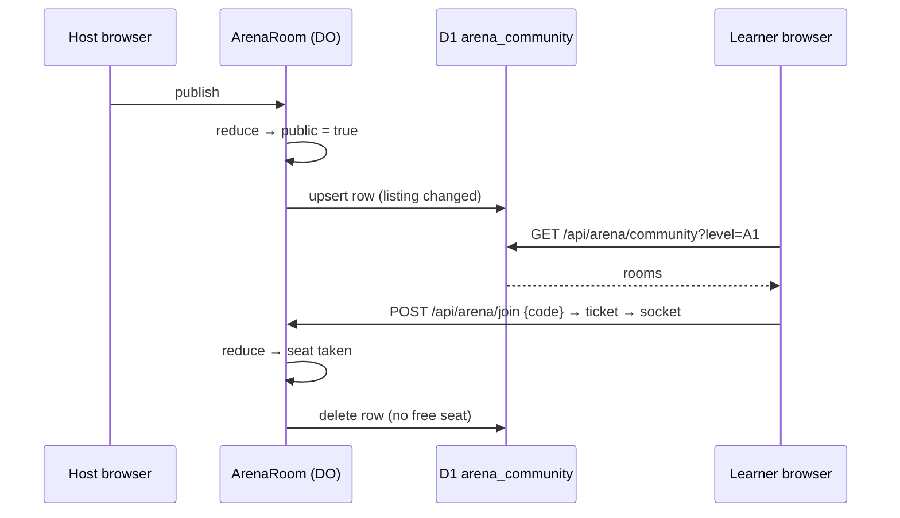

# Technical Design: "Cộng đồng" in the Arena

## Scope

In scope: a `public` flag on duel and team rooms set by a host frame; a D1 table of listed rooms that each room keeps in step with its own state; a GET route that lists them with filters; the hub card, the `/arena/community` page, and the button in both lobbies. Out of scope: live updates, unlisting by the host, spectating from the list (spec, Out of Scope).

## Research Summary

No new technology. Facts from the code:

- A room is a Durable Object named by its code; nothing in D1 points at a room (023 design, Relationships). `joinRoom` (src/server/arena/arena.service.ts:73-94) already refuses full and started rooms for both kinds.
- The room already writes D1 from the object with Drizzle on `this.env.DB` (room.ts:309-311, `recordMatch`), through modules without `server-only` (knowledge.md, 023).
- Rows written are the free plan's tightest limit (039 design). A listing write happens only when what the list shows changes.

## Patterns & Reuse

### Conventions to Follow

| Pattern | Project Uses | Avoid | Reference |
|---------|-------------|-------|-----------|
| Room rules | Pure reducers in `src/learning/arena/*-machine.ts`, the DO only persists and runs effects | Rules in `room.ts` | src/server/arena/room.ts:1-12 |
| D1 from the DO | Service taking `db` as a parameter, no `server-only` | Importing `@/server/db` `getDb()` in the DO | src/server/arena/stats.ts, history.ts |
| Routes | `requireUser` → parse → service → `json`/`error`, `no-store` | Logic in the route | src/app/api/arena/join/route.ts |
| API errors | `{ error: { message } }` Vietnamese, `ARENA_MESSAGES` | New wording for existing refusals | src/server/arena/arena.schema.ts |
| Client fetch | `src/lib/arena-client.ts` with `ArenaError` | `fetch` in components | src/components/arena/join-room.tsx:81-90 |

### Existing Code to Reuse

| Component | Location | How to Use |
|-----------|----------|------------|
| `joinRoom` (client) + `roomPath` | src/lib/arena-client.ts, join-room.tsx:23 | The row's "Vào phòng" calls it like the code box (AC-010) |
| `settingsLine` / team settings line | src/components/arena/settings-fields.tsx, team-settings-fields.tsx | Mode, level, rounds text of a row (AC-007) |
| `PlayerAvatar` | src/components/arena/players.tsx | Host avatar |
| `SignInGate`, `BackToHub` | arena/history/page.tsx | Page shell and guests (AC-014) |
| `LevelTabs`-like filter | src/components/library/level-tabs.tsx | Level filter (AC-008) |
| `ListSkeleton`, `ContentError`, `EmptyState` | src/components/shell/load-states.tsx | Loading, error, empty (AC-013) |

## Data Model

### Entities

| Entity | Purpose |
|--------|---------|
| `RoomState.public`, `TeamRoomState.public` | The host made this lobby public; cleared when the match starts |
| `arena_community` (D1, new) | One row per listed room |
| `CommunityRoom` | A row as the API returns it |

#### RoomState / TeamRoomState (existing) -- machine.ts, team-machine.ts

- `public` (boolean, new; absent on stored rooms = false)

#### PublicRoom / PublicTeamRoom (existing) -- protocol.ts:134, team-protocol.ts:101

- `public` (boolean, new) -- drives the lobby button and the "đang hiện" line (AC-002)

#### arena_community (new, migration `0012_arena_community.sql`)

- `code` text PK
- `kind` text ("duel" | "team")
- `level` text (filter)
- `host_id` text FK → `user.id` ON DELETE CASCADE (edge case: account deletion)
- `host_name` text, `host_image` text null
- `settings` text (JSON `ArenaSettings | TeamSettings`)
- `taken` integer, `seats` integer
- `updated_at` integer (epoch ms; newest first; rows older than 2 h are ignored and pruned)
- index (`updated_at`)

#### CommunityRoom (new, arena.schema.ts)

- `code`, `kind`, `settings`, `host { id, name, image }`, `taken`, `seats`, `updatedAt`

### Relationships

`arena_community.host_id` → `user.id`, cascade. Nothing points from a room to the row; the room owns it by code.

### API Contracts

| Endpoint | Method | Request | Response |
|----------|--------|---------|----------|
| `/api/arena/community` (new) | GET | `?kind=duel|team&level=A1…C1` (both optional) | 200 `{ rooms: CommunityRoom[] }` (≤ 50, newest first, `no-store`); 401/503 sign-in; 422 bad filter; 503 unavailable |
| `/api/arena/join` (existing) | POST | `{ code, name? }` | unchanged |

Socket: new client frame `{ type: "publish" }` in both `clientFrameSchema` and `teamClientFrameSchema`. Host only, lobby only, free seat only; anything else is ignored.

### Currently Exposed Fields

| AC ID | Field | Source (file:line) | Currently Exposed? | Gap? |
|-------|-------|--------------------|--------------------|------|
| AC-007 | host name | `players[host].name` machine.ts:594 / team | yes, in the room | must map into the row |
| AC-007 | host avatar | `players[host].image` | yes, in the room | must map |
| AC-007 | kind | `RoomStatus.kind` room.ts:67-86 | yes | must map |
| AC-007 | mode | `settings.mode` protocol.ts:21 | yes | must map (settings JSON) |
| AC-007 | level | `settings.level` | yes | must map (+ column for the filter) |
| AC-007 | rounds | `settings.rounds` | yes | must map (settings JSON) |
| AC-007 | seats taken | `players.length`, 2 or `settings.size` | yes | must map (`taken`, `seats`) |
| AC-002 | public flag | none | no | must add |

## Decisions

| Decision | Rationale |
|----------|-----------|
| The list is a D1 table written by the rooms, not a new "board" Durable Object | No new DO class or migration tag; level/kind filters are a SQL `WHERE`; account deletion cascades; the room already writes D1 |
| A pure `listingOf(state, now)` in `src/learning/arena/community.ts` returns the row or null (not public, not lobby, no free seat, closed) | One rule for both kinds, unit tested without Workers; AC-003/004 are just "null" |
| `ArenaRoom.apply` compares `listingOf` with the last one it wrote (kept in memory, compared without `updatedAt`) and upserts or deletes only on a change | Rows written stay low: a duel lobby writes about 3 times. After a wake the memory is empty: a listed room writes its row once more (harmless), an unlisted room that was never public writes nothing |
| Starting a match clears `public` in the machines (duel: ready → countdown; team: `start`) | AC-004: once started it's gone for good, even back in the lobby |
| Rows older than 2 h are skipped on read; each upsert also deletes rows older than that in the same `db.batch` | A row whose room died mid-write can't linger (edge case) without a write on every read |
| The community route only reads; joining reuses `/api/arena/join` | Same name, checks and messages as a code (AC-010/011) |
| `/api/arena/join` takes an optional `seatOnly`; the list sends it, and a duel with no free seat then answers `full` | A full duel lets a sixth-or-less person in as a spectator (feature 026, arena.service.ts:86-88); from the list the learner wants the seat, so a race must refuse, not silently seat them as a watcher (AC-011) |
| The refusal shows above the list, naming the host, not on the row | The list reloads at once and the row is gone by then |
| No new rate limiter for the list | It's a signed-in read behind a button, one D1 query; `ARENA_LIMITER` is shared by creates and joins (knowledge.md, 035) and shouldn't be spent on reads |
| The page keeps the list in TanStack Query with `staleTime: Infinity` and refetches only on "Làm mới" or after a failed join | AC-009: the list never changes on its own |
| Filters live in the URL (`?kind=&level=`), the level defaulting to the profile level | Same as the exercise library; shareable and kept on back |

## UI Direction

From `ui-ux-pro-max` (ux domain: empty states with an action, skeleton loading, URL state for deep links, 44 px targets), applied to the existing Arena look rather than a new system:

- Page shell like `/arena/history`: "Đấu trường" back link, title, one-line description, `max-w-3xl` column, `SignInGate`.
- Filter bar: a kind toggle group (Tất cả, Đấu 1-1, Đấu đội) full width on phones, a level select, "Làm mới" (icon spins while loading, reduced motion respected); stacked on phones, one row from `sm`.
- Rows: `rounded-2xl border bg-card` like the hub cards; host avatar, name, a kind chip in the hub colours (primary for 1-1, `arena-rival` for team), the settings line, seats with an accessible label, and a 44 px "Vào phòng" button that wraps under the details on phones.
- Hub card: a full-width row card like "Lịch sử đấu", in the success colour with a globe, so it reads apart from the two match kinds.
- States: `ListSkeleton`, `ContentError` with "Thử lại", and the mascot `EmptyState` with "Tạo phòng 1-1", "Tạo phòng đội" and "Bỏ lọc".

## Component Design

| Component | File | Action | Responsibility |
|-----------|------|--------|----------------|
| Listing rule | src/learning/arena/community.ts | new | `CommunityListing`, `listingOf`, `sameListing` |
| Duel machine | src/learning/arena/machine.ts | modify | `public` in state, `publish` event, cleared at countdown, in `toPublic` |
| Team machine | src/learning/arena/team-machine.ts | modify | same for team rooms, cleared at `start` |
| Protocols | src/learning/arena/protocol.ts, team-protocol.ts | modify | `publish` frame, `public` in public rooms |
| D1 table | src/server/db/schema.ts, migrations/0012_arena_community.sql | new | `arena_community` |
| Community service | src/server/arena/community.ts | new | `writeListing(db, listing)`, `removeListing(db, code)`, `listCommunity(db, filters, now)` |
| Room object | src/server/arena/room.ts | modify | keep the row in step after each `apply` |
| Route | src/app/api/arena/community/route.ts | new | GET with filters |
| Schemas | src/server/arena/arena.schema.ts | modify | `communityQuerySchema`, `CommunityRoom`, response |
| Client | src/lib/arena-client.ts | modify | `fetchCommunity(filters)` |
| Room hooks | use-arena-room.ts, use-team-room.ts | modify | `publish()` |
| Publish control | src/components/arena/publish-room.tsx | new | Button, then the "đang hiện" line; used by both lobbies |
| Lobbies | lobby.tsx, team-lobby.tsx | modify | render it for the host while a seat is free |
| Hub card | src/components/arena/community-card.tsx, arena-hub.tsx | new / modify | AC-006 |
| Community list | src/components/arena/community-list.tsx | new | filters, refresh, rows, join, empty/error |
| Page | src/app/(app)/arena/community/page.tsx | new | shell, metadata, `SignInGate` |

## Data Flow

## Requirements Traceability

| Requirement | Component | File | Status |
|-------------|-----------|------|--------|
| AC-001 | Publish control in lobbies | publish-room.tsx, lobby.tsx, team-lobby.tsx | Planned |
| AC-002 | `publish` event, `public` in public rooms | machine.ts, team-machine.ts, protocols | Planned |
| AC-003 | `listingOf` (free seat), room sync | community.ts (learning), room.ts | Planned |
| AC-004 | cleared at start; null when closed | machines, community.ts, room.ts | Planned |
| AC-005 | `sameListing` sees settings | community.ts, room.ts | Planned |
| AC-006 | Hub card | community-card.tsx, arena-hub.tsx | Planned |
| AC-007 host name | row `host_name` | community.ts (server), community-list.tsx | Planned |
| AC-007 host avatar | row `host_image` | same | Planned |
| AC-007 kind | row `kind` | same | Planned |
| AC-007 mode | `settings.mode` | same + settingsLine | Planned |
| AC-007 level | `settings.level` / `level` | same | Planned |
| AC-007 rounds | `settings.rounds` | same | Planned |
| AC-007 seats | `taken`/`seats` | same | Planned |
| AC-008 | filters | route, community-list.tsx | Planned |
| AC-009 | refresh only | community-list.tsx | Planned |
| AC-010 | join like a code | community-list.tsx | Planned |
| AC-011 | refusal on the row + reload | community-list.tsx | Planned |
| AC-012 | own room | community-list.tsx | Planned |
| AC-013 | empty state | community-list.tsx | Planned |
| AC-014 | guests | page.tsx (`SignInGate`) | Planned |

## Test Strategy

### Infrastructure

| Aspect | Detail |
|--------|--------|
| Framework | Vitest + Testing Library; `sqliteDb()` for SQL (knowledge.md, 007) |
| Command | `pnpm --filter learn-english test` |
| Location | next to each file (`*.test.ts(x)`) |

### Reference Tests

| File | What It Tests |
|------|---------------|
| src/learning/arena/machine.test.ts (if present) / room.test.ts | reducer events and effects |
| src/server/arena/history.test.ts | D1 service with `sqliteDb()` |
| src/app/api/arena/routes.test.ts | route status codes with mocked env |
| src/components/arena/lobby.test.tsx, team-lobby.test.tsx | lobby UI from a room fixture |

### New Tests

| Component | Test File | Scenarios |
|-----------|-----------|-----------|
| listing rule | src/learning/arena/community.test.ts | public duel lobby with 1 player listed; 2 players null; ready/countdown null; team free/full; not public null; closed null |
| machines | existing machine tests | `publish` only by host in lobby with a free seat; cleared at countdown/start; `public` in toPublic |
| service | src/server/arena/community.test.ts | upsert/replace, remove, filters, newest first, 50 cap, 2 h cutoff, prune on write |
| room sync | src/server/arena/room.test.ts | writes on publish, deletes when full, nothing when unchanged |
| route | routes.test.ts | 200 with filters, 422 bad filter, 401 guest |
| lobbies | lobby/team-lobby tests | button for host only, line after publish, hidden when full |
| list | src/components/arena/community-list.test.tsx | rows and details, filters in URL, refresh, join navigates, refusal message + refetch, own room, empty with links |

## Considerations

### Error Handling

- A failed listing write is logged and doesn't affect the room (like history writes, room.ts:376-381); the memory copy isn't updated, so the next change retries.
- Join refusals use `ARENA_MESSAGES` as today.

### Security

- Only the host can publish (checked in the reducer from the socket's user id, never from the frame).
- The list exposes host name, avatar and settings: the same a code holder sees today, now to any signed-in learner. Codes are listed only for rooms the host chose to publish.
- The route needs a session; filters are Zod-validated enums.

## Open Questions

- [ ] None
