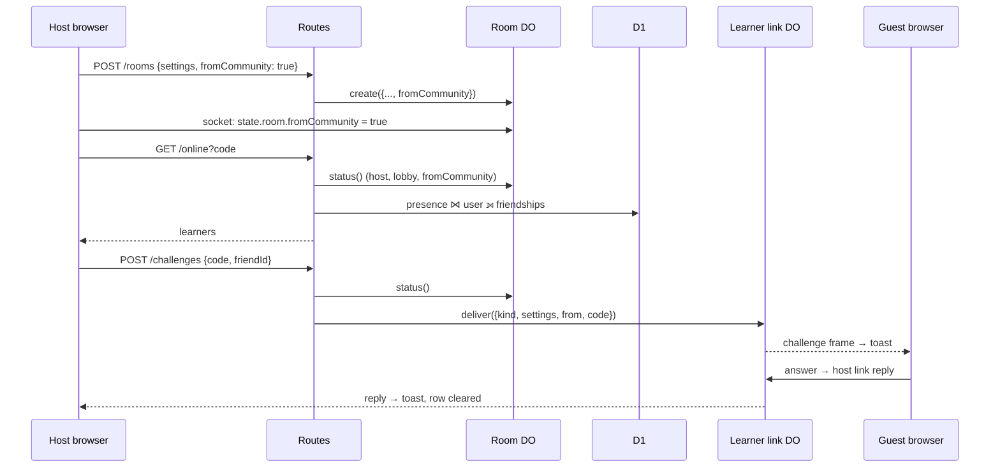

# Technical Design: Invite online learners to a room opened from Cộng đồng

Paths are relative to `apps/learn-english/`.

## Scope

In scope:

- A "from Cộng đồng" flag set when a room is created from the Cộng đồng links. The room keeps it in its own state, it reaches the browser in the room view, and the server's room status carries it too.
- A read-only "online learners" endpoint. Only the host of a waiting room that came from Cộng đồng can call it.
- Wider challenge rules. A room from Cộng đồng can invite non-friends, and team rooms from Cộng đồng can send invites at all.
- Invites that carry a team room's settings, both in the link frame and in the toast.
- One shared invite hook and an "Đang trực tuyến" list, used by the 1-1 lobby (under "Thách đấu bạn bè") and the team lobby.

Out of scope: anything for rooms not opened from Cộng đồng, a D1 schema change, and changes to presence or the pulse.

## Research Summary

No new technology. Everything builds on feature 035 (learner link, challenge routes), feature 031 (presence) and feature 041 (Cộng đồng, the room's `public` flag as a template for a per-room flag).

## Patterns & Reuse

### Conventions to Follow

| Pattern | Project Uses | Avoid | Reference |
|---------|-------------|-------|-----------|
| Per-room flag | Optional field on the machine state, defaulted in the public view and zod schema, so rooms saved before the change still parse | A required field that breaks saved rooms | `src/learning/arena/machine.ts:104`, `src/learning/arena/protocol.ts:166` |
| Route shape | `requireUser`, zod `readBody`/`safeParse`, `error(MESSAGES.x, status)`, `json(body, 200)`, `no-store`, `console.error` + 503 on throw | Throwing to the framework | `src/app/api/arena/challenges/route.ts`, `src/app/api/arena/community/route.ts` |
| Who-may-do-what checks | In the route/service with D1 + room status; the link DO only delivers | Checks in the browser only | `src/server/arena/challenge.service.ts:33` |
| D1 budget | One D1 call per handler | Extra round trips | knowledge.md learn-english (001) |
| Vietnamese copy | Short, "bạn", same terms as 035 | New words for the same thing | `.claude/rules/learn-english/06-writing-content.md` |
| List refresh | Load on open, "Làm mới" only, no refetch on focus | Polling | `src/components/arena/community-list.tsx` (useQuery options) |

### Existing Code to Reuse

| Component | Location | How to Use |
|-----------|----------|------------|
| Challenge state (pending map, timers, reply subscription, unmount cancel) | `src/components/arena/challenge-friends.tsx:51-130` | Extract into a `useChallenges` hook; both lists use it |
| `NOT_SENT`, `REPLY_MESSAGES` | `src/components/arena/challenge-friends.tsx:28-39` | Same messages for invites (AC-004) |
| Row UI ("Đang chờ · Ns", "Hủy") | `src/components/arena/challenge-friends.tsx:163-189` | Generalize the row: action label "Thách đấu" / "Mời", optional "Bạn bè" tag |
| `sendChallenge` / `cancelChallenge` client | `src/lib/arena-client.ts:100-116` | Unchanged endpoint, learner id in `friendId` |
| `isOnline`, `ONLINE_WINDOW_MS` | `src/server/social/presence.service.ts:35`, `src/server/social/social.schema.ts:21` | Same definition of online as the green dot |
| `friendsQuery` join style | `src/server/social/friends.service.ts:124` | Template for the online query |
| `teamSettingsLine` / `settingsLine` | `src/components/arena/team-settings-fields.tsx:13`, `settings-fields.tsx` | Toast subtitle per room kind |
| `PlayerAvatar` | `src/components/arena/players.tsx` | Avatar for an online learner (`{id,name,image}`) |
| `SOCIAL_LIMITER` throttle | `src/server/social/request.ts:43` | Already on the challenge route; invites share it |

## Data Model

### Entities

| Entity | Purpose |
|--------|---------|
| RoomState (duel) | Gains `fromCommunity` |
| TeamRoomState | Gains `fromCommunity` |
| PublicRoom / PublicTeamRoom | Carry `fromCommunity` to the lobby |
| RoomStatus | Carries `fromCommunity` to the challenge and online routes |
| Challenge / LinkFrame "challenge" | Carries the room kind and team settings |
| presence + user + friendships (D1) | Read for the online list |

#### RoomState (duel)

- `creatorId` (string): `src/learning/arena/machine.ts:69`
- `public?` (boolean): `src/learning/arena/machine.ts:104`, the pattern to copy
- NEW `fromCommunity?` (boolean): set by `createRoom` (`machine.ts:151`), never changed afterwards. Rematches spread the state, so the flag survives them

#### TeamRoomState

- `hostId` (string): `src/learning/arena/team-machine.ts:73`
- `public?` (boolean): `team-machine.ts:121`
- NEW `fromCommunity?` (boolean): set by `createTeamRoom` (`team-machine.ts:175`)

#### PublicRoom / PublicTeamRoom

- `public` (boolean, default false): `src/learning/arena/protocol.ts:166`, `src/learning/arena/team-protocol.ts:148`
- NEW `fromCommunity: z.boolean().default(false)` in both schemas. Both public views (`machine.ts:622`, `team-machine.ts:769`) emit `state.fromCommunity ?? false`

#### RoomStatus

- `kind`, `phase`, `creatorId`, `playerIds`, `spectatorIds`, `settings`: `src/server/arena/room.ts:69-89`
- NEW `fromCommunity: boolean` on both arms, filled in `status()` (`room.ts:171`)

#### Challenge (link DO RPC) / LinkFrame

- `from`, `code`, `settings: ArenaSettings`: `src/server/arena/link.ts:20`, `src/learning/arena/link.ts:33-46`
- NEW: the challenge becomes `{ kind: "duel"; settings: ArenaSettings } | { kind: "team"; settings: TeamSettings }` (plus `from` and `code`). In the frame schema `kind` defaults to `"duel"`, so a duel frame from the server is unchanged in shape for tabs that don't know `kind`

#### D1 (read only)

- `presence.userId`, `lastSeenAt`, `left`: `src/server/db/schema.ts:338-344`
- `user.id`, `name`, `image`
- `friendships.userId`, `friendId`

### Relationships

presence.userId → user.id (1:1). friendships(userId = host, friendId = learner) marks a friend. The online query left-joins friendships to set `isFriend`.

### API Contracts

| Endpoint | Method | Request | Response |
|----------|--------|---------|----------|
| `/api/arena/rooms` | POST | settings + `name?` + NEW `fromCommunity?: boolean` | unchanged `RoomTicket` |
| `/api/arena/teams` | POST | team settings + `name?` + NEW `fromCommunity?: boolean` | unchanged `RoomTicket` |
| NEW `/api/arena/online?code=XXXXXX` | GET | room code | `200 { learners: OnlineLearner[], now }`; `403` not the host of a waiting room from Cộng đồng; `422` bad code; `503` |
| `/api/arena/challenges` | POST | unchanged `{ code, friendId, name? }` (`friendId` may now be any learner id) | unchanged `{ state }`; refusals as today |

`OnlineLearner = { id: string; name: string; image: string | null; isFriend: boolean; lastSeenAt: number }`

### Currently Exposed Fields

| AC ID | Field | Source (file:line) | Currently Exposed? | Gap? |
|-------|-------|--------------------|--------------------|------|
| AC-001 | room's from-Cộng-đồng flag | none | no | must add (state, view, status) |
| AC-002 | online learner name | `src/server/db/schema.ts` user.name | no (only friends via `friendsQuery`) | must add (online query) |
| AC-002 | online learner avatar | user.image | no | must add |
| AC-002 | friend or not | `friendships` | no | must add (`isFriend`) |
| AC-005 | most recently active | presence.lastSeenAt `schema.ts:342` | no | must add (`ORDER BY lastSeenAt DESC LIMIT 30`) |
| AC-008 | team settings in the toast | `src/learning/arena/link.ts:45` | no (duel only) | must add (`kind` + team settings) |

## Decisions

| Decision | Rationale |
|----------|-----------|
| The flag lives in the room's state, set at create from a request field | The server must enforce AC-011 (no non-friend invites elsewhere). A URL-only flag would leave the server unable to tell. The flag also survives reloads (AC-001) with no extra storage, like `public` |
| The setup screens read `?from=community` from `window.location` when "Tạo phòng" is pressed | It's read inside the click handler, so the prerendered page shell is untouched and there's no Suspense or hydration concern. Going back to the hub drops the parameter (spec edge case) |
| The online list is gated by room: `?code=` must be a waiting room from Cộng đồng that the caller hosts | It limits who can see online learners' names to people who are actually inviting, and stops anyone from listing everyone online |
| One D1 query: presence ⋈ user ⟕ friendships, online window, not left, not me, `LIMIT 30` by `lastSeenAt DESC` | One call per handler. The presence table has one row per learner, so scanning it without an index is fine at this size. Players already in the room are filtered in the browser, which has the live list |
| Friends are filtered out in the 1-1 lobby but tagged in the team lobby | The 1-1 lobby already lists friends in "Thách đấu bạn bè" (spec AC-002 vs AC-007) |
| Reuse the challenge route, service and link, rather than a new "invite" endpoint | The delivery, busy/offline/here handling, replies, cancel and multi-tab are identical (AC-003, AC-004). Only the eligibility rule and the payload change |
| Challenge eligibility: lobby phase + caller is host → if not from Cộng đồng: team ⇒ refuse, non-friend ⇒ refuse; seats: duel 2, team `settings.size` | Keeps every existing refusal (035 tests), adds the community path. Room status is read first, and D1's friend check only runs when it matters |
| `kind` defaults to `"duel"` in the link frame schema | Duel frames keep their shape. A team frame reaching a tab from before the release fails that tab's parse and is ignored, so the host gets "chưa trả lời" after 30 s. The spec edge case is worded to match |
| Extract `useChallenges` from `ChallengeFriends` | Two lists need the same pending, timer, reply and cancel logic. Each list owns its own instance, and nobody can appear in both lists of one lobby, so the 1-per-learner rule (AC-009) holds |
| Lists mount only while a seat is free in the lobby, so unmount cancels pending invites | Same mechanism as 035 AC-010, which also gives AC-009's withdrawal for team rooms |

## Component Design

| Component | File | Action | Responsibility |
|-----------|------|--------|----------------|
| Duel machine | `src/learning/arena/machine.ts` | modify | `fromCommunity?` on state; `createRoom` input; public view |
| Team machine | `src/learning/arena/team-machine.ts` | modify | same for team rooms |
| Room schemas | `src/learning/arena/protocol.ts`, `team-protocol.ts` | modify | `fromCommunity` default false |
| Link protocol | `src/learning/arena/link.ts` | modify | challenge `kind` + settings union in `LinkFrame` and schema |
| Room DO | `src/server/arena/room.ts` | modify | `create`/`createTeam` accept `fromCommunity`; `status()` returns it |
| Learner link DO | `src/server/arena/link.ts` | modify | `Challenge` type with kind (delivery logic unchanged) |
| Arena schema | `src/server/arena/arena.schema.ts` | modify | `fromCommunity` on both create bodies; `onlineQuerySchema`; `OnlineLearner`/`OnlineResponse`; `notInvitable` message |
| Arena service | `src/server/arena/arena.service.ts` | modify | pass `fromCommunity` through `createRoom`/`createTeamRoom` |
| Create routes | `src/app/api/arena/rooms/route.ts`, `teams/route.ts` | modify | split `fromCommunity` from the settings |
| Challenge service | `src/server/arena/challenge.service.ts` | modify | new eligibility rule, team seats, kind in the delivery |
| Online service | `src/server/arena/online.service.ts` | new | `listOnline(db, me, now)` single query + mapping |
| Online route | `src/app/api/arena/online/route.ts` | new | auth, code check against room status, call service |
| Arena client | `src/lib/arena-client.ts` | modify | `createRoom`/`createTeamRoom` option `fromCommunity`; `fetchOnline(code)` |
| Community list | `src/components/arena/community-list.tsx` | modify | empty-state links add `?from=community` |
| Setup screens | `src/components/arena/duel-setup.tsx`, `team-setup.tsx` | modify | read the flag at create, pass it to the client |
| Challenge hook | `src/components/arena/use-challenges.ts` | new | extracted pending/timer/reply/cancel logic |
| Invite row | `src/components/arena/challenge-friends.tsx` | modify | use the hook; export a generic row (label, tag) |
| Online list | `src/components/arena/online-learners.tsx` | new | "Đang trực tuyến": query, Làm mới, empty state, rows with "Mời" |
| 1-1 lobby | `src/components/arena/lobby.tsx` | modify | render `OnlineLearners` (friends hidden) under `ChallengeFriends` when `room.fromCommunity` |
| Team lobby | `src/components/arena/team-lobby.tsx` | modify | render `OnlineLearners` (friends tagged) for the host while a seat is free and `room.fromCommunity` |
| Link runner toast | `src/components/arena/link-runner.tsx` | modify | team title ("mời bạn vào phòng đội!") and `teamSettingsLine` for `kind: "team"` |

## Visual Design Considerations

- **community-empty.png**: the two empty-state buttons are the only entry points that set the flag. Their look is unchanged.
- **duel-setup.png**: the create screen is unchanged (spec Out of Scope).

Key UI/UX patterns:

- "Đang trực tuyến" matches "Thách đấu bạn bè": a muted `text-sm` heading, rows `min-h-14 rounded-xl border bg-card`, 44 px buttons, `max-h-80` scroll.
- The heading row carries a small ghost "Làm mới" button. Its icon spins while fetching (`motion-reduce` respected).
- The empty state is the dashed box "Chưa có ai khác đang trực tuyến."; the error state is a short line with "Thử lại".
- Each row shows the avatar, the name, the green "Đang trực tuyến" status and the "Mời" button (`UserPlus` icon). Friends in team lobbies get a "Bạn bè" secondary badge.

## Data Flow

## Requirements Traceability

| Requirement | Component | File | Status |
|-------------|-----------|------|--------|
| AC-001 | links + setup + create routes + machines + room DO | community-list.tsx, duel-setup.tsx, team-setup.tsx, rooms/teams routes, machine.ts, team-machine.ts, room.ts | Done |
| AC-002 | OnlineLearners in Lobby, online route/service | lobby.tsx, online-learners.tsx, online/route.ts, online.service.ts | Done |
| AC-003 | useChallenges + challenge service | use-challenges.ts, challenge.service.ts | Done |
| AC-004 | NOT_SENT / REPLY_MESSAGES via hook | use-challenges.ts | Done |
| AC-005 | query options + LIMIT/ORDER | online-learners.tsx, online.service.ts | Done |
| AC-006 | empty state | online-learners.tsx | Done |
| AC-007 | OnlineLearners in TeamLobby (friends tagged) | team-lobby.tsx | Done |
| AC-008 | link kind + toast | link.ts (both), link-runner.tsx, challenge.service.ts | Done |
| AC-009 | hook per list, mount while seat free | use-challenges.ts, team-lobby.tsx | Done |
| AC-010 | gate on `room.fromCommunity` | lobby.tsx, team-lobby.tsx | Done |
| AC-011 | eligibility rule | challenge.service.ts | Done |

## Test Strategy

### Infrastructure

| Aspect | Detail |
|--------|--------|
| Framework | Vitest + Testing Library (unit), Playwright (e2e on Cloudflare preview) |
| Command | `pnpm --filter learn-english test`, `pnpm --filter learn-english e2e` |
| Location | next to the source, `*.test.ts(x)`; e2e in `e2e/` |

### Reference Tests

| File | What It Tests |
|------|---------------|
| `src/components/arena/challenge-friends.test.tsx` | pending rows, replies, cancel on unmount |
| `src/server/arena/arena.service.test.ts` | room status stubs for duel/team |
| `src/app/api/arena/routes.test.ts` | route auth, bodies, refusals |
| `src/server/arena/room.test.ts` | DO create/status |
| `src/components/arena/link-runner.test.tsx` | toast content and answers |
| `src/components/arena/team-lobby.test.tsx`, `lobby.test.tsx` | lobby sections per role |

### New Tests

| Component | Test File | Scenarios |
|-----------|-----------|-----------|
| challenge service | `src/server/arena/challenge.service.test.ts` (new) | friend ok anywhere; non-friend refused outside Cộng đồng; non-friend ok from Cộng đồng; team refused outside, ok from Cộng đồng; team seat full; delivery carries kind/settings |
| online service | `src/server/arena/online.service.test.ts` (new) | online window, left, self excluded, isFriend, order + limit (local D1 test helper as in friends.service.test) |
| routes | `routes.test.ts` | online: 401 guest, 422 bad code, 403 not host / not from Cộng đồng / not lobby, 200 list; create routes pass `fromCommunity` |
| machines/room | `room.test.ts` | flag set by create, in status and public view; absent on old state → false |
| link | `src/learning/arena/link.test.ts` or link-runner test | team frame parses; duel frame without kind parses; team toast text |
| UI | `online-learners.test.tsx` (new), `lobby.test.tsx`, `team-lobby.test.tsx`, `challenge-friends.test.tsx` | list shown only when fromCommunity + host + free seat; friends hidden in duel, tagged in team; Mời → pending; empty state; Làm mới refetches |
| setup | `team-setup.test.tsx`, duel test | `?from=community` passes the flag; no param → false |
| e2e | `e2e/arena-community-invite.spec.ts` (new) | two non-friend learners: Cộng đồng → Tạo phòng 1-1 → Mời → Chấp nhận → seated; own learners, few creates (ARENA_LIMITER budget) |

## Considerations

### Error Handling

- Online route: a room status error or D1 error gives 503 with `MESSAGES.unavailable`. The list shows the error line and "Thử lại".
- Invite refusals use today's messages; `notHost` covers "not a waiting room you host".
- Accepting after the seats fill goes through the room page's join path, as for 035.

### Security

- The server enforces eligibility (AC-011). The client gating is only for display.
- Online names and avatars go only to the host of a live waiting room from Cộng đồng (route gate). No emails, only id, name, image, isFriend and lastSeenAt.
- Invites keep the `SOCIAL_LIMITER` throttle. Spam from strangers is bounded by that throttle and the 30 s toast; blocking is out of scope.
- `fromCommunity` comes from the client, but all it unlocks is inviting people who are online, and the throttle still limits that. The worst case is a learner who sets it by hand on a hub-created room, which is harmless.

## Open Questions

- None
