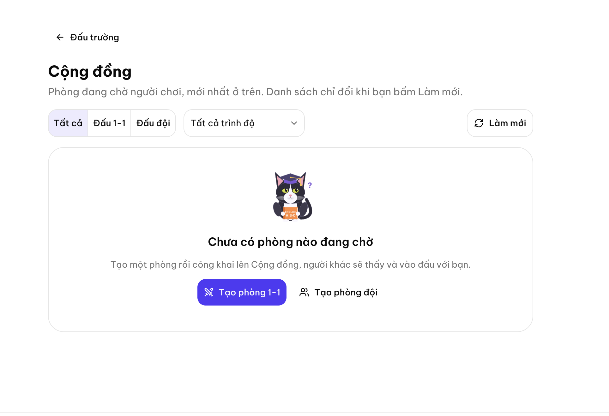
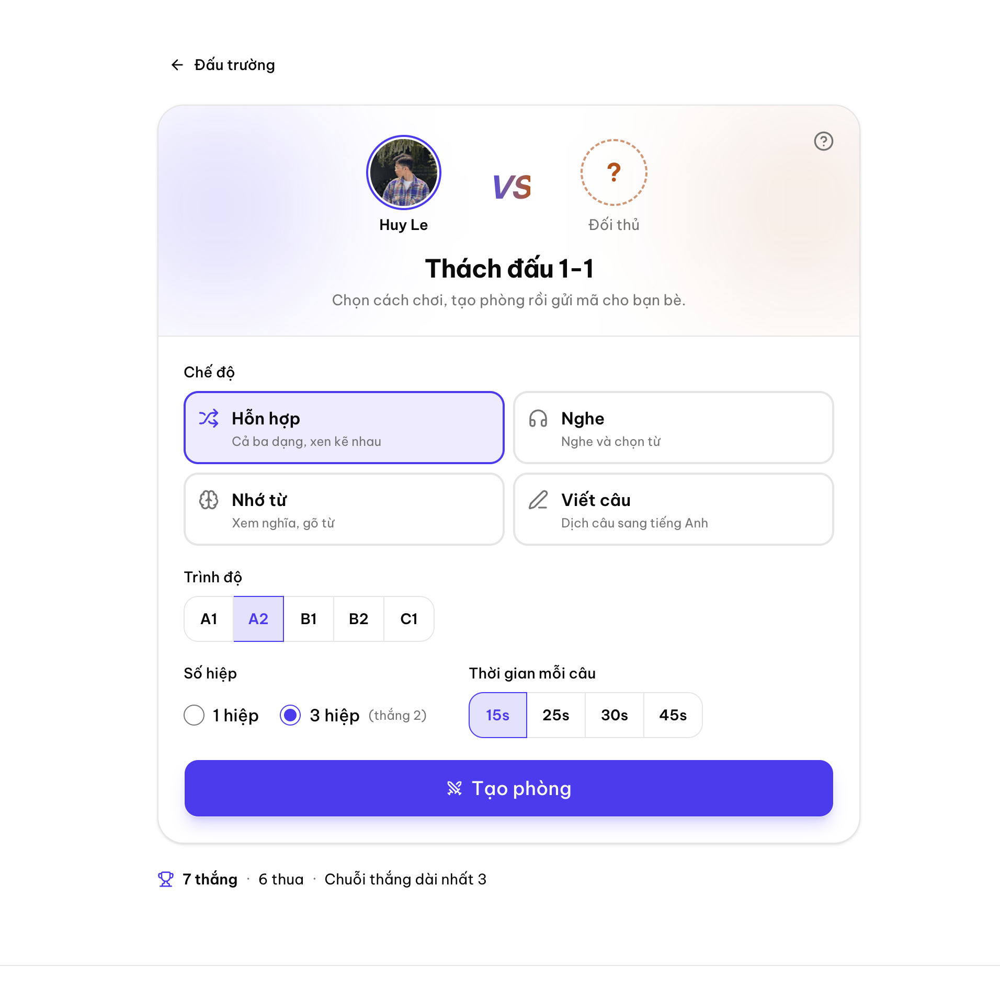

# Feature: Invite online learners to a room opened from Cộng đồng

## Overview

A learner who opens "Cộng đồng" and finds no room waiting (or none they like) can start their own with "Tạo phòng 1-1" or "Tạo phòng đội". Once it exists, they can only fill it by challenging a friend (1-1 rooms only), by publishing it and waiting, or by sending the code outside the app. Someone who came to Cộng đồng looking for a match often has no friend online, while other learners are on the site right now. The host of a room opened from Cộng đồng should see who is online and invite any of them, in 1-1 and team rooms alike. Rooms created any other way keep today's behaviour.

## Goals

- [x] A host whose room was opened from Cộng đồng can invite any online learner, friend or not, in two taps (Mời, then the learner's Chấp nhận), for both 1-1 and team rooms
- [x] Rooms created from anywhere else look and behave exactly as before this feature

## Out of Scope

| Feature | Reason |
|---------|--------|
| The online list in rooms not opened from Cộng đồng | The request: "keep as-is" when the room isn't created through Cộng đồng |
| Choosing invitees on the create screen, before the room exists | Chosen: the list lives in the waiting room, where a code exists to invite to |
| Making a room opened from Cộng đồng public automatically | Chosen: the host still decides with the existing publish switch |
| Filtering or sorting the online list by level | Chosen: every online learner, every level |
| Friend challenges in team rooms not opened from Cộng đồng | Not requested; team rooms elsewhere stay as feature 039 left them |
| Blocking or muting learners who send invites | Invites already have a send limit; a block list is a separate feature |
| Showing who is busy in another room before inviting | Only known at the moment of sending; the host is told then |

## User Stories

### P1: Invite an online learner to a 1-1 room opened from Cộng đồng

- As a host who came from Cộng đồng, I want to see who is online and invite them so that I get an opponent without needing a friend online
- **Why P1:** it is the request, and 1-1 already has the challenge flow to build on
- **Independent Test:** with two signed-in learners who are not friends, the host opens Cộng đồng → Tạo phòng 1-1 → Tạo phòng, taps Mời next to the other learner, who taps Chấp nhận and lands in the room as the second player

**Acceptance Criteria:**

- [x] AC-001: WHEN a learner taps "Tạo phòng 1-1" or "Tạo phòng đội" on the Cộng đồng page and creates the room THEN system SHALL remember that room as opened from Cộng đồng for as long as it exists, through reloads and reconnects
- [x] AC-002: WHEN the host of a 1-1 room opened from Cộng đồng is in the waiting room with a free seat THEN system SHALL show an "Đang trực tuyến" list below "Thách đấu bạn bè", with every other signed-in learner online right now who is not the host's friend and not in this room, each with a "Mời" button
- [x] AC-003: WHEN the host taps "Mời" THEN system SHALL deliver the invite exactly as a friend challenge is delivered (toast on any page, "Chấp nhận"/"Từ chối", 30 seconds), and the row SHALL show "Đang chờ" with the seconds left and "Hủy"
- [x] AC-004: WHEN the invited learner accepts, declines, is busy, has gone offline, does not answer in 30 seconds, or the host cancels THEN system SHALL end the invite with the same messages friend challenges use today
- [x] AC-005: WHEN the online list is shown THEN system SHALL load it on open and on a "Làm mới" button only, with the most recently active learners first, up to 30
- [x] AC-006: WHEN nobody else is online THEN system SHALL say so in the list's place ("Chưa có ai khác đang trực tuyến") and keep "Làm mới"

### P1: Invite online learners to a team room opened from Cộng đồng

- As a team-room host who came from Cộng đồng, I want to invite online learners so that I can fill the seats
- **Why P1:** the request covers both room kinds
- **Independent Test:** the host opens Cộng đồng → Tạo phòng đội → creates a 4-seat room, invites an online learner, who accepts and appears in "Chưa xếp đội"

**Acceptance Criteria:**

- [x] AC-007: WHEN the host of a team room opened from Cộng đồng is in the waiting room with at least one free seat THEN system SHALL show the "Đang trực tuyến" list with every other signed-in learner online right now who is not in this room, friends included and marked "Bạn bè", each with a "Mời" button
- [x] AC-008: WHEN a team invite reaches the learner THEN system SHALL show the toast with the team room's settings (team format and size), and "Chấp nhận" SHALL open the room the same way as joining by its code
- [x] AC-009: WHEN the host has several invites pending THEN system SHALL allow one pending invite per learner, any number at once, and SHALL withdraw them all when the seats fill, the match starts or the host leaves

### P2: Rooms opened elsewhere stay unchanged

- As a learner creating a room from the Arena hub or anywhere else, I want the waiting room I know
- **Why P2:** a guard on the P1 work, not a new behaviour

**Acceptance Criteria:**

- [x] AC-010: WHEN a room was not opened from Cộng đồng THEN system SHALL show no "Đang trực tuyến" list, a 1-1 room SHALL keep "Thách đấu bạn bè" as today, and a team room SHALL offer no invites
- [x] AC-011: WHEN anyone tries to invite a learner who is not their friend to a room not opened from Cộng đồng THEN system SHALL refuse it and deliver nothing

## Visual References

The Cộng đồng page with no waiting room: "Tạo phòng 1-1" and "Tạo phòng đội" are the entry points this feature tracks.

The create screen those buttons open. It stays as it is; the online list appears in the waiting room after "Tạo phòng".

## Edge Cases

- WHEN the host reaches the create screen from Cộng đồng but goes back and creates from the Arena hub instead THEN system SHALL treat the room as not opened from Cộng đồng
- WHEN an invited learner accepts after the seats filled, the match started or the room closed THEN system SHALL show the room page's usual message, as with a friend challenge
- WHEN a learner in the online list has gone offline since the list loaded THEN system SHALL tell the host they have just left when the invite is sent, as with a friend
- WHEN the host invites too quickly THEN system SHALL answer with the Arena's usual "too fast" message, sharing the friend-challenge limit
- WHEN the room's free seat fills while the list is open THEN system SHALL hide the list, as the friend list hides today
- WHEN the host's own row would appear THEN system SHALL leave the host out
- WHEN a 1-1 invite reaches a tab opened before this release THEN system SHALL show it as today's challenge toast; a team invite there SHALL go unshown and end for the host as unanswered after 30 seconds

## Success Criteria

- [ ] An invite reaches the learner's screen within 2 seconds of the tap, for both room kinds (audit 2026-11-21: the 1-1 e2e shows the toast well inside its 5 s wait, but the time is not measured, and team rooms are covered by unit tests only)
- [x] Every invite ends in exactly one message to the host
- [ ] The existing friend-challenge and Arena tests still pass without changes to their expectations (audit 2026-11-21: all pass, but six existing assertions were updated for the new `kind`/`fromCommunity` fields and the Cộng đồng link URLs; no behaviour they check changed)

## Open Questions

- None

## Notes

- The invite toast, timers, busy/offline handling and multi-tab behaviour are feature 035's; this feature widens who can be invited and adds team rooms, only for rooms opened from Cộng đồng.
- "Online" means what the friend list's green dot means today: active in the last few minutes and the last tab not closed.

## Baseline

### Current Behavior

- Cộng đồng lists public rooms with a free seat; its empty state links to the 1-1 and team create screens.
- A 1-1 waiting room shows "Thách đấu bạn bè" to the host while the seat is free: friends only, online friends get "Thách đấu", with a 30-second toast for the friend.
- A team waiting room has the code, the players, the teams and the publish switch; it takes no challenges.
- The server refuses a challenge to anyone who is not the host's friend, and any challenge to a team room.

### Gaps / Limitations

- A host with no friend online can only wait for strangers to find the published room, or share the code outside the app.
- Team hosts cannot bring anyone in from inside the app.
