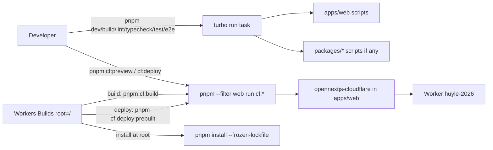

# Technical Design: Monorepo Migration

## Scope

**In scope:** move the site to `apps/web` (package `web`) with `git mv`; root pnpm workspace + Turborepo task pipeline; shared `@repo/typescript-config` and `@repo/eslint-config` packages consumed by `web`; root scripts for every current workflow; non-colliding Cloudflare script names; a two-phase rollout that keeps Workers Builds green; docs, agent rules and ignore files updated to the new layout.

**Out of scope:** the second app; extracting UI / i18n / content packages; any site code change; CI; Turborepo remote cache (see spec Out of Scope, decisions.md).

## Research Summary

> From .artifacts/research/turborepo-pnpm-opennext-cloudflare.md

- Next 16 auto-detects the Turbopack root from the root `pnpm-lock.yaml`; no `turbopack.root` needed with workspaces.
- OpenNext Cloudflare detects `monorepoRoot !== appPath` and patches its output (`node_modules/@opennextjs/cloudflare/dist/cli/build/bundle-server.js:156-158`); `wrangler.jsonc` / `open-next.config.ts` stay beside the Next app.
- Turborepo `envMode` defaults to `strict`: undeclared env vars are hidden from tasks.
- `pnpm deploy` is a pnpm built-in; `pnpm <script>` shorthand never reaches a script with that name.
- Workers Builds root directory is where install context, `wrangler.jsonc` lookup and commands run; whether install walks up to a root lockfile is undocumented, so the design keeps root directory `/`.
- `next dev` writes `AGENTS.md` / `CLAUDE.md` into the **Next project dir** (`node_modules/next/dist/server/lib/generate-agent-files.js:91-118`).

## Patterns & Reuse

### Conventions to Follow

| Pattern | Project Uses | Avoid | Reference |
|---------|-------------|-------|-----------|
| Script names | short verbs (`dev`, `build`, `lint`, `test`, `e2e`) | renaming the everyday ones | `package.json:5-15` |
| Import alias | `@/*` → `src/*`, app-local | `@/` inside shared packages | `tsconfig.json:21-23` |
| Flat ESLint config | `defineConfig` + `globalIgnores` | legacy `.eslintrc` | `eslint.config.mjs:1-24` |
| Config comments | one-line "why" comments | narration | `eslint.config.mjs:19`, `pnpm-workspace.yaml:1-3` |
| Quality gates | lint, tsc, test, build, e2e, preview | skipping preview for deploy-path changes | `.artifacts/quick/repo/002-pnpm-switch/task.md` |

### Existing Code to Reuse

| Component | Location | How to Use |
|-----------|----------|------------|
| Workspace file | `pnpm-workspace.yaml:4-7` | extend with `packages:` globs; keep `onlyBuiltDependencies` |
| ESLint config | `eslint.config.mjs:1-24` | body becomes `@repo/eslint-config/next`; app file re-exports it |
| tsconfig | `tsconfig.json:1-36` | compilerOptions → `@repo/typescript-config/nextjs.json`; app keeps `paths`, `include`, `plugins` |
| Vitest / Playwright / PostCSS / Next / OpenNext / wrangler configs | repo root | `git mv` unchanged into `apps/web/` (all paths inside are app-relative) |

## Data Model

No runtime data model. The "entities" are the configuration contracts the move rewires.

### Entities

| Entity | Purpose |
|--------|---------|
| Root manifest scripts | the commands developers and Workers Builds call |
| App manifest scripts | per-app commands turbo / pnpm filter invoke |
| Turbo task graph | caching and ordering of root commands |
| Workers Builds settings | dashboard build/deploy commands (outside repo) |
| Env var contract | vars the build reads |
| Agent rule scoping | path globs that activate `.claude/rules` |

#### Root manifest scripts (today, `package.json`)

- `dev` (`next dev`) -- package.json:6
- `build` (`next build`) -- package.json:7
- `lint` (`eslint`) -- package.json:9
- `test` (`vitest run`) -- package.json:10
- `e2e` (`playwright test`) -- package.json:12
- `preview` (opennext build && preview) -- package.json:13
- `deploy` (opennext build && deploy) -- package.json:14
- `cf-typegen` (`wrangler types …`) -- package.json:15

#### Env var contract

- `GOOGLE_SITE_VERIFICATION` (optional string, read at build) -- src/app/layout.tsx:108

#### Deploy target

- `name: "huyle-2026"`, `main: ".open-next/worker.js"`, `assets.directory: ".open-next/assets"` -- wrangler.jsonc:3-9 (all relative to the wrangler file, so unchanged after the move)

#### Agent rule scoping

- `paths:` globs `src/components/**`, `src/app/**`, `src/lib/i18n/dictionaries/**`, `src/content/**` -- .claude/rules/i18n-locale-content.md:5-8 (stop matching after the move unless prefixed with `apps/web/`)

### Relationships

Workers Builds → root scripts (`cf:build`, `cf:deploy`) → `pnpm --filter web run <same>` → app scripts → `opennextjs-cloudflare`. Developer → root scripts → `turbo run <task>` → app scripts.

### API Contracts

None.

## Decisions

| Decision | Rationale |
|----------|-----------|
| **Two-phase rollout.** Phase A (old layout): add root `cf:build` / `cf:deploy` scripts, push, owner points Workers Builds at them and confirms a deploy. Phase B: the move, where those root scripts start delegating to `apps/web`. | Pushing to `main` auto-deploys. Making the dashboard call stable script names *before* the move means the move itself needs no dashboard change and can't break deploys. |
| **Workers Builds root directory stays `/`.** | Install keeps running next to the root lockfile, as today. Avoids the undocumented subfolder-install behavior. |
| **Cloudflare scripts renamed `cf:build`, `cf:preview`, `cf:deploy`, `cf:deploy:prebuilt`, `cf:typegen`** (root and app). `cf:build` = OpenNext build only; `cf:preview` / `cf:deploy` = build && preview/deploy (local use); `cf:deploy:prebuilt` = deploy only, for the Workers Builds deploy step after its build step ran `cf:build`. | `deploy` collides with a pnpm built-in. A `cf:` prefix can't collide and groups the edge commands. The prebuilt variant stops Workers Builds building twice, and works whatever the dashboard holds today because Phase A replaces both commands. |
| **Deploy/preview bypass turbo** (`pnpm --filter web run …`). | Uncacheable; strict env mode would strip Cloudflare's token/account vars in Workers Builds. |
| **Turbo runs `build`, `lint`, `typecheck`, `test` (cached) and `dev`, `e2e` (uncached).** | Matches every daily command; `e2e` drives a live dev server so caching would hide failures. |
| **`build` declares `env: ["GOOGLE_SITE_VERIFICATION"]`, outputs `.next/**`, `!.next/cache/**`.** | Strict env mode would silently drop it from metadata. |
| **Add `typecheck` script (`tsc --noEmit`).** | Type-check is a gate today but only run ad hoc; making it a task gives AC-003 a root command. |
| **Shared packages: `@repo/typescript-config` (JSON) and `@repo/eslint-config` (flat config), consumed via `workspace:*`.** | Only config is shared now (decisions.md). `@repo/` is the Turborepo convention and can't clash with npm names. |
| **App ESLint stays app-local (runs from `apps/web`)**, so no `settings.next.rootDir`. | rootDir is only needed when linting from outside the app (`.../03-eslint.md:146-155`). |
| **No `turbopack.root`.** | Auto-detected from root `pnpm-lock.yaml` (`.../turbopack.md:103-108`). |
| **Tooling devDeps (`turbo`) at root; app deps move with the app; shared packages declare their own deps.** | pnpm strictness: each member declares what it imports. |
| **`AGENTS.md` moves to `apps/web/`; add `apps/web/CLAUDE.md` = `@AGENTS.md`; root `CLAUDE.md` imports `@apps/web/AGENTS.md`.** | `next dev` regenerates in the app dir; matching its scaffold keeps the tree clean (AC-015) while keeping the warning repo-wide. |
| **`.gitignore` patterns unanchored** (`node_modules`, `.next/`, `.open-next/`, …) plus `.turbo`. | Root-anchored patterns stop matching nested build output. |
| **Untracked `.env` moved by hand to `apps/web/.env`.** | Next and OpenNext read env files from the app dir; `git mv` can't move an untracked file. |
| **Tailwind `@source` deferred.** Recorded as a knowledge gotcha for when a UI package is created. | No shared UI package exists yet; adding it now scans nothing. |

## Component Design

| Component | File | Action | Responsibility |
|-----------|------|--------|----------------|
| Root manifest | `package.json` | modify | name `evan-le`, `private`, `packageManager`; scripts `dev/build/lint/typecheck/test/e2e` → `turbo run <task>`; `cf:build/cf:preview/cf:deploy/cf:typegen` → `pnpm --filter web run <same>`; devDep `turbo` |
| Workspace | `pnpm-workspace.yaml` | modify | `packages: ["apps/*", "packages/*"]` + existing `onlyBuiltDependencies` |
| Task graph | `turbo.json` | new | tasks as in Decisions |
| Lockfile | `pnpm-lock.yaml` | regenerate | workspace importers |
| App manifest | `apps/web/package.json` | new (from root) | name `web`; current deps/devDeps; scripts incl. `typecheck`, `cf:*`; devDeps `@repo/typescript-config`, `@repo/eslint-config` (`workspace:*`) |
| App source/assets | `apps/web/{src,public,e2e}` | git mv | unchanged content |
| App configs | `apps/web/{next.config.ts,open-next.config.ts,wrangler.jsonc,postcss.config.mjs,vitest.config.mts,vitest.setup.ts,playwright.config.ts}` | git mv | unchanged content (all paths app-relative) |
| App tsconfig | `apps/web/tsconfig.json` | git mv + modify | `extends: "@repo/typescript-config/nextjs.json"`; keep `paths`, `include`, `exclude`, `plugins` |
| App ESLint | `apps/web/eslint.config.mjs` | git mv + modify | re-export `@repo/eslint-config/next` |
| TS config pkg | `packages/typescript-config/{package.json,base.json,nextjs.json}` | new | base strict options; Next preset = today's compilerOptions |
| ESLint config pkg | `packages/eslint-config/{package.json,next.mjs}` | new | today's config incl. ignores; deps `eslint-config-next`, `eslint` peer |
| Agent notice | `apps/web/AGENTS.md`, `apps/web/CLAUDE.md` | git mv / new | Next-managed block in app dir |
| Root instructions | `CLAUDE.md` | modify | `@apps/web/AGENTS.md`; monorepo layout, root + filtered commands |
| Locale rule | `.claude/rules/i18n-locale-content.md` | modify | `paths:` and body → `apps/web/src/...` |
| Project context | `.agents/project.md` | modify | structure + commands |
| Readme | `README.md` | modify | layout, commands, deploy notes |
| Ignores | `.gitignore` | modify | unanchor, add `.turbo` |
| Env file | `apps/web/.env` | move (untracked) | local env |

## Data Flow

Rollout:

1. **Phase A (old layout):** add root `cf:build`, `cf:deploy` (+ `cf:preview`, `cf:typegen`) scripts calling OpenNext directly; push. Owner sets Workers Builds build = `pnpm cf:build`, deploy = `pnpm cf:deploy:prebuilt`, root dir `/`; confirms green deploy.
2. **Phase B (move):** same script names now delegate to `apps/web`; push; Workers Builds deploys with no setting change.

## Requirements Traceability

| Requirement | Component | File | Status |
|-------------|-----------|------|--------|
| AC-001 | Workspace + lockfile | `pnpm-workspace.yaml`, `pnpm-lock.yaml` | Planned |
| AC-002 | Root `dev` → turbo persistent `dev` | `package.json`, `turbo.json` | Planned |
| AC-003 | Root build/lint/typecheck/test → turbo | `package.json`, `turbo.json`, `apps/web/package.json` | Planned |
| AC-004 | Root `e2e` → turbo uncached `e2e`; Playwright config moved | `turbo.json`, `apps/web/playwright.config.ts` | Planned |
| AC-005 | App build unchanged (8 static routes) | `apps/web/**` | Planned |
| AC-006 | Cached tasks with declared outputs | `turbo.json` | Planned |
| AC-007 | `git mv` | — | Planned |
| AC-008 | Root `cf:preview` | `package.json`, `apps/web/package.json` | Planned |
| AC-009 | Root `cf:deploy`, wrangler name unchanged | `package.json`, `apps/web/wrangler.jsonc` | Planned |
| AC-010 | `cf:` script names | `package.json`, `apps/web/package.json`, docs | Planned |
| AC-011 | Phase A rollout + Workers Builds commands | `package.json`, README | Planned |
| AC-012 | Shared TS + ESLint config | `packages/*`, `apps/web/tsconfig.json`, `apps/web/eslint.config.mjs` | Planned |
| AC-013 | Workspace globs + turbo task names generic | `pnpm-workspace.yaml`, `turbo.json` | Planned |
| AC-014 | Docs + rule paths | `CLAUDE.md`, README, `.agents/project.md`, `.claude/rules/i18n-locale-content.md` | Planned |
| AC-015 | Agent notice in app dir | `apps/web/AGENTS.md`, `apps/web/CLAUDE.md` | Planned |

## Test Strategy

### Infrastructure

| Aspect | Detail |
|--------|--------|
| Framework | Vitest (unit), Playwright (e2e) |
| Command | `pnpm test`, `pnpm e2e` (root, via turbo) |
| Location | `apps/web/src/**/*.test.{ts,tsx}`, `apps/web/e2e/` |

### Reference Tests

| File | What It Tests |
|------|---------------|
| `e2e/home.spec.ts` | page renders, sections, links (AC-004/005 smoke) |
| `e2e/editorial.spec.ts` | hero layout; flaky unless display font has swapped (see memory) |

### New Tests

No new automated tests: behavior is unchanged, so the existing suites are the regression proof. Verification per task uses the quality gates: `pnpm install --frozen-lockfile`, `pnpm lint`, `pnpm typecheck`, `pnpm test` (22/22), `pnpm build` (8 routes), second `pnpm build` = full cache hit, `pnpm e2e` (8/8), `pnpm cf:preview` with `/`, `/robots.txt`, `/sitemap.xml`, `/opengraph-image` = 200, `git log --follow` on a moved file.

## Considerations

### Error Handling

- Workers Builds misconfiguration fails the build step; Cloudflare keeps serving the last good version. Phase A proves the commands before the move.
- If Phase B breaks a gate, revert the single move commit; Phase A scripts still work on the old layout.

### Security

- No new secrets. Cloudflare tokens stay in Workers Builds env, never declared in `turbo.json` (deploy bypasses turbo).
- `onlyBuiltDependencies` allowlist unchanged; new deps with install scripts still require approval.

## Open Questions

- [x] Current Workers Builds settings — resolved without them: Phase A sets both commands explicitly (build `pnpm cf:build`, deploy `pnpm cf:deploy:prebuilt`, root `/`), so the prior values don't matter.
- [x] Deploy-step script — `cf:deploy:prebuilt` (deploy without rebuilding).
