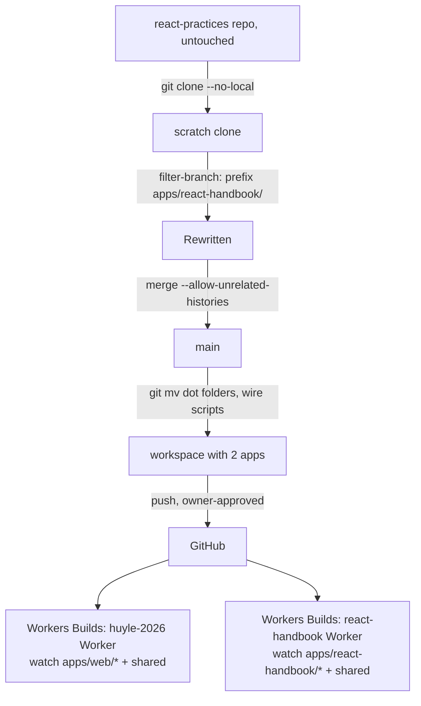

# Technical Design: React Handbook Import

## Scope

**In scope:** import `react-practices` (repo `ltghuy/react-mastering`, branch `main`, 83 commits) with rewritten history into `apps/react-handbook` (package `react-handbook`); wire it into the workspace, turbo and root scripts; reorganize `.artifacts` into `web/`, `react-handbook/`, `repo/` groups; merge `.agents` and `.claude`; scope every rule with `paths:`; per-Worker Workers Builds settings and watch paths; drop Railway; docs.

**Out of scope:** dependency alignment between apps, shared UI, content changes, archiving the old repo (spec Out of Scope).

## Research Summary

> Sources: code.claude.com/docs/en/memory; developers.cloudflare.com/workers/ci-cd/builds/build-watch-paths; `.artifacts/research/turborepo-pnpm-opennext-cloudflare.md`

- **Rules:** `.claude/rules/**/*.md` is discovered recursively. `paths` (YAML list or comma string of globs) is *the only* frontmatter field read; any other field is silently ignored. → The portfolio rule's `appliesTo:` (`.claude/rules/i18n-locale-content.md:4-8`) has never scoped anything; it has loaded for every file.
- **Nested `CLAUDE.md`** in a subdirectory loads on demand when Claude touches a file there, along with its `@` imports.
- **Watch paths:** comma-separated include/exclude globs; excludes apply first; a build always runs for pushes with 0 or 3000+ changed files or 20+ commits. Whether `apps/web/*` matches nested files is undocumented (Cloudflare's monorepo example `project-a/*` implies it) → verify empirically.
- **History rewrite:** `git filter-repo` is not installed; `git filter-branch --index-filter` (built in) rewrites 83 commits fine on a scratch clone.

## Patterns & Reuse

### Conventions to Follow

| Pattern | Project Uses | Avoid | Reference |
|---------|-------------|-------|-----------|
| App layout | `apps/<name>/` with its own Next/OpenNext/wrangler/test configs | root-level app files | `apps/web/` |
| Root scripts | turbo for `dev/build/lint/typecheck/test/e2e`; `pnpm --filter <app> run …` forwarders | names that collide with pnpm built-ins (`deploy`, `start`) | `package.json` |
| Cloudflare scripts | `cf:build`, `cf:preview`, `cf:deploy`, `cf:deploy:prebuilt`, `cf:upload:prebuilt`, `cf:typegen` in the app | `preview`/`deploy` | `apps/web/package.json` |
| Shared TS config | `extends: "@repo/typescript-config/nextjs.json"`, app keeps `paths`/`include`/`exclude`/`plugins` | copying compilerOptions | `apps/web/tsconfig.json` |
| Agent notice | `AGENTS.md` + `CLAUDE.md` (`@AGENTS.md`) in the app dir | root-level AGENTS.md | `apps/web/AGENTS.md` |
| Moves | `git mv` so `--follow` works | delete + add | 004 B1 |

### Existing Code to Reuse

| Component | Location | How to Use |
|-----------|----------|------------|
| `@repo/typescript-config/nextjs.json` | `packages/typescript-config/nextjs.json` | handbook tsconfig extends it (its compilerOptions are identical to the portfolio's pre-004 ones) |
| turbo task graph | `turbo.json` | unchanged except `e2e` gains `passThroughEnv: ["CI"]` |
| pnpm build-script allowlist | `pnpm-workspace.yaml` | merge handbook's `ignoredBuiltDependencies: [sharp]` |

## Data Model

No runtime data. The contracts this feature rewires:

### Entities

| Entity | Purpose |
|--------|---------|
| Handbook manifest scripts | commands turbo / root forwarders call |
| Handbook deploy target | Worker + domain that must not change |
| Artifact groups | where every spec/quick task lives after the merge |
| Rule scoping | which rules load for which files |
| Workers Builds settings (×2) | dashboard config, outside the repo |

#### Handbook manifest scripts (source: react-practices `package.json:5-15`)

- `dev` (`next dev`) → becomes `next dev --port 3001` (portfolio owns 3000)
- `build`, `start`, `lint` → unchanged
- `typecheck` (`next typegen && tsc --noEmit`) → unchanged
- `test:e2e` (`bddgen && playwright test`) → renamed `e2e` so the root turbo task runs it
- `preview`, `deploy`, `cf-typegen` → `cf:preview`, `cf:deploy`, `cf:typegen`; add `cf:build`, `cf:deploy:prebuilt`, `cf:upload:prebuilt`

#### Handbook deploy target (react-practices `wrangler.jsonc:3,10`)

- `name: "react-handbook"`, `routes: [{ pattern: "learn.huyle.work", custom_domain: true }]` — unchanged.
- `open-next.config.ts`: static-assets incremental cache + cache interception — unchanged.

#### Env contract

- Handbook reads only `process.env.CI` (playwright config: retries, `forbidOnly`, `reuseExistingServer`) and `NODE_ENV`. `APP_NAME` in `.env.example` is unused. → turbo `e2e` passes `CI` through (not hashed; e2e is uncached).

#### Rule scoping (after)

| Rule | `paths:` |
|------|----------|
| `.claude/rules/web/i18n-locale-content.md` | `apps/web/src/**` (fixes ignored `appliesTo`) |
| `.claude/rules/react-handbook/01…06-*.md` | `apps/react-handbook/**` |

#### Artifact groups (after)

| From | To |
|------|----|
| `.artifacts/features/001-portfolio` | `.artifacts/features/web/001-portfolio` |
| `.artifacts/features/004-monorepo-migration` | `.artifacts/features/repo/004-monorepo-migration` |
| (new) | `.artifacts/features/repo/005-react-handbook-import` |
| `.artifacts/quick/001-seo-structured-data` | `.artifacts/quick/web/001-seo-structured-data` |
| `.artifacts/quick/002-pnpm-switch` | `.artifacts/quick/repo/002-pnpm-switch` |
| handbook `.artifacts/features/001…048-*` | `.artifacts/features/react-handbook/001…048-*` |
| handbook `.artifacts/quick/001…026-*` | `.artifacts/quick/react-handbook/001…026-*` |
| handbook `.artifacts/research/ai-search.md` | `.artifacts/research/ai-search.md` (no name clash) |
| handbook `.agents/baselines/api-scaffold.md` | `.agents/baselines/react-handbook/api-scaffold.md` |
| handbook `.agents/knowledge.md` (187 lines) | merged into `.agents/knowledge.md` |
| handbook `.gitkeep` files | dropped |

Numbering rule: next ID = highest in *that group* + 1; `repo/` for cross-app or workspace work.

### API Contracts

None.

## Decisions

| Decision | Rationale |
|----------|-----------|
| **History via `git filter-branch --index-filter` on a scratch clone**, prefixing every path with `apps/react-handbook/`, then `git merge --allow-unrelated-histories` into `main`. | Full history with real paths (log/blame work without `--follow`); no new tool to install; the original repo is never touched. `git subtree add` keeps history but not per-file paths. |
| **Merge the dot folders in a follow-up commit with `git mv`** out of `apps/react-handbook/{.agents,.artifacts,.claude}`. | The import merge stays a pure import; renames keep `--follow` history for every spec. |
| **Rules: one subfolder per app under `.claude/rules/`, each file with `paths:`.** | Merged into one `.claude` as asked; explicit scoping; docs confirm recursion. Alternative (nested `apps/react-handbook/.claude/rules/`) would also scope automatically but keeps two `.claude` folders. |
| **Fix the portfolio rule's frontmatter to `paths:`.** | `appliesTo` is ignored, so today the rule loads everywhere; with two apps it would leak into the handbook (AC-015). |
| **Handbook keeps its own `CLAUDE.md` (required-skills table) and `AGENTS.md` in `apps/react-handbook/`.** | Nested CLAUDE.md loads on demand for handbook files only; `next dev` regenerates AGENTS.md in the app dir (004 gotcha). |
| **Knowledge merge: keep the three sections; inside each, `### repo`, `### web`, `### react-handbook` subsections.** | One file as the skill expects; every entry visibly tagged (AC-014); no entry text rewritten. |
| **Handbook tsconfig extends `@repo/typescript-config/nextjs.json`; its ESLint config stays standalone.** | TS options are identical, so sharing is free (verify with `--showConfig`). The shared ESLint package pins `eslint-config-next@16.3.0` while the handbook uses 16.3.8; keeping its own config honors the "keep versions" tentative decision. |
| **Handbook dev on port 3001; its e2e server stays on 3100.** | `pnpm dev` starts both apps; portfolio keeps 3000. |
| **Rename handbook `test:e2e` → `e2e`; turbo `e2e` gets `passThroughEnv: ["CI"]`.** | Root `pnpm e2e` covers both apps; strict env mode would hide `CI` from Playwright. |
| **Root scripts for the handbook: `cf:handbook:{build,preview,deploy,deploy:prebuilt,upload:prebuilt,typegen}` → `pnpm --filter react-handbook run cf:…`. Portfolio's `cf:*` names unchanged.** | The portfolio dashboard just got fixed; renaming its commands would force another dashboard change. |
| **Workers Builds, handbook Worker:** root `/`, build `pnpm cf:handbook:build`, deploy `pnpm cf:handbook:deploy:prebuilt`, version `pnpm cf:handbook:upload:prebuilt`; include `apps/react-handbook/*, packages/*, package.json, pnpm-lock.yaml, pnpm-workspace.yaml, turbo.json`. **Portfolio Worker:** same root-file list with `apps/web/*` instead of `*`. Exclude stays `node_modules/**, .git/` (`.artifacts`/`.agents`/`.claude`/docs then trigger nothing). | AC-008–010. Root workspace files rebuild both (AC-010). |
| **Keep each app's dependency versions; re-resolve the handbook into the shared lockfile and diff against its old lockfile.** | Tentative decision. Any runtime dependency whose resolved version changes beyond patch gets pinned to its old version. |
| **Merge `pnpm-workspace.yaml`: add `ignoredBuiltDependencies: [sharp]`.** Keep `unrs-resolver` allowed (portfolio needs it; harmless for handbook). | Preserve both repos' install-script policy. |
| **Drop `railway.json`, handbook `pnpm-lock.yaml`, `pnpm-workspace.yaml`, `packageManager`.** | Railway dropped by decision; workspace-level files live at the root. |
| **Keep the handbook's nested `.gitignore`** (root-anchored entries resolve relative to the app). | Zero-risk; covers `.features-gen/`, `.dev.vars*`, etc. |
| **Paths inside the handbook's historical specs stay app-relative**; its `CLAUDE.md` says so in one line. Rules get repo-relative paths. | Rewriting ~300 spec files buys nothing; rules must match real paths. |

## Component Design

| Component | File | Action | Responsibility |
|-----------|------|--------|----------------|
| Rewritten history | scratch clone | new (temporary) | 83 commits under `apps/react-handbook/` |
| Import merge | `apps/react-handbook/**` | merge | brings code + history in |
| Handbook manifest | `apps/react-handbook/package.json` | modify | name `react-handbook`; scripts per Data Model; drop `packageManager` |
| Handbook tsconfig | `apps/react-handbook/tsconfig.json` | modify | extend shared preset; keep its `exclude` list |
| Handbook clean-up | `apps/react-handbook/{pnpm-lock.yaml,pnpm-workspace.yaml,railway.json,tsconfig.tsbuildinfo}` | delete | workspace owns these / Railway dropped |
| Handbook docs | `apps/react-handbook/{CLAUDE.md,README.md}` | modify | rule location, root commands, app-relative spec paths note |
| Workspace | `pnpm-workspace.yaml`, `pnpm-lock.yaml` | modify | `ignoredBuiltDependencies`; new importer |
| Task graph | `turbo.json` | modify | `e2e.passThroughEnv: ["CI"]` |
| Root manifest | `package.json` | modify | `cf:handbook:*` forwarders |
| Artifacts | `.artifacts/{features,quick}/{web,repo,react-handbook}/`, `.artifacts/research/` | git mv | grouping per mapping |
| Knowledge | `.agents/knowledge.md`, `.agents/baselines/react-handbook/` | modify / git mv | merged, app-tagged |
| Rules | `.claude/rules/{web,react-handbook}/*.md` | git mv + modify | `paths:` scoping; repo-relative paths |
| Root docs | `CLAUDE.md`, `README.md`, `.agents/project.md` | modify | both apps, artifact groups, deploys |
| Path references | specs/knowledge mentioning `.artifacts/features/00x-…` | modify | new group paths |

## Data Flow

Rollout:

1. **Local:** import, wire, merge folders; all gates green; commits stay local.
2. **Owner, before push:** set the portfolio Worker's include paths (from `*` to the list above). The import push changes root files, so the portfolio rebuilds once; it must stay green (its commands are unchanged).
3. **Push** (owner-approved).
4. **Owner:** point the `react-handbook` Worker's Git connection at `ltghuy/huyle-2026` (replacing `react-mastering` if connected), set its commands, root `/` and watch paths; run a build; check the log line `Executing user build command: pnpm cf:handbook:build`.
5. **Watch-path check:** one handbook-only and one portfolio-only trivial commit, each producing exactly one build.

## Requirements Traceability

| Requirement | Component | File | Status |
|-------------|-----------|------|--------|
| AC-001 | Workspace + lockfile | `pnpm-workspace.yaml`, `pnpm-lock.yaml` | Planned |
| AC-002 | Turbo build/lint/typecheck | `turbo.json`, `apps/react-handbook/package.json` | Planned |
| AC-003 | `e2e` rename, `CI` passthrough, ports 3000/3100 | `apps/react-handbook/package.json`, `turbo.json` | Planned |
| AC-004 | Handbook dev on 3001 | `apps/react-handbook/package.json` | Planned |
| AC-005 | Routes/redirects/headers unchanged | `apps/react-handbook/next.config.ts` (moved as-is) | Planned |
| AC-006 | Rewritten history merge | — | Planned |
| AC-007 | `cf:handbook:preview` | `package.json` | Planned |
| AC-008 | Handbook Workers Builds + watch paths | dashboard, README | Planned |
| AC-009 | Portfolio watch paths | dashboard, README | Planned |
| AC-010 | Shared/root files in both include lists | dashboard, README | Planned |
| AC-011 | `cf:deploy` / `cf:handbook:deploy` | `package.json` | Planned |
| AC-012 | Artifact groups | `.artifacts/**` | Planned |
| AC-013 | Numbering rule in instructions | `CLAUDE.md` | Planned |
| AC-014 | Knowledge merge with app subsections | `.agents/knowledge.md` | Planned |
| AC-015 | `paths:` on every rule | `.claude/rules/**` | Planned |
| AC-016 | Root + handbook instructions | `CLAUDE.md`, `apps/react-handbook/CLAUDE.md` | Planned |
| AC-017 | Railway removed, README | `apps/react-handbook/railway.json`, `README.md` | Planned |

## Test Strategy

### Infrastructure

| Aspect | Detail |
|--------|--------|
| Framework | Portfolio: Vitest + Playwright. Handbook: Playwright specs + playwright-bdd scenarios (no unit tests) |
| Command | root `pnpm e2e` (both), `pnpm test` (portfolio) |
| Location | `apps/web/{src,e2e}`, `apps/react-handbook/e2e/{specs,features,steps}` |

### Reference Tests

| File | What It Tests |
|------|---------------|
| `apps/react-handbook/e2e/specs/*` | handbook pages (regression proof for AC-005) |
| `apps/react-handbook/e2e/features/*.feature` | BDD scenarios via bddgen |
| `apps/web/e2e/*` | portfolio smoke + editorial |

### New Tests

None: behavior is unchanged. Baseline first: run the handbook's `pnpm test:e2e` **in the old repo** and record its pass count; the moved suite must match. Extra checks: `tsc --showConfig` identical before/after for the handbook; `next build` route list and `curl -I` on redirects (`/practices` → `/react-practices`) and `X-Robots-Tag` headers (`/api/*`, `/seo-lab/*`) match the old repo's local build; artifact/knowledge counts (48+26 handbook, 2+2 local); every rule has `paths:`; `git log` on a handbook file shows pre-import commits.

## Considerations

### Error Handling

- Handbook e2e rewrites the tracked `src/handbook/e2e/last-run.json` and `suite-files.json` on every run (`e2e/reporters/handbook-reporter.ts:9,78-79`). Running gates leaves them modified; restore them (`git checkout`) before committing unless the owner wants the new run recorded.
- If the handbook Worker's dashboard switch happens before the import is pushed, its builds fail and the live site keeps the last good version (edge case in spec).
- Rewritten commits get new SHAs; references to old SHAs inside handbook summaries stay pointing at the old repo, which remains available.

### Security

- `.env.local` (handbook) and `.env` (portfolio) are untracked and stay per-app; nothing secret is imported. `APP_NAME` unused.
- Install-script allowlist unchanged except the explicit `sharp` ignore.

## Open Questions

- [ ] Owner: is the `react-handbook` Worker's Workers Builds connected to `react-mastering` today, and with which commands? (Rollout step 4 replaces them either way.)
- [x] Rule frontmatter key → `paths` (only field read; `appliesTo` ignored).
